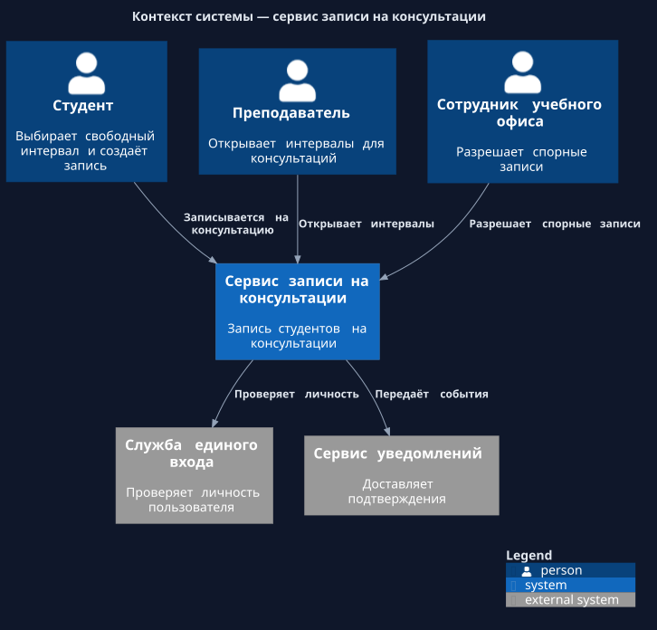

:::note[TL;DR]
Контекст системы в C4 показывает одну проектируемую программную систему, людей и внешние системы, с которыми она непосредственно взаимодействует. Он фиксирует границу и назначение системы, но не раскрывает её внутреннее устройство, технологии или варианты использования.
:::

## Ландшафт и контекст

Системный ландшафт и контекст системы похожи внешне, но имеют разную область.

| Представление | Область | Центральный элемент |
| --- | --- | --- |
| Системный ландшафт | организация, подразделение или предметная область | набор связанных программных систем |
| Контекст системы | одна проектируемая программная система | эта система и её непосредственное окружение |

Ландшафт полезен университету, который хочет показать связь учебных, кадровых и библиотечных систем. Для учебного проекта чаще достаточно контекста: он не расширяет границу проекта до всего университета.

## Элементы контекста системы

Диаграмма строится из результатов работы со [стейкхолдерами и границей системы](/modelling/stakeholders-and-boundary), [целями пользователей](/modelling/capabilities-and-user-goals) и [вариантами использования](/modelling/use-case-specification).

| Элемент | Смысл | Пример для сервиса записи |
| --- | --- | --- |
| Человек | пользователь или внешняя роль, которая достигает цели | студент, преподаватель, сотрудник учебного офиса |
| Проектируемая система | программная система, за которую отвечает команда | сервис записи на консультации |
| Внешняя система | независимая система вне границы проекта | университетская служба единого входа, сервис уведомлений |
| Связь | значимое взаимодействие между элементами | «студент записывается», «проверяет учётные данные», «отправляет уведомление» |

Внешняя система остаётся внешней, даже если доступна по сети организации или поставляется тем же вендором. Признак границы — не техническая близость, а ответственность команды: она не владеет её поведением, данными и изменениями.

## Сквозной пример

```text
[Студент] ── записывается на консультацию ──> [Сервис записи]
[Преподаватель] ── открывает интервалы ──> [Сервис записи]
[Сотрудник учебного офиса] ── разрешает спорные записи ──> [Сервис записи]
[Сервис записи] ── проверяет личность ──> [Служба единого входа]
[Сервис записи] ── передаёт события ──> [Сервис уведомлений]
```




Надписи на связях должны описывать действие или передаваемую ценность. «Использует» почти никогда не помогает: из него непонятны намерение, направление и важность связи.

## От контекста к моделям курса

Контекст не заменяет подробные артефакты. Он даёт их обзор и помогает проверить границу:

- каждого человека можно обосновать стейкхолдером, пользователем или актором варианта использования;
- для каждой внешней системы известен внешний результат, протокол или необходимая информация;
- существенные пользовательские цели раскрываются [вариантами использования](/notation/usecase-diagrams) и их [спецификациями](/modelling/use-case-specification);
- порядок действий остаётся в [сценариях и потоках](/modelling/scenarios-and-flows), а не на контексте.

У системы может быть несколько контекстов для разных аудиторий. Например, преподавателю важны интервалы и отмены, а службе сопровождения — единый вход и уведомления. Менять можно степень детализации, но не границу системы и не состав ответственных внешних систем без нового проектного решения.

## Типичные ошибки

| Ошибка | Почему неверно | Исправление |
| --- | --- | --- |
| Показаны таблицы базы данных и классы | контекст отвечает не о внутренностях | перейти к контейнерам или технической модели классов |
| Внутри границы помещена служба единого входа | команда ею не владеет | оставить внешней системой |
| Между всеми элементами проведены линии | связи теряют смысл | оставить только архитектурно значимые взаимодействия |
| Роль названа «пользователь» | неясна цель и ответственность | назвать конкретную роль |
| Отсутствует подпись связи | читатель угадывает смысл | добавить действие и, при необходимости, канал |

## Проверка

Перед переходом к контейнерам ответьте на вопросы:

1. Граница совпадает с границей ответственности команды?
2. Все люди находятся снаружи системы?
3. У каждой внешней системы есть понятная причина присутствия?
4. Связи можно сопоставить с требованиями, сценариями или архитектурными решениями?
5. Диаграмма остаётся читаемой, если убрать устное объяснение?

Далее: [контейнеры и границы выполнения](./02-containers.md).