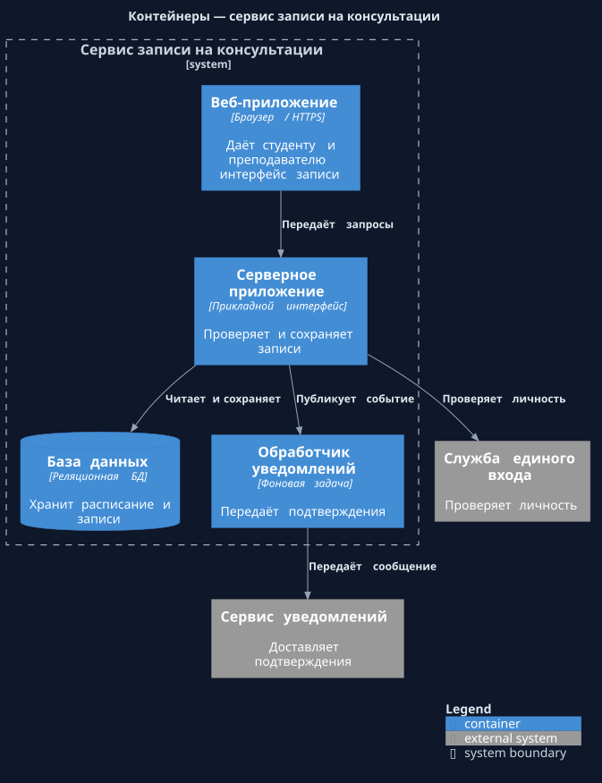

:::note[TL;DR]
Диаграмма контейнеров показывает приложения и хранилища внутри одной проектируемой системы, их ответственность и связи. Контейнер — самостоятельно запускаемая или управляемая часть системы: веб-приложение, серверное приложение, мобильное приложение, база данных, файловое или объектное хранилище, отдельный обработчик задач.
:::

## Граница контейнера

Контейнер описывает логическую часть программной архитектуры и её границу выполнения. Он не равен контейнеру Docker, виртуальной машине, серверу или узлу развёртывания. Один контейнер может работать на нескольких узлах, а несколько контейнеров — на одном узле.

| Элемент | Показан на диаграмме контейнеров | Не следует путать с |
| --- | --- | --- |
| Веб-приложение | интерфейс для пользователя | страницей или браузером |
| Серверное приложение | правила, обработка запросов и прикладные интерфейсы | одним классом или пакетом |
| База данных | долговременное хранение и чтение данных | таблицей или схемой данных |
| Обработчик задач | асинхронная обработка событий | потоком на диаграмме последовательности |
| Внешняя система | зависимость за границей проекта | внутренним контейнером |

## Сквозной пример

Сервис записи на консультации можно показать четырьмя внутренними контейнерами:

```text
Веб-приложение
  → Серверное приложение
  → База данных записи и расписания
  → Обработчик уведомлений

Серверное приложение
  → Служба единого входа
  → Внешний сервис уведомлений
```




Для каждого внутреннего контейнера укажите имя, краткую ответственность и технологию, только если она помогает понять решение. Например: «Серверное приложение — обрабатывает запись и расписание; Java и Spring». У связи укажите направление, назначение и значимый протокол: «передаёт запросы по HTTPS», «читает и сохраняет записи по SQL», «публикует событие в очередь».

## Разделение ответственности

Границы контейнеров должны объяснять решение, а не повторять структуру каталогов. Полезные причины для выделения отдельного контейнера:

- иной пользовательский интерфейс или канал доступа;
- отдельная модель хранения и жизненный цикл данных;
- независимый масштаб или требования к доступности;
- асинхронная обработка;
- независимое владение и развёртывание.

Не выделяйте контейнер для каждого слоя, таблицы, сущности или технической библиотеки. Если два блока всегда изменяются, развёртываются и масштабируются вместе, вероятно, это один контейнер с внутренними компонентами.

## Связь с предметной и программной архитектурой

Контейнеры не появляются из прямоугольников. Их ответственность опирается на уже собранные артефакты:

| Источник | Что уточняет |
| --- | --- |
| [Требования](/modelling/requirements) | существенные качества, ограничения и интеграции |
| [Архитектура данных](/modelling/data-architecture) | где и зачем хранятся данные |
| [Программная архитектура и слои](/modelling/software-architecture-and-layers) | зависимость между пользовательским интерфейсом, прикладной логикой и инфраструктурой |
| [Проектные решения](/modelling/project-decisions) | обоснование технологии, границы и альтернатив |
| [Системная архитектура и развёртывание](/modelling/system-architecture-and-deployment) | переход к экземплярам и физическому окружению |

Диаграмма контейнеров не должна содержать все классы, правила обработки или порядок сообщений. Классы и обязанности уточняют [диаграммы классов](/notation/technical-class-diagrams) и [компонентов](/notation/component-diagrams), а сценарий — [диаграммы последовательности](/notation/sequence-diagrams) или [деятельности](/notation/activity-diagrams).

## Типичные ошибки

- Называть диаграмму «контейнеры», но помещать на неё серверы и подсети. Это область представления развёртывания.
- Показывать «базу данных» без владельца и назначения. Укажите, какие данные она хранит и кто к ней обращается.
- Соединять пользовательский интерфейс сразу с каждой таблицей. Покажите реальное архитектурное взаимодействие.
- Писать на всех стрелках «использует». Замените на конкретное действие и канал.
- Скрывать внешнюю зависимость внутри внутреннего контейнера. Она нужна для оценки рисков и границы ответственности.

## Проверка

1. Каждый контейнер можно описать одной ответственностью?
2. Каждый внутренний контейнер принадлежит проектируемой системе?
3. Связи не противоречат архитектуре данных и проектным решениям?
4. Ясно, какие элементы являются приложениями, а какие — хранилищами?
5. Для обсуждения достаточно этой детализации; классы ещё не нужны?

Далее: [компоненты и представление кода](./03-components-and-code.md).