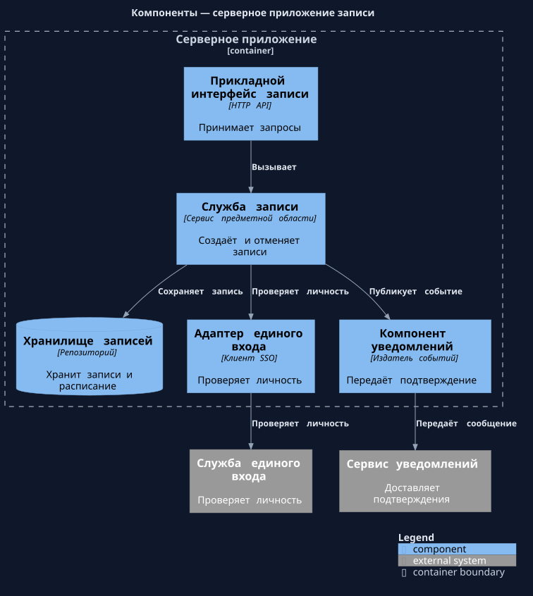

:::note[TL;DR]
Представление компонентов раскрывает один сложный контейнер через устойчивые обязанности и контракты. Представление кода нужно ещё реже: оно показывает техническую реализацию одного важного компонента и обычно опирается на диаграмму классов UML.
:::

## Когда нужна детализация

Контекст и контейнеры отвечают на большинство архитектурных вопросов. Не переходите к компонентам по привычке. Они нужны, если внутри одного приложения невозможно ясно обсудить ответственность, зависимость или значимый интерфейс без внутренней карты.

| Вопрос | Подходящее представление |
| --- | --- |
| Из каких приложений и хранилищ состоит система? | контейнеры |
| Какие устойчивые части есть внутри серверного приложения? | компоненты |
| Как реализованы классы и операции одной части? | код или техническая диаграмма классов |
| В каком порядке выполняется пользовательский сценарий? | динамика или диаграмма последовательности |

Компонент объединяет связанную функциональность за ясным интерфейсом. В зависимости от технологии он может соответствовать модулю, пакету, пространству имён, набору классов или отдельной библиотеке, но такое соответствие не предполагается автоматически.

## Сквозной пример

Внутри серверного приложения сервиса записи можно выделить четыре компонента:

```text
Прикладной интерфейс записи
  → Служба записи
  → Хранилище записей
  → Адаптер службы единого входа
  → Компонент уведомлений
```




- **Служба записи** проверяет доступность интервала, создаёт и отменяет записи.
- **Хранилище записей** читает и сохраняет записи в базе данных.
- **Адаптер службы единого входа** изолирует прикладную логику от протокола внешней системы.
- **Компонент уведомлений** передаёт события отдельному обработчику или внешнему сервису.

Связи показывают направление зависимости и контракт: «вызывает прикладной интерфейс», «сохраняет запись», «проверяет личность», «публикует событие». Они не заменяют пошаговый сценарий.

## Границы компонентов

Компонент принадлежит ровно одному контейнеру на данной диаграмме. Его интерфейс не обязан быть сетевым: это может быть контракт модуля или прикладного интерфейса. Не превращайте в компоненты контроллеры, сущности, таблицы, перечисления и вспомогательные классы только потому, что они существуют в исходном коде.

Устойчивую границу можно проверить вопросами:

- меняется ли часть по собственной причине;
- может ли читатель назвать её ответственность без перечисления методов;
- скрывает ли она детали за понятным контрактом;
- нужен ли её отдельный обзор для архитектурного решения или риска.

Если ответы отрицательны, достаточно [диаграммы пакетов](/notation/package-diagrams), [технической диаграммы классов](/notation/technical-class-diagrams) или текста проектного решения.

## Представление кода

C4 не требует отдельной диаграммы кода. Для курса её роль обычно выполняет техническая диаграмма классов: на ней уже можно показать классы, интерфейсы, операции, видимость, зависимости и реализацию контракта. Представление кода имеет смысл только для архитектурно значимого компонента — например, службы записи с её интерфейсом, прикладной службой, хранилищем, доменными объектами и адаптером внешней системы.

Оставляйте в нём только те элементы, без которых нельзя объяснить реализацию выбранной ответственности. Полная схема классов системы — плохая архитектурная карта: она скрывает границы за деталями.

## Связь с UML

| Задача | UML-представление |
| --- | --- |
| Показать крупные логические части и их интерфейсы | [диаграмма компонентов](/notation/component-diagrams) |
| Показать группировку исходного кода | [диаграмма пакетов](/notation/package-diagrams) |
| Описать классы и реализации интерфейсов | [техническая диаграмма классов](/notation/technical-class-diagrams) |
| Уточнить внутреннюю композицию | [диаграмма внутренней структуры](/notation/internal-structure-diagrams) |

## Проверка

1. Диаграмма раскрывает ровно один контейнер?
2. Каждый компонент имеет понятную ответственность и контракт?
3. Компоненты не подменяют классы, таблицы или порядок сообщений?
4. Внешние зависимости контейнера остались видны там, где они существенны?
5. Детализация помогает обсуждать решение, а не повторяет исходный код?

Далее: [динамика и развёртывание](./04-dynamic-and-deployment.md).