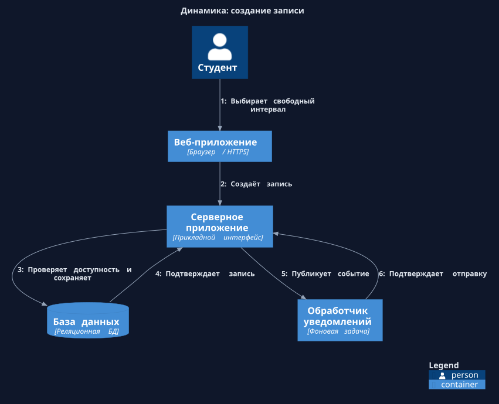
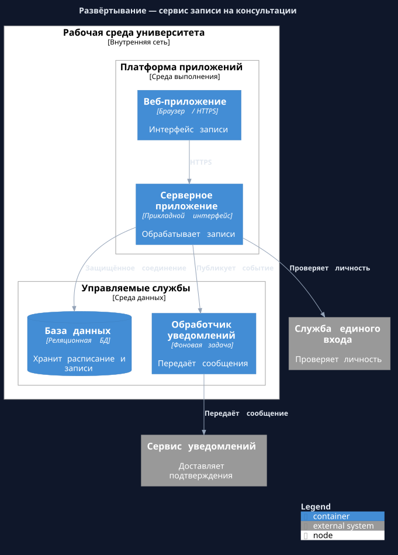

:::note[TL;DR]
Динамическая диаграмма показывает архитектурно значимый порядок взаимодействий в одном сценарии, используя элементы статической модели C4. Диаграмма развёртывания показывает экземпляры этих элементов в конкретном окружении и связывает части системы с физическими копиями.
:::

## Динамическая диаграмма

Статические представления отвечают на вопрос «из чего состоит система». Динамическая диаграмма отвечает на вопрос «как эти части взаимодействуют в одном важном случае». Она использует людей, контейнеры или компоненты из ранее построенной диаграммы и нумерует сообщения.

Для сценария записи на консультацию можно показать:

```text
1. Студент выбирает свободный интервал в веб-приложении.
2. Веб-приложение передаёт запрос серверному приложению.
3. Служба записи проверяет личность через адаптер единого входа.
4. Служба записи проверяет доступность и сохраняет запись.
5. Серверное приложение публикует событие записи.
6. Обработчик уведомлений передаёт сообщение студенту и преподавателю.
```




Это не полная [диаграмма последовательности](/notation/sequence-diagrams): на ней не нужны все объекты, циклы и технические вызовы. Добавьте только такой порядок, который объясняет архитектурное решение, критичную зависимость, асинхронность или альтернативу. Для подробного протокола сценария используйте [расширенную нотацию последовательностей](/notation/sequence-advanced) и [сценарии и потоки](/modelling/scenarios-and-flows).

## Представление развёртывания

Диаграмма развёртывания C4 уточняет, где работают экземпляры контейнеров: в какой среде, на каком узле, в какой сети и с какими внешними зависимостями. Она нужна, когда размещение влияет на доступность, безопасность, производительность, стоимость или соблюдение ограничений.

| Элемент | Пример |
| --- | --- |
| Среда развёртывания | учебная, тестовая, рабочая |
| Узел развёртывания | управляемая платформа, виртуальная машина, кластер |
| Экземпляр контейнера | экземпляр веб-приложения, серверного приложения, обработчика |
| Хранилище | управляемая база данных, объектное хранилище |
| Сетевая связь | закрытая сеть, внешний канал, защищённое соединение |

На схеме сервиса записи веб-приложение и серверное приложение могут выполняться на платформе приложений, база данных — в управляемом хранилище, обработчик — в отдельной среде задач, а службы единого входа и уведомлений — за пределами границы проекта. Показывайте конкретные узлы только когда решение действительно зависит от них.




## Не смешивать уровни

Контейнеры — логическая форма системы. Развёртывание — конкретные экземпляры контейнеров и среда их выполнения. Поэтому один контейнер на диаграмме контейнеров может иметь несколько экземпляров в рабочей среде, а один узел — выполнять несколько контейнеров.

Для точной семантики узлов, сред выполнения, артефактов и связи размещения используйте [диаграмму развёртывания UML](/notation/deployment-diagrams) и её [расширенную нотацию](/notation/deployment-advanced). В C4 достаточно той физической детализации, которая объясняет архитектурное решение.

## Типичные ошибки

- Повторять пользовательский сценарий во всех динамических диаграммах. Выбирайте только сложные или рискованные случаи.
- Вводить на динамической диаграмме новый контейнер. Сначала добавьте его в статическую модель.
- Рисовать серверы на диаграмме контейнеров. Перенесите их в представление развёртывания.
- Считать каждый экземпляр отдельным контейнером. Экземпляр — реализация контейнера в окружении.
- Описывать подробный сетевой протокол, когда он не влияет на решение. Это перегружает архитектурную карту.

## Проверка

**Для динамики:** элементы существуют на статической диаграмме; сообщения имеют порядок и смысл; сценарий связан с требованием или риском.

**Для развёртывания:** каждый экземпляр соответствует контейнеру; видны значимые среды, узлы и каналы; внешние системы остаются внешними; физическое решение можно связать с ограничением или ADR.

Далее: [C4, UML и согласованность модели](./05-uml-and-consistency.md).