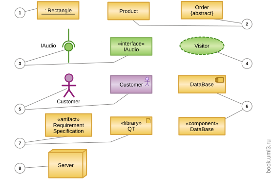
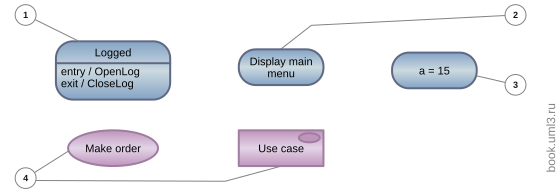
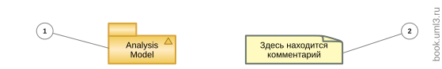

# Из чего состоит UML

Сам стандарт абсолютно открытый, но официальная спецификация стандарта занимает 796 страниц. Это много, но документ описывает абсолютно все аспекты языка. Например, в случае разногласий по нотации при сдаче работ истина в последней инстанции — это спецификация.

Основных типов элементов нотации четыре: фигуры, линии, значки и тексты. Сама нотация достаточно гибкая, но не произвольная: у элементов есть заданная семантика, а у отношений — допустимые направления и способы применения. Инструментальных средств тоже много, какие-то лучше, какие-то хуже, про это мы поговорим ближе к концу лекции.

Формально, модель UML — это граф, вершины которого являются сущностями, а рёбра — отношениями.

Сущности можно разделить на несколько групп: **структурные**, **поведенческие**, **группирующие** и **аннотационные**:

1. Объект — уникальная сущность, инкапсулирующая в себе состояние и поведение.
2. Класс — описание множества объектов с общими атрибутами и операциями.
3. Интерфейс — множество операций, которое определяет набор услуг (службу), предоставляемых классом или компонентом.
4. Кооперация — совокупность объектов, которые взаимодействуют для достижения некоторой цели.
5. Действующее лицо — сущность, находящаяся вне моделируемой системы и непосредственно взаимодействующая с ней.
6. Компонент — модульная часть системы, предоставляющая и требующая некоторый набор интерфейсов.
7. Артефакт — физическая единица реализации, получаемая из другого элемента модели (класса или компонента).
8. Узел — физический вычислительный ресурс.

Структурные сущности

1. Состояние — период в жизненном цикле объекта, в котором объект удовлетворяет некоторому условию, выполняет деятельность или ожидает события.
2. Деятельность — поведение, заданное графом узлов и рёбер, по которым передаются управляющие и объектные токены.
3. Действие — исполняемый узел деятельности, задающий элементарный шаг поведения.
4. Вариант использования — спецификация набора действий, выполняемых субъектом и дающих наблюдаемый результат, значимый для действующего лица или другого заинтересованного лица.

Поведенческие сущности

1. Пакет — группа элементов модели (в том числе пакетов).
2. Заметка или примечание.

Группирующая и аннотационная сущности
