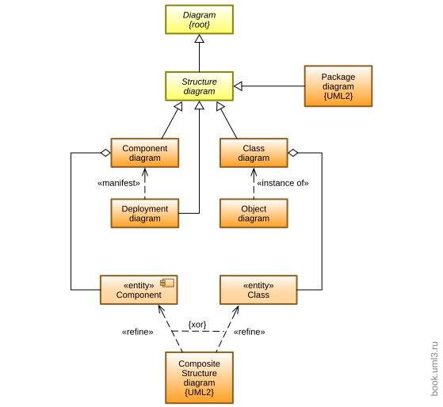
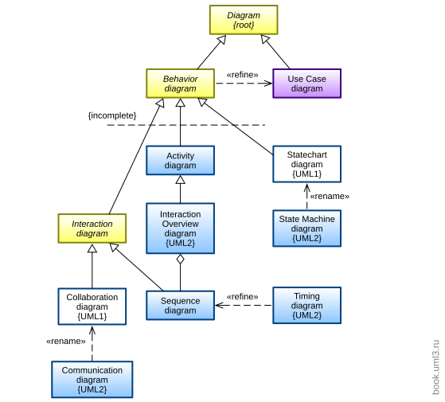
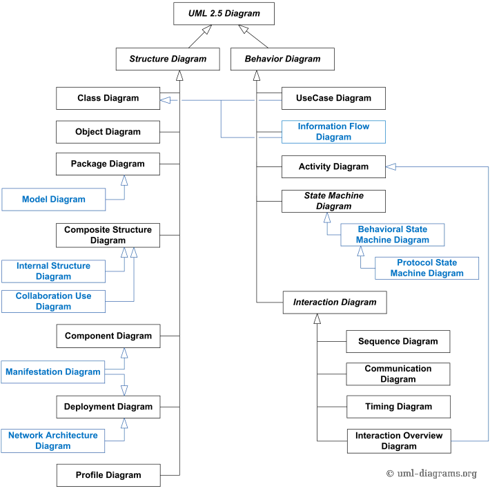

**Диаграммы** — это основная структура, которая облегчает создание и использование модели. Главная задача диаграммы — выделение некоторой части графа модели. Сами диаграммы выделяются рамкой с названием, которое содержит в том числе тег типа диаграммы. В учебной классификации UML-диаграммы обычно делят на две большие группы:

- Структурные диаграммы:
    - Диаграмма классов;
    - Диаграмма объектов;
    - Диаграмма компонентов;
    - Диаграмма размещения;
    - Диаграмма внутренней структуры;
    - Диаграмма пакетов;
    - Диаграмма профилей.
- Поведенческие диаграммы:
    - Диаграмма использования (вариантов использования, прецедентов);
    - Диаграмма автомата (состояний);
    - Диаграмма деятельности;
    - Диаграмма последовательности;
    - Диаграмма коммуникации (кооперации);
    - Обзорная диаграмма взаимодействия;
    - Диаграмма синхронизации.

Диаграмма использования относится к поведенческим диаграммам, но в курсе она будет рассматриваться отдельно и раньше остальных поведенческих диаграмм. Причина практическая: она показывает максимально верхнеуровневый взгляд на систему с точки зрения действующих лиц и заинтересованных сторон, а следующие поведенческие диаграммы уже уточняют отдельные сценарии и взаимодействия.

Структурные диаграммы

Поведенческие диаграммы

UML сам по себе не ограничивает то, что можно показать в рамках одной диаграммы, но тринадцать типов диаграмм выше называются **каноническими**, и обычно используют их. В рамках курса мы рассмотрим те канонические диаграммы, которые применяются чаще всего:

- Диаграмма использования;
- Диаграмма деятельности;
- Диаграмма классов;
- Диаграмма компонентов;
- Диаграмма пакетов;
- Диаграмма состояний;
- Диаграмма последовательности;
- Диаграмма размещения.

Остальные диаграммы либо можно получить из других, либо редко используются в моделировании именно информационных систем.

При этом, что называется, в дикой природе встречаются и другие типы диаграмм:

