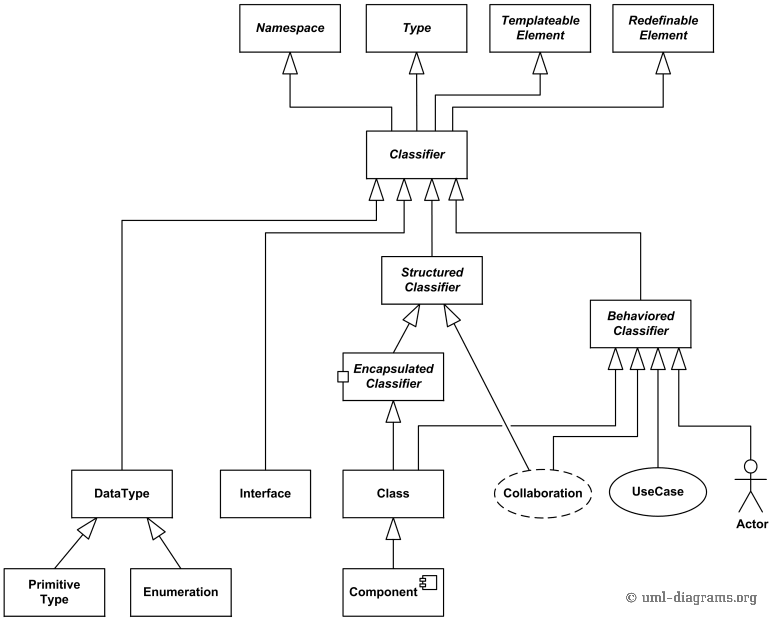

# Классификаторы и стереотипы

Потихоньку начнём возвращаться к UML и перед тем, как рассказывать про диаграмму использования, вернёмся на более общий уровень и введём несколько терминов.

Как говорилось на прошлой лекции, модель в нотации UML состоит из сущностей и отношений между ними. Часть сущностей является **классификаторами**.

<aside>
💡

**Классификатор** — это абстрактный метакласс, описывающий набор элементов, обладающих одинаковыми структурными и/или поведенческими характеристиками.

</aside>

Часть метамодели классификатора

На диаграмме выше показаны не все возможные классификаторы, но в целом, если подумать, то можно распознать сущность-классификатор как раз по тому признаку, что это описание **набора** элементов, то есть объект или состояние, например, здесь будут лишними.

Сразу стоит отметить, что при желании можно создавать и описывать свои классификаторы, для этого существуют **диаграмма внутренней структуры** и **диаграмма кооперации**. В рамках курса мы не будем их рассматривать, поскольку они нужны в сложных моделях, но знать об их существовании всегда полезно.

Любой классификатор может быть **абстрактным**.

<aside>
💡

**Абстрактный классификатор** — это классификатор, который не может иметь непосредственных экземпляров. Имя абстрактного классификатора выделяется *курсивом*.

</aside>

На практике абстрактные классификаторы дополняются конкретными с помощью обобщения.

# Свойства классификаторов

Перед тем, как двигаться дальше, нужно вспомнить понятие классификатора.

<aside>
💡

**Классификатор** — это абстрактный метакласс, описывающий набор элементов, обладающих одинаковыми структурными и/или поведенческими характеристиками.

</aside>

На второй лекции мы в общем и целом посмотрели на понятие классификатора, ввели понятие абстрактного классификаторы и изучили такой механизм расширения классификаторов, как стереотипы. С другой стороны, мы оставили в стороне свойства классификаторов, которые позволяют отделить их от других элементов UML.

## Наличие имени

Классификатор обычно имеет имя, по которому его можно отличить от других элементов модели. Формально в UML имя у `NamedElement` может отсутствовать, а требование различимости действует внутри конкретного пространства имён, а не как глобальная уникальность во всей модели. ПО, заточенное именно под UML, помогает поддерживать такую дисциплину имён (поэтому занимайтесь моделированием в Visual Paradigm).

## Экземпляры

Классификаторы могут иметь конкретные экземпляры. Например, если на диаграмме использования есть действующее лицо “Менеджер”, то его экземпляром может быть “Васильев В.Н.”, в таком случае это будет **прямым** классификатором. Это свойство является транзитивным, в таком случае экземпляры более специализированного класса будут **косвенными** по отношению к более общему классификатору.

Имя экземпляра классификатора подчёркивается одинарной сплошной линией. Примеры экземпляров обычно можно увидеть, например, на диаграмме деятельности при работе с объектным потоком или при описании протокола взаимодействия с помощью диаграммы последовательности.

## Расширяемость

Классификатор может участвовать в отношении обобщения с другими классификаторами. Это свойство появляется за счёт того, что классификатор является типом. 

<aside>
💡

**Тип** с точки зрения UML — абстрактный метакласс, показывающий набор значений.

</aside>

При обобщении классификатор в том числе может быть уточнён или переопределён.

Ещё одна возможность расширения — использование шаблонов, поскольку формально любой классификатор их поддерживает.

## Абстрактность

Напомним, что классификатор может быть абстрактным и конкретным. **Абстрактный** классификатор не может иметь прямых экземпляров, и его имя выделяется курсивом. **Конкретный** классификатор, напротив, может иметь прямые экземпляры. При этом абстрактный классификатор может иметь косвенные экземпляры (например, через классификаторы, которые он обобщает).

## Видимость

Классификатор может иметь один из четырёх типов видимости:

- Открытый (`+`);
- Защищённый (`#`);
- Закрытый (`-`);
- Пакетный (`~`).

Несмотря на то, что чисто технически видимость есть у всех классификаторов, не везде она используется (в основном как раз на диаграммах классов). Видимость работает ровно так же, как в объектно-ориентированных языках.

Стоит отметить, что по умолчанию никакая видимость в самой нотации не задаётся. Это не значит, что модель какая-то плохая, это показывает, что нам это не нужно в рамках текущего уровня моделирования. При этом часть средств моделирования (тот же Visual Paradigm) ставит сам видимость по умолчанию, для разных классификаторов свою (например, для действующих лиц и классов видимость публичная, а для полей и методов классов приватная).

# Зачем нужна метамодель

Полную метамодель UML разбирать на этом курсе не нужно. Она большая, подробная и предназначена скорее для разработчиков инструментов, профилей и стандартов. Но несколько базовых понятий полезно знать, потому что они постоянно встречаются в спецификации и помогают понимать, почему UML работает именно так.

Самое общее понятие — `Element`. Почти всё в UML является элементом. У элемента может быть владелец, вложенные элементы, комментарии и связи с другими элементами. Поэтому UML-модель — это не плоский набор фигур, а структурированный набор элементов.

Чуть более конкретное понятие — `NamedElement`. Это элемент, у которого может быть имя. Важно слово “может”: имя в UML не всегда обязательно. Например, состояние может быть безымянным, и два безымянных состояния всё равно будут разными состояниями. Но в учебной и проектной практике именовать элементы почти всегда полезно, иначе модель быстро становится нечитаемой.

Следующее важное понятие — `Namespace`. Пространство имён определяет, где имя элемента должно быть различимо. Простая аналогия — package или namespace в языках программирования. Но в UML это шире: пространство имён помогает организовать не только кодовую структуру, но и модель в целом.

Одно из центральных понятий UML — `Classifier`. Классификатор описывает множество экземпляров с общими свойствами. Классификаторами являются классы, акторы, use cases, компоненты, узлы, артефакты, интерфейсы, типы данных и сигналы. Это объясняет, почему такие разные на вид элементы в спецификации часто обсуждаются через общие свойства: у них могут быть имена, обобщения, признаки, экземпляры и типы.

У классификатора есть `Feature`, то есть признак. Атрибут класса — это не просто строка текста внутри прямоугольника, а feature. Операция — тоже feature. Порт компонента — тоже feature. Когда мы настраиваем атрибут, операцию или порт в UML-инструменте, мы меняем свойства модели, а не просто редактируем подпись на картинке.

Наконец, есть `Relationship`. Это общее понятие для отношений между элементами модели. Ассоциация, зависимость, обобщение, реализация, include, extend, template binding, manifestation и deployment — всё это отношения, но с разной семантикой.

Метамодель нужна не для того, чтобы заучивать названия метаклассов. Она нужна, чтобы понимать, где заканчивается картинка и начинается модельный смысл.
