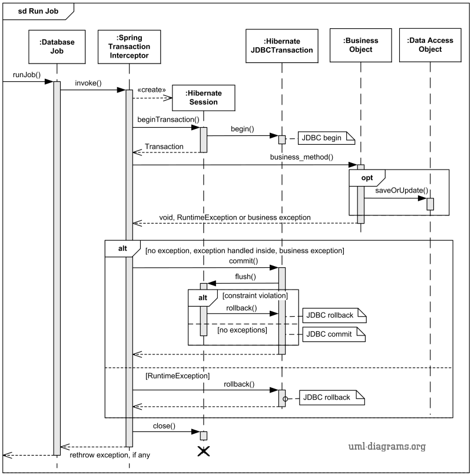

# Диаграмма последовательности

Диаграмма последовательности — это, наверно, сама популярная диаграмма UML. Основное назначение — показать некоторый протокол взаимодействия экземпляров классификаторов, обычно экземпляров классов.

Может показаться, что диаграмма последовательности — это просто другая нотация для диаграммы деятельности, но это не так. Диаграмма деятельности описывает процесс на более высоком уровне, с точки зрения конечного пользователя. Формально на диаграмме деятельности можно показывать и код, плюс можно показывать обмен сообщениями между действиями, но мы делаем упор именно на действия и их очерёдность. В диаграмме последовательности нас интересует, какими сообщениями мы обмениваемся между различными экземплярами классификаторов, т.е., например, показываем вызовы методов классов. Это более низкий уровень по сравнению с диаграммой деятельности.

Основные понятия:

- Линии жизни, представляющие участников взаимодействия: экземпляры, роли, части системы или действующих лиц
- Гейты (шлюзы) — место входа во взаимодействие и выхода из него
- Инвариант состояния экземпляра
- Траектория (трейс) — частично упорядоченная последовательность возникновения событий
- Взаимодействие — поведение участников, указывающее разрешённые и запрещённые траектории
- Сообщения — синхронный и асинхронный вызов операций, асинхронная отправка сигнала, создание и уничтожение экземпляра, ответные сообщения
- Потерянное и найденное сообщение
- Вложенные взаимодействия
- Фрагменты взаимодействия и операторы взаимодействия
    - **alt** - [**alternatives**](https://www.uml-diagrams.org/sequence-diagrams-combined-fragment.html#operator-alt)
    - **opt** - [**option**](https://www.uml-diagrams.org/sequence-diagrams-combined-fragment.html#operator-opt)
    - **loop** - [**iteration](https://www.uml-diagrams.org/sequence-diagrams-combined-fragment.html#operator-loop) (хотя бы min_count и максимум max_count)**
    - **break** - [**break](https://www.uml-diagrams.org/sequence-diagrams-combined-fragment.html#operator-break) (выполняет свой операнд вместо остатка охватывающего фрагмента взаимодействия)**
    - **par** - [**parallel**](https://www.uml-diagrams.org/sequence-diagrams-combined-fragment.html#operator-par)
    - **strict** - [**strict sequencing**](https://www.uml-diagrams.org/sequence-diagrams-combined-fragment.html#operator-strict)
    - **seq** - [**weak sequencing**](https://www.uml-diagrams.org/sequence-diagrams-combined-fragment.html#operator-seq)
    - **critical** - [**critical region](https://www.uml-diagrams.org/sequence-diagrams-combined-fragment.html#operator-critical) (критическая секция в параллельных потоках)**
    - **ignore** - [**ignore**](https://www.uml-diagrams.org/sequence-diagrams-combined-fragment.html#operator-ignore)
    - **consider** - [**consider**](https://www.uml-diagrams.org/sequence-diagrams-combined-fragment.html#operator-consider)
    - **assert** - [**assertion**](https://www.uml-diagrams.org/sequence-diagrams-combined-fragment.html#operator-assert)
    - **neg** - [**negative](https://www.uml-diagrams.org/sequence-diagrams-combined-fragment.html#operator-neg) (выделяем некорректный с точки зрения системы трейс)**

В учебной модели основной упор стоит делать на `alt`, `opt`, `loop` и `par`. Остальные операторы полезны, но легко перегружают диаграмму, если нет явной причины их использовать.

Стоит также отметить, что есть ещё две диаграммы, которые преследуют ту же цель, что и диаграмма последовательности. Это диаграмма коммуникации и диаграмма синхронизации.

Диаграмма последовательности описывает interaction через трассы событий. Lifeline представляет участника взаимодействия. Сообщение имеет отправку и получение. Отправка сообщения происходит раньше его получения. Внутри одной lifeline порядок событий идёт сверху вниз. Между разными lifelines нет полного глобального времени, если оно специально не задано.

Поэтому расстояние между сообщениями на sequence diagram не является длительностью. Если нужно говорить о времени, нужно явно задавать timing constraints или использовать timing diagram. В обычной sequence diagram вертикальное расстояние помогает читать порядок, но не измеряет время.
