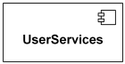
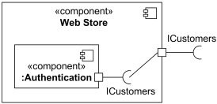

# Диаграмма компонентов

Когда система достаточно большая, и показывать все классы на одной диаграмме затруднительно, появляется необходимость показать программную архитектуру ИС на более высоком уровне. Ещё один популярный случай: ИС, программное обеспечение для которой пишется на языке, не поддерживающем ООП в его классическом понимании или если оно не используется (это актуально, например, для JS и Go). Для обоих случаев UML предусматривает диаграмму компонентов. На диаграмме компонентов мы показываем (совершенно внезапно) компоненты и связи между ними.

## Компоненты

Дадим понятие компонента.

<aside>
💡

С точки зрения синтаксиса **компонент** — это прямоугольник, в углу которого показана специальная иконка.

С точки зрения семантики **компонент** — это структурированный классификатор, обладающий поведением.

</aside>

Компонент без иконки

Компонент с иконкой

**Структурированный классификатор** позволяет показать, как разные свойства (читай как поля) этого классификатора взаимодействуют друг с другом и с внешним миром с помощью интерфейсов. Обратите внимание, что так как речь идёт именно о свойствах классификатора, то **мы работаем с их конкретными экземплярами**.

С точки зрения прагматики **компонент** выделяет какую-то часть системы, скрывая детали реализации, предоставляя во внешний мир набор интерфейсов и запрашивая другие интерфейсы. Компоненты как раз позволяют выделять крупные и, что немаловажно, заменяемые модули системы. Возможность замены определяется тем, что для работы модуля нужны только интерфейсы.

Компоненты могут определяться как сами по себе, и тогда это будет просто верхнеуровневая диаграмма, так и с внутренней структурой (например, вложенными компонентами или классами), и тогда это будет более приближенная к реализации диаграмма.

Компонент не обязан соответствовать одному классу или одному пакету. Чаще компонент группирует набор классов и пакетов, которые вместе реализуют заметную часть системы: клиентское приложение, backend API, модуль уведомлений, модуль оплаты, подсистему отчётов, адаптер внешней системы.

## Соединители и порты

Как следует из понятия компонента, он может содержать в себе другие классификаторы, взаимодействующие между собой и с внешним миром. При этом сам компонент также может взаимодействовать с внешним миром, т.е. содержимое компонента не обязано описывать его самого полностью.

Чтобы показать точку взаимодействия с компонентом, используются **порты**. Порт показывается с помощью квадратика на границе компонента и является его частью. Порт может требовать и предоставлять несколько интерфейсов. С точки зрения классификатора порт является его свойством (т.е. полем).

Порт с интерфейсами

Чтобы показать взаимодействие между портами (или другого структурированного классификатора), используются соединители. **Соединитель** — это фича, показывающая связь между экземплярами частей классификатора. Соединители бывают двух типов:

- **Сборочный соединитель** соединяет два порта, показывая их взаимодействие. Частный случай сборочного соединителя — порт одного компонента предоставляет интерфейс, а порт другого компонента его запрашивает.

Сборочный соединитель

- **Делегирующий соединитель** связывает порт с одной из частей классификатора, если он запрашивает интерфейс или предоставляет его.

Делегирующие соединитель, предоставляющий интерфейс

Делегирующий соединитель, запрашивающий интерфейс
