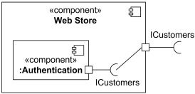

Сразу стоит отметить, что при желании можно создавать и описывать свои классификаторы, для этого существуют **диаграмма внутренней структуры** и **диаграмма кооперации**. В рамках курса мы не будем их рассматривать, поскольку они нужны в сложных моделях, но знать об их существовании всегда полезно.

## Соединители и порты

Как следует из понятия компонента, он может содержать в себе другие классификаторы, взаимодействующие между собой и с внешним миром. При этом сам компонент также может взаимодействовать с внешним миром, т.е. содержимое компонента не обязано описывать его самого полностью.

Чтобы показать точку взаимодействия с компонентом, используются **порты**. Порт показывается с помощью квадратика на границе компонента и является его частью. Порт может требовать и предоставлять несколько интерфейсов. С точки зрения классификатора порт является его свойством (т.е. полем).

Порт с интерфейсами

Чтобы показать взаимодействие между портами (или другого структурированного классификатора), используются соединители. **Соединитель** — это фича, показывающая связь между экземплярами частей классификатора. Соединители бывают двух типов:

- **Сборочный соединитель** соединяет два порта, показывая их взаимодействие. Частный случай сборочного соединителя — порт одного компонента предоставляет интерфейс, а порт другого компонента его запрашивает.

Сборочный соединитель

- **Делегирующий соединитель** связывает порт с одной из частей классификатора, если он запрашивает интерфейс или предоставляет его.

Делегирующие соединитель, предоставляющий интерфейс

Делегирующий соединитель, запрашивающий интерфейс

    - Диаграмма внутренней структуры (показываем сложный классификатор);
