# Диаграмма развёртывания

Теперь у вас должно было сложиться понимание, что мы хотим описать, и нужно только понять, как именно это сделать с помощью UML. Для этого, как было сказано в начале, существует специальная диаграмма развёртывания (или размещения).

Сама по себе **диаграмма развёртывания** — это структурная диаграмма, которая показывает, каким образом программные компоненты размещаются на целевых узлах развёртывания.

## Узлы и подключения

<aside>
💡

**Узел** с точки зрения UML — это вычислительный ресурс, на котором размещаются артефакты. Узел показывается в виде параллелепипеда. Формально узел является классификатором и одновременно целью развёртывания (`DeploymentTarget`).

</aside>

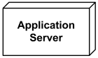

Просто узел

Узлы можно вкладывать как друг в друга, как с помощью композиции, так и визуально, непосредственно один внутрь другого.

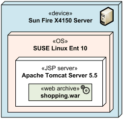

Вложенность узлов

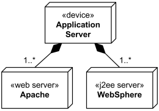

Вложенность узлов с помощью композиции

Узлы обычно не используются сами по себе, а дополняются ключевыми словами `«device»` или `«executionEnvironment»`. С точки зрения спецификации это именно ключевые слова, а не стереотипы, однако большинство инструментов рассматривает их как стереотипы, поэтому не удивляйтесь :)

**Устройство** (узел с ключевым словом device) — это физическое вычислительное устройство. Стандартные стереотипы устройств не предусмотрены, однако всегда можно добавить свои стереотипы, например:

- «application server»;
- «client workstation»;
- «mobile device»;
- «embedded device».

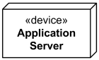

Пример устройства

**Среда выполнения** (узел с ключевым словом `«executionEnvironment»`) — это стандартизованное ПО, которое необходимо для работы компонентов. Тут тоже нет стандартных стереотипов, однако можно выделить некоторые нестандартные стереотипы:

- «OS»;
- «workflow engine»;
- «database system»;
- «J2EE container»;
- «web server»;
- «web browser».

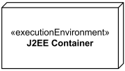

Пример среды выполнения

Узлы могут быть связаны друг с другом с помощью специального типа ассоциаций, **подключений** (communication path). На диаграмме развёртывания они показывают, какие узлы связаны и какие протоколы взаимодействия используются. Как и на обычных ассоциациях, можно указывать кратность, чтоб показать наличие нескольких экземпляров узлов, это полезно, например, в случаях, когда у нас есть балансировщик нагрузки и за ним несколько серверов.

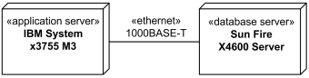

Физическое соединение между устройствами

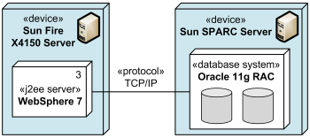

Соединение между средами выполнения

Важный момент, на который хочется обратить внимание: не забывайте про модель OSI, когда указываете протоколы взаимодействия между узлами. Некорректно показывать, например, что два устройства подключаются по HTTP, а браузер и веб-сервер — по TCP/IP. В первом случае идеально было бы показать физическое подключение по Ethernet или Wi-Fi, а во втором — по HTTPS.

Выбор протокола должен соответствовать уровню детализации модели. Между браузером и веб-сервером уместен HTTPS. Между приложением и PostgreSQL можно указать PostgreSQL protocol, а при более низком уровне детализации — TCP. Между физическими устройствами лучше показывать физическую или сетевую среду связи, если именно она важна для модели.

## Артефакты и их развёртывание

<aside>
💡

**Артефакт** — это классификатор, который показывает файл, документ или другой объект, который используется или создаётся в процессе разработки программы или появляется в ходе её установки и использования.

</aside>

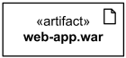

Простой артефакт

Артефакт показывается в виде прямоугольника с иконкой в углу и ключевым словом `«artifact»`.

Артефакты могут иметь дополнительные стереотипы:

| `«file»` | A physical file in the context of the system developed. |
| --- | --- |
| `«document»` | A generic file that is not a «source» file or «executable». |
| `«source»` | A source file that can be compiled into an executable file. |
| `«library»` | A static or dynamic library file. |
| `«executable»` | A program file that can be executed on a computer system. |
| `«script»` | A script file that can be interpreted by a computer system. |

Поскольку артефакт — это классификатор, то они могут быть связаны отношением ассоциации и производными, например, композицией. Также можно делать артефакты зависимыми друг от друга.

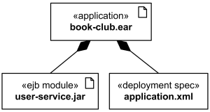

Артефакт с двумя вложенными артефактами

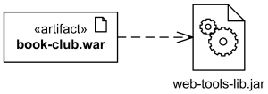

Зависимость артефакта

Основное назначение артефактов — **материализация** (манифестация) других элементов модели, например, компонентов. Другими словами, артефакт является физической единицей, которая реализует или представляет логический элемент модели. Развёртывание — это уже отдельное отношение, которое показывает размещение артефакта на цели развёртывания.

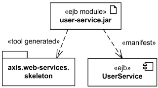

Пример отношения материализации

**Отношение материализации** — это отношение зависимости (если быть более точным, это подтип отношения абстракции, более близкий к реализации), которое показывается так же, как и сама зависимость, но подписывается ключевым словом `«manifest»`.

В UML 2 с помощью отношения материализации можно связывать не только непосредственно компоненты, но и другие элементы модели, которые могут быть представлены артефактом. Например, артефакт может материализовать компонент, класс или пакет. Это всё ещё не означает размещение на узле: размещение показывается отношением deployment.

Как показать, что артефакт развёртывается на каком-то узле? Есть два способа. Первый и самый часто употребимый: показать артефакт внутри нужного узла. Второй способ — связать артефакт и узел отношением зависимости с ключевым словом `«deploy»`.

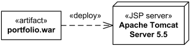

Пример развёртывания с помощью отношения

Также можно показать параметры развёртывания того или иного артефакта (например, конфигурационные файлы), это делается с помощью **спецификации развёртывания** (deployment specification). Она является подтипом артефакта с ключевым словом `«deployment spec»`.

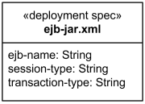

Спецификация развёртывания с тремя параметрами

В нотации спецификацию развёртывания обычно прикрепляют к развёрнутому компоненту или артефакту обычной dependency-стрелкой. Семантически такая спецификация параметризует deployment, а не является произвольной ассоциацией между двумя файлами.

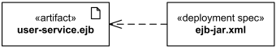

Пример с зависимостью

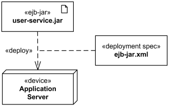

Пример с ассоциацией
