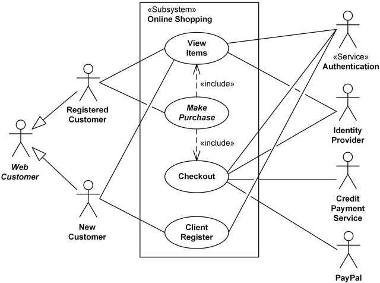

---

title: Основы работы в Visual Paradigm CE

---

# Цели и задачи

В этой лабораторной работе необходимо изучить интерфейс Visual Paradigm Community Edition и с её помощью перерисовать диаграммы нескольких типов, сохраняя максимально возможное количество деталей.

<aside>
💡

В рамках этого курса используется исключительно Visual Paradigm Community Edition, т.е. никаких онлайн-редакторов, никакого Mermaid и PlantUML, никаких водяных знаков на всю диаграмму.

</aside>

Все диаграммы нужно сделать в одном проекте: открыв один файл, практик должен увидеть список из пяти диаграмм.

Все диаграммы ниже взяты с сайта [https://www.uml-diagrams.org/](https://www.uml-diagrams.org/).

<aside>
💡

 Нужно именно перерисовать диаграммы ниже, не нужно делать похожие диаграммы под выбранную тему, для этого есть следующие лабораторные работы.

</aside>

## Диаграмма использования (Use Case Diagram)

## Диаграмма деятельности (Activity Diagram)

## Диаграмма классов (Class Diagram)

## Диаграмма последовательности (Sequence Diagram)

## Диаграмма размещения (Deployment Diagram)

<aside>
💡

Артефакт `web-tools-lib.jar` и схемы СУБД можно показать как обычные артефакты, в случае схем нужно добавить соответствующий стереотип. Однако при желании можно найти иконки и сделать диаграмму один в один.

</aside>

# Оценивание

В отчёте обязательно укажите ФИО, группу и номер лабораторной работы.

Максимум за эту лабораторную работу — 5 баллов. За что снимаются баллы:

- Отсутствие диаграмм;
- Отсутствие элементов диаграммы, изображённых в оригинале;
- Расхождение с исходными диаграммами;
- Некорректное оформление отчёта (например, картинки без подписи, водяной знак, закрывающий часть диаграммы или всю диаграмму);
- Использование неподходящего ПО;
- Сдача после дедлайна.

# Методические рекомендации

- Курсив у надписи — это не красивое выделение, а указание на то, что сущность с этой надписью является абстрактной, соответственно, нужно найти это свойство в настройках сущности.
- У большинства сущностей есть стереотипы, их нужно указать именно как стереотип, а не как часть названия сущности. При необходимости VP позволяет добавлять свои стереотипы.
- Обращайте внимание на типы ассоциаций и их стереотипы. Например, если показана открытая стрелка с пунктирной линией (т.е. зависимость) с надписью (т.е. стереотипом) “extend”, на вашей диаграмме это должно быть ровно той же зависимостью со стереотипом “extend”.
- У части диаграмм есть рамка с ярлычком, показывающим тип диаграммы. Чтобы показать эту рамку в VP, нужно отредактировать Presentation Options самой диаграммы (но это поддерживается не для всех диаграмм).
- Зачастую текст на отношениях — это не просто текст, а дополнительные элементы (например, кратности ассоциации, защитные условия, ограничения), которые тоже должны указываться в отдельных свойствах отношений. По умолчанию на диаграммах показываются не все свойства, поэтому их надо включить в Presentation Options соответствующих отношений.
- Естественно, диаграммы не должны выглядеть один в один как оригинал, визуальные различия всё равно будут. Можно не подгонять цвет элементов и как-то по-особому выравнивать линии отношений, главное, чтобы сохранилась семантика диаграмм. Но чем более непохожей будет диаграмма визуально, тем сложнее будет её проверять, постарайтесь учесть расположение элементов :)
- Чем позже вы сдаёте работу, тем больше вопросов по ней может задать преподаватель практики, т.к. будет пройдено больше материала.