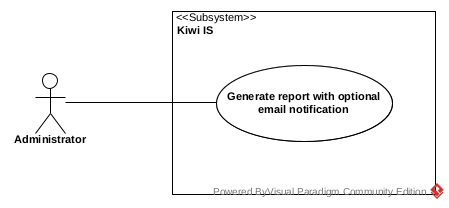

---

title: Диаграммы использования

---

## Цели и задачи

По требованиям из ЛР 2 постройте как минимум две диаграммы использования:
общую и детализированную. Перед построением проверьте, что каждое существенное
функциональное требование связано с пользовательской целью и имеет источник.

На общей диаграмме покажите границу проектируемой системы, её акторов и
внешние системы, с которыми система действительно взаимодействует. Вариант
использования выражает завершённый полезный результат, а не экран, шаг
интерфейса или слишком общее действие. Например, «Оплатить покупку» уместнее,
чем «Открыть страницу оплаты» или «Управлять покупками».

На детализированной диаграмме раскройте один нетривиальный вариант
использования. Выберите его так, чтобы его можно было описать в ЛР 4 в виде
процесса: в нём должны быть данные, решение или исключительная ситуация.

Для этого же варианта подготовьте краткую спецификацию: цель и основной актор,
триггер, предусловия и постусловия, связанные требования и бизнес-правила.
Полный сценарий с основным потоком, альтернативами и исключениями оформляйте
только в ЛР 4: он станет исходным материалом activity-диаграммы.

## Оценивание

В отчёте обязательно укажите ФИО, группу и номер лабораторной работы.

Максимум за эту лабораторную работу — 7 баллов. За что снимаются баллы:

- отсутствуют общая или детализированная диаграмма, граница системы либо
  значимые акторы;
- вариант использования не выражает самостоятельный полезный результат или не
  связан с требованиями и целью пользователя;
- отсутствует краткая спецификация выбранного варианта, связанные требования
  либо бизнес-правила;
- несоблюдение нотации и методических рекомендаций;
- неудачная вёрстка диаграммы, затрудняющая чтение;
- некорректное оформление отчёта, использование неподходящего ПО или сдача
  после дедлайна.

## Методические рекомендации

- Разделяйте между собой функциональные и нефункциональные требования. Если что-то не касается конкретной функции системы для конкретного действующего лица, это с вероятностью 95% нефункциональное требование (оставшиеся 5% включают в себя неправильную формулировку требования).

- Варианты использования для удобства анализа (и рисования) показывают внутри границы системы. При этом действующие лица расставляются так, что с одной стороны от границы (обычно слева) находятся непосредственно действующие лица, а с другой стороны (справа) — внешние системы.

- Не забудьте про правила именования вариантов использования: это глагол с кратким пояснением, в идеале из одного слова, то есть не нужно копипастить предложения из функциональных требований как есть, иначе теряется наглядность. Если есть ощущение, что сократить текст не получится, может, в одном требовании скрывается несколько вариантов использования сразу, в таком случае на диаграмме их нужно показать отдельно.

Два примера

Так точно не надо, это может привести к снижению баллов

Здесь на уровне нотации показано, что уведомление — необязательная опция, плюс можно привязать уведомления к разным вариантам использования

- При необходимости используйте обобщение, оно помогает уменьшить количество ассоциаций (но без фанатизма). Частный случай 1: в системе одна роль является суммой нескольких других ролей, например, если есть два типа менеджеров и администратор, который умеет всё. В таком случае администратор может просто обобщить менеджеров, и в таком случае можно не проводить лишние ассоциации с участием администратора.

Два примера

Вот так не надо

Вот так надо

- Частный случай 2: в системе часть ролей пересекается между собой по возможностям, например, когда два типа менеджеров могут смотреть список клиентов и ещё что-то своё сверху. В таком случае (особенно если есть несколько общий вариантов использования) полезно выделить *абстрактного менеджера*, который умеет только смотреть список клиентов, и остальных менеджеров обобщить от него.

Два примера

Можно оставить и так

Можно переделать так, особенно если общих вариантов использования несколько

- Частный случай 3: в системе есть несколько похожих вариантов использования, например, сгенерировать отчёт за неделю и за месяц. Тогда, чтобы не тянуть ассоциации от действующих лиц к двум вариантам использования, можно вынести абстрактный вариант использования (*сгенерировать отчёт*), ассоциации тянуть к нему, а от абстрактного варианта использования обобщить конкретные (сгенерировать отчёт за неделю и за месяц).

Два примера

Если варианты использования связаны с одним действующим лицом, то можно оставить так

Если логически есть возможность сгенерировать отчёт, но отчёт генерируется только за конкретный период, то лучше сделать вот так

- Если у вас появляется желание сделать цепочку из `<<include>>`, чтобы показать последовательность действий, лучше протяните несколько `<<include>>` от основного варианта использования. Ещё раз напомним, что диаграмма использования показывает возможности системы декларативно.

Три примера

Вот так точно не надо

Уже лучше, но всё ещё недостаточно

Самый корректный вариант

- Когда вы выносите на диаграмму вариант использования, не лишним будет проверить, будет ли что-то с ним связано. Если вариант использования просто висит в воздухе, то он, скорее всего, не нужен конечным пользователям системы, и его можно убрать. Аналогично можно рассуждать для действующих лиц.
