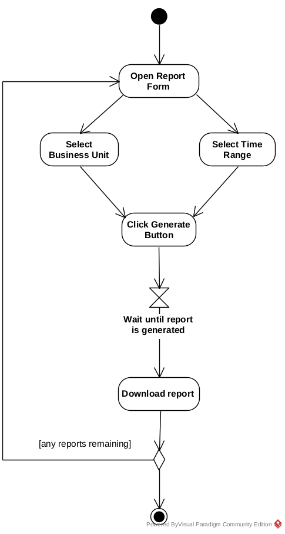

---

title: Диаграммы деятельности

---

## Цели и задачи

:::caution[Внимание!]
Эту лабораторную (и все последующие) нужно делать в одном проекте, там же, где и третья. Это позволит создать единую модель системы.
:::

В этой лабораторной работе опишите процесс выполнения варианта использования,
выбранного в ЛР 3, с помощью сценария и диаграммы деятельности. Используйте
краткую спецификацию из ЛР 3 как контекст, но полный сценарий оформляйте в рамках
этой ЛР.

Сначала подготовьте нумерованный основной поток. Для каждого шага укажите
исполнителя, действие, входные или создаваемые данные, а также применяемое
правило, если оно определяет решение. Затем опишите альтернативы и исключения,
привязав их к шагу (`2a`) или ко всему процессу (`*a`). Это обязательный
результат: по нему должно быть возможно проверить диаграмму.

Постройте одну activity-диаграмму, в которой основной поток и значимые
альтернативы показаны вместе. Разделите ответственность минимум между актором
и системой; добавляйте дорожки внешних участников, если они выполняют действие.
Покажите объектный поток только там, где данные влияют на решение, передаются
между действиями или являются результатом процесса. Диаграмма описывает
бизнес-процесс: «вызвать endpoint» и другие детали реализации относятся к
последующим техническим моделям.

### Пример текстового описания

Обратите внимание, что это всего лишь пример, по нему не надо строить диаграммы. Также учтите, что он покрывает большое количество альтернативных потоков, вам можно не расписывать такое количество.

[Пример.pdf](../assets/lab-4/example.pdf)

## Оценивание

В отчёте обязательно укажите ФИО, группу и номер лабораторной работы.

Максимум за эту лабораторную работу — 8 баллов. За что снимаются баллы:

- отсутствуют проверяемый сценарий, альтернативы или activity-диаграмма;
- схема не согласована с выбранным вариантом использования, его правилами или
  ролями;
- на диаграмме смешаны бизнес-процесс и технические детали реализации;
- несоблюдение нотации и методических рекомендаций, нечитаемая вёрстка,
  некорректное оформление отчёта, неподходящее ПО или сдача после дедлайна.

## Методические рекомендации

Два примера диаграмм, плохой и хороший.

Какие есть ошибки на этой диаграмме: нет защитного условия на одном из переходов, в действие “Open Report Form” входит несколько переходов (и выходит тоже). За каждую такую ошибку будет снижение баллов.

Более толковый вариант диаграммы: появилась параллельность с помощью fork/join node, появилось защитное условие для случая, когда все отчёты сгенерированы, добавлена merge node для слияния разных последовательных потоков управления в один, добавлен коннектор для перехода из конца в начало

- Несмотря на то, что в UML поддерживаются и горизонтальные дорожки, и вертикальные, негласной практикой считается использовать именно вертикальные дорожки. Разумного объяснения нет, как и явного ограничения. При этом горизонтальные дорожки приняты, например, в BPMN.
- Не забывайте про защитные условия (guards) на разветвлении управления, причём на всех выходах, в противном случае выбор конкретного пути исполнения не гарантируется. Тут же отметим, что из одного разветвления может идти больше двух вариантов.
- Распространённая ошибка — проводить из одного действия несколько потоков управления сразу. Для этого используйте либо разветвление/объединение управления (decision/merge node), либо развилку/слияние управления (fork/join node).
- Чтобы не тянуть стрелки через всю диаграмму (например, если по какому-то условию мы приходим к завершающим действиям прямо из начала), можно воспользоваться коннекторами. Чтобы сделать коннектор в Visual Paradigm, нужно нажать ПКМ по нужному переходу и выбрать “Split Connector”. Обратите внимание, что по нотации коннектор имеет ровно один вход и один выход.
- Между **конечным узлом деятельности** (`activity final`) и **конечным узлом
  потока** (`flow final`) есть разница. `activity final` завершает всю
  деятельность, а `flow final` — только текущий поток; если процесс должен
  завершиться целиком, используйте `activity final`.
- Чтобы обработать альтернативный поток, который распространяется на несколько
  шагов диаграммы, можно использовать обработку исключений.
- Для циклов используйте decision/merge либо expansion region — только когда
  повторяется работа над набором объектов.
- Для объектного потока укажите тип передаваемых или принимаемых данных. Эти
  понятия должны согласовываться со словарём и, если становятся устойчивыми,
  появиться на концептуальной диаграмме классов.
- Если для действия нужно несколько значений одновременно, используйте
  наборы параметров.
