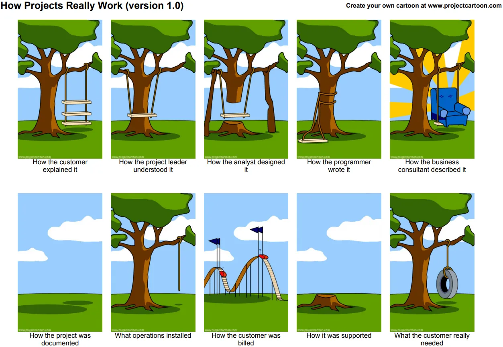
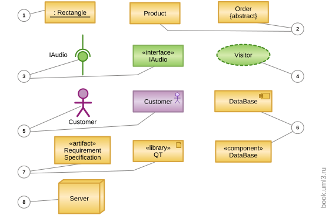
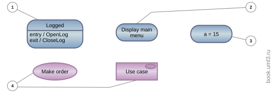
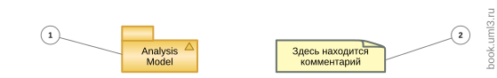
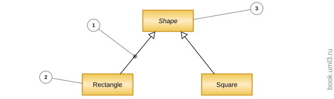
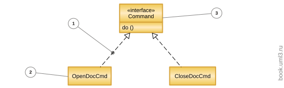
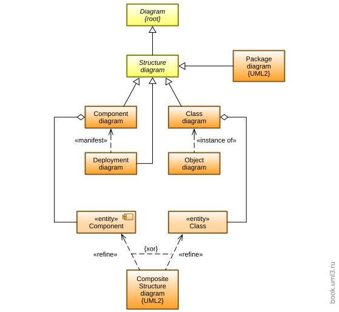
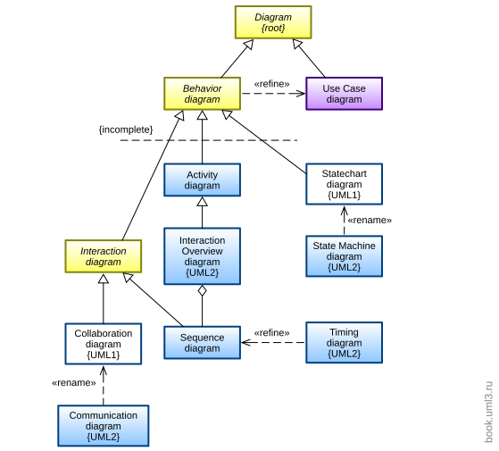
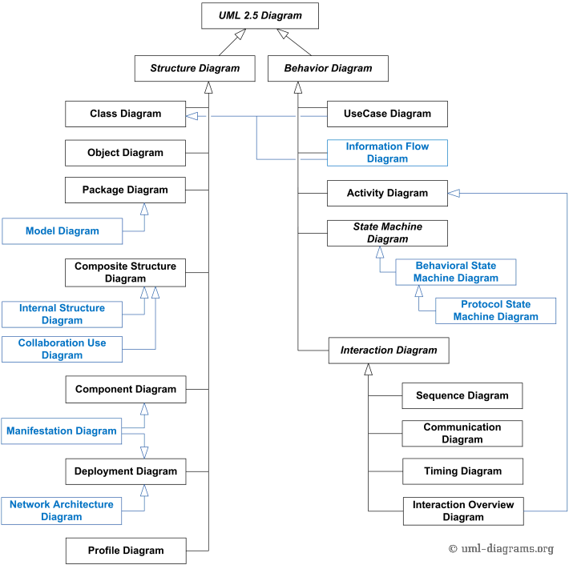

---

title: "Моделирование информационной системы: от предметной области к системе артефактов"

---

# Собаки и небоскрёбы

Наверно, сейчас первый вопрос, который вы хотите задать: зачем заниматься чем-то до написания кода, когда можно просто писать код и решать проблемы по мере необходимости? Давайте посмотрим на более капитальный пример, который, как ни странно, красиво отражает то, как это всё всплывает в разработке ПО.

Допустим, вы хотите построить конуру для своей собаки. В целом не нужно каких-то особых знаний, кроме того, что такое конура, как должна выглядеть и какого быть размера. С материалами всё тоже просто и понятно: доски (в идеале ровные), гвозди, молоток, рулетка, несколько часов/дней работы, и всё готово.

Идём дальше и строим дом. С домом сложнее, так как одного визуального представления не хватит, чтобы понять, что в итоге должно получиться. Перед началом строительства крайне хочется сделать несколько эскизов и чертежей, на которых будет показана планировка дома, разводка коммуникаций (освещение, отопление, водопровод). На этих же чертежах можно (и нужно) учесть пожелания жильцов и требования всяких разных служб. Ну и понятно, что одних досок с гвоздями тоже не хватит, чтобы построить дом: нужно заложить фундамент, определиться с несущими стенами, перекрытиями, материалами внешней и внутренней отделки… В общем, затея сложнее конуры, и лучше её поручить знающим людям =)

Ещё дальше: строим небоскрёб. Понятно, что из гвоздей и палок такую махину точно не соорудить. Хуже даже не это: в небоскрёбе живут не несколько человек, а работает несколько (десятков) компаний и сотни людей, и пожелания каждой компании, которая вложилась в здание деньгами или другими ресурсами, необходимо учесть при строительстве. Хуже, что пожелания могут начаться после начала строительства, и такую возможность тоже надо заложить =) Да и работать придётся явно не в одиночку: для таких масштабов нужна команда специалистов.

Ну и давайте посмотрим правде в глаза: частенько получается так, что компания хочет возвести небоскрёб, но её подход едва ли натягивается на собачью конуру.

# Про моделирование

Так зачем же нам нужно заниматься моделированием? В первую очередь любой софт пишется для решения чьих-то задач, соответственно, моделирование должно быть нацелено на обеспечение решения этих самых задач. Конура должна иметь четыре стены, в идеале не протекать во время дождя и защищать от ветра. Дом должен иметь планировку, которая устроит всех жильцов, при этом не должен развалиться за десять лет из-за плохого фундамента или сгореть из-за плохой проводки и легко воспламеняющихся материалов, по незнанию использованных в отделке. Небоскрёб визуально должен удовлетворять всех заказчиков и градозащитников, внутреннее разделение должно содержать все те плюшки, которые компании заявляют при найме (подземная парковка, спортзал, игровая комната с консолями, кухня с бесплатными печеньками и йогуртами), само здание не должно быть подвержено влиянию внешних погодных условий (порывы сильного ветра, молнии, дожди, землетрясения). На каждом уровне свои требования, и эти требования определяют количество той или иной документации с моделями.

С другой стороны, чтобы задачи решались и сейчас, и в дальнейшем, софт должен быть открыт к изменяющимся требованиям, а для этого нужно, во-первых, откуда-то получать эти самые требования (скорее всего, вам нужно будет периодически проводить интервью с пользователями), а во-вторых, сама архитектура софта должна позволять относительно безболезненно эти требования воплощать в жизнь.

Модели в целом применяются не только в строительстве (попробуйте сами подумать и назвать сферы перед тем, как читать дальше). Автомобили и самолёты требуют моделей разных уровней и исполнения, начиная с чертежей и заканчивая физическими моделями, проверяемыми на прочность. Гуманитарные дисциплины (экономика, социология, менеджмент) также применяют моделирование для проверки тех или иных идей без ущерба для окружающей среды.

В итоге модель — это упрощённое представление реальности, своеобразный чертёж. Модель может быть как детализированной, так и более абстрактной. В хорошей модели есть элементы, влияющие на результат, и нет элементов, которые в данный момент не столь значимы.

Ну и понятно, что и в случае со строительством, и в случае с разработкой ПО, основным этапом, предшествующим разработке, является проектирование модели ПО. Так зачем же в итоге нам нужны модели? Модели нам нужны, чтобы лучше понимать разрабатываемую систему с различных точек зрения (требований, процессов, архитектуры приложения) и в случае необходимости дополнять эту модель ещё до этапа реализации, когда внесение изменений будет более дорогим удовольствием.

Иначе в какой-то момент будет вот так

Задачи, которые решаются моделированием:

- визуализация системы в текущем или желаемом состоянии;
- определение структуры и/или поведения системы;
- создание шаблона для дальнейшего создания системы;
- документация принимаемых решений.

В рамках этого курса важно смотреть на модель не как на набор отдельных картинок, а как на систему связанных проектных артефактов. Диаграмма сама по себе редко отвечает на все вопросы: она фиксирует один взгляд на систему и должна согласовываться с другими взглядами.

Ключевой принцип курса:

:::note[Важно]
UML — не “рисование диаграмм”, а способ фиксировать проектные решения и связывать разные представления одной информационной системы.

:::

Хорошая модель помогает ответить сразу на несколько вопросов:

- что происходит в предметной области;
- какие проблемы должна решить система;
- кто взаимодействует с системой и зачем;
- какие сценарии должны быть поддержаны;
- какие информационные объекты участвуют в этих сценариях;
- как эти объекты превращаются в программную модель;
- из каких компонентов состоит реализация;
- где эта реализация разворачивается;
- как проверить, что все части модели не противоречат друг другу.

## Информационная система и программное обеспечение

В курсе мы моделируем не просто программу, а информационную систему. Программное обеспечение является важной частью ИС, но не исчерпывает её. В ИС также есть пользователи, регламенты, документы, внешние системы, данные, аппаратная база, организационные процессы и ограничения эксплуатации.

Это различие важно для моделирования. Если смотреть только на ПО, легко начать проектирование с контроллеров, таблиц и API. Если смотреть на ИС, сначала появляются предметная область, заинтересованные лица, требования, процессы и информационные объекты. Только после этого имеет смысл переходить к программным классам, компонентам и развёртыванию.

## Уровни архитектуры ИС

В дальнейшем мы будем постепенно проходить несколько уровней архитектуры информационной системы:

| Уровень | Что описывает |
| --- | --- |
| Функциональная архитектура | какие функции и сценарии нужны пользователям и внешним системам |
| Информационная архитектура | какие понятия, документы, события и данные важны в предметной области |
| Программная архитектура | какие классы, интерфейсы, пакеты и компоненты могут реализовать модель |
| Системная архитектура | на каких узлах и в каких средах выполняется система |
| Архитектура данных | как информационные объекты могут храниться и ограничиваться на уровне данных |

Эти уровни не являются независимыми. Например, объектный поток на диаграмме деятельности помогает выделить классы, технические классы используются на диаграмме последовательности, а нефункциональные требования влияют на диаграмму развёртывания.

# Принципы моделирования

Моделирование само по себе — не новая концепция, поэтому есть какие-то устоявшиеся принципы, которым было бы хорошо следовать:

- Выбор модели оказывает определяющее влияние на подход к решению проблемы и на то, как оно в итоге будет выглядеть. Другими словами, выбирать и создавать модель нужно вдумчиво.
- Каждая модель может быть воплощена с разной степенью абстракции.
- Лучшие модели — те, что ближе к реальности. Если модель где-то расходится с действительностью, нужно понимать, в чём именно расхождение и на что оно влияет.
- Нельзя ограничиваться созданием только одной модели. Наилучший подход — использовать совокупность нескольких моделей, почти независимых друг от друга.

Если смотреть на средства моделирования объектно-ориентированных систем (а к таким сводится большинство), то обычно UML покрывает большинство потребностей и выбирается в силу своей выразительности.

# Про UML в целом

Естественно, модель может быть просто текстовой (т.е. просто записанные требования и словесное описание), но это становится неудобно уже для проектов среднего масштаба, поскольку нет наглядности, и рука невольно тянется рисовать (неважно, где, на бумаге, draw.io или в Miro). Даже ту же конуру в идеале хочется нарисовать и по рисунку (а в идеале чертежу) строить. Отсюда возникает проблема, что в случае рисунков нужно отдельно объяснять, какой элемент что значит. Если каждый рисует по-своему, то велик риск, что в итоге все забьют на идею и оставят всё на уровне договорённостей. В качестве альтернативы можно заранее договориться о каком-то одном варианте изображать те или иные элементы. И вот как раз в этот момент появляются всякие разные нотации.

Если брать что-то из того же строительства, то в разных странах разные стандарты, но в целом они сильно пересекаются. При желании на досуге можно почитать про единую систему конструкторской документации (ЕСКД).

Нотаций в программировании, на самом деле, достаточно много:

- **Всякие блок-схемы** — это и так известно со школьной скамьи, но не все знают, что нотация блок-схем шире, чем она обычно даётся, и при необходимости с её помощью также можно описывать процессы.
- **IDEF*** (прямиком из начала 80-х) — набор различных нотаций на все случаи жизни, объединённых под одним названием. Достаточно разрозненный и никак не развивается (последнее обновление IDEF0 в 1993 году).
- **eEPC** (c 90-х годов) — блок-схемы для мира бизнеса, описывающие процесс с точки зрения событий (произошло событие — мы отреагировали и сгенерировали новое событие).
- **BPMN** — нотация для моделирования бизнес-процессов. Широко используется, в том числе для реального управления процессами на основе диаграмм, и относительно развивается (последнее обновление в 2014 году).
- **SysML** — диалект UML с небольшими изменениями (два новых типа диаграмм, изменения в некоторых других).
- **C4** (официально с 2018 года) — свежая альтернатива UML с небольшим количеством сущностей и призванная стать удобной заменой “прямоугольниками со стрелками”. Про неё мы поговорим на одной из последних лекций.

Так как курс включает в себя именно UML, про него мы и будем говорить на большинстве лекциях.

Аббревиатура **UML** расшифровывается как “Unified Modelling Language”, то есть унифицированный язык моделирования. Давайте разберём по частям мною вышесказанное.

:::tip[Определение]
**Язык** — это знаковая система для хранения и передачи информации.

:::

Если говорить на человеческом, то язык (в частности формальный искусственный язык) состоит из трёх частей:

- Синтаксис (правила составления конструкций);
- Семантика (правила присваивания смысла конструкциям);
- Прагматика (правила использования конструкций для достижения каких-то целей).

То есть язык описывает, что мы можем использовать для передачи смысла, какой в целом смысл мы можем вкладывать и какие цели достигаются.

:::tip[Определение]
**Модель** — это описание объекта или явления, в котором мы убираем детали, которые нам не критичны в рамках задач, для которых используется данное описание.

:::

Этим, в целом, всё сказано: мы пытаемся показать нужные нам элементы и характеристики системы.

В чём заключается **унификация**: UML в целом — это сборная солянка из всяких разных идей, которые авторы языка (Гради Буч, Ивар Якобсон и Джеймс Рамбо) привели в относительно единую структуру и методологию. За основу был взят объектно-ориентированный подход, вокруг которого построилось остальное.

Авторы нотации дают ей следующее определение:

:::tip[Определение]
**UML** — это графический язык моделирования общего назначения, предназначенный для спецификации, визуализации, проектирования и документирования всех артефактов, создаваемых при разработке программных систем.

:::

В целом, каждое слово в этом определении, а именно “спецификация”, “визуализация”, “проектирование” и “документирование” мы разобрали выше как задачи моделирования.

Как в целом можно использовать UML:

- Рисование картинок;
- Обмен информацией;
- Спецификация систем;
- Повторное использование архитектурных решений;
- Генерация кода;
- Имитационное моделирование;
- Верификация моделей.

В этом курсе UML используется прагматично: не ради полного покрытия стандарта, а для построения согласованной модели ИС. Поэтому для каждой диаграммы важно понимать три вещи: какой вопрос она закрывает, из каких предыдущих артефактов появляется и чем потом проверяется.

| Вопрос | Диаграмма или артефакт |
| --- | --- |
| Кто и зачем использует систему? | контекст системы, требования, диаграмма использования |
| Как выполняется процесс? | сценарий, спецификация use case, диаграмма деятельности |
| Какие понятия важны в предметной области? | словарь, бизнес-правила, концептуальная диаграмма классов |
| Как предметная модель может быть реализована в ПО? | техническая диаграмма классов, пакеты |
| Из каких крупных частей состоит система? | диаграмма компонентов |
| Где и как система развёрнута? | диаграмма развёртывания |
| Как меняется состояние важного объекта? | диаграмма состояний |
| Как объекты взаимодействуют во времени? | диаграмма последовательности |

# Из чего состоит UML

Сам стандарт абсолютно открытый, но официальная спецификация стандарта занимает 796 страниц. Это много, но документ описывает абсолютно все аспекты языка. Например, в случае разногласий по нотации при сдаче работ истина в последней инстанции — это спецификация.

Основных типов элементов нотации четыре: фигуры, линии, значки и тексты. Сама нотация достаточно гибкая, но не произвольная: у элементов есть заданная семантика, а у отношений — допустимые направления и способы применения. Инструментальных средств тоже много, какие-то лучше, какие-то хуже, про это мы поговорим ближе к концу лекции.

Формально, модель UML — это граф, вершины которого являются сущностями, а рёбра — отношениями.

Сущности можно разделить на несколько групп: **структурные**, **поведенческие**, **группирующие** и **аннотационные**:

1. Объект — уникальная сущность, инкапсулирующая в себе состояние и поведение.
2. Класс — описание множества объектов с общими атрибутами и операциями.
3. Интерфейс — множество операций, которое определяет набор услуг (службу), предоставляемых классом или компонентом.
4. Кооперация — совокупность объектов, которые взаимодействуют для достижения некоторой цели.
5. Действующее лицо — сущность, находящаяся вне моделируемой системы и непосредственно взаимодействующая с ней.
6. Компонент — модульная часть системы, предоставляющая и требующая некоторый набор интерфейсов.
7. Артефакт — физическая единица реализации, получаемая из другого элемента модели (класса или компонента).
8. Узел — физический вычислительный ресурс.

Структурные сущности

1. Состояние — период в жизненном цикле объекта, в котором объект удовлетворяет некоторому условию, выполняет деятельность или ожидает события.
2. Деятельность — поведение, заданное графом узлов и рёбер, по которым передаются управляющие и объектные токены.
3. Действие — исполняемый узел деятельности, задающий элементарный шаг поведения.
4. Вариант использования — спецификация набора действий, выполняемых субъектом и дающих наблюдаемый результат, значимый для действующего лица или другого заинтересованного лица.

Поведенческие сущности

1. Пакет — группа элементов модели (в том числе пакетов).
2. Заметка или примечание.

Группирующая и аннотационная сущности

Отношения также можно выделить в четыре типа: зависимость, ассоциация, обобщение и реализация:

- **Зависимость** — это наиболее общий тип отношения между двумя сущностями. Отношение зависимости указывает на то, что изменение независимой сущности каким-то образом влияет на зависимую сущность. Графически отношение зависимости изображается в виде пунктирной стрелки (1), направленной от зависимой сущности (2) к независимой (3).
    
    
    
- **Ассоциация** — это наиболее часто используемый тип отношения между сущностями. Отношение ассоциации имеет место, если одна сущность непосредственно связана с другой (или с другими — ассоциация может быть не только бинарной). Графически ассоциация изображается в виде сплошной линии (1) с различными дополнениями, соединяющей связанные сущности.
    
    
    
- **Обобщение** — это отношение между двумя сущностями, одна их которых является частным (специализированным) случаем другой. Графически обобщение изображается в виде сплошной стрелки с треугольником на конце (1), направленной от частного (2) к общему (3). Отношение наследования между классами в объектно-ориентированных языках программирования является типичным примером обобщения.
    
    
    
- Отношение **реализации** указывает, что одна сущность является реализацией другой. Например, класс является реализацией интерфейса. Графически реализация изображается в виде пунктирной стрелки с треугольником на конце (1), направленной от реализующей сущности (2) к реализуемой (3).
    
    
    

**Диаграммы** — это основная структура, которая облегчает создание и использование модели. Главная задача диаграммы — выделение некоторой части графа модели. Сами диаграммы выделяются рамкой с названием, которое содержит в том числе тег типа диаграммы. В учебной классификации UML-диаграммы обычно делят на две большие группы:

- Структурные диаграммы:
    - Диаграмма классов;
    - Диаграмма объектов;
    - Диаграмма компонентов;
    - Диаграмма размещения;
    - Диаграмма внутренней структуры;
    - Диаграмма пакетов;
    - Диаграмма профилей.
- Поведенческие диаграммы:
    - Диаграмма использования (вариантов использования, прецедентов);
    - Диаграмма автомата (состояний);
    - Диаграмма деятельности;
    - Диаграмма последовательности;
    - Диаграмма коммуникации (кооперации);
    - Обзорная диаграмма взаимодействия;
    - Диаграмма синхронизации.

Диаграмма использования относится к поведенческим диаграммам, но в курсе она будет рассматриваться отдельно и раньше остальных поведенческих диаграмм. Причина практическая: она показывает максимально верхнеуровневый взгляд на систему с точки зрения действующих лиц и заинтересованных сторон, а следующие поведенческие диаграммы уже уточняют отдельные сценарии и взаимодействия.

Структурные диаграммы

Поведенческие диаграммы

UML сам по себе не ограничивает то, что можно показать в рамках одной диаграммы, но тринадцать типов диаграмм выше называются **каноническими**, и обычно используют их. В рамках курса мы рассмотрим те канонические диаграммы, которые применяются чаще всего:

- Диаграмма использования;
- Диаграмма деятельности;
- Диаграмма классов;
- Диаграмма компонентов;
- Диаграмма пакетов;
- Диаграмма состояний;
- Диаграмма последовательности;
- Диаграмма размещения.

Остальные диаграммы либо можно получить из других, либо редко используются в моделировании именно информационных систем.

При этом, что называется, в дикой природе встречаются и другие типы диаграмм:

