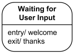
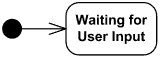
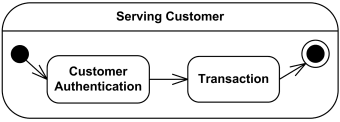
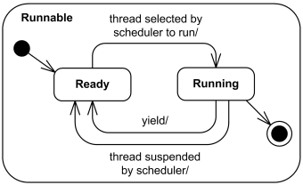

**Длительность: 90 минут.** Лекция выбирает между жизненным циклом объекта и обменом сообщениями, чтобы не пытаться одной диаграммой объяснить всё поведение системы.

## Материалы лекции

[Диаграмма состояний](/notation/state-machine-diagrams), [Диаграмма последовательности](/notation/sequence-diagrams), [Диаграмма коммуникации](/notation/communication-diagrams).

[Расширенная нотация автоматов состояний](/notation/state-machine-advanced), [Расширенная нотация диаграммы последовательности](/notation/sequence-advanced), [Обзорная диаграмма взаимодействия](/notation/interaction-overview-diagrams), [Диаграмма синхронизации](/notation/timing-diagrams) и [Диаграмма внутренней структуры](/notation/internal-structure-diagrams) оставлены в справочнике. Это специализированные средства для иерархических автоматов, сложных фрагментов, временных ограничений и внутреннего устройства; для типичного учебного сценария сначала нужны базовые state и sequence diagrams.


## Развёрнутый тезисный план

| Время | Тезисы и действие преподавателя |
| --- | --- |
| 0–15 | Выбрать state или sequence для трёх вопросов о системе. |
| 15–40 | Построить автомат записи; добавить событие, guard и запрещённый переход. |
| 40–65 | Построить sequence создания записи и проверить порядок сообщений. |
| 65–75 | Сравнить sequence и communication diagram на одном наборе участников. |
| 75–90 | Сопоставить состояния, сценарий, правило и технические элементы. |

## Полный материал лекции

### Диаграмма состояний


:::tip[Определение]{icon="starlight"}
**Состояние** — период жизни объекта, в котором он удовлетворяет некоторому условию, ожидает событие или выполняет связанную деятельность.
:::

Диаграмму строят для объекта с настоящим жизненным циклом: заказа, заявки, документа, платежа, записи на консультацию. «Открыта форма» и «нажата кнопка» обычно описывают интерфейс, а не состояние предметного объекта.

#### Состояния и переходы

Простое состояние показывают прямоугольником со скруглёнными углами. Переход — направленной стрелкой. Подпись перехода имеет вид:

```text
trigger [guard] / effect
```

Триггер (`trigger`) — событие или вызов операции, защитное условие (`guard`) определяет допустимость, а действие перехода (`effect`) выполняется при срабатывании перехода. Например, `подтвердить [интервал свободен] / отправитьУведомление`.



У состояния могут быть поведения `entry`, `do` и `exit`: при входе, пока объект находится в состоянии и при выходе. Они относятся к состоянию, а не к переходу.

#### Начало, завершение и выбор

Начальное псевдосостояние показывает начало региона автомата. Конечное состояние завершает его. **Точка выбора** (`choice`) выбирает переход по защитным условиям; условия должны быть связаны с бизнес-правилами и атрибутами объекта.



Если объект действительно проходит независимые ветви жизненного цикла одновременно, применяют развилку (`fork`) и соединение (`join`). Для большинства предметных объектов достаточно одного последовательного региона.

#### Проверка диаграммы

- каждое состояние описывает устойчивое условие объекта;
- у значимых переходов есть событие или понятная причина;
- защитное условие выражает проверяемое правило;
- состояние и переходы согласованы с атрибутами, правилами и сценариями;
- диаграмма не подменяет жизненный цикл последовательностью экранов.

#### В модели

Состояния выводятся из [бизнес-правил](/modelling/business-rules-and-constraints), [сценариев](/modelling/scenarios-and-flows) и [концептуальной модели](/modelling/conceptual-model). Экземпляры жизненного цикла можно показать на [диаграмме объектов](/notation/object-diagrams), а события между участниками — на [диаграмме последовательности](/notation/sequence-diagrams). Составные автоматы и протоколы вынесены в [расширенную нотацию](/notation/state-machine-advanced).

---

### Диаграмма последовательности


Диаграмму строят для конкретного сценария: успешной записи на консультацию, отмены заказа или обработки ошибки оплаты. Она отвечает на вопрос, кто кому отправляет сообщение и что должно существовать в модели, чтобы такой обмен был возможен.


#### Линии жизни и порядок

**Линия жизни** (`lifeline`) представляет участника взаимодействия: актора, объект, компонент, сервис или внешнюю систему. Экземпляр класса обычно подписывают как `имя : Тип`, например `запись : Запись`. Если имя несущественно, можно оставить только `: Запись`.

Вертикальная ось задаёт порядок событий, но не измеряет их длительность. События на одной линии жизни читаются сверху вниз; отправка сообщения предшествует его получению. Если важны секунды, таймауты или длительность, нужна [диаграмма синхронизации](/notation/timing-diagrams).

**Трасса** (`trace`) — допустимая последовательность событий взаимодействия. Это не всегда один линейный порядок: события на разных линиях жизни могут быть лишь частично упорядочены. Диаграмма задаёт ограничения на трассы, а не точную длительность каждого вызова.

#### Сообщения

Сообщение показывает передачу информации или вызов между линиями жизни. В основной модели различают:

| Вид сообщения | Смысл |
| --- | --- |
| Синхронный вызов (`synchCall`) | отправитель ждёт завершения обработки операции |
| Асинхронный вызов (`asynchCall`) | отправитель вызывает операцию и продолжает работу, не ожидая результата |
| Асинхронный сигнал (`asynchSignal`) | отправитель передаёт экземпляр сигнала и не ждёт ответа |
| Ответ (`reply`) | получатель возвращает результат или управление |
| Создание и уничтожение | линия жизни появляется или завершается в ходе сценария |

Сигнал (`Signal`) задаёт тип одностороннего асинхронного сообщения и может иметь атрибуты. Не смешивайте его с асинхронным вызовом: `asynchCall` вызывает операцию, а `asynchSignal` передаёт сигнал.

Активация показывает отрезок выполнения поведения на линии жизни. Её используют, когда вложенность вызовов или длительность обработки помогает понять сценарий, но не рисуют автоматически на каждом сообщении.

Создающее сообщение начинает линию жизни в своей точке, а уничтожающее заканчивает её крестом. Их стоит показывать, когда жизненный цикл объекта является существенной частью сценария: например, временная сессия создаётся при входе и уничтожается после завершения оплаты.

Имена сообщений должны соответствовать действиям сценария и операциям получателя. Если `orderService` получает `подтвердитьОплату()`, такая операция или контракт должны быть обоснованы на технической модели.

Минимальный технический фрагмент может выглядеть так: `actor → api: создатьЗапись()`, `api → bookingService: создать()`, `bookingService → repository: сохранить(запись)`, затем `bookingService → notificationGateway: отправитьПодтверждение()`. Такой обмен проверяет, что для сценария существуют нужные операции и границы компонентов.

#### Что не показывает диаграмма

Диаграмма последовательности не является процессной схемой: она не заменяет диаграмму деятельности с дорожками, объектными потоками и правилами ветвления. Она также не является диаграммой компонентов или развёртывания: линии жизни могут представлять компоненты, но не показывают всю архитектуру.

#### Проверка диаграммы

- сценарий ограничен одним понятным результатом;
- участники находятся на одном уровне абстракции;
- сообщения имеют получателя и читаемый смысл;
- условия и альтернативы происходят из сценариев и бизнес-правил;
- показанные классы, операции и интерфейсы существуют в соответствующей модели.

#### В модели

Диаграмма уточняет [сценарии и потоки](/modelling/scenarios-and-flows) и [техническую модель классов](/notation/technical-class-diagrams). Ветвления и повторное использование взаимодействий раскрыты в [расширенной нотации](/notation/sequence-advanced); альтернативный вид взаимодействия — [диаграмма коммуникации](/notation/communication-diagrams).

[Динамическое представление C4](/c4/dynamic-and-deployment) показывает архитектурно значимый путь через существующие контейнеры и компоненты; эта диаграмма раскрывает его точный протокол и альтернативы.

---

### Диаграмма коммуникации


Линии жизни располагают как узлы сети и соединяют связями, по которым возможен обмен сообщениями. Рядом со стрелками указывают номер и имя сообщения: `1: создатьЗапись()`, `1.1: проверитьДоступность()`, `2: отправитьУведомление()`.

Вложенная нумерация показывает вызов, происходящий внутри другого вызова. Условия записывают в квадратных скобках, повторения — через `*` или уточняющий диапазон. Сообщения должны соответствовать возможным связям участников, а не пересекать схему произвольными стрелками.

Например, `1: создатьЗаказ()`, `1.1: проверитьКорзину()`, `1.2 [товар доступен]: сохранить()` показывают основной вызов, вложенные сообщения и условие. Повторение можно записать как `*[для каждой позиции]: проверитьНаличие()`. Такая нумерация обязательна, если порядок нельзя восстановить по одной схеме связей.

Диаграмма коммуникации удобна, когда важно обсудить, какие объекты или компоненты вообще могут взаимодействовать. Если важнее увидеть порядок, вложенность вызовов или длительность, лучше выбрать [диаграмму последовательности](/notation/sequence-diagrams).

#### В модели

Диаграмма конкретизирует техническое взаимодействие из [сценариев](/modelling/scenarios-and-flows) и [технической модели классов](/notation/technical-class-diagrams). Для большого сценария из нескольких взаимодействий есть [обзорная диаграмма](/notation/interaction-overview-diagrams).

---

### Расширенная нотация автоматов состояний


#### Составные и вложенные состояния

Составное состояние скрывает внутренний автомат за одним крупным этапом. Например, состояние «Обрабатывается» может включать проверки, согласование и ожидание оплаты. Это помогает не смешивать разные уровни детализации на одной схеме.

Ортогональные регионы показывают независимые части состояния, существующие одновременно. Они уместны, когда объект действительно имеет несколько параллельных жизненных циклов; иначе диаграмма становится сложнее без новых выводов.



Поверхностная и глубокая история возвращают автомат в ранее активное вложенное состояние. **Точки входа и выхода** (`entry point` и `exit point`) обозначают именованные границы составного состояния, а **состояние-подмашина** (`submachine state`) ссылается на повторно используемый автомат. **Соединительное псевдосостояние** (`junction`) служит для соединения переходов, **псевдосостояние завершения** (`terminate`) прекращает работу автомата, а **отложенное событие** (`deferred event`) ждёт подходящего состояния для обработки.

#### Внутренние переходы

Внутренний переход обрабатывает событие, не покидая состояние. Его отличают от поведения `entry`, `do` и `exit`: те привязаны соответственно к входу, пребыванию и выходу, а внутренний переход имеет собственные триггер, защитное условие и действие перехода. Например, в состоянии «Ожидает оплату» событие `напомнить` может отправить уведомление, не меняя состояние.

Триггер связывает переход с событием. Основные виды событий: `CallEvent` для вызова операции, `SignalEvent` для получения сигнала, `TimeEvent` для момента или интервала времени, `ChangeEvent` для изменения наблюдаемого условия и `AnyReceiveEvent` для сообщения, не обработанного более конкретным триггером.

**Сигнал** (`Signal`) — не само событие, а классификатор, задающий вид асинхронного сообщения и его атрибуты. `SignalEvent` ссылается на такой сигнал. Поэтому таймаут не следует записывать как пользовательскую операцию, а внешний сигнал — как внутреннее поведение `do`.

#### Протокольный автомат

**Протокольная диаграмма состояний** описывает допустимые операции классификатора с точки зрения его внешнего потребителя. Она не раскрывает внутренние действия `entry`, `do` и `exit`, а фиксирует, какие вызовы допустимы до и после других вызовов.

Например, объект заказа может принять `оплатить` только после `создать`, а `отменить` — пока не началась доставка. Такая диаграмма подходит для публичного контракта компонента или класса.



В протокольном переходе отдельно фиксируют предусловие, триггер и постусловие. Предусловие определяет, когда операция допустима, триггер обозначает операцию или событие, а постусловие говорит, какое состояние или свойство будет истинно после успешного перехода. Внутренние действия и история в протоколе обычно не показываются: потребителю важен контракт, а не реализация.

#### Семантика выполнения

Автомат обрабатывает события по принципу **обработки до завершения** (`run-to-completion`): одно принятое событие доводит автомат до устойчивой конфигурации, после чего начинается обработка следующего. Это объясняет, почему триггер, защитное условие и действие перехода имеют разные роли и не должны записываться как одно неразличимое описание перехода.

#### В модели

Для большинства предметных объектов достаточно [базовой диаграммы состояний](/notation/state-machine-diagrams). Протокол имеет смысл сопоставлять с техническим контрактом из [диаграммы классов](/notation/technical-class-diagrams) или [диаграммы компонентов](/notation/component-diagrams).

---

### Расширенная нотация диаграммы последовательности


#### Комбинированные фрагменты

Фрагмент окружает часть взаимодействия и задаёт оператор, по которому она читается.

| Оператор | Когда использовать |
| --- | --- |
| `alt` | несколько взаимоисключающих ветвей с защитными условиями |
| `opt` | необязательная ветвь с одним условием |
| `loop` | повторение при условии или в диапазоне |
| `par` | независимые части могут выполняться параллельно |
| `break` | при условии фрагмент заменяет оставшуюся часть сценария |
| `critical` | фрагмент выполняется атомарно относительно параллельных частей |
| `assert` | показанная трасса допустима как единственная |
| `neg` | показанная трасса недопустима |

`strict`, `seq`, `consider` и `ignore` уточняют допустимый порядок и набор сообщений. Это специализированные средства: добавляйте их, когда обычных операторов недостаточно для контракта взаимодействия.

#### Ссылки и границы

`ref` (**использование взаимодействия**, `interaction use`) ссылается на отдельное взаимодействие. Это помогает не помещать длинный повторяющийся сценарий в каждую диаграмму. **Ворота** (`gate`) обозначают точку, через которую сообщение пересекает границу фрагмента или взаимодействия.

Состояние линии жизни можно дополнительно ограничить инвариантом, а внешнюю границу взаимодействия — найденным и потерянным сообщениями. **Найденное сообщение** (`found message`) показывает сообщение от неизвестного внешнего отправителя, **потерянное сообщение** (`lost message`) — сообщение неизвестному внешнему получателю. Они особенно полезны для асинхронного обмена, когда граница рассматриваемого взаимодействия важна, но вносить внешнего участника на схему не нужно.

Инвариант состояния у линии жизни фиксирует условие, которое должно быть истинно в отмеченный момент. Он должен согласовываться с [диаграммой состояний](/notation/state-machine-diagrams), а не быть произвольным комментарием.

#### В модели

Если один сценарий собирается из нескольких `ref`, используйте [обзорную диаграмму взаимодействия](/notation/interaction-overview-diagrams). Временные ограничения относятся к [диаграмме синхронизации](/notation/timing-diagrams), а не к расстоянию между сообщениями. Различие асинхронного вызова и сигнального сообщения раскрыто в [основной диаграмме последовательности](/notation/sequence-diagrams).

---

### Обзорная диаграмма взаимодействия


По внешнему виду диаграмма похожа на диаграмму деятельности: есть начальный и конечный узлы, решения, слияния, развилки, соединения и потоки управления. Главное отличие в том, что узел представляет не маленькое действие, а встроенное взаимодействие или ссылку `ref` на него.

Например, сценарий оформления заказа может состоять из `ref Проверить доступность`, `ref Создать заказ`, `ref Запустить оплату` и `ref Отправить уведомление`. Детали сообщений остаются на отдельных диаграммах последовательности.

Диаграмма полезна, когда один сценарий слишком велик для одной диаграммы последовательности, содержит повторно используемые фрагменты или ветвится между крупными взаимодействиями. Для обычного процесса без сообщений лучше использовать [диаграмму деятельности](/notation/activity-diagrams).

#### Проверка диаграммы

- каждый содержательный узел ссылается на существующее взаимодействие;
- уровень детализации узлов одинаковый;
- условия согласованы с альтернативными сценариями;
- диаграмма не повторяет последовательность мелких действий из диаграммы деятельности.

#### В модели

Обзорная диаграмма помогает раскрыть [декомпозицию процесса](/modelling/process-decomposition), когда этапы состоят из самостоятельных взаимодействий. Сами фрагменты описывайте на [диаграммах последовательности](/notation/sequence-diagrams) или [коммуникации](/notation/communication-diagrams).

---

### Диаграмма синхронизации


Линия жизни показывает участника, а горизонтальная ось — время. На ней отмечают состояния (`Ожидает оплату`, `Оплачен`) или значения свойства (`доступ = разрешён`). Сообщения и события объясняют причины изменений.

На диаграмме синхронизации могут присутствовать линия жизни, состояние или значение, событие, сообщение, временная ось, **наблюдение времени** (`time observation`), **наблюдение длительности** (`duration observation`), **ограничение момента времени** (`time constraint`) и **ограничение длительности** (`duration constraint`). Состояние и значение различаются: первое обычно связано с жизненным циклом объекта, второе показывает конкретную характеристику, например температуру или доступность соединения.

**Ограничение момента времени** задаёт условие на момент времени, например `{t < 10 с}`. **Ограничение длительности** ограничивает интервал между событиями: `{длительность <= 5 мин}`. Наблюдение времени и наблюдение длительности позволяют сослаться на конкретный момент или измеренный интервал.

Физическое время, логический порядок сценария и порядок сообщений — разные вещи. Не используйте расстояние между линиями на диаграмме последовательности как замену временной шкалы; если ограничение времени существенно, запишите его явно.

Состояния должны соответствовать состояниям объекта на [диаграмме автомата](/notation/state-machine-diagrams), а события — сценарию или техническому контракту. Для обычного бизнес-процесса без временных требований диаграмма синхронизации избыточна: используйте диаграмму деятельности или последовательности.

#### В модели

Источником временных ограничений служат [требования](/modelling/requirements), [бизнес-правила](/modelling/business-rules-and-constraints) и [системная архитектура](/modelling/system-architecture-and-deployment). Порядок сообщений без масштаба времени показывает [диаграмма последовательности](/notation/sequence-diagrams).

---

### Диаграмма внутренней структуры


**Структурированный классификатор** может содержать внутренние части и соединители. **Инкапсулированный классификатор** — его специализация, которая может также владеть портами. Компонент относится к инкапсулированным классификаторам, поэтому на его внутренней структуре допустимы все три элемента.

Часть — свойство классификатора, представляющее его внутреннюю роль. Запись `validator: OrderValidator` показывает не просто существование класса `OrderValidator`, а его роль внутри `OrderService`.

Порт — точка взаимодействия на границе инкапсулированного классификатора. Он может предоставлять и требовать интерфейсы; это не декоративный квадрат, а свойство элемента модели.


**Сборочный соединитель** (`assembly connector`) связывает части или порты, контракты которых совместимы. **Делегирующий соединитель** (`delegation connector`) проводит запрос с внешнего порта к внутренней части или обратно.


Диаграмма не нужна для любой декомпозиции. Если надо показать только модули и их контракты, используйте [компоненты](/notation/component-diagrams). Если важны классы и свойства предметной области, используйте [диаграмму классов](/notation/conceptual-class-diagrams).

#### В модели

К внутренней структуре переходят после [программной архитектуры](/modelling/software-architecture-and-layers), когда требуется объяснить делегирование и роли частей внутри компонента. Физическое размещение остаётся на [диаграмме развёртывания](/notation/deployment-diagrams).

## После лекции

Для одного объекта с жизненным циклом создайте state diagram, а для одного сценария — sequence diagram. Укажите, какой риск проверяет каждая из них.