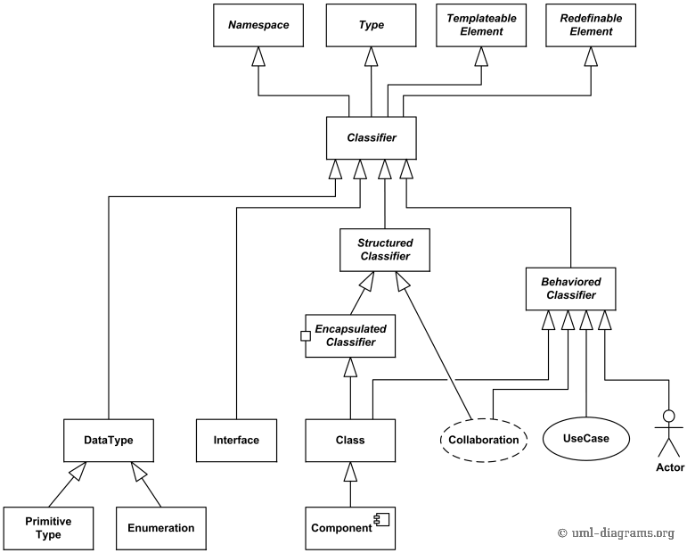

---

title: "Анализ предметной области, требования и границы системы"

---

# Quick recap

На прошлой лекции мы разобрали в целом понятие моделирования, выяснили, что для задач различной степени сложности нужна разная степень проработки тех или иных решений. Также мы плавно перешли к UML как к нотации, позволяющей решать задачи моделирования (спецификация, визуализация, проектирование и документирование артефактов разработки). Мы посмотрели на основные элементы UML, из которых складывается модель (различные типы сущностей и отношений между ними), а также выделили ряд диаграмм, отвечающих за ту или иную часть модели.

Дальше мы будем подробно рассматривать различные диаграммы, а также то, что нам нужно знать, чтобы диаграммы действительно были частью модели системы, а не просто абстрактными картинками в вакууме.

Главная задача этой лекции — не сразу нарисовать диаграмму использования, а подготовить аналитический слой для неё. Перед use case diagram нужно понять предметную область, заинтересованных лиц, границу системы, требования, ограничения, бизнес-правила и внешние системы.

# Понятие информационной системы и уровни архитектуры ИС

Первым делом (можно даже сказать, что нулевым) нужно определиться с тем, что мы будем моделировать. Поскольку предполагается, что тут в основном собрались разработчики ПО, условимся, что наша модель будет описывать информационную систему.

Формально понятие информационной системы шире, чем понятие программного обеспечения.

<aside>
💡

**Информационная система** — это вся инфраструктура предприятия, задействованная в процессе управления всеми информационно-документальными потоками, включающая в себя следующие обязательные элементы:

- Информационная модель, представляющая собой совокупность правил и алгоритмов функционирования ИС.
- Регламент развития информационной модели и правила внесения в неё изменений.
- Кадровые ресурсы (департамент развития, привлекаемые консультанты), отвечающие за формирование и развитие информационной модели.
- Программное обеспечение, конфигурация которого соответствует требованиям информационной модели (программное обеспечение является основным движителем и, одновременно, механизмом управления ИС).
- Кадровые ресурсы, отвечающие за настройку и адаптацию программного обеспечения, и его соответствие утвержденной информационной модели.
- Регламент внесения изменений в настраиваемые структуры (специфические настройки, структуры баз данных и т.д.) и конфигурацию программного обеспечения и состав его функциональных модулей.
- Аппаратно-техническая база, соответствующая требованиям по эксплуатации программного обеспечения.
- Правила использования программного обеспечения и пользовательские инструкции, регламент обучения и сертификацию пользователей.
</aside>

Нас во всей этой истории интересуют пункты про информационную модель (не путать с моделью ИС), программное обеспечение, кадровые ресурсы и аппаратно-техническую базу: как раз это является частью модели самой системы и может быть отражено с помощью UML.

ИС можно рассматривать на различных уровнях, которые, как мы потом увидим, хорошо ложатся на UML:

- Функциональная архитектура (описание ИС с точки зрения функциональных подсистем и их взаимодействия между собой);
- Информационная архитектура (описание ИС с точки зрения информационных объектов);
- Системная архитектура (описание взаимодействия программных и аппаратных компонентов системы и её пользователей);
- Программная архитектура (описание структурных элементов ПО ИС и взаимодействия между ними);
- Архитектура данных (описание формата хранения данных с точки зрения СУБД).

# Требования и как с ними жить

## Жизненный цикл ПО

Дальше стоит вспомнить ещё одну бессмертную классику: жизненный цикл программного обеспечения. Жизненный цикл показывает общую схему появления ПО и состоит из нескольких этапов:

1. Сбор и анализ требований;
2. Проектирование;
3. Разработка;
4. Тестирование;
5. Внедрение и сопровождение.

Понятно, что такой вид жизненного цикла больше подходит для каскадной разработки, но в гибких методологиях, на самом деле, мало что отличается, разве что два последних пункта отличаются.

Про каждый из пунктов, на самом деле, есть отдельная дисциплина, иногда не одна:

1. Управление требованиями (6 семестр);
2. Архитектура информационных систем (6 семестр);
3. Тут всё понятно =)
4. Тестирование ПО (7 семестр);
5. Управление программными проектами (8 семестр).

В рамках конкретно нашего курса мы затронем только первые два пункта, и только в той степени, которая нам нужна для адекватного применения нотации, поскольку наша основная задача — графически показать артефакты этапа проектирования информационной системы.

## Понятие требования

Понятно, что перед тем, **как начать** проектировать, необходимо понять, **что нужно** проектировать. Тут появляется понятие требования. С требованиями вы уже сталкиваетесь, когда пытаетесь сообразить, что должна уметь делать рассматриваемая система и для кого это делается. Какого-то единого понятия требования, на самом деле, нет, поэтому мы остановимся на следующем варианте.

<aside>
💡

**Требование** — это любое условие, которому должна соответствовать разрабатываемая система или программное средство. Требованием может быть возможность, которой система должна обладать и ограничение, которому система должна удовлетворять.

</aside>

У требований есть свои характеристики, но в общем и целом они интуитивно понятны, поэтому оставим это на следующий семестр :) Пока что нас больше интересует, какие типы требований есть. Обычно выделяют две большие категории требований, функциональные и нефункциональные.

**Функциональные требования** составляют основной пласт требований, поскольку их главная задача — показать потребности пользователей, которые нужно закрыть с помощью разрабатываемой системы. Функциональные требования отвечают на вопрос “Какие функции должна выполнять система?” (это видно даже из названия 😀).

**Нефункциональные требования**, соответственно — это все остальные требования к системе. Это могут быть управленческие требования, требования к эргономике, архитектуре системы, взаимодействию с другими программными компонентами, требования к качеству предоставляемых услуг. 

Кроме функциональных и нефункциональных требований, в аналитической модели полезно явно отделять ограничения, пользовательские потребности, системные возможности и бизнес-правила.

**Ограничение** фиксирует рамку, в которой должно существовать решение: используемая платформа, нормативный документ, обязательная внешняя система, формат обмена, допустимый способ хранения данных.

**Пользовательская потребность** описывает проблему или цель пользователя на его языке. Она может породить несколько требований.

**Системная возможность** описывает, что система должна уметь делать, чтобы закрыть потребность.

**Бизнес-правило** описывает устойчивое правило предметной области. Например: “заказ нельзя отменить после передачи курьеру” или “заявка без ответственного не может перейти в работу”. Такие правила потом проявятся в guards на диаграммах деятельности, constraints на диаграммах классов и переходах диаграммы состояний.

## Качество требований

Для дальнейшего моделирования требования должны быть достаточно качественными. Минимальный набор проверок:

- атомарность: одно требование описывает одну возможность или одно ограничение;
- проверяемость: можно понять, выполнено требование или нет;
- непротиворечивость: требование не конфликтует с другими требованиями и бизнес-правилами;
- полнота: требование содержит достаточно контекста для проектирования;
- реализуемость: требование не противоречит известным ограничениям;
- трассируемость: понятно, из какого источника оно появилось и какими артефактами покрывается.

Плохое требование почти всегда приводит к плохой диаграмме. Если формулировка слишком общая, use case получится расплывчатым. Если требование смешивает несколько действий, на диаграмме появится искусственный “комбайн”. Если нет проверяемости, невозможно будет понять, покрыта ли моделью нужная функциональность.

## Способы сбора требований

Понятно, что требования сами по себе — не новая концепция, и есть некоторое количество различных способов замкнуть в голове заказчика нужные нейронные связи, чтобы он сам понял, что ему нужно от системы.

Способов достаточно много, но тут мы выделим самые популярные.

### Интервью

Первый и самый очевидный способ — **интервью**. Обычно это интервью один на один с заинтересованными лицами (**стейкхолдерами**), отвечающими за процессы, в который планируется интегрировать информационную систему. Какие главные цели интервьюирования:

- Наладить контакт с ключевыми сотрудниками и сформировать фундамент для дальнейшей работы;
- Собрать информацию о текущем состоянии дел, в том числе различных проблемах.

Какую информацию нужно получить в ходе интервью:

- Текущие процессы, поддержку которых нужно реализовать в системе;
- Проблемы в текущих процессах, с которыми нужно разобраться;
- Новые возможности, которые требуются от системы.

Плюсы:

- Выстраивание отношений с пользователями;
- Получение полезной информации;
- Изучение различных точек зрения на одни и те же вопросы;
- Изучение ландшафта, в котором будет использоваться система.

Минусы:

- Требуется слишком много времени;
- Нет возможности быстро решить конфликт требований.

### Воркшоп

Ещё один способ, противоположный интервьюированию и дополняющий его — **воркшоп**. Воркшоп позволяет собрать всех заинтересованных лиц в одном месте и совместно проработать необходимые вопросы. Что нужно учесть при проведении таких мероприятий:

- Цель воркшопа должна быть адекватной по масштабам, её нужно достичь за отведённое время;
- Все заинтересованные лица должны быть оповещены о воркшопе, иначе полученные требования могут оказаться недостаточно проработанными.

Плюсы:

- Широкий взгляд на процессы: наличие всех заинтересованных лиц даёт более полное понимание происходящего;
- Высокая скорость работы: не нужно беседовать с каждым отдельно;
- Принятие единого решения: если есть все заинтересованные лица, то с большой вероятностью их интересы будут учтены.

Минусы:

- Долгая подготовка к проведению, например, бывает сложно собрать всех нужных людей в одно время в одном месте;
- Иногда не получается “выдернуть” людей с нужными полномочиями;
- Иногда сложно говорить на одном языке с менеджментом и людьми на местах.

### Наблюдение и слежение

Невероятно, но для существующих процессов простое **наблюдение** за ними может быть крайне эффективным. Плюсы:

- Более полное понимание процессов, так как они выполняются на местах непосредственными исполнителями;
- Формируется более чёткое понимание того, как ИС может улучшить этот процесс.

Можно наблюдать как в целом за всем процессами сразу, так и за конкретным процессом (это называется **слежением**).

С другой стороны, наше наблюдение может влиять на процесс (в присутствии постороннего лица сотрудник может начать работать продуктивнее), поэтому доверяться только наблюдению, естественно, не стоит, и лучше совместить его с двумя прошлыми способами.

# Стейкхолдеры, пользователи и акторы

Перед диаграммой использования нужно аккуратно разделить три похожих, но разных понятия.

**Стейкхолдер** — любое лицо или организация, заинтересованные в системе или затронутые её результатами. Стейкхолдер может вообще не работать с системой напрямую: например, руководитель, владелец процесса, служба безопасности, регулятор.

**Пользователь** — человек, который непосредственно работает с системой. Пользователь может выполнять несколько ролей.

**Актор** — роль относительно системы на диаграмме использования. Актором может быть не только человек, но и внешняя система, устройство или организация, если они взаимодействуют с системой как внешняя сущность.

Из этого следуют практические правила:

- стейкхолдер не всегда пользователь;
- пользователь не всегда один актор;
- внешняя система тоже может быть актором;
- актор находится вне границы моделируемой системы;
- актор должен быть связан с видимым результатом, а не с внутренним техническим действием.

# Граница системы как аналитическое решение

Граница системы отвечает на вопрос: что входит в проектируемую ИС, а что остаётся внешним. Это не просто рамка на диаграмме использования, а проектное решение.

При определении границы нужно явно указать:

- какие процессы автоматизируются;
- какие действия остаются ручными;
- какие внешние системы участвуют во взаимодействии;
- какие данные система хранит сама;
- какие данные только получает или передаёт;
- какие организационные правила система должна учитывать, но не реализует полностью.

Если граница не определена, диаграмма использования начинает смешивать действия пользователя, внутренние функции, процессы другой системы и организационные регламенты.

# Классификаторы и стереотипы

Потихоньку начнём возвращаться к UML и перед тем, как рассказывать про диаграмму использования, вернёмся на более общий уровень и введём несколько терминов.

Как говорилось на прошлой лекции, модель в нотации UML состоит из сущностей и отношений между ними. Часть сущностей является **классификаторами**.

<aside>
💡

**Классификатор** — это абстрактный метакласс, описывающий набор элементов, обладающих одинаковыми структурными и/или поведенческими характеристиками.

</aside>

Часть метамодели классификатора

На диаграмме выше показаны не все возможные классификаторы, но в целом, если подумать, то можно распознать сущность-классификатор как раз по тому признаку, что это описание **набора** элементов, то есть объект или состояние, например, здесь будут лишними.

Сразу стоит отметить, что при желании можно создавать и описывать свои классификаторы, для этого существуют **диаграмма внутренней структуры** и **диаграмма кооперации**. В рамках курса мы не будем их рассматривать, поскольку они нужны в сложных моделях, но знать об их существовании всегда полезно.

Любой классификатор может быть **абстрактным**.

<aside>
💡

**Абстрактный классификатор** — это классификатор, который не может иметь непосредственных экземпляров. Имя абстрактного классификатора выделяется *курсивом*.

</aside>

На практике абстрактные классификаторы дополняются конкретными с помощью обобщения.

Практически всегда можно придумать ситуации, когда существующие классификаторы не могут раскрыть полностью какой-то аспект модели. Для таких ситуаций UML предусматривает механизм **стереотипов**.

<aside>
💡

**Стереотип** — это способ расширения существующего элемента модели (не только классификатора) без добавления нового. Один элемент модели может быть расширен несколькими стереотипами.

</aside>

Стереотип выделяется кавычками-ёлочками (например, `«device»`), при этом некоторые стандартные стереотипы могут менять внешний вид элемента модели. Похожая запись используется и для ключевых слов отношений, например `«extend»` или `«include»`, но это уже не обязательно стереотипы.

Формально есть ещё два способа расширения модели, **ограничения** и **помеченные значения**, но их мы оставим за рамками лекции для искушённых слушателей :)

# Диаграмма использования

Дальше речь пойдёт только о функциональных требований, а нефункциональные требования мы оставим для следующих лекций.

Все способы выявления требований на выходе оставляют их список в каком-то виде. Обычно это текстовые заметки, в идеале структурированные. Зачем нам нужно эти заметки оформлять в виде чего-то в нотации UML:

- Для диаграмм не годятся длинные предложения, и мы их сокращаем и разбиваем на более короткие предложения определённой структуры, это позволяет в случае необходимости разбить большое требование на более мелкие и чёткие;
- Мы абстрагируемся от всего, кроме самих требований: наша задача — описать только то, что должна предоставлять система с точки зрения функциональности, но не способ реализации;
- Декларативное описание: мы перечисляем требования, но не задаём их иерархию, порядок реализации и пр.;
- Выявление границ системы: всё ли учтено, нет ли лишнего или пропущенного, как система взаимодействует с внешним миром.

Всё это реализовано в **диаграмме использования**. Формально на диаграмме использования применяются следующие элементы:

4 типа сущностей:

- Действующее лицо (actor);
- Вариант использования (use case);
- Примечание (note);
- Пакет (package).

3 типа отношений:

- Ассоциация (association);
- Обобщение (generalization);
- Зависимость (dependency).

В самом простом случае можно обойтись без примечаний и пакетов (но лучше с пакетами).

Рассмотрим подробнее сущности и отношения с точки зрения как UML, так и здравого смысла.

## Действующее лицо

<aside>
💡

**Действующее лицо** с точки зрения синтаксиса — это классификатор, который чаще всего обозначается специальным значком. Альтернативно его можно показать прямоугольником классификатора с ключевым словом `«actor»`.

**Действующее лицо** с точки зрения семантики — это роль, которую пользователь, внешняя система, устройство или организация играет относительно рассматриваемой системы.

**Действующее лицо** с точки зрения прагматики использует систему для решения своих задач и находится вне этой системы или её части.

</aside>

Роль здесь — это взаимосвязь действующего лица с вариантами использования, которые с ним связаны.

Как правило, действующие лица выделяются в процессе формирования требований и не появляются из воздуха. Если требования уже были сформированы кем-то другим, то в них обычно указывается, какие есть действующие лица. Если же ни того, ни другого не было, то быстрый способ попробовать выделить действующих лиц — пробежаться по списку требований и посмотреть, какие роли там могут “скрываться”.

Действующее лицо

Отдельно стоит упомянуть, как именно нужно именовать сущности (это называется дисциплиной имён). Обычно имена действующих лиц — это существительное с определением, а имена вариантов использования — глагол (обычно с дополнением). На используемый язык ограничений нет, но часто это английский язык.

## Вариант использования

<aside>
💡

**Вариант использования** с точки зрения синтаксиса — это имя, помещённое в овал.

**Вариант использования** с точки зрения семантики — это спецификация набора действий, выполняемых субъектом и приводящих к наблюдаемому результату, значимому для действующего лица или другого заинтересованного лица.

**Вариант использования** с точки зрения прагматики позволяет показать, какие действия выдают видимый и важный для действующего лица результат.

</aside>

Если требования выделяются в идеальном мире, то все варианты использования очевидны из этих требований. С другой стороны обычно техзадание — это смесь пожеланий заказчика, смутных формулировок и конкретных пунктов, в таком случае можно попробовать выделить глаголы с дополнениями или отглагольные существительные, они вполне могут быть кандидатами для выделения в вариант использования.

Вариант использования

Естественно, можно уточнять детали у заказчика (или другого автора техзадания) и добавлять новые варианты использования.

## Отношения

Как было упомянуто ранее, на диаграмме использования выделяются три типа отношений: ассоциация, обобщение и зависимость.

**Ассоциация** всегда показывает отношение между действующим лицом и вариантом использования. По сути, это основное отношение на этой диаграмме, которая показывает, кто где участвует. Если какое-то действующее лицо или вариант использования остались без ассоциации, то стоит задуматься об их целесообразности.

Пример ассоциации

**Обобщение** между действующими лицами показывает, что одно действующее лицо наследует все свойства (в частности, участие в ассоциациях) другого действующего лица. Такое обобщение показывает иерархию категорий пользователей, в том числе прав доступа. Например, разумно предположить, что администратор службы поддержки может выступать и оператором.

Пример обобщения

Ещё одна польза обобщения — обобщение с использованием абстрактных действующих лиц. В контексте диаграммы использования абстрактное действующее лицо в итоге не будет использовать систему, а абстрактный вариант использования не будет реализован сам по себе.

Отсюда же видно, что **обобщение** может быть не только между лицами, но и между вариантами использования, это показывает, что один вариант является частным случаем другого.

Между вариантами использования есть два специальных направленных отношения, которые визуально похожи на зависимость:

- `«include»` — показывает, что поведение включённого варианта использования вставляется в базовый вариант использования. Стрелка направлена от базового варианта использования к включённому.

Пример зависимости типа `«include»`

- `«extend»` — показывает, что расширяющий вариант использования может добавить поведение к расширяемому варианту использования при выполнении условия и в определённой точке расширения. Стрелка направлена от расширяющего варианта к расширяемому.

Пример зависимости типа `«extend»`

Если говорить совсем формально, то `include` и `extend` — это отдельные типы отношений use case model, а не просто произвольные стереотипы зависимости. Визуально они похожи на зависимость, поэтому в учебных материалах их часто объясняют рядом с зависимостями.

## Граница системы

Для более чёткого разделения системы (или нескольких подсистем) от действующих лиц используется **граница системы**. С логической точки зрения это что-то, что подлежит анализу и рассмотрению и к чему можно отнести варианты использования.

Формально граница системы представляет собой ещё один классификатор, который, однако, не выделяется отдельно в иерархии сущностей. Границей системы может выступать и класс, и компонент, но чаще всего используется отдельный стереотип `«system»`, `«subsystem»` или `«service»`.

Пример применения границы системы

# Что дальше?

Вполне разумно предположить, что для описания большой системы может потребоваться больше одной диаграммы использования, например, одна более общая и несколько уточняющих, где показаны составные части больших вариантов использования.

После выделения необходимых вариантов использования, скорее всего, останутся такие варианты, для которых нужно будет показать именно последовательность шагов, из которых состоят эти варианты. Частая ошибка — выносить все эти шаги на диаграмму использования и связывать их с помощью зависимостей. Такой подход всё равно не позволит показать различные тонкости выполнения процесса (например, условия или параллелизм), поэтому стоит использовать другие инструменты. Можно, например, описать процесс текстом по шагам, но в таком случае мы можем получить не совсем точное описание, забыв про нюансы. Ещё один вариант — псевдокод, но его, во-первых, сложно визуализировать, а во-вторых, сложно переиспользовать, поэтому это тоже не наш вариант.

В UML для детализации именно вариантов использования есть диаграмма деятельности (или активности), которую мы посмотрим на следующей лекции.
