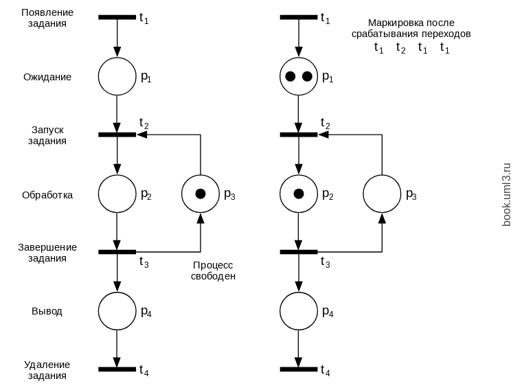

---

title: "Спецификация вариантов использования, сценарии и диаграмма деятельности"

---

# Quick recap

На прошлой лекции мы разобрали понятие информационной системы, увидели, что программное обеспечение само по себе не является информационной системой, но является её частью, и разобрали различные уровни архитектуры ИС. Также мы изучили основные способы выявления требований и их формализации в виде диаграммы использования в нотации UML.

Диаграмма использования сама по себе показывает нам только то, что в целом требуется от системы, но не показывает, каким образом будет достигаться то или иное функциональное требование, поэтому наша задача на сегодня — посмотреть, каким образом можно уточнить тот или иной вариант использования с помощью диаграммы деятельности.

Между диаграммой использования и диаграммой деятельности нужен промежуточный текстовый артефакт — спецификация варианта использования. Без него activity diagram часто превращается в произвольную блок-схему: непонятно, какой use case она раскрывает, какие альтернативы допустимы и какие бизнес-правила управляют процессом.

# Спецификация варианта использования

Диаграмма использования слишком компактна: она показывает, какие результаты система должна предоставить актору, но не показывает порядок действий, альтернативы, ошибки, предусловия и постусловия. Всё это фиксируется в спецификации use case.

Минимальный шаблон спецификации:

| Поле | Содержание |
| --- | --- |
| Название | глагол с дополнением, совпадает с названием use case |
| Цель | какой значимый результат получает актор или стейкхолдер |
| Основной актор | кто инициирует сценарий или получает основной результат |
| Заинтересованные лица | кому важен результат сценария |
| Триггер | событие, запускающее сценарий |
| Предусловия | что должно быть истинно до начала сценария |
| Основной сценарий | успешная последовательность шагов |
| Альтернативные сценарии | допустимые варианты внутри процесса |
| Исключительные сценарии | ошибки и нештатные ситуации |
| Постусловия | что становится истинным после успешного завершения |
| Минимальные гарантии | что система обязана сохранить даже при ошибке |
| Связанные требования | какие требования покрывает use case |
| Связанные бизнес-правила | какие правила ограничивают сценарий |

Основной поток описывает успешный сценарий. Альтернативный поток описывает допустимый вариант достижения результата. Исключительный поток описывает ошибку или ситуацию, когда результат не достигается полностью.

# AS-IS и TO-BE

Перед построением диаграммы деятельности полезно разделить текущий и целевой процесс.

**AS-IS** описывает, как процесс выполняется сейчас: вручную, в старой системе, через таблицы, документы, звонки или внешние сервисы. Здесь важно найти проблемы текущего процесса, а не просто переписать его шаги.

**TO-BE** описывает, как процесс должен выполняться после внедрения проектируемой ИС. Здесь фиксируется, какие шаги автоматизируются, какие остаются ручными, какие новые данные появляются и какие внешние взаимодействия меняются.

Это разделение помогает не моделировать “как есть” как будто это уже проектное решение. Иногда текущий процесс нужно сохранить, иногда изменить, а иногда убрать лишний ручной шаг за счёт новой функции системы.

# Структурное проектирование

Перед тем, как продолжить разговор про проектирование, нужно в целом обсудить, какие есть методы проектирования. Мы будем понемногу затрагивать различные способы в том контексте, в котором они будут наиболее уместны.

Самый классический вариант — это **структурное проектирование**. Как следует из названия, в основе подхода лежит выделение определённой структуры решаемой задачи и её последующая декомпозиция.

:::tip[Определение]
**Декомпозиция** — процесс разделения задачи на несколько более простых и независимых друг от друга подзадач.

:::

Структурное проектирование подразумевает, что у нас есть три типа базовых конструкций, которые мы можем вкладывать друг в друга произвольным образом:

- Последовательное исполнение;
- Ветвление;
- Цикл.

Проектирование при этом необязательно подразумевает работу непосредственно с программной реализацией, можно (и нужно) моделировать и проектировать процессы информационной системы.

Структурное проектирование в свою очередь можно разделить на три подхода:

- Нисходящее проектирование (сверху вниз);
- Восходящее проектирование (снизу вверх);
- Проектирование вширь.

Под **нисходящим проектированием** подразумевается непосредственное применение декомпозиции. Она повторяется до тех пор, пока не будет получен набор подзадач, разработка которых будет очевидной, этот процесс называется **пошаговой детализацией**. Если говорить с точки зрения кода, то мы описываем решаемую задачу в виде набора вызовов функций-заглушек, которые будут реализованы позже. При этом во время реализации заглушек высокого уровня можно применять новые функции-заглушки более низкого уровня.

**Восходящее проектирование** работает от обратного: мы определяем набор базовых подзадач и из них пытаемся собрать задачи более высокого уровня до тех пор, пока не сможем выполнить исходную задачу. Тут, скорее всего, переложить пример на код проще :)

**Проектирование вширь** работает немного иначе: мы применяем пошаговую детализацию для одного конкретного сценария использования (чаще всего это успешный сценарий) и далее уточняем крайние случаи.

На практике эти подходы применяются вместе в той или иной пропорции. Например, проектирование вширь применяется непосредственно при моделировании процессов ИС, а нисходящее проектирование — при реализации этих процессов в виде компонентов ПО.

# Сети Петри

Дальше пойдёт ещё одно лирическое отступление, которое дальше поможет нам в формализации выполнения диаграмм деятельности. Формально диаграмма деятельности строится на математическом аппарате сетей Петри.

:::tip[Определение]
**Сеть Петри** — это общепринятый формализм, используемый при постановке и решении различных задач параллельных вычислений.

:::

Есть множество вариаций сетей Петри, однако мы рассмотрим самый простой вариант. В этом варианте сеть Петри — это ориентированный двудольный мультиграф с вершинами двух видов: позициями и переходами. Позиции обычно обозначаются кружочком, а переходы — чёрточками.

Для сети Петри определяется понятие **маркировки**, которая сопоставляет каждой позиции неотрицательное число. Визуально маркировка — это метки внутри позиций.

У каждого перехода может быть несколько входных позиций (из которых дуги ведут в переход) и несколько выходных позиций (в которые ведут дуги из перехода). Переход называется **разрешённым**, если все его входные позиции не пусты; любой разрешённый переход может **сработать**. В результате срабатывания перехода маркировка всех входных позиций уменьшается на 1, а маркировка всех выходных позиций увеличивается на 1. На диаграмме количество маркеров во входных позициях уменьшается, а в выходных — увеличивается. В результате срабатывания перехода маркировка сети Петри изменяется: некоторые переходы могут стать разрешенными или, наоборот, перестать быть таковыми.

В качестве самостоятельного упражнения можно разобрать работу следующей сети Петри:

Пример сети Петри

# Диаграмма деятельности

Теперь в целом можно перейти непосредственно к диаграммам деятельности 🙂 Как было сказано ранее, диаграмма деятельности помогает нам показать способ реализации того или иного варианта использования. Так как с точки зрения семантики диаграмма использования никак не показывает нам алгоритм, который приводит к нужному результату, то таких алгоритмов (и соответствующих диаграмм деятельности) может быть несколько, но на практике есть ровно один способ что-то сделать.

Формально диаграмма деятельности — это граф деятельности.

:::tip[Определение]
Синтаксически **граф деятельности** — это ориентированный граф узлов и рёбер. В нём используются исполняемые узлы, узлы управления и узлы объектов, а рёбра задают потоки управления или объектные потоки.

Семантически **граф деятельности** описывает выполнение поведения через передачу токенов между узлами деятельности.

:::

## Узлы действий и поток управления

В идеале стоит различать понятия **деятельности** и **действия**.

:::tip[Определение]
**Действие** —  атомарный процесс без какой-либо внутренней структуры.

**Деятельность** — продолжительный процесс, который можно раскрыть подробнее на отдельной диаграмме деятельности.

:::

И действие, и вызов другой деятельности изображаются прямоугольником со скруглёнными краями. Если действие вызывает отдельную деятельность, внутри символа действия может ставиться rake-значок (“трезубец”): он показывает, что за этим узлом стоит отдельная детализированная activity diagram. При моделировании простых процессов обычно такой потребности нет.

При этом речь идёт об исполняемых узлах деятельности. Эти узлы соединяются рёбрами, которые могут задавать **поток управления**.

Действие

Деятельность

Кроме действия и деятельности, существуют действия **посылки и приёма сигнала**. Они обозначаются пятиугольниками. Сам по себе **сигнал** — это классификатор, который показывает, какая информация отправляется и/или принимается. Обычно сигнал показывает коммуникацию с внешним миром, однако не является нарушением отправлять и принимать один и тот же сигнал в рамках одной диаграммы.

Посылка сигнала

Приём сигнала

Ещё одним узлом действия является **срабатывание по таймеру**. Необязательно срабатывание происходит именно по таймеру, это может быть срабатывание в какой-то заданный момент времени или срабатывание по событию (хотя в этом случае лучше использовать сигналы).

Таймер срабатывает каждый час, пока используется содержащая его деятельность

Для простоты восприятия, как и в сетях Петри, можно представить, что по графу деятельности также перемещаются метки, такие метки называются **метками (или маркерами) управления** (далее мы рассмотрим ещё один тип меток). На диаграмме эти метки никак не отображаются, но позволяют “выполнить” её.

## Узлы управления

Вместе с исполняемыми узлами на диаграмме деятельности часто применяется набор **узлов управления**, которые управляют маршрутизацией токенов по графу деятельности. С точки зрения сетей Петри эти узлы можно условно сравнивать с переходами, но в UML это именно разновидности узлов деятельности, а не классификаторы.

Есть три узла, отвечающих за начало и завершение деятельности.

Первый узел — это **начальный узел**. Если на диаграмме нет приёма сигнала, то начальный узел необходим для начала деятельности. Чисто технически на диаграмме может быть несколько начальных узлов, в таком случае при старте деятельности она начинается параллельно в разных местах.

Начальный узел

**Завершающий узел (или конечный узел деятельности)** показывает, что завершается вся деятельность, даже если есть несколько параллельных потоков управления, все они завершаются. На диаграмме может быть несколько конечных узлов в разных местах, и каждый из них завершит деятельность.

Завершающий узел

В UML 2 появился **конечный узел потока**. Он показывает, что в данном месте завершается один поток, но не вся деятельность.

Конечный узел

Для работы с условиями также существует несколько узлов управления.

**Разветвление управления** показывает место, в котором маркер управления пойдёт строго по одной из исходящих дуг. На всех исходящих дугах необходимо указать **защитное условие**, выполнение которого позволит маркеру управления пойти именно по тому или иному переходу. Защитное условие указывается в квадратных скобках.

Разветвление управления с двумя вариантами

:::note[Важно]
Обратите внимание, что все защитные условия должны быть взаимоисключающими, в противном случае выбор конкретного перехода будет случайным.

:::

**Объединение управления**, в свою очередь, показывает место, где разветвление сливается в один поток управления.

Объединение управления

Есть механизмы параллельного выполнения действий.

**Развилка управления** показывает место разделения одного потока управления на несколько. При необходимости некоторые параллельные потоки можно завершить, не трогая остальные, с помощью конечного узла потока (см. выше).

Развилка потока управления на три

**Слияние управления** показывает место слияние нескольких потоков управления в один. По умолчанию слияние управления дожидается, пока выполнятся все параллельные потоки, и только потом передаёт управление дальше, в каком-то смысле это барьерная синхронизация.

Слияние трёх потоков управления в один

UML 2 позволяет соединить узлы объединения и разветвления управления в один комбинированный узел. Такая же схема работает и для узлов слияния и развилки управления.

Формально узлы управления задают способ обработки маркеров управления:

1. Начальное состояние создает один маркер управления и все исходящие дуги готовы передать этот маркер.
2. Если единственная входящая дуга развилки готова передать маркер (управления или данных), то все исходящие дуги готовы одновременно (параллельно) передать копии этого маркера. Развилка создает параллельные потоки.
3. Если все входящие дуги слияния готовы передать маркеры (управления или данных), то исходящая дуга готова передать маркер управления. Слияние обеспечивает синхронизацию потоков.
4. Если единственная входящая дуга разветвления готова передать маркер (управления или данных), то те исходящие дуги разветвления, на которых сторожевые условия выполняются, готовы передать этот маркер.
5. Если любая входящая дуга соединения готова передать маркер (управления или данных), то единственная исходящая дуга соединения готова передать этот маркер.
6. Если хотя бы одна входящая дуга заключительного состояния потока готова передать маркер, то заключительное состояние потока поглощает этот маркер.
7. Если хотя бы одна входящая дуга заключительного состояния деятельности готова передать маркер, то заключительное состояние деятельности поглощает все маркеры управления и все маркеры данных, завершая, тем самым, выполнение деятельности.

В случае, если дуга на диаграмме какая-то дуга выглядит слишком длинной, её можно разделить с помощью **коннектора**. Коннектор не несёт дополнительной информации для самой модели, при этом с одним названием должна быть ровно одна пара коннекторов, в один из которых дуга входит, а из другого она выходит.

Пример коннектора между двумя действиями

## Узлы объектов и объектный поток

Диаграмма деятельности часто показывает не только алгоритм, но и данные, которые используются в ходе работы алгоритма. Если управляющий токен показывает ход выполнения деятельности, то **объектный токен** переносит значение. Соответственно, рёбра с перемещением объектов формируют **объектный поток**. В UML управляющие и объектные токены различаются, поэтому поток управления и объектный поток имеют разную семантику, хотя на учебных диаграммах их иногда визуально совмещают.

Для работы с метками данных используются отдельные сущности, **узлы объектов:**

- **Контакт**: аргумент или результат действия. Контакт указывается на границе действия в виде квадрата.
- **Параметр деятельности**: контакт, который является параметром всей деятельности и указывается на границе рамки деятельности.
- **Центральный буфер**: узел, позволяющий перенаправить объекты между разными потоками объектов. Изображается в виде объекта со стереотипом `centralBuffer`.
- **Хранилище данных**: узел, позволяющий перезаписывать хранящуюся метку данных и после считывать её неограниченное количество раз. Изображается в виде объекта со стереотипом `datastore`.

Отдельный объект

Входной контакт

Выходной контакт

Хранилище данных

Для узлов объектов, как и для узлов управления, определены правила выполнения:

1. Параметр деятельности создает один маркер данных и все исходящие дуги готовы передать этот маркер.
2. Хранилище данных поглощает один маркер данных и создает неограниченное количество его копий. Все выходные дуги хранилища всегда готовы передать копию хранимого маркера данных.
3. Центральный буфер перенаправляет маркеры данных, не создавая и не поглощая их. Как только входная любая входная дуга готова передать маркер, все выходные дуги готовы передать этот маркер.
4. Входной контакт действия поглощает маркер данных.
5. Выходной контакт действия создает маркер данных.

## Разбиения

Для упрощения восприятия на диаграмме деятельности можно использовать так называемые разбиения (или дорожки). **Разбиение** представляет собой разбиение множества действий именно в математическом смысле: каждое действие принадлежит одной дорожке.

Вертикальное разбиение

Горизонтальное разбиение

С точки зрения UML каждая дорожка обычно показывает определённый классификатор, чаще всего действующее лицо, но никаких ограничений на это нет. Разбиения могут быть вертикальными и горизонтальными, разницы нет. При необходимости разбиения действия по двум группам классификаторов (например, по действующему лицу и по способу обработки) разбиение может быть и горизонтальным, и вертикальным.

## **Структурированный** узел деятельности

**Структурированный узел деятельности** позволяет выделить некоторую часть диаграммы и сделать для этой части общий набор входных и выходных контактов. Структурированный узел выделяется пунктирной рамкой со скруглёнными углами и ключевым словом `«structured»`.

Частным случаем структурированного узла деятельности является **expansion region**. В русскоязычной литературе этот тип отдельно не рассматривается (по крайней мере, переводов найдено не было), но бывает крайне полезен, поскольку он позволяет явно показать, что часть операций над объектами выполняется в цикле либо последовательно (iterative), либо параллельно (parallel), либо конвейерно (stream).

Expansion region с последовательной обработкой объектов

## Прерывания и исключения

Часто процессы предполагают наличие каких-то внештатных ситуаций, которые также нужно обработать (например, во время перевода сотрудника на другую должность он решает отказаться от перевода). В таком случае необходимо прервать стандартный поток управления и обработать внештатную ситуацию. Для этого в UML предусмотрена область прерывания.

**Область прерывания** — это структурированный узел, внутри которого возможно прерывание стандартного порядка действий при наступлении какого-то события. Исключительная ситуация соединяется с обработчиком с помощью **потока прерывания**. Это, по сути, частный случай объектного потока, который передаёт в обработчик информацию, необходимую для обработки исключения.

Область прерывания с обработкой

Если исключение возникло в структурированном узле, который возвращает какие-то данные (например, expansion region), то обработчик должен вернуть значение того же типа, что и выходное значение узла деятельности.

# Что дальше?

После описания процессов в виде диаграмм деятельности естественным образом появляется некоторый набор объектов, с которыми они работают. Эти объекты естественным образом поднимают вопрос, с какими в целом данными работает информационная система. В этом месте происходит плавный переход от функциональной архитектуры ИС к информационной и, как мы увидим на следующей лекции, к программной. Оба уровня архитектуры можно показать с помощью диаграммы классов.
