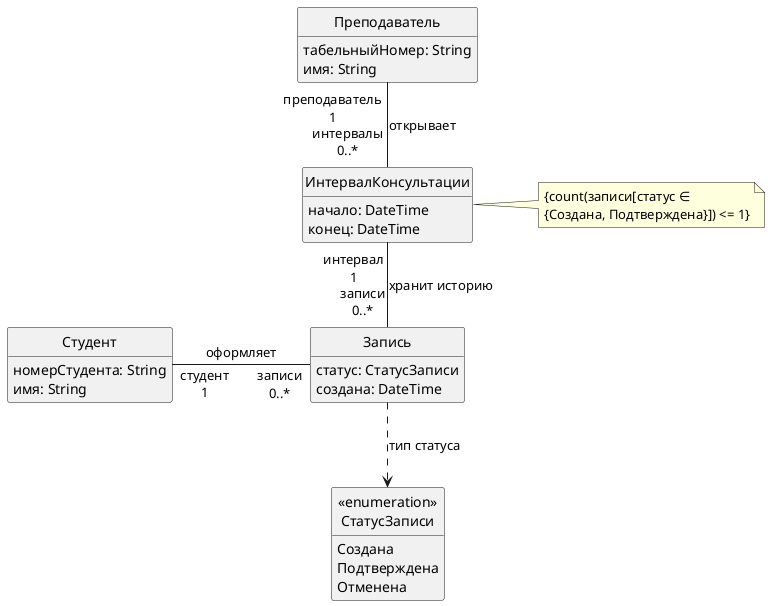
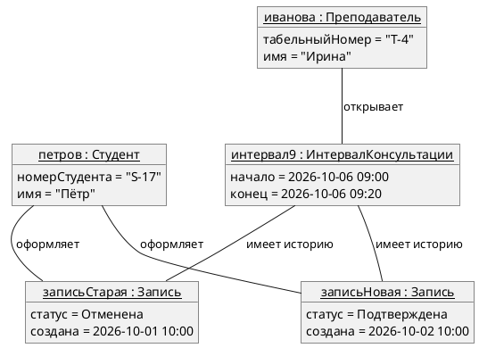

## Материалы лекции

[Предметная область и словарь](/modelling/domain-and-vocabulary), [Методы выделения классов](/modelling/class-identification-methods), [Объекты предметной области](/modelling/domain-objects), [Концептуальная модель](/modelling/conceptual-model), [Концептуальная диаграмма классов](/notation/conceptual-class-diagrams), [Диаграмма объектов](/notation/object-diagrams), [Объектно-ориентированное проектирование](/modelling/object-oriented-design), [Концептуальная и техническая модель](/modelling/conceptual-vs-technical-model).

## Развёрнутый тезисный план

| Время | Тезисы и действие преподавателя                                                                                      |
| ----- | -------------------------------------------------------------------------------------------------------------------- |
| 0–20  | Ввести предметную область и общий язык; разобрать кандидатов по Абботу, именным группам, шаблонным категориям и CRC. |
| 20–35 | Начать диаграмму примера: объяснить класс, экземпляр, секции прямоугольника, атрибуты, операции и видимость.         |
| 35–50 | Соединить классы: прочитать ассоциации, роли, кратности и навигацию в обе стороны.                                   |
| 50–65 | Проверить выбор отношений; добавить перечисление и ограничение активной записи.                                      |
| 65–85 | Построить допустимый и недопустимый объектные снимки; проверить кратности, историю и правило состояния.              |
| 85–90 | Подвести итог и провести границу с технической моделью следующей лекции.                                             |

Это рабочий план занятия с объяснением и построением модели, а не оценка времени
прочтения текста. Вопросы разбираются при появлении соответствующего элемента;
фактическую длительность показа нужно проверить репетицией.

## Полный материал лекции

### Компактная теория: от слов к предметным понятиям

:::tip[Определение]{icon="starlight"}
**Предметная область** — часть реальности, которую поддерживает ИС. **Концептуальная модель** фиксирует её понятия, связи и правила без таблиц, API, контроллеров и классов реализации.
:::

Словарь согласует язык эксперта, аналитика и разработчика: фиксирует название, определение, синонимы, источник и связанные правила. Не каждое слово становится классом: возможны атрибут, состояние, событие, роль или действие.

Для сквозного случая примем один язык:

| Термин                | Согласованное значение                                              | Роль в модели               |
| --------------------- | ------------------------------------------------------------------- | --------------------------- |
| Студент               | участник, который бронирует время консультации                      | класс                       |
| Преподаватель         | участник, открывающий время консультации                            | класс                       |
| Интервал консультации | время, открытое преподавателем для записи                           | класс                       |
| Запись                | бронирование студентом одного интервала с жизненным циклом          | класс                       |
| Активная запись       | запись в состоянии `Создана` или `Подтверждена`                     | условие, не отдельный класс |
| Отмена                | перевод записи в состояние `Отменена`; запись сохраняется в истории | операция и состояние        |

Спорные слова нужно развести. Здесь «консультация» — встреча, а «интервал консультации» — доступное для бронирования время. «Свободный интервал» не является отдельным классом: это следствие отсутствия активной записи.

### Методы выделения кандидатов

Кандидат — понятие, которое нужно проверить, а не готовый класс. Сначала
собираем кандидатов, затем выбираем их роль: класс, свойство, связь, состояние
или правило.

Все методы разберём на одном фрагменте требований; по нему затем построим диаграмму:

> Преподаватель открывает интервалы консультации. Студент бронирует один интервал. Интервал хранит историю бронирований, но одновременно может иметь не более одной активной записи. Активны состояния «Создана» и «Подтверждена»; отменённая запись остаётся в истории. После сохранения записи система пытается уведомить участников. Ошибка уведомления не отменяет сохранённую запись.

#### Метод Аббота: от грамматики к гипотезам

Метод Аббота использует грамматическую структуру описания. **Существительные**
подсказывают объекты и их свойства; **глаголы** — действия и отношения;
**прилагательные и обороты с условиями** — признаки, состояния и ограничения.
Это подсказки для анализа, а не правила автоматического преобразования в UML.

Порядок работы:

1. **Выбрать связный фрагмент требований** с понятными участниками, результатом
   и границей задачи: кто бронирует интервал и когда бронирование допустимо?
2. **Выписать существительные с контекстом:** `Студент`, `Преподаватель`,
   «интервал консультации», «история бронирований», «активная запись»,
   «уведомление». Спорные слова пока не отбрасываем.
3. **Нормализовать названия:** единственное число, имя из словаря, объединение
   синонимов. «Бронь» и «запись» не дают два класса, если обозначают один факт.
4. **Разобрать глаголы:** «открывает» — связь преподавателя с интервалом,
   «бронирует» — создание записи, «остаётся» — сохранение истории.
   Не каждый глагол становится методом программного класса.
5. **Выписать признаки и условия:** «активная» требует определить статусы;
   «не более одной одновременно» — ограничение записей одного интервала,
   а не атрибут `неБолееОдной`.
6. **Записать гипотезу и вопрос:** «история — отдельный объект или множество
   сохранённых записей?». Решение определяется смыслом, а не частью речи.

| Фрагмент                                | Что он подсказывает                               | Что проверить                                                     |
| --------------------------------------- | ------------------------------------------------- | ----------------------------------------------------------------- |
| «Студент бронирует один интервал»       | студент, интервал, факт бронирования              | как отличить одно бронирование от другого и кому оно принадлежит? |
| «Преподаватель открывает интервалы»     | преподаватель и связь с интервалами               | кто владелец конкретного интервала?                               |
| «История бронирований»                  | сохранённые записи или отдельная история          | требуется ли что-то сверх самих записей?                          |
| «Активная запись»                       | запись и условие её активности                    | какие значения статуса считаются активными?                       |
| «Ошибка уведомления не отменяет запись» | независимость результата бронирования от доставки | какие факты должны сохраниться при ошибке?                        |

**Ограничение метода:** важное понятие может не быть названо существительным.
Во фразе «студент бронирует интервал» нет слова «запись», но подтверждение,
отмена и сохранение истории выявляют жизненный цикл бронирования — основание
выделить `Запись`. Напротив, «история» здесь выражается множеством сохранённых
записей и не требует отдельного класса.

#### Метод именных групп: уточнить границы понятия

Именная группа — сочетание существительного с зависимыми словами:
«интервал консультации», «статус записи», «владелец интервала».
Метод помогает не потерять смысл сочетания при разборе отдельных слов.

1. **Найти устойчивое сочетание целиком.** «Интервал консультации» точнее,
   чем абстрактный `Интервал`: эксперт понимает, какое время можно бронировать.
2. **Выяснить, что обозначает главное слово и как его уточняют остальные.**
   В «статусе записи» речь о значении свойства конкретной записи;
   во «владельце интервала» — об участии преподавателя в отношении.
3. **Проверить сочетание на примере экземпляра.** У интервала есть начало,
   конец и владелец; статус — значение у записи; владелец — уже существующий
   преподаватель. Поэтому из трёх сочетаний не получаются три новых класса.
4. **Согласовать имя и синонимы в словаре.** Если «слот», «окно» и «интервал
   консультации» обозначают одно понятие, выбираем одно имя для диаграммы.

**Ошибка:** превращать каждое сочетание в класс или, наоборот, всегда оставлять
только первое существительное. `СтатусЗаписи` здесь удобен как перечисление,
а «владелец интервала» — как роль у конца ассоциации с `Преподавателем`.
Выбор определяется смыслом и правилами, а не количеством слов.

#### Метод шаблонных классов: проверить полноту списка

Здесь **шаблон** — типовая категория предметных понятий, а не паттерн
программного проектирования. Проходим по категориям и задаём вопросы эксперту.
Метод особенно полезен, если исходное описание короткое и не называет
очевидные для участников объекты.

| Категория                   | Вопрос для поиска                                                 | Проверка на примере консультаций                                                               |
| --------------------------- | ----------------------------------------------------------------- | ---------------------------------------------------------------------------------------------- |
| Люди и роли                 | кто участвует и чем различаются его обязанности?                  | `Студент` бронирует, `Преподаватель` открывает интервалы                                       |
| Организации                 | чьи регламенты или полномочия влияют на работу?                   | факультет станет кандидатом, если от него зависят правила записи; сейчас такого требования нет |
| Сделки и документы          | какой результат нужно различать, изменять и сохранять?            | `Запись` фиксирует бронирование и сохраняется после отмены                                     |
| События и интервалы времени | что происходит в определённый момент или имеет временные границы? | `ИнтервалКонсультации` имеет начало и конец; отмена пока выражается изменением статуса записи  |
| Места и устройства          | важно ли, где и с помощью чего выполняется работа?                | аудитория нужна, если проверяем место встречи; браузер не становится предметным классом        |
| Справочники и состояния     | какие значения выбираются из устойчивого набора?                  | `СтатусЗаписи` — перечисление, а не отдельный объект для каждого статуса                       |
| Соглашения и правила        | какие обязательства и ограничения связывают участников?           | «не более одной активной записи» — ограничение интервала, не новый класс                       |

**Категория не обязывает добавлять класс:** нужны источник и смысл в выбранной
задаче, а не просто существование факультета, аудитории или устройства.
Например, подтверждение с собственным номером и содержимым станет кандидатом
при соответствующем требовании. Здесь его нет — `ДокументПодтверждения`
ради заполнения категории не добавляем.

#### CRC-карточки: проверить ответственность и взаимодействия

**CRC** — Class, Responsibilities, Collaborators: класс, его ответственности
и взаимодействующие классы. Карточка не является перечнем полей или методов.
Она объясняет, **что объект должен знать или обеспечивать** и **с какими
предметными объектами это связано**.

Порядок работы:

1. Выбрать кандидат и записать его имя из словаря.
2. Сформулировать ответственности предметными фразами: «знать свой интервал»,
   «сохранять статус», «не терять запись после отмены», а не `save()` или
   «выполнить SQL».
3. Для каждой ответственности определить, чьи сведения или участие нужны.
   Это и есть collaborators; в карточке `Запись` ими будут `Студент`
   и `ИнтервалКонсультации`, а не аналитик и разработчик.
4. Пройти сценарий по карточкам и найти потерянную или лишнюю ответственность.
   При отмене меняется состояние записи, но сама запись остаётся связанной
   со студентом и интервалом.

Проверим более трудный вопрос: **кто знает, занят ли интервал?** Одна запись
знает собственный статус, но не статусы остальных записей. Для ответа нужны
записи данного интервала и правило активности. Так CRC обнаруживает,
что проверку единственности нельзя объяснить только карточкой `Запись`.
В концептуальной модели фиксируем правило интервала; как обеспечить его
атомарно при одновременных запросах, решаем позже в технической модели.

**Признаки проблемы:** карточка лишь повторяет имя; объединяет бронирование,
SQL, вход и доставку писем; либо при проигрывании сценария некому обеспечить
правило. Уточняем кандидат или ответственности, не добавляя класс механически.
Понятие со значимыми данными тоже может быть нужно: программные методы
у каждого концептуального класса не обязательны.

#### От сырого списка к решениям

Методы дополняют друг друга: Аббот даёт стартовые гипотезы, именные группы
уточняют названия и границы понятий, шаблонные категории выявляют пропуски,
CRC проверяет ответственности на сценарии. Ни один метод не выдаёт готовую модель.

Для каждого кандидата задаём вопросы:

- **Что обозначает кандидат и откуда взят?** Указываем фразу, правило,
  сценарий или объяснение эксперта.
- **Нужно ли различать экземпляры?** Две записи с одинаковым статусом могут
  обозначать разные бронирования. Идентичность ещё не требует технического `id`.
- **Есть ли значимые данные, связи, жизненный цикл или правила?** Это аргументы,
  а не признаки, обязательные одновременно для каждого кандидата.
- **Не является ли он свойством, ролью, состоянием или вычисляемым условием?**
  «Свободный» вычисляется по активным записям.
- **Не дублирует ли другое понятие?** «Бронь» и «запись» сверяем по словарю.
- **Входит ли в границу модели?** `Repository`, таблица и HTTP — реализация.
  Уведомление может быть предметным объектом для учёта получателей, попыток
  и результатов доставки. Здесь моделируем допустимость бронирования,
  а не учёт доставки.

Зафиксируем решения с причинами, чтобы отбор можно было объяснить и пересмотреть
при изменении требований:

| Кандидат из текста                 | Решение                          | Причина                                                                                   |
| ---------------------------------- | -------------------------------- | ----------------------------------------------------------------------------------------- |
| Студент                            | принять как класс                | бронирует, обладает идентичностью, участвует в правиле                                    |
| Преподаватель                      | принять как класс                | открывает интервалы                                                                       |
| Интервал консультации              | принять как класс                | имеет владельца и участвует в ограничении записи                                          |
| Запись                             | принять как класс                | хранит студента, интервал и состояние; отмена оставляет историю                           |
| Статус записи                      | принять как перечисление-атрибут | закрытый набор состояний записи                                                           |
| Свободный                          | отклонить как класс              | вычисляемое условие, а не самостоятельный объект                                          |
| Уведомление                        | не включать в эту модель         | доставка не меняет сохранённое бронирование; учёт доставки не входит в вопрос этой модели |
| База данных / таблица / Repository | отклонить                        | технические средства реализации                                                           |

### Концептуальная модель: что в ней проверяется

Концептуальная диаграмма отвечает на вопросы «какие типы объектов важны?», «как связаны их экземпляры?» и «какие конфигурации допустимы?». Каждое обозначение будем вводить, когда оно потребуется для выражения требования.

CRC и объектная проверка дополняют диаграмму: CRC отвечает за распределение ответственности, а диаграмма объектов показывает один допустимый либо недопустимый момент времени. Диаграмма объектов не показывает переходы во времени; их описывают [диаграммы состояний](/notation/state-machine-diagrams).

### Обязательная демонстрация: модель записи на консультацию

Построим диаграмму для разобранных требований, затем проверим её на экземплярах.

#### Шаг 1. Разобрать текст и собрать минимальный набор

Из таблицы отбора берём `Студент`, `Преподаватель`, `ИнтервалКонсультации`, `Запись`. История выражается сохранёнными записями, активность — условием по статусу; для статуса добавим перечисление. Причину добавления каждого класса уже зафиксировали при отборе.

Заполненная CRC-карточка проверяет центральный кандидат:

| CRC: `Запись`         | Содержание                                                                                                                             |
| --------------------- | -------------------------------------------------------------------------------------------------------------------------------------- |
| Ответственности       | хранить ссылку на единственного студента и единственный интервал; хранить `статус`; переходить в `Отменена`, сохраняя запись в истории |
| Взаимодействует с     | `Студент`, `ИнтервалКонсультации`                                                                                                      |
| Не её ответственность | выбирать транспорт уведомления, выполнять SQL или обращаться к внешней идентификации                                                   |

#### Шаг 2. Нарисовать классы и выбрать их свойства

Начнём с утверждения «студент бронирует интервал». На диаграмме появятся
прямоугольники `Студент`, `ИнтервалКонсультации` и `Запись`; для владельца
интервала добавим `Преподаватель`.

**Класс** описывает множество объектов с общими свойствами и поведением.
Прямоугольник `Студент` — тип участников, а конкретный Пётр — его **экземпляр**.
На объектном снимке он будет обозначен `петров : Студент` с конкретными
значениями свойств.

Прямоугольник класса может иметь три секции: имя, атрибуты, операции.
Секции с признаками можно не показывать, если они не нужны для вопроса диаграммы.
Это не утверждение, что у класса вообще нет свойств или поведения.

У `ИнтервалКонсультации` добавим `начало: DateTime` и `конец: DateTime`,
у `Запись` — `создана: DateTime` и `статус: СтатусЗаписи`.
**Атрибут** описывает значение, характеризующее экземпляр. В записи
`начало: DateTime` до двоеточия стоит имя свойства, после — его тип.
У конкретного интервала вместо имени типа будет значение, например дата
и время начала. Здесь тип означает вид предметного значения, не тип столбца SQL.

Почему `создана` — атрибут, а студент — отдельный класс? Время создания —
значение; студент обладает идентичностью и участвует в связях.
Строка `имяСтудента` не различит тёзок. Поэтому используем ассоциацию,
не дублируя её техническим `studentId`.

Теперь посмотрим, что означала бы нижняя секция `Запись`.
**Операция** задаёт доступное поведение; например, запись
`отменить(): Boolean` означала бы операцию без параметров с результатом типа
`Boolean`. Метод — реализация операции, а не сама её сигнатура.
В нашей концептуальной диаграмме операции пока опустим: ответственность за отмену
уже обсуждена в CRC, а детали программного контракта относятся к следующей лекции.

Если перед признаком написан знак, он обозначает видимость:
`+` — общедоступная, `-` — закрытая, `#` — защищённая, `~` — в пределах пакета.
Например, `- статус: СтатусЗаписи` в технической модели означал бы закрытый
атрибут. В текущем предметном примере знаки видимости не ставим: способ
доступа из программы ещё не выбран. Отсутствие знака не означает `public`.

#### Шаг 3. Соединить экземпляры по смыслу требований

Проведём сплошную линию между `Студент` и `Запись` и назовём связь «оформляет».
Это **ассоциация**: она описывает допустимые связи экземпляров двух классов.
Конкретный Пётр может быть связан с конкретными записями. Линия не означает
вызов метода, обмен сообщениями или порядок выполнения действий.

У конца рядом со `Студент` поставим роль `студент` и кратность `1`,
рядом с `Запись` — роль `записи` и кратность `0..*`.
**Роль** называет участие объекта на этом конце связи; это не название действия.
**Кратность** отвечает, сколько экземпляров на данном конце допустимо
для одного экземпляра на противоположном конце.

Прочитаем одну связь в обе стороны:

- У одной `Запись` ровно один `Студент`. Это число `1` рядом со студентом,
  а не рядом с записью.
- У одного `Студент` может быть ноль, одна или много записей. Это `0..*`
  рядом с записью; новая запись не обязана уже существовать у каждого студента.

Теперь добавим связь `ИнтервалКонсультации — Запись` с ролями `интервал`
и `записи`. Снова получим `1` у интервала и `0..*` у записи.
Интервал хранит историю, поэтому отменённые записи не удаляются.
Кратность `0..1` здесь запретила бы вторую запись вообще, даже если первая
давно отменена. Правило об одной **активной** записи выразим отдельно.

По тому же принципу свяжем `Преподаватель` и `ИнтервалКонсультации`:
у интервала один преподаватель, у преподавателя `0..*` открытых интервалов.

| Кратность      | Как прочитать у конца ассоциации |
| -------------- | -------------------------------- |
| `1`            | ровно один связанный экземпляр   |
| `0..1`         | ни одного или один               |
| `0..*` или `*` | любое число, включая ноль        |
| `1..*`         | хотя бы один                     |

Например, замена `0..*` на `1..*` у записей студента утверждала бы,
что каждый студент уже обязан иметь хотя бы одну запись. Такого требования нет.
Кратности выводят из правил, а не из того, сколько объектов удобно нарисовать.

Если важно указать возможность перехода от записи к студенту, на конце
у студента можно показать стрелку **навигации**. Она означает доступность
связанного объекта в этом направлении, а не то, что запись отправляет студенту
сообщение. В данном концептуальном примере навигацию не уточняем;
отсутствие стрелок само по себе не утверждает двустороннюю навигацию.
Маленькая стрелка возле названия ассоциации, если она используется,
задаёт только направление чтения подписи, а не навигацию.

#### Шаг 4. Проверить, не требуется ли другой вид отношения

Возьмём уже построенную связь `Студент — Запись` и попробуем заменить линию:

- **Обобщение** показывают сплошной линией с незакрашенным треугольником
  у общего класса. Оно утверждало бы «запись является видом студента» —
  это неверно. Обобщение могло бы связать `Студент` с более общим `Участник`,
  если такая классификация нужна предметной модели. Общие поля сами по себе
  не являются достаточной причиной вводить иерархию.
- **Композиция** — сплошная линия с закрашенным ромбом у целого.
  Часть одновременно включена не более чем в одно композиционное целое;
  целое отвечает за её существование, а при его уничтожении уничтожаются
  и остающиеся в нём части. Если поставить ромб у студента, пришлось бы
  обосновать такую зависимость существования записи. В нашем примере история
  не должна исчезать автоматически вместе со студентом или интервалом,
  поэтому используем обычные ассоциации.
- **Разделяемая агрегация** обозначается незакрашенным ромбом у целого.
  Она не задаёт той же зависимости существования, что композиция;
  без дополнительных правил её смысл слаб. Фразы «у студента есть записи»
  недостаточно, чтобы заменить ассоциацию ромбом.

Самостоятельный класс `Запись` тоже выбран не ради усложнения рисунка:
у бронирования есть время создания, статус и история. Если оставить только
линию `Студент — ИнтервалКонсультации`, станет неясно, к какому именно
бронированию относятся эти значения.

#### Шаг 5. Добавить тип статуса и ограничение интервала

Для `статус` нужен закрытый набор значений: `Создана`, `Подтверждена`, `Отменена`.
Покажем **перечисление** отдельным прямоугольником с ключевым словом
`«enumeration»` и списком литералов. `СтатусЗаписи` — тип значения атрибута,
а не ещё один участник, которому запись отправляет сообщение.

На итоговом рисунке пунктирная стрелка от `Запись` к `СтатусЗаписи`
показывает **зависимость**: описание записи использует этот тип.
Стрелка направлена от зависимого элемента к поставщику.
В отличие от ассоциации она не утверждает связи двух самостоятельных
предметных объектов. Сам тип уже указан у атрибута; стрелка лишь делает
эту зависимость видимой на рисунке.

Осталось требование «не более одной активной записи одновременно».
У интервала оставим историческую кратность `0..*`, а рядом поместим
**ограничение** в фигурных скобках. Его можно сформулировать словами:
`{Не более одной записи со статусом Создана или Подтверждена}`.
Это обязательное правило модели, а не произвольный комментарий.
В формальной записи ниже `count` считает только записи с этими статусами;
обычная кратность считает все связанные записи независимо от статуса.

Соберём классы, ассоциации и ограничение в итоговую диаграмму;
затем проверим правило на экземплярах.

В модели нет технических `id`, таблиц, контроллеров и отправителя email.
Проверьте рисунок предложениями о предметной области: каждой записи соответствует
один студент и один интервал; у интервала может быть много исторических записей,
но не более одной активной. Теперь проверим, действительно ли диаграмма
различает допустимую и ошибочную ситуации.

#### Шаг 6. Обязательно проверить диаграмму объектными снимками

**Допустимый снимок** показывает историю и одну активную запись:

**Недопустимый снимок** нарушает именно ограничение активных записей:

Во втором снимке изменён только статус `записьСтарая`: с `Отменена` на `Создана`. Все объекты, остальные значения и связи сохранены. Теперь все кратности соблюдены, но две записи одновременно активны. Следовательно, одной кратности недостаточно: ограничение `{ count(активные записи) <= 1 }` проверяется отдельно на экземплярах.

#### Шаг 7. Провести границу с реализацией

Концептуальная модель сохраняет правило и смысл объектов. В следующей лекции оно получит техническое воплощение: `BookingService` координирует создание, `BookingRepository` хранит и атомарно обеспечивает единственность активной записи, а `NotificationChannel` скрывает провайдера. Отправка уведомления идёт после сохранения и не отменяет уже сохранённую запись при ошибке. Это мост к реализации, а не часть текущей концептуальной диаграммы.

### Итог

Сначала согласуйте слова, затем проверьте кандидатов несколькими простыми методами, зафиксируйте только предметные классы и правила, а после — обязательно испытайте модель объектными снимками. [Концептуальная диаграмма классов](/notation/conceptual-class-diagrams) объясняет типы и правила, [диаграмма объектов](/notation/object-diagrams) проверяет конкретное состояние, а переход к реализации раскрывают [объектно-ориентированное проектирование](/modelling/object-oriented-design) и [концептуальная и техническая модель](/modelling/conceptual-vs-technical-model).

---

## После лекции

Создайте словарь из десяти терминов и концептуальную диаграмму, затем проверьте её двумя объектными примерами.
