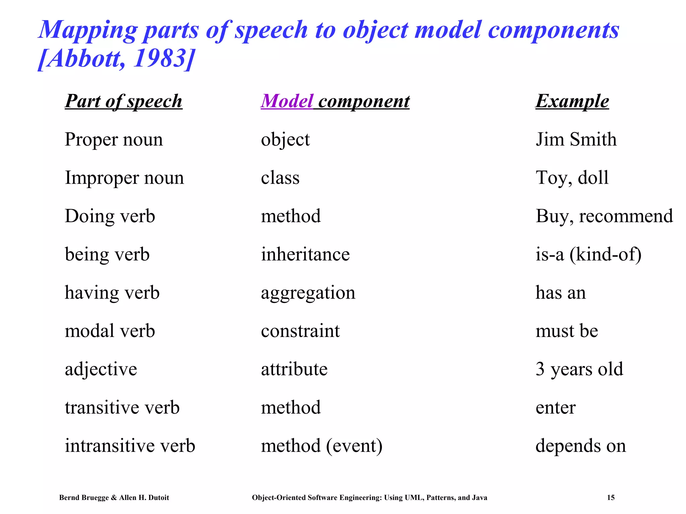
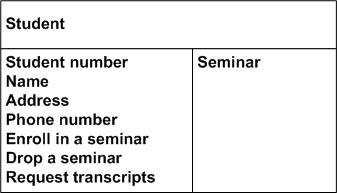
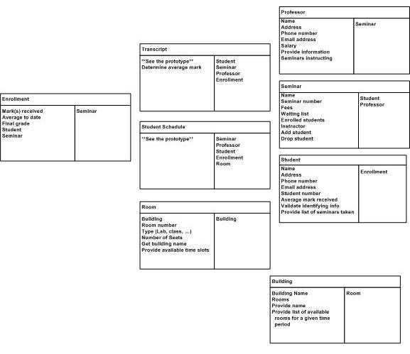
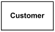
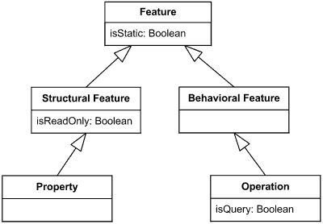
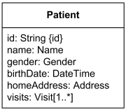
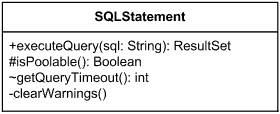
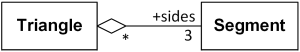
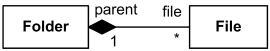
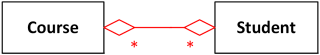

---

title: "Информационная архитектура: словарь, бизнес-правила и концептуальная диаграмма классов"

---

# Quick recap

В прошлый раз мы посмотрели, каким образом можно детализировать варианты использования, используя диаграммы деятельности: изучили различные способы структурного проектирования и их применение на практике, посмотрели различные элементы диаграммы деятельности и способы их применения, а также попытались описать эти диаграммы формально с помощью математического аппарата сетей Петри.

Сейчас настало время перейти от функциональной архитектуры ИС к информационной. На диаграммах деятельности при должном уровне проработки должны быть показаны объекты различных классов, с помощью которых информация передаётся между действиями. Полезным будет проанализировать, какие в целом могут быть классы в ИС именно с точки зрения бизнеса, не с точки зрения программной реализации. За это (и, на самом деле, за описание программной реализации) отвечает диаграмма классов.

Информационная архитектура ИС описывает не таблицы базы данных и не классы выбранного языка программирования, а предметные понятия, документы, справочники, события, журналы, состояния и правила, с которыми работает система.

Основные источники концептуальной модели:

- паспорт предметной области;
- словарь терминов;
- требования;
- бизнес-правила;
- спецификации use cases;
- object flow на диаграммах деятельности;
- документы, отчёты и справочники предметной области;
- жизненные циклы важных объектов.

# Анализ и выделение классов

Как и раньше, перед тем, как заниматься диаграммой классов, необходимо понять, какие классы в целом нас интересуют. Для этого, на самом деле, есть некоторое количество методов, которые являются частным случаем объектно-ориентированного анализа и проектирования. **Объектно-ориентированное проектирование** разбивается на несколько этапов:

- Составление словаря предметной области, т.е. набора используемых понятий данной предметной области.
- Сопоставление классов проектируемой системы этим понятиям;
- Определение атрибутов, операций и связей между классами.

В идеальном мире в этих этапах участвуют не только разработчики и менеджеры, но и эксперты предметной области, которые не будут знать внутреннего устройства ИС с точки зрения программной архитектуры и ниже, но могут указать на полезные и неочевидные моменты, которые не видны обычным пользователям.

Методы в основном различаются именно тем, как эти этапы будут выполняться.

## Метод Аббота и метод именных групп

Метод Аббота ставит во главу угла само описание предметной области. Работает очень просто: определённые части речи отвечают за определённые категории понятий предметной области. Например, существительные будут кандидатами в классы, а глаголы — кандидатами для методов классов.



Метод именных групп похож на метод Аббота, но работает в основном с существительными.

Оба метода несовершенны в том плане, что предложения можно формулировать по-разному, и глагол может стать отглагольным существительным, например, и эти тонкости сильно зависят от естественного языка описания предметной области.

## Метод шаблонных классов

Метод шаблонных классов — это более формальный метод, основная суть которого — проанализировать существующие похожие системы и попробовать выделить классы, опираясь на заранее заданные категории и имеющийся опыт.

У разных авторов выделяются разные категории, мы же приведём более общий список:

- Транзакции;
- Элементы транзакций;
- Что-то, связанное с транзакциями или их элементами (над чем мы выполняем транзакции);
- Места записи транзакций;
- Каталоги и контейнеры других объектов;
- Содержимое контейнеров;
- Внешние системы;
- Запись деятельности (различные логи);
- Роли действующих лиц;
- Места транзакций (физические);
- Важные события, для которых нужно хранить время и место;
- Описания объектов;
- Руководства, документы и прочие материалы, на которые ссылаются в процессе работы.

## Метод карточек CRC

CRC-карточки (Class-Responsibility-Collaborators) — это ещё один простой способ сформировать словарь и сразу же выделить в нём атрибуты, операции и связи между различными терминами. Этот метод любят применять в командах, которые используют гибкие методологии разработки.

Сама по себе карточка выглядит следующим образом: сверху пишется название **класса**, в левой половине указывается, за какую информацию он отвечает и что он делает (**ответственность**), в правой половине указывается, какие классы нужны для реализации ответственности (**кооперация**).



Пример CRC-карточки

Карточки располагают рядом, причём чем сильнее связаны классы, тем ближе они должны быть.

Понятно, что это итеративный процесс, и после перетасовки карточек может всплыть ещё какая-то ответственность или даже класс, это нормально.



Пример нескольких упорядоченных карточек

При необходимости на карточках можно указывать и другую информацию, например, место в иерархии наследования. Единственное ограничение — карточки должны быть небольшими, чтобы стимулировать архитектора выделять только те детали, которые нужны на данном этапе. Также такое ограничение позволяет не раздувать классы, давая слишком много обязанностей.

Как мы увидим дальше, структура карточки и рекомендации к их компоновке сильно коррелируют с диаграммой классов, это, по сути, неформальный метод её описания.

# Свойства классификаторов

Перед тем, как двигаться дальше, нужно вспомнить понятие классификатора.

<aside>
💡

**Классификатор** — это абстрактный метакласс, описывающий набор элементов, обладающих одинаковыми структурными и/или поведенческими характеристиками.

</aside>

На второй лекции мы в общем и целом посмотрели на понятие классификатора, ввели понятие абстрактного классификаторы и изучили такой механизм расширения классификаторов, как стереотипы. С другой стороны, мы оставили в стороне свойства классификаторов, которые позволяют отделить их от других элементов UML.

## Наличие имени

Классификатор обычно имеет имя, по которому его можно отличить от других элементов модели. Формально в UML имя у `NamedElement` может отсутствовать, а требование различимости действует внутри конкретного пространства имён, а не как глобальная уникальность во всей модели. ПО, заточенное именно под UML, помогает поддерживать такую дисциплину имён (поэтому занимайтесь моделированием в Visual Paradigm).

## Экземпляры

Классификаторы могут иметь конкретные экземпляры. Например, если на диаграмме использования есть действующее лицо “Менеджер”, то его экземпляром может быть “Васильев В.Н.”, в таком случае это будет **прямым** классификатором. Это свойство является транзитивным, в таком случае экземпляры более специализированного класса будут **косвенными** по отношению к более общему классификатору.

Имя экземпляра классификатора подчёркивается одинарной сплошной линией. Примеры экземпляров обычно можно увидеть, например, на диаграмме деятельности при работе с объектным потоком или при описании протокола взаимодействия с помощью диаграммы последовательности.

## Расширяемость

Классификатор может участвовать в отношении обобщения с другими классификаторами. Это свойство появляется за счёт того, что классификатор является типом. 

<aside>
💡

**Тип** с точки зрения UML — абстрактный метакласс, показывающий набор значений.

</aside>

При обобщении классификатор в том числе может быть уточнён или переопределён.

Ещё одна возможность расширения — использование шаблонов, поскольку формально любой классификатор их поддерживает.

## Абстрактность

Напомним, что классификатор может быть абстрактным и конкретным. **Абстрактный** классификатор не может иметь прямых экземпляров, и его имя выделяется курсивом. **Конкретный** классификатор, напротив, может иметь прямые экземпляры. При этом абстрактный классификатор может иметь косвенные экземпляры (например, через классификаторы, которые он обобщает).

## Видимость

Классификатор может иметь один из четырёх типов видимости:

- Открытый (`+`);
- Защищённый (`#`);
- Закрытый (`-`);
- Пакетный (`~`).

Несмотря на то, что чисто технически видимость есть у всех классификаторов, не везде она используется (в основном как раз на диаграммах классов). Видимость работает ровно так же, как в объектно-ориентированных языках.

Стоит отметить, что по умолчанию никакая видимость в самой нотации не задаётся. Это не значит, что модель какая-то плохая, это показывает, что нам это не нужно в рамках текущего уровня моделирования. При этом часть средств моделирования (тот же Visual Paradigm) ставит сам видимость по умолчанию, для разных классификаторов свою (например, для действующих лиц и классов видимость публичная, а для полей и методов классов приватная).

# Классы

Теперь перейдём непосредственно к классам. Как было сказано ранее, **класс** — это также один из классификаторов. По факту это самый общий классификатор, поэтому он не имеет особой графической нотации или стереотипов, это просто прямоугольник с названием класса внутри.



Класс без деталей

Напомним, что в рамках этой лекции мы в основном будем рассматривать элементы, свойственные концептуальным (доменным) диаграммам классов. На следующей лекции мы поговорим про диаграмму классов с точки зрения программной реализации.

## Атрибуты и операции, видимость, свойства

Если брать более полную нотацию, класс разбивается на части: название класса, список полей (атрибутов), список методов (операций) и при необходимости другие compartments. Если поля или методы не нужно показывать на текущем уровне детализации, соответствующую часть можно скрыть. Отсутствие compartment на диаграмме не доказывает, что у класса действительно нет таких элементов в модели.

У полей и методов может быть проставлена видимость согласно описанию выше, это можно увидеть на примере чуть ниже. Это, на самом деле, самый частый способ использования видимости.


Класс с двумя полями и одним методом

По факту, и поля, и методы являются т.н. фичами (features). На диаграмме ниже показана иерархия обобщений, связанная с фичами.



Иерархия фичей

Из этой иерархии видно, что и поля, и методы могут быть **статичными**, это задаёт область действия. **Область действия** оперирует на уровне составляющей классификатора и определяет, будет ли она своя в каждом экземпляре или одна на весь классификатор.

Чтобы показать область действия на уровне классификатора, нужная часть подчёркивается.


Класс с указанной видимостью полей и методов, а также статическим методом

### Атрибуты

**Поля (или атрибуты)** сами по себе показывают некоторую структуру классификатора (в данном случае класса). В общем случае описание поля состоит из его названия, типа данных, модификаторов и значения по умолчанию.

UML имеет стандартные примитивные типы, например `Boolean`, `Integer`, `UnlimitedNatural`, `String` и `Real`. Типы, специфичные для языка программирования (`int`, `long`, `bool` и т.п.), лучше использовать только на технических диаграммах или в профиле конкретной реализации. Более сложные типы данных лучше расписать в виде отдельных классов. Из диаграммы выше видно, что поля могут быть доступны только на чтение, если у них установлено свойство `isReadOnly`.



Класс с полями

Поля могут иметь следующие модификаторы, уточняющие способ их хранения:

| **Модификатор** | **Описание** |
| --- | --- |
| `id` | Property is part of the identifier for the class which owns the property. |
| `readOnly` | Поле доступно только для чтения (`isReadOnly = true`). |
| `ordered` | Значения внутри составного поля упорядочены (`isOrdered = true`). |
| `unique` | Поле с несколькими значениями не содержит дубликаты (`isUnique = true`). |
| `nonunique` | Поле с несколькими значениями может содержать дубликаты (`isUnique = false`). |
| `sequence (or seq)` | Поле является последовательностью (`isUnique = false` and `isOrdered = true`). |
| `redefines *property-name*` | Поле переопределяет наследуемое поле с названием **`*property-name*`**. |
| `subsets *property-name*` | Значение поля должно быть подмножеством значений поля с названием **`*property-name*`**. |
| `union` | Поле является объединением подмножеств, которые указаны для него через `subsets` |
| `*property-constraint*` | Ограничение, накладываемое на поле |

Большая часть этих модификаторов встретится при работе с ассоциациями.

Формальный синтаксис описания полей следующий:

```
видимость имя : тип [кратность] = начальное_значение {свойства}
```

Про кратности будет написано чуть позже, всё остальное уже было рассмотрено :)

### Операции

**Методы (или операции)** показывают поведение классификатора (класса или интерфейса). Методы принимают набор параметров и опционально возвращают какой-то тип данных. Методы могут быть шаблонными и/или абстрактными.



Класс с методами

Полезное свойство методов, которое можно показывать на диаграммах: метод может только возвращать некоторые данные, не меняя состояние объекта, такое свойство называется `isQuery`.

Формальный синтаксис описания методов следующий:

```
видимость имя (параметры) : тип {свойства}
```

При этом каждый параметр описывается так:

```
направление имя : тип = значение
```

Направление показывает, как параметр передаётся и используется в функции. Направлений может быть несколько:

- `in` — параметр является входным, его значение используется в методе, но не меняется;
- `out` — параметр является выходным, это хранилище, куда метод помещает значение;
- `inout` — параметр является и входным, и выходным;
- `return` — значение, возвращаемое методом.

В целом направление на диаграммах показывается не так уж часто, обычно подразумевается, что все параметры метода являются входными. С другой стороны, если, например, параметр передаётся по ссылке и меняется в ходе работы метода, это будет параметр с направлением `inout`.

## Стандартные ключевые слова и стереотипы классов

В разделе имени, кроме самого имени, часто указывается ключевое слово или стереотип, уточняющий назначение класса. Важно различать элементы UML и расширения из стандартного профиля. Например, интерфейс и перечисление — это отдельные виды классификаторов, а `«utility»`, `«focus»` и `«auxiliary»` — стереотипы стандартного профиля.

- `«interface»` — интерфейс, задающий контракт без реализации;
- `«enumeration»` — перечисление;
- `«utility»` — класс-служба без экземпляров, содержащий статические атрибуты и операции;
- `«type»` — класс, задающий область объектов и операции без физической реализации;
- `«auxiliary»` — вспомогательный класс, содержит какую-то вторичную логику для работы основного класса;
- `«focus»` — основной класс, содержащий ключевую логику;
- `«metaclass»` — класс, экземплярами которого являются классы.

# Обобщения

Отношение обобщения позволяет показать, что один класс является родительским для других классов. При обобщении выполняется буква L из SOLID (принцип подстановки Барбары Лисков).

Напомним, что в случае обобщений существует полезное свойство `{redefines}`, которое показывает, что мы переопределяем какую-то часть родительского класса в дочернем.


Пример иерархи наследования

В целом обобщения позволяют показать достаточно гибкую структуру наследования, которая ограничивается только тем, что цепочка обобщений не должна превратиться в цикл. При этом множественное наследование, несколько иерархий наследования и вот это всё разрешается и при необходимости даже приветствуется. С другой стороны, нотация никак не решает, например, проблему ромбовидного наследования, так что используйте это осторожно.

## Подмножества обобщений

В UML существует возможность выделять в множестве обобщений *подмножества обобщений* (generalization set) и задавать ограничения для них.

Рассмотрим следующий (несколько искусственный) пример для информационной системы отдела кадров. Допустим, что для экземпляров класса `Person` требуется смоделировать такие характеристики, как пол ‒ `Gender` и служебное положение ‒ `Employment Status`. Подклассы `Male Person` и `Female Person` будут описывать пол сотрудника, а `Employer` и `Employee`, соответственно, его служебное положение. Тогда данную ситуацию можно описать с помощью следующей диаграммы.


Классификация по полу является завершенной и дизъюнктной. Классификация по служебному положению, напротив, не является ни завершенной, ни дизъюнктной∇.

Имена подмножеств обобщений, указываются после двоеточия рядом с обобщением, а в случае, если надо охватить несколько обобщений, то применяется нотация в виде пунктирной линии, как это сделано для подмножества `Employment Status`. Помимо имени подмножества можно указать накладываемые на подмножество ограничения (или их комбинацию). Возможные варианты ограничений приведены в следующей таблице.

| Ограничение | Применение |
| --- | --- |
| `{complete}`полнота | Множество обобщений, входящих в подмножество, является полным, т.е. определяет все возможные подтипы для данной характеристики суперклассификатора. Каждый экземпляр суперклассификатора должен быть экземпляром какого-либо подклассификатора. |
| `{incomplete}`неполнота | Множество обобщений, входящих в подмножество, не является полным, т.е. определяет только часть возможных подклассификаторов для данной характеристики суперклассификатора. Некоторый экземпляр суперклассификатора может не являться экземпляром ни одного подклассификатора из множества. |
| `{disjoint}`несовместность | Области значений подклассификаторов, входящих в данное подмножество не пересекаются, т.е. являются взаимоисключающими. У них не может быть общего прямого или косвенного экземпляра. |
| `{overlapping}`совместность | Области значений подклассификаторов могут пересекаться, т.е. они не являются взаимоисключающими. У них может быть общий прямой или косвенный экземпляр. |

Как видно из описания, приведенного выше, пары `{compete}` ‒ `{incomplete}` и `{disjoint}` ‒ `{overlapping}` являются взаимоисключающими, т.е. не может быть одновременно множество и `{complete}`, и `{incomplete}`. Значения ограничений по умолчанию ‒ `{incomplete, overlapping}`.

# Ассоциации

При работе с ассоциациями полезно помнить, что они показывают свойства классов, которые связаны ассоциацией.

Есть много всяких разных **украшений**:

- **имя ассоциации (возможно, вместе с направлением чтения);**
- **кратность полюса ассоциации;**
- **агрегации или композиция (рисуется у контейнера);**
- **возможность навигации для полюса ассоциации (можно ли пройти в заданном направлении);**
- **роль полюса ассоциации (как он участвует);**
- видимость полюса ассоциации;
- **упорядоченность объектов на полюсе ассоциации;**
- изменяемость множества объектов на полюсе ассоциации;
- **ограничения subset и union полюса ассоциации;**
- **класс ассоциации;**
- квалификатор полюса ассоциации;
- переопределение полюса ассоциации.

## Агрегация и композиция







Shared aggregation в UML имеет слабую формальную семантику: спецификация намеренно оставляет точный смысл такой связи методике или предметной области. Композиция строже: часть в один момент времени принадлежит не более чем одному композиту, а удаление композита влечёт удаление его частей в рамках модели.

## Кратность ассоциации

Кратность указывается не у классификатора вообще, а у multiplicity elements: например, у атрибутов, параметров и полюсов ассоциации.

<aside>
💡 **Кратность множества** — это множество чисел, которые задают все допустимые значения мощности для данного множества.

</aside>

Проще говоря, кратность показывает пределы, в которых может изменяться количество экземпляров классификатора. Кратность задаётся в формате `low .. high`, где в качестве границ могут быть неотрицательные целые числа (и `*` в качестве верхней границы). Нижнюю границу можно опускать, если она не задана. Примеры выражений кратности:

| Выражение кратности | Множество может иметь… |
| --- | --- |
| `0..*` или `*` | Произвольное число элементов |
| `1..*` | Один или более элементов |
| `0..1` | Не более одного элемента |
| `1..10` | От одного до десяти элементов |
| `1..3, 5, 7..10` | Один, два, три, пять, семь, восемь, девять или десять элементов |
| `5..3` | Некорректная кратность. Нижняя граница больше верхней |
| `-1..3` | Некорректная кратность. Отрицательные числа недопустимы |

При этом на полюсах ассоциации могут быть указаны дополнительные опции:

| **Тип коллекции** | **`isOrdered`** | **`isUnique`** |
| --- | --- | --- |
| Мультимножество | `false` | `false` |
| Массив, список | `true` | `false` |
| Множество | `false` | `true` |
| Упорядоченное множество | `true` | `true` |

## Класс ассоциации

Класс ассоциации используется, когда у связи между классами есть собственные атрибуты, операции или бизнес-правила. Типичный пример — связь “студент записан на курс”. Если у записи есть дата, статус, оценка или причина отчисления, то это уже не просто линия между студентом и курсом, а отдельное предметное понятие.

Класс ассоциации особенно часто появляется там, где в будущей архитектуре данных возникла бы таблица связи с дополнительными полями. Но на концептуальной диаграмме мы всё равно описываем не таблицу, а смысловую связь предметной области.

## Навигация

Навигация показывает, в каком направлении один класс “знает” о другом в рамках модели. На концептуальном уровне навигацию стоит указывать только тогда, когда это действительно важно для понимания ответственности или ограничений. На техническом уровне навигация ближе к тому, какие ссылки или зависимости будут в коде.

Не нужно автоматически ставить стрелки на всех ассоциациях. Если направление неизвестно или неважно на текущем уровне абстракции, ассоциацию можно оставить ненаправленной.

# Бизнес-правила и ограничения на диаграмме классов

Бизнес-правила можно фиксировать на диаграмме классов несколькими способами:

- constraint в фигурных скобках рядом с атрибутом;
- constraint на ассоциации;
- constraint на классе;
- note с текстом правила;
- ограничение на подмножестве обобщений;
- кратность ассоциации, если правило выражается количеством объектов.

Например, правило “у заказа должен быть хотя бы один товар” может быть выражено кратностью `1..*` на связи с позициями заказа. Правило “оплаченный заказ нельзя редактировать” лучше зафиксировать как note или constraint, потому что одной кратности недостаточно.

Связь с предыдущей лекцией прямая: guards на activity diagram часто превращаются в constraints или правила переходов состояния. Если в процессе есть условие `[заказ оплачен]`, это состояние или признак должен быть отражён в информационной модели.

# Что дальше?

В рамках этой лекции мы посмотрели основные приёмы построения информационной архитектуры ИС как с точки зрения выявления её элементов, так и с точки зрения её изображения в виде диаграммы классов.

Само собой, на информационной архитектуре проектирование не заканчивается, и следующим логичным шагом является проектирование непосредственно программной архитектуры ИС. Это можно сделать как с помощью диаграммы классов, так и с помощью некоторых других диаграмм, которые мы рассмотрим на следующей лекции.
