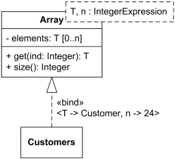
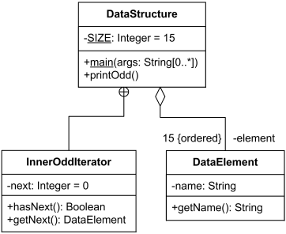
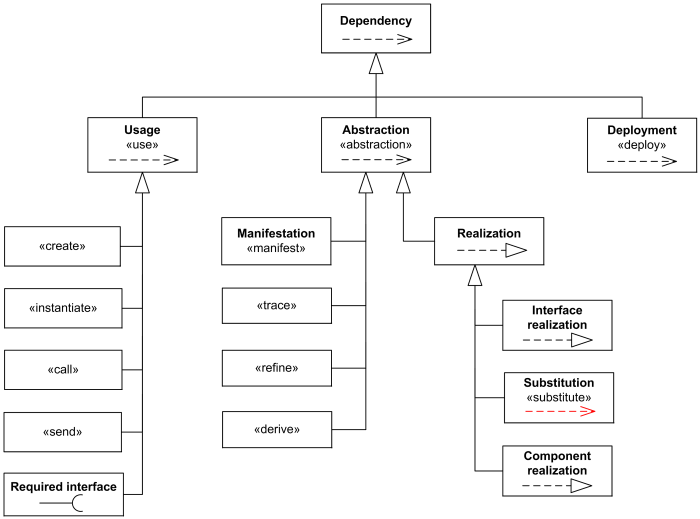
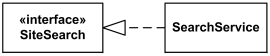
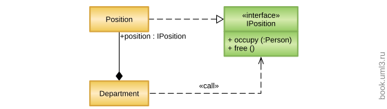
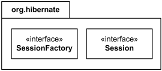
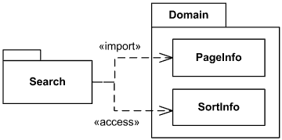

---

title: "Программная архитектура: от концептуальной модели к технической диаграмме классов и пакетам"

---

# Quick recap

На прошлых лекциях мы рассматривали информационную систему как некоторую бизнес-систему для решения каких-то конкретных проблем, начиная с определения необходимой функциональности и заканчивая перечнем информационных объектов, с которыми мы оперируем.

На этой и на следующих лекциях мы будем перебираться в сторону реализации, и сегодня наша задача — посмотреть, каким образом можно показать программную архитектуру ИС на различных уровнях, начиная с конкретных классов и заканчивая более крупными функциональными компонентами.

Эта лекция будет одной из двух, где не будет теоретического введения, поскольку всё необходимое вам уже успели рассказать на линейке дисциплин по программированию: это и основы программирования, и ООП на C#, и технологии программирования на Java.

# Концептуальная модель и техническая модель

| Концептуальная модель | Техническая модель |
| --- | --- |
| Описывает предметную область | Описывает возможную реализацию |
| Понятна экспертам предметной области | Понятна разработчикам |
| Не зависит от языка и фреймворка | Ближе к Java, C#, TypeScript или другой технологии |
| Содержит бизнес-понятия | Содержит классы, интерфейсы, сервисы, DTO, репозитории |
| Проверяется сценариями и бизнес-правилами | Проверяется sequence diagram и архитектурными зависимостями |

Один концептуальный класс может породить несколько технических классов. Например, концептуальный `Order` может соответствовать доменной модели, DTO для API, ORM entity, mapper, repository и сервисным методам. Обратная ситуация тоже нормальна: технический класс может не иметь прямого предметного аналога, если он нужен для инфраструктуры, интеграции или организации слоя приложения.

# Диаграмма классов и программная архитектура

Диаграмма классов, как было сказано в прошлой лекции, позволяет показать не только концептуальную модель (т.е. информационную архитектуру), но и непосредственно реализацию в виде набора классов, интерфейсов, перечислений и пр., а также связей между ними. Для этого применяются как те средства нотации, которые были рассмотрены ранее, так и другие средства, которые мы посмотрим на этой лекции.

## Базовая слоистая архитектура

Для учебной модели достаточно простой слоистой структуры. Она не требует углубления в DDD, Clean Architecture или конкретный backend-фреймворк, но помогает не смешивать ответственности.

Типовые слои:

- presentation layer: взаимодействие с пользователем или внешним клиентом;
- application layer: сценарии приложения и координация use cases;
- domain/model layer: предметная модель и бизнес-правила;
- infrastructure/data access layer: хранение, внешние сервисы, файлы, сетевые интеграции.

Типовые роли классов:

- Controller принимает внешнее действие и передаёт его в application layer;
- ApplicationService реализует сценарий приложения и координирует работу объектов;
- DomainService содержит предметную операцию, если она не принадлежит одному объекту;
- Repository скрывает способ получения и сохранения объектов;
- DTO переносит данные через границу слоя или интерфейса;
- Mapper преобразует одну техническую форму данных в другую;
- Gateway или Adapter изолирует внешнюю систему;
- Entity или Model представляет предметный объект в технической модели.

Эти роли не являются обязательным набором для любой системы. Их нужно добавлять только тогда, когда они помогают реализовать выбранные сценарии и удержать зависимости между слоями.

## Шаблонные классы

Зачастую появляется необходимость применить механизм, позволяющий однотипно работать с различными типами данных. Это, например, шаблоны в C++ или дженерики в C# и Java. UML предоставляет нотацию для добавления такой информации в модель с помощью шаблонных классов.

**Шаблонный класс** позволяет указать параметры, которые должны быть связаны с конкретными элементами модели при создании связанного классификатора. В роли таких параметров чаще всего выступают типы, но механизм шаблонов в UML шире, чем дженерики в языках программирования.

Пример шаблонного класса и связывания

В самом определении класса мы используем параметры шаблона, указанные в пунктирном прямоугольнике в углу классификатора. Чтобы показать, что создаётся связанный классификатор с конкретными значениями параметров, используется отношение `TemplateBinding`: пунктирная стрелка от связанного элемента к шаблону с ключевым словом `«bind»` и указанием подстановок. Всё это показано на примере выше.

Важная особенность: шаблонными могут быть не только классы, но и отдельные методы.

## Вложенные классы

Вложенные классы в реализации встречаются, наверно, не так часто, но отдельная нотация под них также есть: вложенность показывается с помощью ассоциации с якорем на конце.

Пример вложенного класса

## Отношение зависимости

**Отношение зависимости** — достаточно общее отношение, которое показывает, что один класс нуждается в другом для своего определения или реализации (например, для работы метода). Напомним, что зависимость рисуется **от зависимой сущности к независимой**. Зависимости бывают различных типов (и стереотипов) и выстраиваются в иерархию:

Иерархия типов отношений зависимости

Зависимости, как видно на диаграмме мета-модели, делятся на три категории:

- Отношение использования (`use`) показывает, что зависимый класс каким-то образом использует экземпляры независимого класса.
- Отношение абстракции (`abstraction`) показывает, что два класса показывают одно и то же, но на разных уровнях абстракции.
- Отношение развёртывания (`deploy`) показывает, что зависимый артефакт развёртывается на заданном узле (про это мы поговорим на следующей лекции).

## Отношение реализации и интерфейсы

Отдельно из иерархии выше выделяется **отношение реализации**. В общем контексте оно показывает, что два элемента модели зависят таким образом, что один из них является спецификацией (т.е. контрактом), а другой — реализацией этой спецификации.

Обычно, когда мы говорим про интерфейсы, мы используем два типа отношений: реализацию, чтобы показать конкретную реализацию, и зависимость использования (`Usage`), чтобы показать, что классификатору для работы нужен интерфейс. Стереотип `«call»` имеет более узкий смысл: он показывает вызов операции одной операцией или классом. По сути, это позволяет показать ту самую абстракцию различных слоёв ПО, про которую много говорили на курсе ООП.

В UML2 такую комбинацию отношений можно показать с помощью lollipop-нотации (иногда это называется ball-and-socket, можно называть и “чупа-чупс”, но звучит так себе 😀). В этом случае реализация интерфейса показывается с помощью кружочка (сам кружочек показывает интерфейс, а реализация с ним соединяется), а зависимость от этого интерфейса показывается полукругом.

# Диаграмма пакетов

Ещё одна диаграмма, призванная упорядочить модель в целом и диаграмму классов частности — диаграмма пакетов.

<aside>
💡

С точки зрения синтаксиса **пакет** изображается в виде прямоугольника с ярлычком.

С точки зрения семантики **пакет** — это группирующая сущность, задающая пространство имён и объединяющая набор элементов, которые связаны друг с другом логически.

</aside>

Пример пакета с двумя элементами

Не все элементы могут быть частью пакета, но все классификаторы заведомо могут быть частью пакета. Обычно на уровне интуиции не возникает желания вложить в пакет что-то некорректное с точки зрения семантики (например, действие), поэтому этот момент обычно не проговаривают, но имеют в виду.

Пакет, как и класс, также может быть шаблонным, и тогда нам нужно связать с ним другой пакет.

Для простоты восприятия пакет действительно можно представить как пространство имён в том же C# или Java. Это же позволяет нам очевидным образом реорганизовать диаграмму классов в диаграмму пакетов, если код уже готов.

## Отношение импорта и слияния

Пакеты могут взаимодействовать как с другими пакетами, так и с их элементами. Для этого используется **отношение импорта**, которое похоже на зависимость со стереотипом `import` или `access`, но семантически является отдельным направленным отношением.

Публичный и приватный импорт элементов

Выбор ключевого слова зависит от того, импортируется ли элемент или пакет публично или приватно. Импорт является публичным, если импортируемые в пакет элементы становятся доступными извне через этот пакет, иначе он считается приватным. Для первого случая используется ключевое слово `import`, для второго `access`. Если ключевое слово опущено, то обычно подразумевается публичный импорт.

Второе отношение, используемое на диаграмме пакетов — это **отношение слияния**. Семантически оно похоже на отношение обобщения, но в данном случае содержание сливаемых пакетов буквально становится содержимым пакета, который с ними связан. Синтаксически отношение слияния выглядит как отношение зависимости со стереотипом `merge`.

Слияние пакетов `Kernel` и `Profiles` в пакет `Constructs`

# Архитектура данных как мост

В этом курсе мы не превращаем диаграмму классов в ER-диаграмму и не углубляемся в проектирование баз данных, но связь с архитектурой данных нужно понимать.

Практические соответствия:

- концептуальный класс не обязан становиться таблицей один к одному;
- ассоциация может стать внешним ключом или таблицей связи;
- класс ассоциации часто становится таблицей связи с собственными атрибутами;
- техническая модель может включать ORM entity, DTO, repository и mapper;
- часть constraints может перейти в ограничения целостности данных;
- некоторые вычисляемые атрибуты не хранятся, а рассчитываются.

Важно не смешивать уровни. На концептуальной модели мы объясняем смысл предметных объектов. На технической модели показываем, какие классы нужны для реализации выбранных сценариев. На уровне данных уже решается, как именно это будет храниться.

# Что дальше?

К этому моменту мы можем показать программную архитектуру ИС с точки зрения её структуры. Диаграмма классов, на самом деле, является низкоуровневым инструментом, и иногда нужно показать программную архитектуру на более высоком уровне (а зачастую воспользоваться классами просто нельзя). Для решения этой проблемы моделирования используется диаграмма компонентов, которую мы посмотрим в следующий раз.

Также в следующий раз мы спустимся на уровень системной архитектуры и изучим, как с помощью диаграммы развёртывания можно описать взаимодействие ПО и аппаратного обеспечения, тем самым закончив структурное описание ИС.
