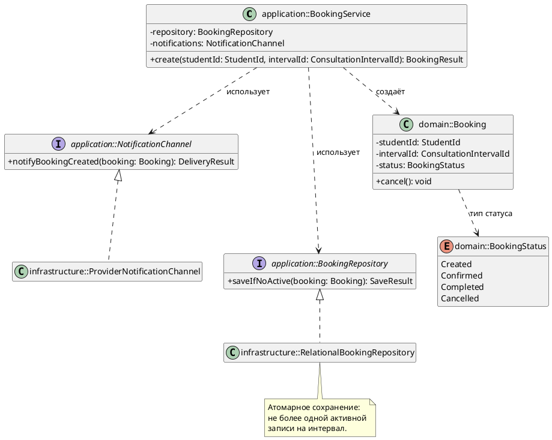
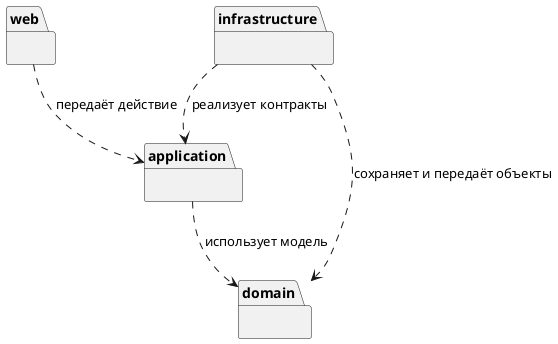
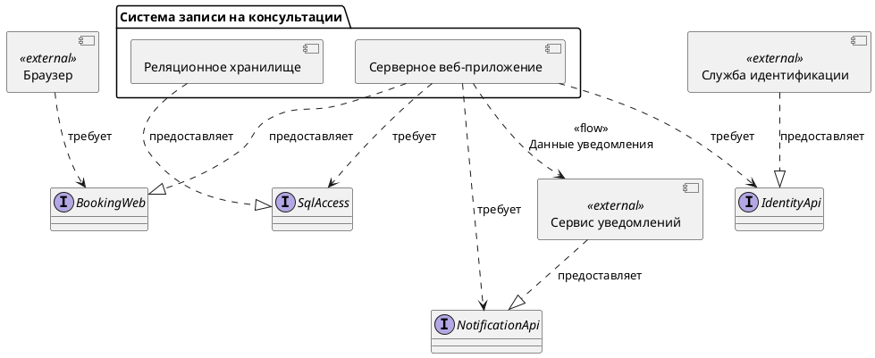
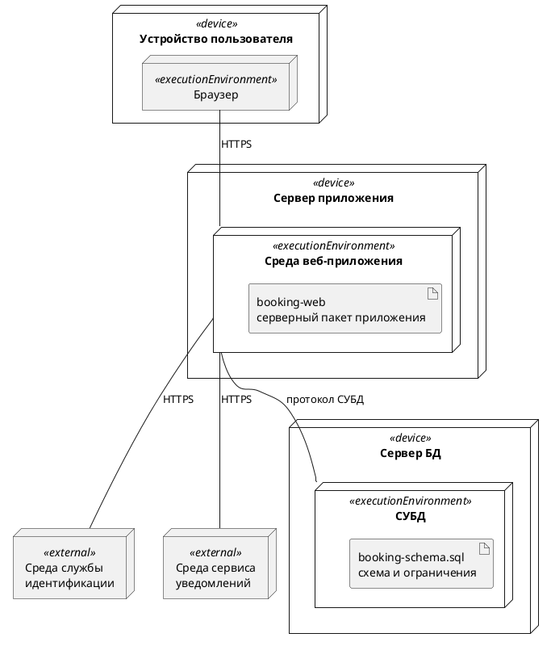

**Длительность: 90 минут.** Лекция продолжает предметную модель из предыдущего занятия: распределяет программные ответственности, обосновывает проектные решения и связывает технические классы, пакеты, компоненты и развёртывание. Сквозной пример — запись на консультацию; диаграммы строятся и проверяются в Visual Paradigm CE.

## Материалы лекции

[Объектно-ориентированное проектирование](/modelling/object-oriented-design), [Концептуальная и техническая модель](/modelling/conceptual-vs-technical-model), [Проектные решения и ADR](/modelling/project-decisions), [Техническая диаграмма классов](/notation/technical-class-diagrams), [Архитектура данных](/modelling/data-architecture), [Программная архитектура и слои](/modelling/software-architecture-and-layers), [Диаграмма пакетов](/notation/package-diagrams), [Диаграмма компонентов](/notation/component-diagrams), [Информационные потоки](/notation/information-flows), [Системная архитектура и развёртывание](/modelling/system-architecture-and-deployment), [Диаграмма развёртывания](/notation/deployment-diagrams), [Согласованность, трассируемость и типовые ошибки](/modelling/model-consistency-and-traceability).

Редкие средства нотации — [приёмы и сигналы](/notation/technical-class-diagrams), [связывание шаблонов](/notation/technical-class-diagrams), [квалификаторы, n-арные и специальные отношения](/notation/relations) — остаются справочным материалом. В базовой архитектурной модели их не объясняют и не используют без необходимости.

## Развёрнутый тезисный план

Дополнительное чтение после занятия: [распределение ответственности, GRASP и паттерны](/modelling/responsibility-and-patterns), [проверки реализации по моделям](/modelling/model-based-testing). Эти темы не добавляют обязательных паттернов или диаграмм к ЛР 5.

| Время | Тезисы и действие преподавателя |
| --- | --- |
| 0–10 | Перейти от предметных понятий к программным ответственностям; объяснить роли классов и контракты. |
| 10–20 | Разобрать архитектуру данных: формы хранения и передачи, источник истины, историю и проблему конкурентных запросов. |
| 20–30 | Объяснить слои; сравнить варианты системной архитектуры и обосновать выбор по нефункциональным требованиям. |
| 30–40 | Разобрать структуру ADR; зафиксировать выбор сохранения и уведомлений, альтернативы и последствия. |
| 40–57 | Построить техническую диаграмму в Visual Paradigm: классы, операции, интерфейсы, зависимости и реализации. |
| 57–65 | Показать пакеты и принадлежность классов; исправить зависимость предметной модели от инфраструктуры. |
| 65–73 | Прочитать компонентную диаграмму: предоставляемые и требуемые контракты, владелец данных, информационный поток. |
| 73–80 | Связать компоненты с развёртыванием: узлы, среды выполнения, артефакты и пути связи. |
| 80–90 | Сверить представления; проверить конкурентное бронирование, отказ доставки, ограничения решения и замену провайдера; подвести итог. |

Это рабочий план занятия с объяснением и построением модели. Вопросы разбираются
по ходу показа; примеры ошибок и проверки входят в основной материал.
Фактическую длительность демонстрации нужно проверить репетицией.

## Полный материал лекции

### От предметной модели к технической

:::tip[Определение]{icon="starlight"}
**Техническая модель** показывает программные ответственности, контракты и зависимости, которые реализуют предметные понятия и правила.
:::

В предыдущей лекции мы выделили студента, преподавателя, интервал консультации и запись. Концептуальная модель объяснила, какие объекты существуют и какие связи между ними допустимы. Теперь нужно выбрать программные элементы, которые выполнят сценарий: кто координирует операцию, кто хранит данные и какой контракт скрывает внешнюю систему.

Сохраним требования предыдущего занятия:

> Студент бронирует интервал преподавателя. Отменённые записи остаются в истории,
> но активна (`Создана` или `Подтверждена`) не более одна запись. После сохранения
> система пытается уведомить участников. Сбой доставки не отменяет бронирование.

В техническом фрагменте будем считать, что право студента на запись и открытость
интервала уже проверены. Нас интересуют сохранение записи, конкурентный доступ
к одному интервалу и независимость предметного правила от провайдера уведомлений.

Предметное понятие не определяет автоматически набор контроллеров, сервисов
и таблиц. Для перехода задаём четыре вопроса: кто представляет
состояние, кто координирует сценарий, кто гарантирует сохранение и кто обращается
во внешнюю систему? Ответы дают разные программные ответственности.

#### Программные ответственности

**Ответственность класса** — то, что он должен знать или обеспечивать.
Объектно-ориентированное проектирование распределяет между объектами состояние,
поведение и ответственность. Для выбора места операции полезно спросить,
кто знает нужные данные и по какой причине эта операция будет меняться.

Связанные обязанности собираются вместе, а знание технических деталей
ограничивается соответствующей границей. Если для изменения провайдера
уведомлений приходится менять правило отмены записи, граница проведена неудачно.
Разделим обязанности по типовым ролям:

| Роль | Ответственность | Пример в сценарии |
| --- | --- | --- |
| Предметный объект — Entity / Model | хранит предметное состояние и выполняет относящиеся к нему правила | запись знает свой статус и может быть отменена |
| Сервис приложения — Application Service | координирует действия участников сценария | организует создание записи, сохранение и запрос уведомления |
| Репозиторий — Repository | скрывает способ загрузки и сохранения объектов | сохраняет запись и сообщает об успехе или конфликте |
| Шлюз / адаптер — Gateway / Adapter | изолирует внешний контракт и переводит вызовы в нужный протокол | преобразует запрос уведомления в обращение к провайдеру |

Каждая роль должна объяснять часть выбранного сценария. Если ответственность нельзя связать с требованием или решением, её появление в модели нужно обосновать отдельно.

**Контракт** задаёт доступные операции, входные данные, результаты и ошибки,
на которые может рассчитывать потребитель. **Интерфейс** фиксирует программную
часть контракта и позволяет отделить потребность приложения от конкретного
способа её выполнения. Например, сценарию нужно запросить уведомление;
формат вызова внешнего провайдера можно скрыть за этой границей.

В технических моделях встречаются и другие роли:

| Роль | Назначение | Когда нужна |
| --- | --- | --- |
| Controller | принимает внешнее действие, разбирает вход и передаёт управление сценарию | веб-контроллер принимает запрос бронирования |
| Domain Service | выражает предметную операцию, которая не принадлежит одному объекту | если правило требует нескольких предметных объектов и у него нет естественного владельца |
| DTO — Data Transfer Object | переносит данные через границу без предметного поведения | например, ответ веб-интерфейса с идентификатором и статусом записи |
| Mapper | преобразует одну форму данных в другую | если доменный объект и ответ интерфейса имеют разную структуру |

Отдельные классы для всех перечисленных ролей добавляются только
при необходимости выбранного сценария.

Контракт сохранения также должен определять, что означает успех при двух
одновременных запросах. Чтобы выбрать такой контракт, сначала разберём данные
и правило, которое он обязан сохранять.

### Архитектура данных

**Архитектура данных** — решения о хранении, передаче, происхождении
и целостности информации. Она связывает предметный смысл с техническими
формами данных. Один предметный объект может храниться в нескольких таблицах,
а одна таблица может представлять несколько ролей или понятий.

#### От предметных объектов к хранению

Связь «один ко многим» часто реализуется внешним ключом; для «многие ко многим»
обычно нужна таблица связи. Если у связи есть собственные свойства, их также
нужно сохранить. Часть значений вычисляется: например, признак «интервал свободен»
можно получить из отсутствия активной записи. Хранить его отдельно означает
поддерживать согласованность двух представлений одного факта.

В нашем случае запись связана с одним интервалом, а множество записей
образует его историю. Сохранить отменённые бронирования и хранить журнал всех
смен статуса — разные решения: первое не даёт автоматически сведения о том,
кто и когда менял каждое состояние.

#### Формы данных и источник истины

| Вид данных | Назначение | Пример для консультаций |
| --- | --- | --- |
| Основное состояние | представляет предметные объекты | интервалы и записи с текущими статусами |
| Справочные значения | задают допустимый набор значений | статусы записи; их можно выразить перечислением |
| Журнал | фиксирует изменения и их участников | кто и когда отменил запись, если требуется аудит |
| Событие | сообщает о произошедшем факте | «запись создана»; само по себе не гарантирует доставку |
| DTO | переносит данные через интерфейс | ответ со списком доступных интервалов |
| Отчётные данные | дают агрегированное представление | число записей по преподавателям за период |

Эти формы не требуют отдельных компонентов или таблиц в каждом проекте.
Журнал, события и отчётность добавляются по требованиям; в текущем техническом
фрагменте показаны только данные, нужные выбранному сценарию.

**Источник истины** — авторитетный источник актуального значения.
Если данные приходят из внешней системы, локальная копия не становится
автоматически главным источником. Нужно определить, кто вправе менять сведения,
как обновляется копия и что делать при недоступности источника.

Владельцем данных является система или внешний источник, который отвечает за их актуальность и изменение. В нашем случае приложение владеет записями и их историей; внешняя служба идентификации владеет учётными данными, а внешний сервис уведомлений — своими доставками. Их не превращают в локальные предметные сущности без отдельного решения.

#### Ограничения целостности

Для хранения интервалов и записей рассмотрим реляционное хранилище. Для правила «на интервале не более одной активной записи» недостаточно проверки в пользовательском интерфейсе или только в памяти сервиса: конкурентные запросы должны быть остановлены атомарным ограничением/операцией репозитория. Отменённая запись хранится как история и не входит в активные. Ошибка отправки уведомления не откатывает сохранённую запись: доставка — отдельный внешний эффект.

Для разбора возьмём два запроса А и Б к одному интервалу. Оба прочитали
«свободен», затем оба пытаются сохранить запись. Если чтение и запись ничем
не защищены, оба запроса могут завершиться успешно. Контракт атомарного сохранения
должен допускать один успех и один конфликт независимо от порядка прихода
запросов. Реализация может использовать ограничение уникальности для
активных записей или блокировку интервала внутри транзакции с повторной проверкой.
Само слово «транзакция» без подходящего ограничения или блокировки этой гарантии
не даёт. Домен задаёт смысл правила, а репозиторий обеспечивает его при конкуренции.

Определили обязанности элементов и требования к данным. Теперь объединим
элементы в слои, зададим зависимости между ними и сравним варианты размещения.

### Программная архитектура и слои

**Программная архитектура** описывает внутреннюю организацию ПО: модули,
классы, контракты и зависимости. **Системная архитектура** описывает размещение:
клиентов, серверы, среды выполнения, внешние службы и каналы связи.

**Слой** объединяет элементы с общей ответственностью и допустимым направлением
зависимостей. Уже рассмотренные роли распределим между четырьмя слоями:

| Слой | Какие роли и элементы объединяет | От каких слоёв зависит в выбранной схеме |
| --- | --- | --- |
| Представление — presentation | контроллеры | от приложения |
| Приложение — application | сервисы приложения и нужные им интерфейсы репозиториев и каналов | от предметной модели |
| Предметная модель — domain/model | предметные объекты и доменные сервисы, если они нужны | от остальных слоёв не зависит |
| Инфраструктура — infrastructure | реализации репозиториев и адаптеры внешних систем | от контрактов приложения и типов предметной модели |

DTO и mapper размещают у той границы, которую они обслуживают; сами названия
этих ролей не определяют слой. Папки помогают организовать код, а слоистость
проверяется по принадлежности элементов и фактическим зависимостям.
Направления из таблицы затем проверим на пакетной диаграмме.

Пакет группирует связанные элементы и показывает направление зависимостей. Компонент показывает заменяемую часть с внешним контрактом. Информационный поток поясняет **что** передаётся через границу, а не заменяет API, ассоциацию или сообщение.

### Варианты системной архитектуры

Разберём одно действие «записаться на интервал» в трёх размещениях. На протяжении
сравнения предметное правило остаётся тем же; меняются место обработки и способы
контроля доступа, обновления и конкурентной записи.

| Вопрос                              | Файл-серверная схема                                                       | Двухзвенная схема                                                                  | Трёхзвенная схема                                                               |
| ----------------------------------- | -------------------------------------------------------------------------- | ---------------------------------------------------------------------------------- | ------------------------------------------------------------------------------- |
| Где выполняется сценарий?           | На рабочих местах; общий файл содержит данные.                             | В клиентском приложении, часть правил может находиться в СУБД.                     | На сервере приложения; клиент передаёт действие.                                |
| Как сохраняется запись?             | Клиент читает и изменяет общий файл.                                       | Клиент обращается к серверу БД.                                                    | Клиент обращается к приложению, приложение — к БД.                              |
| Где защищать одну активную запись?  | Нужен согласованный механизм блокировок файла или записей у всех клиентов. | Ограничение или атомарная операция на сервере БД защищает от конкуренции клиентов. | Приложение координирует сценарий, БД обеспечивает конкурентную целостность.     |
| Что обновлять при смене провайдера? | Клиенты, если вызов встроен в них.                                         | Клиенты, если интеграция находится в клиентской логике.                            | Серверный адаптер и его конфигурацию.                                           |
| Кто имеет доступ к хранилищу?       | Рабочие места имеют доступ к общему файлу.                                 | Клиенты имеют соединения с БД и соответствующие права.                             | К БД обращается сервер приложения; браузеру прямое соединение не нужно.         |
| Какова цена варианта?               | Зависимость от файлового доступа и дисциплины блокировок.                  | Сопровождение клиентов и их доступа к БД.                                          | Отдельный сервер приложения, дополнительный сетевой переход и его эксплуатация. |

Пройдём путь запроса в каждом варианте. При общем файле клиент сам читает
и изменяет данные, поэтому всем клиентам нужен согласованный способ блокировки.
В двухзвенной схеме сохранением управляет сервер БД: транзакции и ограничения
уже позволяют защищать данные от конкурентных изменений. Третье звено добавляет
отдельное место для координации сценария и интеграций.

**Толстый клиент** содержит значительную обработку на рабочем месте.
**Тонкий клиент** в основном показывает интерфейс и передаёт действия на сервер.
Это характеристика распределения ответственности: браузер с большой клиентской
логикой тоже может быть толстым клиентом.

**Слой и звено отвечают на разные вопросы.** Слой группирует программные
ответственности и зависимости; звено описывает размещение частей системы.
Четыре программных слоя могут находиться внутри одного серверного приложения.

#### Связь с нефункциональными требованиями

Число звеньев само по себе не доказывает качество архитектуры. Выбор размещения
нужно проверять по требованиям к системе:

| Требование | На какое решение влияет |
| --- | --- |
| Производительность | где обрабатывается запрос, как распределяется нагрузка и какие сетевые переходы допустимы |
| Доступность | какие отказы допустимы, нужны ли резервирование и восстановление |
| Безопасность | кто получает доступ к данным и где проходят границы доверия |
| Сопровождаемость и совместимость | что обновляется у пользователя и какие клиентские платформы поддерживаются |

Например, отдельный сервер приложения централизует обновление логики и доступ
к БД, но становится ещё одной частью, отказ которой влияет на работу сервиса.
Требование сохранять бронирование при отказе уведомлений определяет границу
внешнего эффекта. Ни число слоёв, ни наличие интерфейса не обеспечивают
доступность автоматически.

Для сервиса консультаций выберем трёхзвенную схему. Пользователи работают
в браузере, обновлять установленные программы на их устройствах нежелательно,
а интеграции и доступ к БД нужно централизовать. Три звена — браузер, сервер
приложения с серверно-рендеримым веб-приложением и сервер реляционной БД.
Браузер остаётся тонким клиентом; внешние службы идентификации и уведомлений
находятся за границей нашей системы.

**Проверка решения:** университет добавил мобильный клиент. Новый клиент
использует ту же серверную операцию и ту же гарантию репозитория. Проверка
занятости в интерфейсе помогает быстрее показать ошибку, но окончательное
решение о создании записи принимает атомарная операция сохранения.

Выбор размещения определил, где выполняется сценарий. Остаётся зафиксировать,
как он сохраняет целостность и отделяет уведомление от предметной записи.
Для этого оформим проектное решение.

### Проектные решения и ADR

:::tip[Определение]{icon="starlight"}
**Проектное решение** — обоснованный выбор одного из допустимых способов реализации. **ADR** (_Architecture Decision Record_) — короткая запись этого выбора, его оснований и последствий.
:::

Предметное правило само по себе не определяет устройство программы. Отправку
можно вызвать из объекта записи, из сервиса приложения или через отдельный
обработчик. Выбор влияет на зависимости и поведение при отказе, поэтому его
нужно объяснить до построения технических элементов.

#### Структура ADR

В учебном проекте достаточно четырёх разделов. Каждый отвечает на свой вопрос:

| Раздел | На какой вопрос отвечает | Что нужно записать |
| --- | --- | --- |
| Контекст | почему возник выбор? | проблему, значимые требования, ограничения и условия; готовое решение здесь ещё не предполагается |
| Решение | какой вариант выбран? | конкретный способ реализации и основание выбора |
| Альтернативы | что ещё могло решить задачу? | рассмотренные варианты и причины, по которым они не выбраны в этих условиях |
| Последствия | что меняется после выбора? | преимущества, дополнительные обязанности, стоимость сопровождения и риски |

Контекст «провайдер может измениться» отличается от решения «вызов скрыт
за интерфейсом». Последствие «появляется адаптер, который нужно поддерживать»
отличается от повторения решения «будет интерфейс». Без альтернатив и цены
выбора запись превращается в описание устройства программы и не объясняет,
почему оно выбрано.

ADR полезен там, где требования допускают несколько реализаций: способ хранения
истории, граница внешнего сервиса, распределение логики между клиентом и сервером.
Его связывают с требованиями и порождёнными элементами модели. При изменении
исходных условий решение пересматривают; это не документ только для конца проекта.

#### Пример: сохранение записи и уведомление

На основе разобранных проблем и границ выберем решение `ADR-05`: сервис
координирует создание записи, репозиторий атомарно обеспечивает целостность,
а канал уведомлений скрывает провайдера. Назовём соответствующие элементы
`BookingService`, `BookingRepository` и `NotificationChannel`; предметную запись —
`Booking`. Теперь имена обозначают выбранные ответственности.

| Раздел ADR                                                 | Содержание                                                                                                                                                                                                                                                                                                                         |
| ---------------------------------------------------------- | ---------------------------------------------------------------------------------------------------------------------------------------------------------------------------------------------------------------------------------------------------------------------------------------------------------------------------------- |
| Контекст                                                   | Студент бронирует интервал, открытый преподавателем. Запись принадлежит ровно одному студенту и одному интервалу. У интервала может быть история записей, но активна (`Создана` или `Подтверждена`) не более одна. После сохранения нужно попытаться уведомить участников; провайдер уведомлений может измениться или отказать.    |
| Решение                                                    | `BookingService` координирует операцию. `BookingRepository` в реляционном хранилище сохраняет запись и атомарно обеспечивает одну активную запись. `NotificationChannel` скрывает поставщика, а вызов уведомления выполняется после успешного сохранения.                                                                          |
| Альтернатива: вызвать провайдера прямо из `Booking`        | Отклонена: доменный объект становится зависим от транспорта и поставщика; замена провайдера затрагивает предметную логику.                                                                                                                                                                                                         |
| Альтернатива: сначала уведомить, потом сохранить           | Отклонена: при отказе БД возможно ложное уведомление; при отказе уведомления нельзя терять корректно сохранённую запись.                                                                                                                                                                                                           |
| Альтернатива: проверять активность только в веб-интерфейсе | Отклонена: параллельные запросы могут создать две активные записи.                                                                                                                                                                                                                                                                 |
| Последствия                                                | Нужны два интерфейса инфраструктуры и обработка результата доставки. Поставщик меняется локально в реализации канала; `Booking`, история, ограничение одной активной записи и владелец данных не меняются. При остановке процесса после сохранения попытка уведомления может быть потеряна; автоматический повтор не предусмотрен. |

Прочитаем ADR как обоснование будущей диаграммы. Требование о независимости
от поставщика даёт интерфейс `NotificationChannel` и его реализацию.
Правило единственной активной записи даёт атомарную операцию репозитория.
Порядок «сначала сохранить, затем уведомить» объясняет поведение при отказе
внешнего сервиса.

У решения есть цена: нужно поддерживать адаптеры, обрабатывать ошибки
и учитывать отсутствие гарантированного повтора доставки. ADR хранится рядом
с проектом как текст; заметка `ADR-05` на технической диаграмме связывает
программные элементы с обоснованием выбора.

**Типичная ошибка:** интерфейс появился, но сервис всё равно создаёт конкретный
адаптер провайдера внутри операции сценария. Зависимость от провайдера
осталась: при замене поставщика придётся менять сервис. Передадим реализацию
через свойство или конструктор. Выбор конкретных объектов относится к сборке
приложения и находится вне предметной модели и сценария.

### Обязательная демонстрация: архитектура записи на консультацию

Построим технический фрагмент для ADR-05, затем прочитаем его в трёх других
представлениях: пакетах, компонентах и развёртывании. На каждом шаге проверим,
сохранились ли правило единственной активной записи и граница уведомлений.

#### Условие и подготовка

Для показа используем рабочую копию проекта предыдущей лекции в Visual Paradigm CE.
Концептуальную модель сохраним, а технические элементы разместим в отдельной
модели проекта с пакетами `web`, `application`, `domain` и `infrastructure`.
Предметный и технический классы различаются по назначению; соответствие
`domain::Booking` понятию «Запись» зафиксируем в пояснении или таблице трассировки.

В проекте нужны четыре представления: `05-1 Технические классы` (Class Diagram),
`05-2 Пакеты` (Package Diagram), `05-3 Компоненты` (Component Diagram),
`05-4 Развёртывание` (Deployment Diagram). Для создания используйте **Diagram → New**,
выберите тип и задайте имя и расположение. На занятии технический фрагмент
строится на пустой диаграмме; остальные три представления подготовлены заранее.
В них проверим зависимости и границы, изменяя отдельные элементы. Диаграммы ниже
показывают результат построения и позволяют сверить модель со страницей лекции.

Один элемент модели может иметь несколько представлений. При повторном показе
пакета или класса выбирайте существующий элемент через дополнение имени
(**Ctrl+Space**, если сочетание не перехватывает ОС). Переименование элемента
должно отражаться в его остальных представлениях. Простое совпадение подписей
двух заново созданных классов не делает их одним элементом.
Порядок создания и повторного использования описан в руководстве Visual Paradigm:
[создание диаграмм](https://www.visual-paradigm.com/support/documents/vpuserguide/1283/27/6243_creatingdiag.html),
[повторное использование элементов](https://www.visual-paradigm.com/support/documents/vpuserguide/1283/31/6805_showingmodel.html).

Для разбора возьмём студентов `s1` и `s2` и один открытый интервал `i1`.
Активных записей пока нет; личность пользователя и право на запись проверены.
Результаты операций будем выводить из контрактов модели. Готовую копию проекта,
ADR-05 и сигнатуры стоит подготовить до занятия, чтобы восстановить показ
при ошибке в редакторе.

#### Шаг 1. Построить техническую диаграмму

Из ADR-05 получаем следующий состав технического фрагмента. Сопоставим
конкретные имена с уже рассмотренными ролями и контрактами:

| Элемент | Роль в выбранном решении |
| --- | --- |
| `BookingService` | сервис приложения |
| `Booking` | предметный объект записи |
| `BookingRepository` | контракт атомарного сохранения записи |
| `NotificationChannel` | контракт попытки уведомления после сохранения |
| `RelationalBookingRepository` | реализация `BookingRepository` для реляционного хранилища |
| `ProviderNotificationChannel` | реализация `NotificationChannel` для внешнего провайдера |

На диаграмме покажем только классы, интерфейсы, операции и зависимости,
которые объясняют выбранный сценарий.

У каждого элемента ниже есть пакет-владелец. В подписях диаграммы использованы
квалифицированные имена `пакет::Элемент`; в дальнейшем тексте — короткие имена.
В редакторе создавайте элемент внутри соответствующего пакета и задавайте короткое
имя: принадлежность пакету должна быть свойством модели, а не частью подписи.
`StudentId` и `ConsultationIntervalId` — типы идентификаторов, а `SaveResult`,
`DeliveryResult` и `BookingResult` — типы результатов операций. Их внутреннее
устройство скрыто: для показа достаточно различать успех сохранения и конфликт,
принятие уведомления и ошибку, успешное бронирование и занятый интервал.

Начнём с `domain::Booking`: добавим атрибуты `studentId`, `intervalId`, `status`
и операцию `cancel`. В предыдущей лекции связь со студентом выражалась ассоциацией
и кратностью; здесь выбран технический способ хранения ссылки — идентификатор.
Предметный смысл связи при этом сохраняется.

В записи `- status: BookingStatus` минус обозначает закрытую видимость,
после двоеточия указан тип. В `+ cancel(): void` плюс означает общедоступную
операцию без параметров и возвращаемого значения. Абстрактный класс, если он
понадобится, обозначается курсивом или `{abstract}` и не имеет непосредственных
экземпляров.

`Created`, `Confirmed`, `Completed`, `Cancelled` соответствуют `Создана`,
`Подтверждена`, `Завершена`, `Отменена`. Активны первые два состояния;
`cancel` меняет состояние, а не удаляет историческую запись. Переходы и права
на отмену подробно разбираются в лекции 6.

Добавим `application::BookingService` с операцией `create` и проведём зависимость
к `Booking`. **Зависимость** (`Dependency`) направлена от использующего элемента
к поставщику: сервису нужен тип записи, которую он создаёт. Положение элементов
на листе и направление стрелки не задают порядок вызовов.

Теперь создадим интерфейсы `BookingRepository` и `NotificationChannel`, зададим
их операции и добавим сервису свойства `repository` и `notifications`.
**Интерфейс** определяет контракт: какие действия доступны и какой результат
ожидает вызывающая сторона. Конкретный способ сохранения или обращения
к провайдеру остаётся за этим контрактом.

Завершим фрагмент классами `RelationalBookingRepository` и
`ProviderNotificationChannel`. Каждый реализует соответствующий интерфейс.
Добавим перечисление статусов и заметку о конкурентном сохранении;
прочитаем зависимости сервиса и обязательства двух реализаций.

**Реализация интерфейса** (`Realization`) изображается пунктирной линией с пустым треугольником к интерфейсу. Она означает обязательство выполнить контракт. Сплошная линия с таким же треугольником обозначала бы обобщение — другое отношение.

Итоговый технический фрагмент:

Пройдём один вызов `create` по построенной модели:

1. `BookingService` получает идентификаторы студента и интервала; внешний identity service остаётся за границей и не становится частью доменной модели.
2. Сервис формирует `Booking` со статусом `Создана`.
3. `BookingRepository.saveIfNoActive` одной атомарной операцией сохраняет запись либо возвращает конфликт активной записи; при конфликте сервис не создаёт вторую запись и уведомление не посылает.
4. После успешного сохранения сервис вызывает `NotificationChannel.notifyBookingCreated`.
5. Ошибка или отрицательный `DeliveryResult` фиксируется как результат внешнего эффекта, но не отменяет уже сохранённую `Booking`.

Такой фрагмент отделяет доменное правило от SQL и поставщика. Реальная реализация репозитория обязана обеспечивать условие конкурентно, а не делать отдельное чтение с последующей записью без защиты.

#### Шаг 2. Проверить пакеты и зависимости

В технической модели владельцы элементов уже заданы; обзорная пакетная диаграмма
показывает только крупные области и зависимости. Не переносим на неё весь список
классов — принадлежность проверяется по дереву модели и квалифицированным именам.

| Пакет | Классы и интерфейсы |
| --- | --- |
| `web` | `WebBookingController`; на техническом фрагменте скрыт |
| `application` | `BookingService`, `BookingRepository`, `NotificationChannel` |
| `domain` | `Booking`, `BookingStatus`, `ConsultationInterval`; интервал на техническом фрагменте скрыт |
| `infrastructure` | `RelationalBookingRepository`, `ProviderNotificationChannel` |

`application` использует абстракции, определённые на собственной границе;
`infrastructure` их реализует. Направление зависимости исходного кода здесь
не совпадает с направлением вызова во время работы: сервис вызывает канал,
но его код знает интерфейс, а не провайдера. Для создания конкретных объектов
нужна сборка приложения; она соединяет сервис с адаптерами и на этой обзорной
диаграмме не показана.

Откроем пакетную диаграмму и прочитаем зависимости через классы из таблицы.
`web → application` объясняется обращением контроллера к сервису,
`application → domain` — работой сервиса с `Booking`,
`infrastructure → application` — реализацией двух контрактов.

**Ошибка:** добавим зависимость `domain → infrastructure` и операцию
`Booking.sendEmail()` с вызовом провайдера. Теперь изменение внешнего API
затронет предметный класс. Исправим модель: уберём эту зависимость и вернём
отправку сервису через `NotificationChannel`.

Проверим в свойствах `BookingRepository`, что его пакет-владелец — `application`.
Перемещение прямоугольника на листе само по себе не меняет принадлежность
элемента. Если вместо повторного представления появился второй интерфейс
в другом пакете, нужно исправить модель.

**Проверка:** домен не зависит от SQL, HTTP или API доставки; приложение знает
свои контракты и предметные типы; инфраструктура реализует выбранные способы
хранения и интеграции.

#### Шаг 3. Прочитать компонентную диаграмму

Теперь скрываем отдельные классы и смотрим на логические контракты целого
веб-приложения. Внутри него находятся сервис и оба адаптера. Компонент
`Реляционное хранилище` представляет ответственность за постоянное хранение,
а внешние компоненты — независимые службы за границей нашей системы.

`BookingWeb` — контракт страниц и действий бронирования, `SqlAccess` — контракт
обращения к реляционному хранилищу. `NotificationApi` и `IdentityApi` — внешние
контракты провайдеров. На этом уровне не перечисляются классы, SQL-запросы
или физические серверы. Связь с реализацией читается так:

| Внутри веб-приложения         | Какой контракт используется                                       |
| ----------------------------- | ----------------------------------------------------------------- |
| `WebBookingController`        | обрабатывает действия `BookingWeb` и передаёт их сервису          |
| `BookingService`              | использует внутренние `BookingRepository` и `NotificationChannel` |
| `RelationalBookingRepository` | реализует `BookingRepository`, обращается к `SqlAccess`           |
| `ProviderNotificationChannel` | реализует `NotificationChannel`, обращается к `NotificationApi`   |

Найдём поставщика и потребителя каждого интерфейса. Например, браузер использует
`BookingWeb`, который предоставляет веб-приложение. Самому приложению нужен
`NotificationApi`, предоставляемый внешним сервисом уведомлений.
Пунктирная зависимость означает использование контракта, реализация с пустым
треугольником — его предоставление. Здесь интерфейсы раскрыты прямоугольниками;
в сокращённой нотации предоставляемый интерфейс показывают кружком.
В Visual Paradigm можно показать требуемый интерфейс полукругом и
соединить совместимые концы вместо развёрнутых отношений; достаточно одного
согласованного способа показа.

**Внутренний контракт и внешний API задают разные границы.** `NotificationChannel`
принадлежит нашему приложению и выражает его потребность; `NotificationApi`
определяется провайдером. Адаптер преобразует одно в другое. Поэтому замена
внешнего API не требует менять контракт сервиса, если потребность приложения
сохранилась. Аналогично `BookingRepository` не является интерфейсом самой СУБД.

Прочитаем информационный поток `«flow»`: от приложения к провайдеру уходят
данные уведомления — идентификатор записи, адресаты и сведения об интервале.
Поток отвечает на вопрос «что передаётся», а не задаёт порядок вызовов или
сетевой протокол. Он не даёт провайдеру доступа к таблицам. Владельцем записей
и истории остаётся наша система, владельцем учётных данных — служба идентификации.

#### Шаг 4. Связать компоненты с развёртыванием

На этом представлении объясняем, где выполняется ПО и что поставляется.
**Компонент** — логическая ответственность, **артефакт** — файл или набор поставляемых
файлов, **узел** — вычислительный ресурс, **среда выполнения** — программный узел,
в котором работает артефакт. Несколько логических частей могут поставляться
одним артефактом на один сервер.

Прочитаем вложенность элементов: физический сервер → среда выполнения → артефакт. `booking-web` реализует серверное веб-приложение из
компонентного представления и содержит код разных пакетов. `booking-schema.sql`
задаёт структуру и ограничения хранения; это поставляемый скрипт, а не условное
название всех пользовательских данных. Данные записей и интервалов находятся
под управлением СУБД; ответственность за их правила и изменение несёт система.

Теперь проследим пути связи. Между браузером и средой
веб-приложения указан HTTPS, между приложением и СУБД — её протокол.
Линии communication path показывают возможность связи между узлами, поэтому
нарисованы без стрелок вызовов. Порядок «сначала сохранение, затем уведомление»
из этой диаграммы прочитать нельзя. Внутреннее размещение внешних служб нам
неизвестно и здесь не раскрывается.

Сопоставим все четыре представления: пакет `application`
входит в код `booking-web`, компонент веб-приложения использует хранилище,
а его артефакт работает в среде на сервере приложения. Четыре пакета не
превращаются в четыре устройства. Браузер получает серверно сформированные
страницы; отдельного артефакта SPA и фонового worker в этом решении нет.

#### Шаг 5. Проверить сценарии и трассируемость

**Согласованность** означает, что представления используют одинаковые понятия
и не противоречат друг другу. Если техническая модель считает активным только
статус `Confirmed`, а предметное правило — и `Created`, и `Confirmed`, модели
не согласованы даже при правильной нотации всех стрелок.

**Трассируемость** показывает происхождение элемента и его использование дальше.
Проверяем цепочку «требование и правило → цель и сценарий → процесс и предметные
объекты → ADR → технические элементы → данные, компоненты и развёртывание».
Это не соответствие один к одному: один сценарий требует нескольких классов,
а один контракт может поддерживать несколько сценариев.

Для записи на консультацию цель «записаться» раскрывается шагом «создать запись».
Процесс использует студента и интервал и создаёт предметную запись. ADR-05
уточняет способ реализации, `BookingService` координирует действие,
а `BookingRepository` обеспечивает сохранение. Так можно проследить путь
от требования к технической операции и обратно.

Минимальная матрица трассируемости содержит важные требования и связанные с ними
сценарии, предметные и технические элементы, решения и проверки. Начнём с двух
правил и посмотрим, что происходит при изменении поставщика:

| Источник и правило                                                             | ADR и технический элемент                                             | Что меняется при смене notification provider                                    | Что не меняется                                                                              |
| ------------------------------------------------------------------------------ | --------------------------------------------------------------------- | ------------------------------------------------------------------------------- | -------------------------------------------------------------------------------------------- |
| После сохранения записи уведомить участников; сбой доставки не отменяет запись | ADR; `NotificationChannel`; `ProviderNotificationChannel`             | реализация `ProviderNotificationChannel`, его конфигурация и проверка контракта | `Booking`, `BookingRepository`, реляционные данные, история и правило `<= 1` активной записи |
| Не более одной активной записи на интервал                                     | `BookingRepository.saveIfNoActive`; ограничение/атомарная операция БД | ничего, если меняется только поставщик уведомлений                              | владелец данных — наша система; инвариант и его конкурентное обеспечение                     |

Трассировка доказывает, что решение не декоративно: требование о доставке ведёт к интерфейсу и компоненту, а независимое правило целостности — к репозиторию и БД. Если замена провайдера меняет эти данные или инвариант, граница выбрана неверно.

Проверим решение на четырёх случаях. Для каждого найдём технический элемент,
ответственный за результат, и сверим его с остальными представлениями.

| Случай                                  | Что пройти на модели                                                                                             | Ожидаемый результат                                                                                                                                                   |
| --------------------------------------- | ---------------------------------------------------------------------------------------------------------------- | --------------------------------------------------------------------------------------------------------------------------------------------------------------------- |
| Два студента одновременно выбирают `i1` | Проследить два вызова `create` до `saveIfNoActive`; найти реализацию репозитория и ограничение в хранилище.      | Один запрос сохраняет активную запись, другой получает конфликт. Для проигравшего запроса уведомление не отправляется.                                                |
| Провайдер отказал после сохранения      | Найти границу `NotificationChannel` и проверить, кто обрабатывает ошибку.                                        | Запись остаётся `Создана`; сервис фиксирует ошибку доставки. Автоматический повтор этим ADR не предусмотрен.                                                          |
| Изменился API провайдера                | Указать внешний `NotificationApi`, адаптер и место конфигурации приложения; затем проверить остальные диаграммы. | Меняются адаптер, конфигурация и проверка контракта; при смене адреса внешней службы обновляется описание подключения. Предметное правило и схема данных сохраняются. |
| Отменённая запись уже есть в истории    | Отменить её по смыслу модели, затем повторить бронирование `i1`.                                                 | История не удаляется; новая активная запись допустима, если другой активной записи нет. Ограничение «одна запись за всё время» было бы ошибочным.                     |

:::note[Граница выбранного решения]
В этой лекции после сохранения выполняется непосредственная попытка отправки.
Если процесс завершится между сохранением и вызовом провайдера, уведомление
может не уйти. Успешный `DeliveryResult` здесь означает принятие запроса
провайдером, а не прочтение сообщения человеком. Гарантированная повторная
обработка потребует отдельного решения, например outbox с фоновым обработчиком
и защитой от повторов. В [справочнике технических классов](/notation/technical-class-diagrams)
и [развёртывания](/notation/deployment-diagrams) показан именно такой, более
сложный вариант. Там также выбран другой шаг сценария — сохранение подтверждённой
записи. Эти примеры нельзя незаметно смешивать с текущим созданием записи:
добавление outbox, worker и иной операции требует пересмотра ADR и диаграмм.
:::

Проверку выполняем после каждого перехода между моделями. Для каждого
технического элемента спрашиваем, какое требование, сценарий или решение
объясняет его появление; для каждого требования — где оно реализовано
и каким случаем проверяется. Элемент без такого обоснования требует уточнения:
например, сервер на развёртывании без соответствующего компонента или требования.

Проверим связь с ЛР 5: технические классы имеют пакеты-владельцы,
обзорная диаграмма пакетов не дублирует их содержимое, а у компонентов названы
контракты, данные и их владелец. Deployment здесь поясняет архитектурное решение;
он не добавляет нового обязательного артефакта к требованиям ЛР 5.

### Итог

Сначала свяжите предметное правило с программными ответственностями, затем зафиксируйте выбор в ADR и постройте технический фрагмент. Пакеты проверяют допустимые зависимости, компоненты — контракты на границах, развёртывание — размещение артефактов. Все представления должны сохранять одно и то же правило и одинаково объяснять результат сценария. Для полной нотации используйте [техническую диаграмму классов](/notation/technical-class-diagrams), [диаграмму пакетов](/notation/package-diagrams), [диаграмму компонентов](/notation/component-diagrams) и [диаграмму развёртывания](/notation/deployment-diagrams). Связность артефактов проверяют через [согласованность и трассируемость](/modelling/model-consistency-and-traceability).

---

## После лекции

Для одного проектного решения запишите контекст, альтернативы, последствия и затронутые элементы моделей.
