---

title: "Компоненты, интеграционные границы, нефункциональные требования и развёртывание"

---

# Quick recap

На прошлых лекциях мы рассмотрели архитектуру информационной системы на различных уровнях и изучили, как UML позволяет её показать в стандартизованном виде. С этой точки зрения осталось рассмотреть только один уровень, который не относится напрямую к функциональным требованиям и, соответственно, не отвечает за реализацию какой-то функциональности, но обеспечивает функционирование ИС в целом. Речь идёт про системную архитектуру ИС и диаграмму развёртывания, про всё это мы сегодня и поговорим.

Также мы поговорим про диаграмму компонентов, которая позволяет показать программную архитектуру на уровне крупных функциональных модулей и связей между ними.

Эта лекция связывает три уровня модели:

- крупные программные модули и их интерфейсы;
- внешние системы и интеграционные границы;
- физическое или логическое развёртывание с учётом нефункциональных требований.

# Диаграмма компонентов

Когда система достаточно большая, и показывать все классы на одной диаграмме затруднительно, появляется необходимость показать программную архитектуру ИС на более высоком уровне. Ещё один популярный случай: ИС, программное обеспечение для которой пишется на языке, не поддерживающем ООП в его классическом понимании или если оно не используется (это актуально, например, для JS и Go). Для обоих случаев UML предусматривает диаграмму компонентов. На диаграмме компонентов мы показываем (совершенно внезапно) компоненты и связи между ними.

## Компоненты

Дадим понятие компонента.

<aside>
💡

С точки зрения синтаксиса **компонент** — это прямоугольник, в углу которого показана специальная иконка.

С точки зрения семантики **компонент** — это структурированный классификатор, обладающий поведением.

</aside>

Компонент без иконки

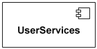

Компонент с иконкой

**Структурированный классификатор** позволяет показать, как разные свойства (читай как поля) этого классификатора взаимодействуют друг с другом и с внешним миром с помощью интерфейсов. Обратите внимание, что так как речь идёт именно о свойствах классификатора, то **мы работаем с их конкретными экземплярами**.

С точки зрения прагматики **компонент** выделяет какую-то часть системы, скрывая детали реализации, предоставляя во внешний мир набор интерфейсов и запрашивая другие интерфейсы. Компоненты как раз позволяют выделять крупные и, что немаловажно, заменяемые модули системы. Возможность замены определяется тем, что для работы модуля нужны только интерфейсы.

Компоненты могут определяться как сами по себе, и тогда это будет просто верхнеуровневая диаграмма, так и с внутренней структурой (например, вложенными компонентами или классами), и тогда это будет более приближенная к реализации диаграмма.

Компонент не обязан соответствовать одному классу или одному пакету. Чаще компонент группирует набор классов и пакетов, которые вместе реализуют заметную часть системы: клиентское приложение, backend API, модуль уведомлений, модуль оплаты, подсистему отчётов, адаптер внешней системы.

## Соединители и порты

Как следует из понятия компонента, он может содержать в себе другие классификаторы, взаимодействующие между собой и с внешним миром. При этом сам компонент также может взаимодействовать с внешним миром, т.е. содержимое компонента не обязано описывать его самого полностью.

Чтобы показать точку взаимодействия с компонентом, используются **порты**. Порт показывается с помощью квадратика на границе компонента и является его частью. Порт может требовать и предоставлять несколько интерфейсов. С точки зрения классификатора порт является его свойством (т.е. полем).

Порт с интерфейсами

Чтобы показать взаимодействие между портами (или другого структурированного классификатора), используются соединители. **Соединитель** — это фича, показывающая связь между экземплярами частей классификатора. Соединители бывают двух типов:

- **Сборочный соединитель** соединяет два порта, показывая их взаимодействие. Частный случай сборочного соединителя — порт одного компонента предоставляет интерфейс, а порт другого компонента его запрашивает.

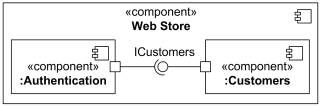

Сборочный соединитель

- **Делегирующий соединитель** связывает порт с одной из частей классификатора, если он запрашивает интерфейс или предоставляет его.

Делегирующие соединитель, предоставляющий интерфейс

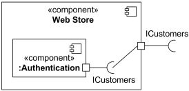

Делегирующий соединитель, запрашивающий интерфейс

# Различные виды системной архитектуры ИС

Теперь перейдём к системной архитектуре. Давайте в целом вспомним, что уровень системной архитектуры описывает взаимодействие программных и аппаратных компонентов системы и её пользователей.

Типовая ИС, как вы подозреваете, не является строго клиентским или строго серверным приложением. Всегда есть программные компоненты, с которыми взаимодействует конечный пользователь, и программные компоненты, которые работают с данными. Есть большая пачка вариаций на тему того, какие конкретно программные и аппаратные компоненты выделяются, однако в целом полезно держать в голове историю развития видов системной архитектуры, поскольку все современные решения (микросервисы, брокеры сообщений и пр.) являются надстройкой над базовыми идеями.

## Файл-серверная архитектура

Несмотря критику этой архитектуры как устаревшей, сегодня по-прежнему не только функционируют, но и разрабатываются решения, основанные на этой архитектуре.

Обратим внимание, что в этом случае на сервер возложена только функция хранения данных, а вся обработка, включая организацию доступа к данным, осуществляется на стороне клиента. В результате, во-первых, возрастает нагрузка на телекоммуникационные компоненты, а во-вторых либо возникает либо сложность в обеспечении целостности данных (слой доступа данных распределен по клиентам), либо падает производительность, если мы делаем блокирование данных на время доступа одного из клиентов.

Преимущества:

- Многопользовательский режим работы с данными;
- Возможность централизованного управления доступом к данным;
- Низкая стоимость разработки;

Недостатки:

- Низкая производительность;
- Низкая надежность;
- Слабые возможности масштабирования;

## Двухзвенная архитектура

Ключевая особенность – абстрагирование от внутреннего представления данных. Клиентские приложения манипулируют данными с точки зрения их логической схемы, а не физического хранения. Это позволяет находить баланс между обеспечением целостности данных и производительностью.

В таком варианте архитектуры представление полностью реализуется на стороне клиента, а доступ к данным на стороне сервера, но с тем, где расположен слой бизнес-логики однозначного решения не было. Это привело в дальнейшем  к двум вариантам реализации: «толстый клиент» и «тонкий клиент».

Преимущества:

- Полная поддержка многопользовательской работы;
- Гарантия целостности данных;

Недостатки:

- (для толстого клиента) Бизнес логика приложений реализована в клиентском ПО. При любом изменении алгоритмов, необходимо обновлять пользовательское ПО на каждом клиенте.
- (для толстого клиента) Высокая сложность администрирования и настройки рабочих мест пользователей системы.
- (для толстого клиента) Высокие требования к аппаратному обеспечению на клиентских местах
- (для тонкого клиента) Высокие требования к пропускной способности коммуникационных каналов с сервером.
- (для тонкого клиента) Высокие требования к аппаратной производительности сервера.
- (для толстого клиента) Высокая сложность разработки системы из-за необходимости выполнять бизнес-логику и обеспечивать пользовательский интерфейс в одной программе
- Слабая защита данных от взлома в связи с прямым доступом к базе данных.

## Трёхзвенная архитектура

Четкое разделение логики обработки данных от логики представления доступа к данным привели к появлению трехзвенной (трехслойной) клиент-серверной архитектуры.

Преимущества:

- Простая реализация тонкого клиента.
- Минимизация потока данных между клиентом и сервером приложений, возможность использовать быстрый канал связи между сервером приложений и СУБД, одновременно снимая лишнюю нагрузку с сервера СУБД.
- Возможность масштабировать производительность за счет использования множества серверов приложений в кластере. Следует отметить, что это будет проявлением распределенности вычислений, но не будет в полной мере распределенной архитектурой, поскольку хранилище данных остается единым и становится узким местом.
- Удобство в обновлении ПО, проведении регламентных работ по техническому обслуживанию и ремонту и т.д.

Недостатки:

- Выше расходы на администрирование и обслуживание серверной части.

## Толстый и тонкий клиент

В случае реализации клиент-серверной архитектуры с толстым клиентом основная часть обработки данных осуществляется на стороне клиента. В случае тонкого клиента, на клиентское приложение возлагается в основном функционал представления информации, а обработка преимущественно осуществляется на сервере.

**Трехслойная (трехзвенная) архитектура с тонким клиентом**

Преимущества:

1. Простота обновления клиентского ПО, реже возникает необходимость в таких обновлениях.
2. Минимальные требования к аппаратному обеспечению АРМ с клиентским ПО.
3. Удобство в реализации кроссплатформенности клиентского ПО.
4. Проще контролировать доступ к данным.

Недостатки:

1. Высокие требования к производительности и надежности телекоммуникационной подсистемы. Невозможность пользоваться ИС в случае отказа канала доступа к серверу.
2. Высокие требования к производительности серверного оборудования, необходимость балансировки нагрузки.

**Трехслойная (трехзвенная) архитектура с толстым клиентом**

Преимущества:

1. Снижение нагрузки на сервер приложений.
2. Возможность ограниченного доступа к функционалу в случае отказа канала доступа к серверу, возможность работать в условиях неустойчивых характеристик каналов связи.

Недостатки:

1. Повышенные требования к аппаратному обеспечению АРМ с клиентским ПО
2. Сложнее реализовывать кроссплатформенное клиентское ПО
3. Более дорогостоящее администрирование, частые обновления клиентского ПО с необходимостью доступа к АРМ

# Диаграмма развёртывания

Теперь у вас должно было сложиться понимание, что мы хотим описать, и нужно только понять, как именно это сделать с помощью UML. Для этого, как было сказано в начале, существует специальная диаграмма развёртывания (или размещения).

Сама по себе **диаграмма развёртывания** — это структурная диаграмма, которая показывает, каким образом программные компоненты размещаются на целевых узлах развёртывания.

## Узлы и подключения

<aside>
💡

**Узел** с точки зрения UML — это вычислительный ресурс, на котором размещаются артефакты. Узел показывается в виде параллелепипеда. Формально узел является классификатором и одновременно целью развёртывания (`DeploymentTarget`).

</aside>

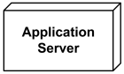

Просто узел

Узлы можно вкладывать как друг в друга, как с помощью композиции, так и визуально, непосредственно один внутрь другого.

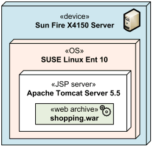

Вложенность узлов

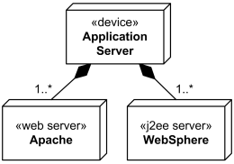

Вложенность узлов с помощью композиции

Узлы обычно не используются сами по себе, а дополняются ключевыми словами `«device»` или `«executionEnvironment»`. С точки зрения спецификации это именно ключевые слова, а не стереотипы, однако большинство инструментов рассматривает их как стереотипы, поэтому не удивляйтесь :)

**Устройство** (узел с ключевым словом device) — это физическое вычислительное устройство. Стандартные стереотипы устройств не предусмотрены, однако всегда можно добавить свои стереотипы, например:

- «application server»;
- «client workstation»;
- «mobile device»;
- «embedded device».

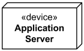

Пример устройства

**Среда выполнения** (узел с ключевым словом `«executionEnvironment»`) — это стандартизованное ПО, которое необходимо для работы компонентов. Тут тоже нет стандартных стереотипов, однако можно выделить некоторые нестандартные стереотипы:

- «OS»;
- «workflow engine»;
- «database system»;
- «J2EE container»;
- «web server»;
- «web browser».

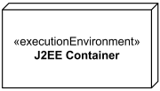

Пример среды выполнения

Узлы могут быть связаны друг с другом с помощью специального типа ассоциаций, **подключений** (communication path). На диаграмме развёртывания они показывают, какие узлы связаны и какие протоколы взаимодействия используются. Как и на обычных ассоциациях, можно указывать кратность, чтоб показать наличие нескольких экземпляров узлов, это полезно, например, в случаях, когда у нас есть балансировщик нагрузки и за ним несколько серверов.

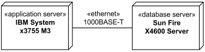

Физическое соединение между устройствами

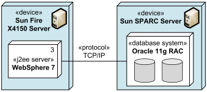

Соединение между средами выполнения

Важный момент, на который хочется обратить внимание: не забывайте про модель OSI, когда указываете протоколы взаимодействия между узлами. Некорректно показывать, например, что два устройства подключаются по HTTP, а браузер и веб-сервер — по TCP/IP. В первом случае идеально было бы показать физическое подключение по Ethernet или Wi-Fi, а во втором — по HTTPS.

Выбор протокола должен соответствовать уровню детализации модели. Между браузером и веб-сервером уместен HTTPS. Между приложением и PostgreSQL можно указать PostgreSQL protocol, а при более низком уровне детализации — TCP. Между физическими устройствами лучше показывать физическую или сетевую среду связи, если именно она важна для модели.

## Артефакты и их развёртывание

<aside>
💡

**Артефакт** — это классификатор, который показывает файл, документ или другой объект, который используется или создаётся в процессе разработки программы или появляется в ходе её установки и использования.

</aside>

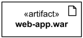

Простой артефакт

Артефакт показывается в виде прямоугольника с иконкой в углу и ключевым словом `«artifact»`.

Артефакты могут иметь дополнительные стереотипы:

| `«file»` | A physical file in the context of the system developed. |
| --- | --- |
| `«document»` | A generic file that is not a «source» file or «executable». |
| `«source»` | A source file that can be compiled into an executable file. |
| `«library»` | A static or dynamic library file. |
| `«executable»` | A program file that can be executed on a computer system. |
| `«script»` | A script file that can be interpreted by a computer system. |

Поскольку артефакт — это классификатор, то они могут быть связаны отношением ассоциации и производными, например, композицией. Также можно делать артефакты зависимыми друг от друга.

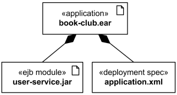

Артефакт с двумя вложенными артефактами

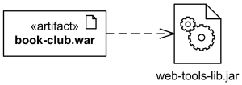

Зависимость артефакта

Основное назначение артефактов — **материализация** (манифестация) других элементов модели, например, компонентов. Другими словами, артефакт является физической единицей, которая реализует или представляет логический элемент модели. Развёртывание — это уже отдельное отношение, которое показывает размещение артефакта на цели развёртывания.

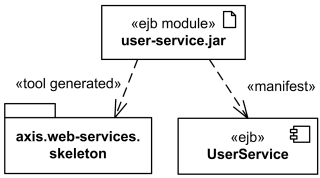

Пример отношения материализации

**Отношение материализации** — это отношение зависимости (если быть более точным, это подтип отношения абстракции, более близкий к реализации), которое показывается так же, как и сама зависимость, но подписывается ключевым словом `«manifest»`.

В UML 2 с помощью отношения материализации можно связывать не только непосредственно компоненты, но и другие элементы модели, которые могут быть представлены артефактом. Например, артефакт может материализовать компонент, класс или пакет. Это всё ещё не означает размещение на узле: размещение показывается отношением deployment.

Как показать, что артефакт развёртывается на каком-то узле? Есть два способа. Первый и самый часто употребимый: показать артефакт внутри нужного узла. Второй способ — связать артефакт и узел отношением зависимости с ключевым словом `«deploy»`.

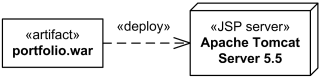

Пример развёртывания с помощью отношения

Также можно показать параметры развёртывания того или иного артефакта (например, конфигурационные файлы), это делается с помощью **спецификации развёртывания** (deployment specification). Она является подтипом артефакта с ключевым словом `«deployment spec»`.

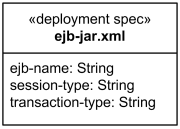

Спецификация развёртывания с тремя параметрами

В нотации спецификацию развёртывания обычно прикрепляют к развёрнутому компоненту или артефакту обычной dependency-стрелкой. Семантически такая спецификация параметризует deployment, а не является произвольной ассоциацией между двумя файлами.

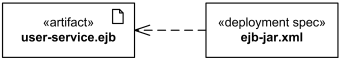

Пример с зависимостью

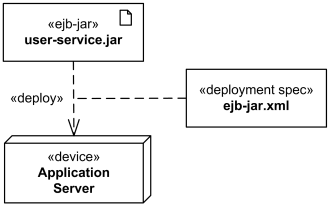

Пример с ассоциацией

# Что дальше?

Теперь у нас есть все средства, чтобы описать полную структуру нашей ИС. Чаще всего одной структуры недостаточно, и её нужно уточнять конкретными описаниями поведения экземпляров объектов как самостоятельно, так и во взаимодействии с другими экземплярами. Для этого используются диаграммы состояния и диаграммы последовательности, которые как раз позволяют раскрыть это в модели.
