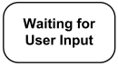
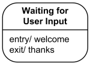
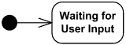
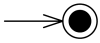
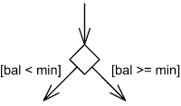
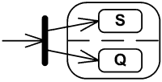
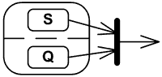
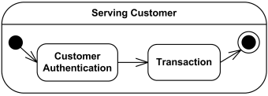
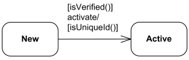
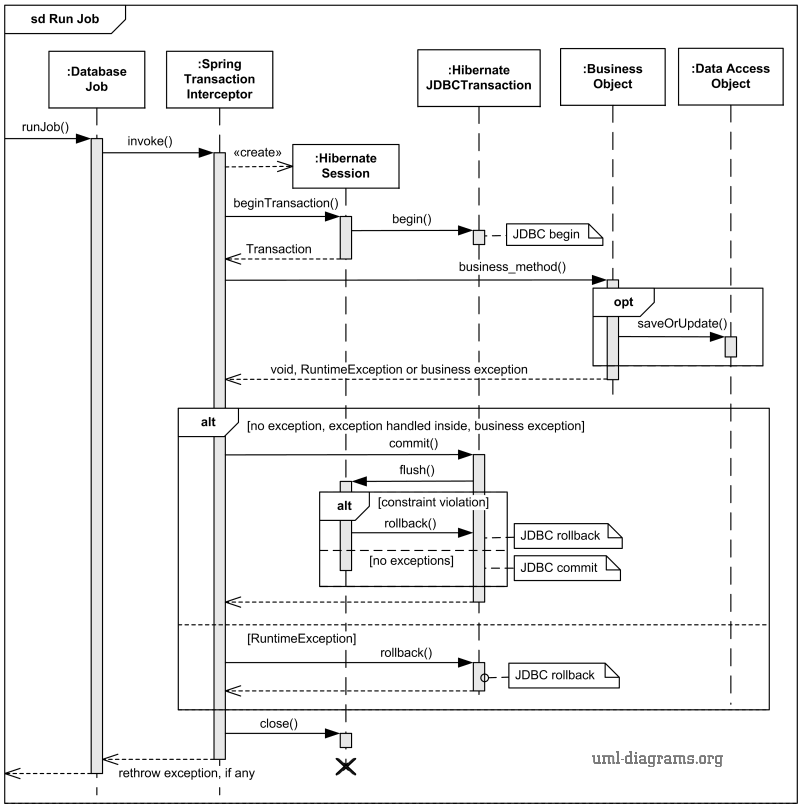

---

title: Программная архитектура ИС. Диаграмма состояний. Диаграмма последовательности

---

# Quick recap

На двух прошлых лекциях мы посмотрели, как можно показать структуру ИС на различных уровнях архитектуры с использованием диаграммы классов, диаграммы компонентов и диаграммы пакетов. Это позволяет нам выделить различные части системы и связи между ними, но пока что на этом уровне мы никак не показывали поведение системы

Напомним, что в UML выделяются две группы канонических диаграмм, структурные и поведенческие. Со структурными диаграммами мы уже подробно познакомились на прошлых лекциях, а сегодня разберём поведенческие диаграммы, помогающие описать работу ИС на уровне программной архитектуры.

Эта лекция, опять же, будет без теоретического введения, поскольку тут мы будем максимально близко к коду.

# Диаграмма состояний

Первая диаграмма, с которой мы сегодня познакомимся — диаграмма состояний (в UML 2 её называют диаграммой автомата). Эта диаграмма показывает поведение части рассматриваемой системы, используя аппарат конечных автоматов. Представление о конечных автоматах, по идее, у вас должно быть из курса дискретной математики :)

В общем и целом диаграмма состояний довольно простая, основной элемент на ней — состояние с переходами между этими состояниями. С этой точки зрения диаграмма состояний сильно похожа на уже известную вам диаграмму деятельности. Дальше мы увидим, что на этом сходства не заканчиваются.

## Базовая нотация

Состояния на диаграмме могут быть трёх типов, и самый базовый тип — простое состояние (оно так и называется). **Простое состояние** — это прямоугольник со скруглёнными краями. Что может содержать в себе простое состояние:

- **Название**. Как ни странно, оно является опциональным, и при этом все состояния без названий являются различными состояниями.
- **Внутреннюю деятельность**. С помощью этого элемента нотации можно показать, что при выполнении определённых условий происходит действие (**эффект**), не изменяющее состояния. Есть три предопределённых условия: `entry` (при входе в состояние), `do` (при нахождении в состоянии) и `exit` (при выходе из состояния).
- **Внутренние переходы**. По смыслу они схожи с описанием внутренней деятельности, но позволяют указывать свои условия и события срабатывания эффектов.

Состояние без конкретики

Состояние с действиями при входе в него и выходе из него

Эти состояния могут соединяться **переходами**, которые в самом простом случае выглядят как направленная стрелка без надписей. В этом смысле переходы между состояниями аналогичны переходам между действиями на диаграмме деятельности.

В UML также выделяются **псевдосостояния**, которые не показывают непосредственно состояние, но позволяют смоделировать более сложное поведение, чем просто переход из одного состояния в другое. Часть этих псевдосостояний вы уже знаете (:

**Начальное псевдосостояние** показывает “точку входа” в диаграмму. В простых случаях его можно не показывать, но для удобства 

Начальное псевдосостояние

Конечное состояние (почему-то не псевдо)

Выбор

Развилка и слияние

Переходное псевдосостояние

## Дополнительная нотация

Простые и ортогональные составные состояния, точки входа и выхода, необходимость начального псевдосостояния

Поверхностная и глубокая история

Описание переходов (триггеры, защитные условия, действия при переходе)

Виды триггеров: вызов метода, сигнал, событие приёма, триггер по времени, триггер по изменению

## Протоколы на диаграмме состояний

Протокол как средство описания жизненного цикла классификатора для внешних потребителей

Без истории, без действий в состояниях

Переходы описывают предусловие, триггер и постусловие

# Диаграмма последовательности

Диаграмма последовательности — это, наверно, сама популярная диаграмма UML. Основное назначение — показать некоторый протокол взаимодействия экземпляров классификаторов, обычно экземпляров классов.

Может показаться, что диаграмма последовательности — это просто другая нотация для диаграммы деятельности, но это не так. Диаграмма деятельности описывает процесс на более высоком уровне, с точки зрения конечного пользователя. Формально на диаграмме деятельности можно показывать и код, плюс можно показывать обмен сообщениями между действиями, но мы делаем упор именно на действия и их очерёдность. В диаграмме последовательности нас интересует, какими сообщениями мы обмениваемся между различными экземплярами классификаторов, т.е., например, показываем вызовы методов классов. Это более низкий уровень по сравнению с диаграммой деятельности.

Основные понятия:

- Линии жизни (обычно классы и действующие лица) и их выполнение
- Гейты (шлюзы) — место входа во взаимодействие и выхода из него
- Инвариант состояния экземпляра
- Траектория (трейс) — частично упорядоченная последовательность возникновения событий
- Взаимодействие — поведение участников, указывающее разрешённые и запрещённые траектории
- Сообщения — синхронный и асинхронный вызов операций, асинхронная отправка сигнала, создание и уничтожение экземпляра, ответные сообщения
- Потерянное и найденное сообщение
- Вложенные взаимодействия
- Фрагменты взаимодействия и операторы взаимодействия
    - **alt** - [**alternatives**](https://www.uml-diagrams.org/sequence-diagrams-combined-fragment.html#operator-alt)
    - **opt** - [**option**](https://www.uml-diagrams.org/sequence-diagrams-combined-fragment.html#operator-opt)
    - **loop** - [**iteration](https://www.uml-diagrams.org/sequence-diagrams-combined-fragment.html#operator-loop) (хотя бы min_count и максимум max_count)**
    - **break** - [**break](https://www.uml-diagrams.org/sequence-diagrams-combined-fragment.html#operator-break) (прерывает только тот фрагмент, в который он вложен)**
    - **par** - [**parallel**](https://www.uml-diagrams.org/sequence-diagrams-combined-fragment.html#operator-par)
    - **strict** - [**strict sequencing**](https://www.uml-diagrams.org/sequence-diagrams-combined-fragment.html#operator-strict)
    - **seq** - [**weak sequencing**](https://www.uml-diagrams.org/sequence-diagrams-combined-fragment.html#operator-seq)
    - **critical** - [**critical region](https://www.uml-diagrams.org/sequence-diagrams-combined-fragment.html#operator-critical) (критическая секция в параллельных потоках)**
    - **ignore** - [**ignore**](https://www.uml-diagrams.org/sequence-diagrams-combined-fragment.html#operator-ignore)
    - **consider** - [**consider**](https://www.uml-diagrams.org/sequence-diagrams-combined-fragment.html#operator-consider)
    - **assert** - [**assertion**](https://www.uml-diagrams.org/sequence-diagrams-combined-fragment.html#operator-assert)
    - **neg** - [**negative](https://www.uml-diagrams.org/sequence-diagrams-combined-fragment.html#operator-neg) (выделяем некорректный с точки зрения системы трейс)**

Стоит также отметить, что есть ещё две диаграммы, которые преследуют ту же цель, что и диаграмма последовательности. Это диаграмма коммуникации и диаграмма синхронизации.

# Что дальше?

А дальше как бы и ничего 😄 С точки зрения проектирования информационных систем мы посмотрели на всё, что может пригодиться для их анализа, моделирования и проектирования на различных уровнях:

- Функциональная архитектура — диаграммы использования и деятельности;
- Информационная архитектура — диаграммы деятельности и классов;
- Программная архитектура — диаграммы классов, компонентов и пакетов;
- Системная архитектура — диаграммы компонентов и развёртывания.

Какие диаграммы остались за бортом курса:

- Структурные диаграммы:
    - Диаграмма объектов (экземпляр диаграммы классов);
    - Диаграмма внутренней структуры (показываем сложный классификатор);
- Поведенческие диаграммы:
    - Диаграмма коммуникации (облегчённая диаграмма последовательности);
    - Обзорная диаграмма взаимодействия (смесь диаграмм деятельности и последовательности);
    - Диаграмма синхронизации (диаграмма последовательности с акцентом на время работы).

Как вы видите, ничего такого сверхнового (кроме диаграммы внутренней структуры) тут нет, поэтому эти диаграммы при необходимости можно посмотреть самостоятельно.

Если углубляться непосредственно в сам язык моделирования, то можно попробовать изучить, из чего он сам состоит и как работает, это приведёт нас к понятию метамодели UML. Эту метамодель можно дополнять (и вы это делали, например, добавляя свои стереотипы), но есть чуть более продвинутый способ расширить сам UML — диаграмма профилей. Соответственно, последняя лекция будет посвящена механизмам расширения UML, плюс мы завершим наш курс обзором того, как сейчас используется UML, что можно с этим сделать и что можете для этого сделать конкретно вы 🙂