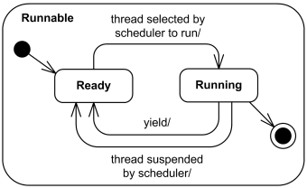

---

title: "Поведение реализации, согласованность модели и итоговая трассировка"

---

# Quick recap

На двух прошлых лекциях мы посмотрели, как можно показать структуру ИС на различных уровнях архитектуры с использованием диаграммы классов, диаграммы компонентов и диаграммы пакетов. Это позволяет нам выделить различные части системы и связи между ними, но пока что на этом уровне мы никак не показывали поведение системы

Напомним, что в UML выделяются две группы канонических диаграмм, структурные и поведенческие. Со структурными диаграммами мы уже подробно познакомились на прошлых лекциях, а сегодня разберём поведенческие диаграммы, помогающие описать работу ИС на уровне программной архитектуры.

Эта лекция, опять же, будет без теоретического введения, поскольку тут мы будем максимально близко к коду.

Но финальная задача шире, чем изучить ещё две диаграммы. Нам нужно проверить, что вся модель ИС согласована: требования связаны с use cases, сценарии отражены на activity diagram, информационные объекты попали в концептуальную модель, технические классы реализуют сценарии, а компоненты и deployment учитывают архитектурные решения.

# Диаграмма состояний

Первая диаграмма, с которой мы сегодня познакомимся — диаграмма состояний (в UML 2 её называют диаграммой автомата). Эта диаграмма показывает поведение части рассматриваемой системы, используя аппарат конечных автоматов. Представление о конечных автоматах, по идее, у вас должно быть из курса дискретной математики :)

В общем и целом диаграмма состояний довольно простая, основной элемент на ней — состояние с переходами между этими состояниями. С этой точки зрения диаграмма состояний сильно похожа на уже известную вам диаграмму деятельности. Дальше мы увидим, что на этом сходства не заканчиваются.

## Базовая нотация

Состояния на диаграмме могут быть трёх типов, и самый базовый тип — простое состояние (оно так и называется). **Простое состояние** — это прямоугольник со скруглёнными краями. Что может содержать в себе простое состояние:

- **Название**. Как ни странно, оно является опциональным, и при этом все состояния без названий являются различными состояниями.
- **Внутреннюю деятельность**. С помощью этого элемента нотации можно показать поведение, связанное с состоянием: `entry` выполняется при входе в состояние, `do` выполняется пока объект находится в состоянии, `exit` выполняется при выходе из состояния. Это не условия, а виды поведения состояния.
- **Внутренние переходы**. По смыслу они схожи с описанием внутренней деятельности, но позволяют указывать свои условия и события срабатывания эффектов.


Состояние без конкретики


Состояние с действиями при входе в него и выходе из него

Эти состояния могут соединяться **переходами**, которые в самом простом случае выглядят как направленная стрелка без надписей. В этом смысле переходы между состояниями аналогичны переходам между действиями на диаграмме деятельности.

В UML также выделяются **псевдосостояния**, которые не показывают непосредственно состояние, но позволяют смоделировать более сложное поведение, чем просто переход из одного состояния в другое. Часть этих псевдосостояний вы уже знаете (:

**Начальное псевдосостояние** показывает начальную вершину региона автомата. Для диаграммы, которая описывает исполняемый жизненный цикл, его обычно стоит показывать явно, чтобы было понятно, с какого состояния начинается поведение.


Начальное псевдосостояние

**Конечное состояние** показывает завершение региона автомата. Если диаграмма описывает весь жизненный цикл объекта, это можно трактовать как завершение жизненного цикла; если показан только фрагмент поведения, завершается только рассматриваемая часть.


**Choice** позволяет выбрать дальнейший переход по guard-условиям.


**Fork** и **join** позволяют показать параллельные ветви поведения, если объект действительно проходит параллельные активности.


Переход на диаграмме состояний обычно описывается в формате:

```text
trigger [guard] / effect
```

где trigger — событие или вызов, guard — условие перехода, effect — действие при переходе.

## Дополнительная нотация

Кроме простых состояний есть составные состояния. Они помогают скрыть внутреннюю детализацию и показать, что несколько вложенных состояний относятся к одному крупному этапу жизненного цикла.


Составные состояния могут быть простыми или ортогональными. Ортогональные регионы используются, когда объект одновременно находится в нескольких независимых поджизненных циклах. Использовать их стоит осторожно: если параллельность не важна для предметной области, диаграмма станет сложнее без пользы.

Поверхностная и глубокая история позволяют вернуться в ранее активное вложенное состояние. В учебных моделях это редко нужно, но полезно знать, что такая нотация существует для сложных жизненных циклов.

Виды триггеров: вызов операции, сигнал, любое принимаемое событие, событие времени, событие изменения. Guards на переходах должны согласовываться с бизнес-правилами и атрибутами концептуального класса.

## Протоколы на диаграмме состояний

Протокол как средство описания жизненного цикла классификатора для внешних потребителей



Без истории, без действий в состояниях


Переходы описывают предусловие, триггер и постусловие


Протокольная диаграмма состояний описывает допустимые операции классификатора с точки зрения внешнего потребителя. Она отвечает не на вопрос “что происходит внутри UI”, а на вопрос “какие операции допустимы над объектом в данном состоянии”.

# Диаграмма последовательности

Диаграмма последовательности — это, наверно, сама популярная диаграмма UML. Основное назначение — показать некоторый протокол взаимодействия экземпляров классификаторов, обычно экземпляров классов.

Может показаться, что диаграмма последовательности — это просто другая нотация для диаграммы деятельности, но это не так. Диаграмма деятельности описывает процесс на более высоком уровне, с точки зрения конечного пользователя. Формально на диаграмме деятельности можно показывать и код, плюс можно показывать обмен сообщениями между действиями, но мы делаем упор именно на действия и их очерёдность. В диаграмме последовательности нас интересует, какими сообщениями мы обмениваемся между различными экземплярами классификаторов, т.е., например, показываем вызовы методов классов. Это более низкий уровень по сравнению с диаграммой деятельности.

Основные понятия:

- Линии жизни, представляющие участников взаимодействия: экземпляры, роли, части системы или действующих лиц
- Гейты (шлюзы) — место входа во взаимодействие и выхода из него
- Инвариант состояния экземпляра
- Траектория (трейс) — частично упорядоченная последовательность возникновения событий
- Взаимодействие — поведение участников, указывающее разрешённые и запрещённые траектории
- Сообщения — синхронный и асинхронный вызов операций, асинхронная отправка сигнала, создание и уничтожение экземпляра, ответные сообщения
- Потерянное и найденное сообщение
- Вложенные взаимодействия
- Фрагменты взаимодействия и операторы взаимодействия
    - **alt** - [**alternatives**](https://www.uml-diagrams.org/sequence-diagrams-combined-fragment.html#operator-alt)
    - **opt** - [**option**](https://www.uml-diagrams.org/sequence-diagrams-combined-fragment.html#operator-opt)
    - **loop** - [**iteration](https://www.uml-diagrams.org/sequence-diagrams-combined-fragment.html#operator-loop) (хотя бы min_count и максимум max_count)**
    - **break** - [**break](https://www.uml-diagrams.org/sequence-diagrams-combined-fragment.html#operator-break) (выполняет свой операнд вместо остатка охватывающего фрагмента взаимодействия)**
    - **par** - [**parallel**](https://www.uml-diagrams.org/sequence-diagrams-combined-fragment.html#operator-par)
    - **strict** - [**strict sequencing**](https://www.uml-diagrams.org/sequence-diagrams-combined-fragment.html#operator-strict)
    - **seq** - [**weak sequencing**](https://www.uml-diagrams.org/sequence-diagrams-combined-fragment.html#operator-seq)
    - **critical** - [**critical region](https://www.uml-diagrams.org/sequence-diagrams-combined-fragment.html#operator-critical) (критическая секция в параллельных потоках)**
    - **ignore** - [**ignore**](https://www.uml-diagrams.org/sequence-diagrams-combined-fragment.html#operator-ignore)
    - **consider** - [**consider**](https://www.uml-diagrams.org/sequence-diagrams-combined-fragment.html#operator-consider)
    - **assert** - [**assertion**](https://www.uml-diagrams.org/sequence-diagrams-combined-fragment.html#operator-assert)
    - **neg** - [**negative](https://www.uml-diagrams.org/sequence-diagrams-combined-fragment.html#operator-neg) (выделяем некорректный с точки зрения системы трейс)**

В учебной модели основной упор стоит делать на `alt`, `opt`, `loop` и `par`. Остальные операторы полезны, но легко перегружают диаграмму, если нет явной причины их использовать.


Стоит также отметить, что есть ещё две диаграммы, которые преследуют ту же цель, что и диаграмма последовательности. Это диаграмма коммуникации и диаграмма синхронизации.

# Что дальше?

С точки зрения проектирования информационных систем мы прошли основную цепочку модели:

- предметная область и требования;
- акторы, граница системы и варианты использования;
- спецификация сценариев и диаграммы деятельности;
- словарь, бизнес-правила и концептуальная диаграмма классов;
- техническая диаграмма классов и пакеты;
- компоненты, интеграционные границы и развёртывание;
- диаграммы состояний и последовательности;
- итоговая проверка согласованности через трассируемость.

Какие диаграммы остались за бортом курса:

- Структурные диаграммы:
    - Диаграмма объектов (показывает экземпляры классификаторов и связи между ними);
    - Диаграмма внутренней структуры (показываем сложный классификатор);
- Поведенческие диаграммы:
    - Диаграмма коммуникации (показывает взаимодействие через архитектурные связи между линиями жизни и нумерацию сообщений);
    - Обзорная диаграмма взаимодействия (специализированный вариант activity diagram, где узлами являются взаимодействия или ссылки на них);
    - Диаграмма синхронизации (timing diagram, где основной акцент сделан на изменении состояний и условий во времени).

Как вы видите, ничего такого сверхнового (кроме диаграммы внутренней структуры) тут нет, поэтому эти диаграммы при необходимости можно посмотреть самостоятельно.

Главный итог курса: UML-модель ценна не количеством диаграмм, а тем, насколько разные представления одной ИС согласованы между собой. Если каждая диаграмма появляется из предыдущих артефактов и проверяется связями с остальной моделью, UML становится инструментом проектирования, а не набором картинок.
