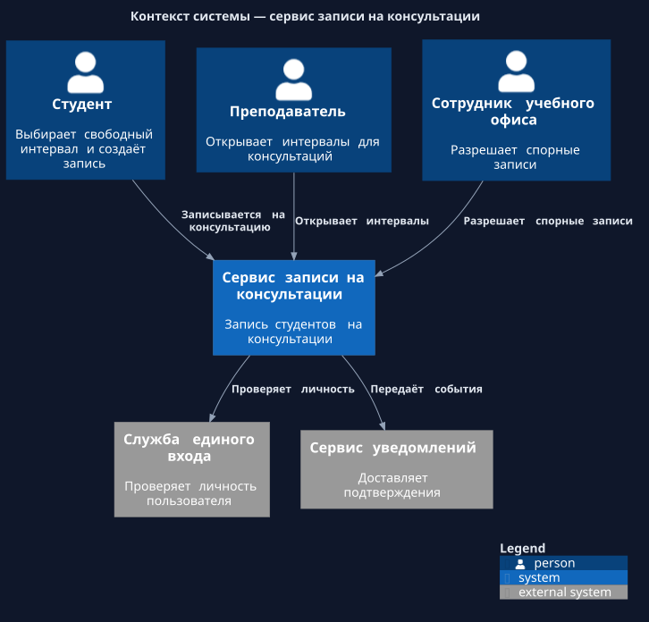

## Материалы лекции

[Архитектурные представления C4](/c4/), [Контекст системы и системный ландшафт](/c4/context), [Контейнеры и границы выполнения](/c4/containers), [Компоненты и представление кода](/c4/components-and-code), [Динамика и развёртывание в C4](/c4/dynamic-and-deployment), [C4, UML и согласованность модели](/c4/uml-and-consistency).

## Развёрнутый тезисный план

| Время | Тезисы и действие преподавателя |
| --- | --- |
| 0–10 | Задать вопрос архитектурного представления, соотнести его с материалами курса; резерв вопросов — 2 мин. |
| 10–25 | Дать компактную теорию уровней C4 и границ; соотнести C4 с UML без повторения нотаций; резерв вопросов — 3 мин. |
| 25–35 | Зафиксировать условие демонстрации, исходные данные и нотацию, вводя обозначения по мере применения; резерв вопросов — 2 мин. |
| 35–50 | Построить на экране контекст сервиса записи, проверить границу и направления связей; резерв вопросов — 3 мин. |
| 50–70 | Построить на экране контейнеры базового решения, исправить намеренную ошибку границы; резерв вопросов — 4 мин. |
| 70–85 | Пройти готовые представления компонентов, динамики и развёртывания; проследить изменение требования; резерв вопросов — 1 мин. |
| 85–90 | Сверить трассировку, уровни C4 и связь с UML, подвести итог. |

**Резерв вопросов** распределён по ходу занятия: преподаватель использует его для уточнения текущего представления, а не добавляет учебные задания.

## Полный материал лекции

### Компактная теория: что уточняет C4

C4 — набор согласованных архитектурных представлений, а не замена требованиям, предметной модели или UML. Начинаем с вопроса читателя и выбираем самый крупный уровень, на котором на него можно ответить. Границу системы, акторов и цели уже задают [стейкхолдеры и граница](/modelling/stakeholders-and-boundary), [варианты использования](/notation/usecase-diagrams) и их [спецификации](/modelling/use-case-specification).

| Представление | Вопрос читателя | Элемент, который уточняется |
| --- | --- | --- |
| Контекст | Что входит в проектируемую систему и с кем она взаимодействует? | одна программная система среди людей и внешних систем |
| Контейнеры | Из каких выполняемых приложений и хранилищ она состоит? | система на контекстном уровне |
| Компоненты | Какие устойчивые части ответственны за важное поведение внутри одного контейнера? | ровно один контейнер |
| Код | Как реализован выбранный компонент? | компонент, когда кода без этого не понять |
| Динамика | Как архитектурно значимые участники действуют в одном случае? | элементы статического представления |
| Развёртывание | Где выполняются экземпляры контейнеров? | контейнеры и их связи |

Контейнер — не Docker-контейнер, сервер, таблица или класс: это отдельно воспринимаемая граница выполнения приложения либо хранилища. Компонент не становится контейнером от того, что у него есть интерфейс или пакет исходного кода. Подробности о слоях, интерфейсах и технических классах не повторяем: используем [программную архитектуру и слои](/modelling/software-architecture-and-layers), [диаграммы компонентов UML](/notation/component-diagrams) и [технические диаграммы классов](/notation/technical-class-diagrams).

UML и C4 отвечают на связанные, но не одинаковые вопросы. C4 отбирает масштаб и уровень архитектурного обзора; UML даёт строгую семантику конкретной нотации. Поэтому контейнер C4 не обязан совпадать с UML-компонентом, пакетом или классом. Для подробного порядка сообщений обращаемся к [диаграммам последовательности](/notation/sequence-diagrams), для узлов и артефактов — к [диаграммам развёртывания UML](/notation/deployment-diagrams). Не дублируем одну и ту же информацию на всех диаграммах.

### Демонстрация: сервис записи на консультации

#### Условие и исходная модель

Демонстрация отвечает на требование: студент записывается только на открытый свободный интервал преподавателя. Перед началом на доске или в редакторе зафиксированы условия:

- преподаватель `T-17` открыл `ConsultationInterval I-42`;
- студент `S-9` прошёл внешнюю проверку личности;
- новая `Booking` принадлежит ровно одному `Student` и ровно одному `ConsultationInterval`;
- у интервала хранится история `0..*` записей, но активна не более одна запись в состояниях `Created` или `Confirmed`; `Cancelled` не активна и сохраняется в истории;
- команда владеет сервисом записи, но не внешними SSO и сервисом уведомлений;
- сбой уведомления не отменяет уже сохранённую запись.

Базовое решение — серверно-рендеримое веб-приложение и реляционная база данных. Внешние SSO и сервис уведомлений остаются за границей. `BookingService` оркестрирует создание и отмену, `Repository` атомарно обеспечивает единственность активной записи, а `NotificationChannel` скрывает поставщика уведомлений. Доменная запись не является ни SQL-моделью, ни отправителем писем.

#### Нотация вводится во время построения

Когда преподаватель рисует контекст, прямоугольник с названием «Сервис записи на консультации» обозначает **одну проектируемую программную систему**; человек и внешняя система остаются за её границей. Стрелка идёт от инициатора взаимодействия к получателю, а её подпись называет действие: не «использует», а «открывает интервалы» или «проверяет личность».

При переходе к контейнерам пунктирная рамка остаётся той же границей системы. Каждый внутренний прямоугольник теперь означает **выполняемое приложение или хранилище**, а не слой, класс либо развёрнутый сервер. Подпись связи включает направление и существенный канал: `HTTPS` или `SQL`. Компонентный уровень в этой части не рисуется: его обозначения будут разобраны на готовой диаграмме.

#### Построение контекста на экране

1. Нарисовать единственную рамку **«Сервис записи на консультации»**.
2. Снаружи добавить `Студент`, `Преподаватель`, `Служба единого входа` и `Сервис уведомлений`. При необходимости показать `Сотрудника учебного офиса` как роль, разрешающую спорные записи.
3. Провести только следующие направленные связи: `Студент → Сервис записи: записывается на консультацию`; `Преподаватель → Сервис записи: открывает интервалы`; `Сервис записи → Служба единого входа: проверяет личность`; `Сервис записи → Сервис уведомлений: передаёт событие`.
4. Проверить, что обе внешние службы не попали внутрь рамки: команда не владеет их поведением, данными или изменениями.

Итоговая спецификация контекста: в центре одна система; люди инициируют действия по отношению к ней; SSO и уведомления — внешние получатели исходящих зависимостей. Направление не меняется от того, что внешний сервис затем возвращает технический ответ.

На готовой схеме дополнительно показан учебный офис. Его связь направлена в сервис, а SSO и уведомления получают запросы из сервиса; это согласуется с построенной границей.

#### Построение контейнеров на экране

1. Сохранить ту же рамку системы и поместить внутрь `Веб-приложение (серверный рендеринг)` с ответственностью «показывает страницы, принимает команды записи и вызывает прикладную логику».
2. Добавить `Реляционная база данных` с ответственностью «хранит интервалы и историю записей; атомарно допускает не более одной активной записи на интервал».
3. Провести `Веб-приложение → Реляционная база данных: читает интервалы и атомарно сохраняет запись (SQL)`.
4. Добавить внешние зависимости без изменения границы: `Веб-приложение → Служба единого входа: проверяет личность (HTTPS)` и `Веб-приложение → Сервис уведомлений: передаёт событие через NotificationChannel`. Сохранение записи завершается до этой последней попытки.
5. Подписать, что рендеринг страниц происходит в веб-приложении; браузер пользователя — не внутренний контейнер.

Итоговая спецификация контейнерного представления: внутри ровно веб-приложение и реляционная БД; снаружи SSO и сервис уведомлений. Стрелки направлены от веб-приложения к БД и внешним системам. В модели нет отдельного SPA, сервера как контейнера, таблицы как контейнера или внутреннего «контейнера SSO».

Готовый результат фиксируется четырьмя связями из шагов выше. Сопоставьте его с [другими вариантами контейнерного представления](/c4/containers), только если останется время: выделение браузерного приложения или обработчика меняет архитектурное решение, а не просто добавляет детали рисунка.

#### Ошибка и исправление

Намеренная ошибка: поставить `BookingService` рядом с веб-приложением и БД как третий контейнер, а адаптер SSO поместить за границу системы вместе со службой единого входа.

Исправление: `BookingService`, `Repository` и реализация `NotificationChannel` — компоненты внутри серверно-рендеримого веб-приложения; их можно обсудить на следующем уровне, но они не получили отдельную границу выполнения. Внешней остаётся сама служба единого входа. После исправления контекстная граница, направления связей и состав двух базовых контейнеров не меняются.

#### Опциональный вариант

**Опционально:** если доставка уведомлений должна переживать недоступность поставщика, выделить фоновый обработчик как отдельный контейнер и передавать ему событие после сохранения записи. Это вариант надёжности, а не повод автоматически делить систему на контейнеры.

### Готовые представления: точный обход

Следующие представления подготовьте по таблицам ниже: это точные спецификации элементов и связей базового решения, а не новая архитектура. На занятии преподаватель открывает готовые схемы и объясняет их; повторно строить все фигуры не требуется.

#### Компоненты одного контейнера

Рамка — один контейнер `Веб-приложение (серверный рендеринг)`. Внутри находятся обработчик веб-запросов, служба записи, адаптер хранилища и адаптер уведомлений.

| Источник | Получатель | Ответственность связи |
| --- | --- | --- |
| Обработчик веб-запросов | Служба записи (`BookingService`) | передаёт команду создания |
| Служба записи | Адаптер хранилища (`BookingRepository`) | атомарно сохраняет при отсутствии активной записи |
| Адаптер хранилища | Реляционная БД вне рамки контейнера | выполняет операцию хранения |
| Служба записи | Адаптер уведомлений (`NotificationChannel`) | запрашивает отправку после сохранения |
| Адаптер уведомлений | Внешний сервис уведомлений | вызывает API поставщика |
| Обработчик веб-запросов | Внешняя служба единого входа | проверяет личность перед командой |

`BookingRepository` и `NotificationChannel` — контракты компонентов, не дополнительные контейнеры. Доменный класс `Booking` здесь не изображаем отдельным компонентом: его подробности остаются в технической модели лекции 5.

#### Динамика создания записи

Используйте те же контейнеры, что на построенной схеме:

| Порядок | Взаимодействие | Результат |
| --- | --- | --- |
| 1 | Студент → Веб-приложение | запрос записи; личность уже подтверждена |
| 2 | Веб-приложение → Реляционная БД | проверка и сохранение одной атомарной операцией |
| 3 | Реляционная БД → Веб-приложение | запись сохранена либо конфликт |
| 4, только после сохранения | Веб-приложение → Сервис уведомлений | попытка отправки |
| 5 | Веб-приложение → Студент | результат создания |

При конфликте шаг 4 отсутствует; при ошибке отправки сохранённая запись остаётся созданной. Номера задают порядок архитектурного сценария, а не интервалы времени. В отличие от sequence здесь не раскрываем операции предметной записи или все обратные сообщения.

#### Развёртывание

| Среда или узел | Размещённый экземпляр | Связь |
| --- | --- | --- |
| Устройство студента | браузер, внешний по отношению к сервису | HTTPS к веб-приложению |
| Сервер приложений, среда выполнения | серверно-рендеримое веб-приложение | соединение с БД; HTTPS к внешним службам |
| Сервер данных, СУБД | реляционная БД | принимает обращения веб-приложения |
| Внешние среды поставщиков | служба единого входа и сервис уведомлений | внутреннее размещение не раскрываем |

На готовой схеме подпишите экземпляры теми же именами контейнеров. Слои и классы не превращаются в узлы размещения. Отдельного клиентского приложения и фонового обработчика в этом решении нет; они потребовали бы изменения контейнерного представления.

### Трассировка изменения и согласованность

Рассмотрим одно изменение требования: **преподаватель может отменить уже занятой интервал; активная `Booking` переводится в `Cancelled`, остаётся в истории, а интервал снова не имеет активной записи**.

| Представление | Изменение или отсутствие изменения | Почему |
| --- | --- | --- |
| Требование и сценарий | Изменить | добавить команду отмены преподавателя, проверку состояния и наблюдаемый результат для студента |
| Контекст | Не изменять | преподаватель уже внешний инициатор, а граница сервиса, SSO и уведомлений не меняется |
| Контейнеры | Не изменять | выполнение и хранение остаются в том же веб-приложении и той же реляционной БД; новая команда не создаёт границу выполнения |
| Компоненты | Изменить спецификацию `BookingService` и `Repository` | сервис оркестрирует перевод состояния, репозиторий атомарно снимает активность и сохраняет историю |
| Динамика | Добавить альтернативный сценарий отмены | после команды преподавателя сохраняется `Cancelled`, затем только после фиксации передаётся событие уведомления |
| Развёртывание | Не изменять | команда отмены сама по себе не требует новых экземпляров, узлов, каналов или очереди |

Так трассировка показывает не «обновить все картинки», а связь изменения с ответственностью. Во всех затронутых видах сохраняются имена `Booking`, `ConsultationInterval`, `BookingService` и `Repository`, граница системы и направление внешних зависимостей. Проверку согласованности выполняют вместе с [трассируемостью модели](/modelling/model-consistency-and-traceability) и [проектными решениями](/modelling/project-decisions).

### Контрольная сверка C4

Перед публикацией архитектурного набора проверить:

- контекст показывает одну проектируемую систему, людей и внешние системы, а стрелки имеют действие и направление;
- контейнеры уточняют систему выполняемыми приложениями и хранилищами, а не слоями, классами, таблицами или серверами;
- каждый компонент раскрывает ровно один контейнер и имеет ответственность, отличную от соседних компонентов;
- представление кода добавлено только когда нужно объяснить реализацию компонента;
- динамика содержит только уже существующие участники, их порядок и архитектурно важный альтернативный исход;
- развёртывание сопоставляет экземпляр с контейнером и показывает существенные среду, узел и канал;
- UML-диаграмма выбрана для нужной семантики, а не подменена прямоугольником C4;
- требование, сценарий, C4-элементы, UML-артефакт и проектное решение можно проследить без переименования или смены границы.

Вернуться к [обзору C4](/c4).

## После лекции

Подготовьте контекст и контейнерную диаграмму учебной системы. Добавляйте компонентную, динамическую или развёртывание только для вопроса, который они действительно помогают решить.
