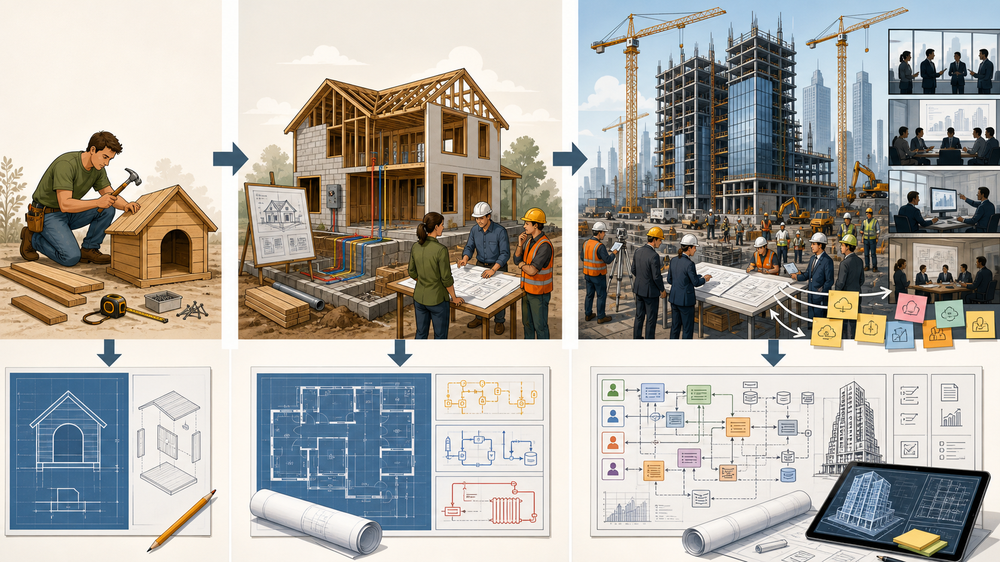

:::note[TL;DR]
Сначала мы учимся думать о системе через модели, а уже потом выбираем нотацию для фиксации решений. UML в этом курсе не цель сам по себе, а один из инструментов проектного моделирования информационной системы.
:::

В рамках большинства курсов, так или иначе связанных с чем-то, предшествующим разработке, первый вопрос обычно такой: зачем заниматься чем-то до написания кода, когда можно просто писать код и решать проблемы по мере необходимости? Для ответа удобно взять более фундаментальный пример, который достаточно близок к тому, что происходит при разработке ПО.

Допустим, вы хотите построить конуру для своей собаки. Задача простая и без подвохов. Для её выполнения не нужно каких-то особых знаний, кроме того, что такое конура, как она должна выглядеть и какого быть размера. С материалами всё тоже просто и понятно: доски, гвозди, молоток, рулетка, несколько часов или дней работы, и всё готово.

Следующий уровень сложности — построить дом для семьи. Это уже более сложная задача, так как одного визуального представления в голове не хватит, чтобы понять, что в итоге должно получиться. Перед началом строительства хочется сделать эскизы и чертежи, на которых будет зафиксирована планировка дома и разводка коммуникаций: освещение, отопление, водопровод. На этих же чертежах можно и нужно учесть пожелания жильцов и требования разных служб. Одних досок с гвоздями тоже не хватит: нужно заложить фундамент, определиться с несущими стенами, перекрытиями, материалами внешней и внутренней отделки.

Ещё один уровень сложности — новый офис. Его уже невозможно построить по принципу “примерно понятно, как должно быть”. Офис должен быть рассчитан не на нескольких человек, а на несколько компаний и сотни людей. Пожелания каждой компании, вложившейся в здание деньгами или другими ресурсами, нужно учесть при строительстве. Хуже того, часть пожеланий может появиться уже после начала работ, и такую возможность тоже надо заложить. Работать придётся не в одиночку: для таких масштабов нужна команда специалистов.

## Когда модели становятся необходимы

С информационными системами происходит то же самое. Простую программу иногда можно сделать “из головы”. Но система для реального процесса затрагивает людей, регламенты, данные, внешние системы, инфраструктуру и организационные ограничения. Если всё это не описать заранее хотя бы на нужном уровне детализации, команда быстро начинает проектировать разные системы под одним названием.

## Маршрут курса

И как раз здесь появляется основная задача курса — научиться строить проектную модель информационной системы: понять, что происходит в предметной области, какие требования есть у участников, какие процессы нужно поддержать, какие объекты важны, какие программные и архитектурные решения нужны.

UML и другие нотации появляются как инструменты фиксации этой работы. Они важны, но не являются начальной точкой. Сначала нужно понять, что именно мы хотим выразить, и только потом выбирать форму записи. На практике часто получается ещё и так, что компания хочет возвести офис-небоскрёб, но её подходы едва ли натягиваются на собачью конуру. Моделирование как раз помогает вовремя заметить этот разрыв между масштабом задачи и способом работы.

В курсе есть несколько устойчивых вопросов, которые будут повторяться в разных формах:

| Вопрос                            | Что появляется в модели                       |
| --------------------------------- | --------------------------------------------- |
| Что за область мы автоматизируем? | описание предметной области и границы системы |
| Кому и зачем нужна система?       | стейкхолдеры, пользователи, акторы, цели      |
| Что система должна делать?        | требования и варианты использования           |
| Как выполняется работа?           | сценарии и процессные модели                  |
| Какие понятия важны?              | словарь и концептуальная модель               |
| Как это может быть реализовано?   | техническая модель, слои, компоненты          |
| Где это будет работать?           | системная архитектура и развёртывание         |
| Как проверить целостность?        | трассируемость и согласованность модели       |

Такой порядок не запрещает возвращаться назад. В реальной работе требования уточняются, граница системы меняется, предметные термины переопределяются, а архитектурные решения пересматриваются. Но даже при итерациях полезно понимать общий маршрут: от реальности и потребностей к проектным решениям, которые можно объяснить, обсудить и проверить.
