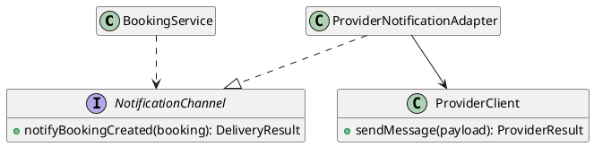

:::note[TL;DR]
Техническая диаграмма полезна, когда объясняет выбор получателя сообщения и расположение правила. GRASP предлагает вопросы для такого выбора, а паттерны — повторяющиеся решения при определённых условиях. Название паттерна не заменяет обоснование.
:::

Это дополнительное продолжение [объектно-ориентированного проектирования](/modelling/object-oriented-design). Оно не добавляет обязательного перечня паттернов в лабораторные работы.

## От сценария к ответственности

Студент отменяет свою запись. Сервис приложения загружает запись, предметный объект проверяет допустимость отмены, хранилище сохраняет изменение, адаптер инициирует уведомление. Внешний поставщик не решает, можно ли отменять запись, а предметная запись не знает HTTP-адрес поставщика.

Проверьте предлагаемую операцию четырьмя вопросами:

1. Какие данные и правила нужны, чтобы её выполнить?
2. Кто уже владеет этим знанием и за что отвечает?
3. Какой новый вид зависимости появится?
4. Что придётся менять при смене правила или внешней технологии?

## GRASP как набор вопросов

GRASP (*General Responsibility Assignment Software Patterns*) описывает принципы назначения ответственности. Следующая таблица служит ориентиром для обсуждения решения, а не требованием использовать все принципы на одной диаграмме.

| Принцип | Вопрос к решению | Применение и граница |
| --- | --- | --- |
| Information Expert | кто знает данные для правила? | запись знает свой статус и владельца; проверка конкурирующих записей дополнительно требует общего хранилища |
| Creator | кто естественно создаёт экземпляр? | координирующий сервис создаёт запись из команды; это не делает его владельцем всей предметной логики |
| Controller | кто принимает системное событие и координирует сценарий? | контроллер или сервис приложения передаёт работу другим объектам, не реализуя всё внутри одного метода |
| Low Coupling | сколько посторонних деталей нужно знать? | зависимость от `NotificationChannel` скрывает SDK поставщика |
| High Cohesion | насколько связаны обязанности элемента? | запись управляет жизненным циклом, адаптер — внешним протоколом |
| Polymorphism | можно ли менять поведение через общий контракт? | разные каналы уведомления выполняют один контракт без проверки конкретного класса в каждом сценарии |
| Pure Fabrication | нужна ли техническая ответственность вне предметных сущностей? | репозиторий изолирует хранение; его не нужно выдавать за предметное понятие |
| Indirection | поможет ли посредник разделить зависимости? | адаптер отделяет приложение от API поставщика; каждый лишний посредник требует причины |
| Protected Variations | какая граница должна пережить ожидаемое изменение? | контракт канала стабилен при смене провайдера, пока сохраняются обещания по результату и ошибкам |

Низкая связанность не означает отсутствие связей, а высокая связность обязанностей не требует собрать весь сценарий в одном классе. Например, выделение интерфейса без реального контракта может лишь переместить зависимость в другое место.

## Adapter: согласовать внешний протокол

Приложение ожидает `NotificationChannel.notifyBookingCreated`, а SDK поставщика предоставляет `ProviderClient.sendMessage`. Адаптер переводит параметры, результаты и ошибки между контрактами.

Смена SDK затрагивает адаптер. Доменное правило одной активной записи остаётся прежним. Адаптер не вправе превращать отказ провайдера в подтверждение фактической доставки: семантика `DeliveryResult` должна сохраняться. Эта схема продолжает базовое решение лекций с `NotificationChannel`.

## Strategy: выбрать заменяемое поведение

Добавим **отдельное учебное требование**: напоминание можно отправлять по email либо SMS в зависимости от предпочтения участника. `ReminderService` использует контракт `ReminderStrategy.send`, который реализуют `EmailReminderStrategy` и `SmsReminderStrategy`. Конфигурация или фабрика выбирает стратегию; сервис не переключается по именам конкретных провайдеров.

Strategy отвечает на вопрос «какой из взаимозаменяемых способов выполнить ответственность?», Adapter — «как согласовать этот способ с чужим API?». Одна реализация стратегии может использовать адаптер, но это разные основания изменения. Без альтернативного поведения отдельная иерархия стратегий может быть избыточной.

## Observer: уведомить несколько заинтересованных участников

При новом требовании несколько обработчиков могут реагировать на `BookingConfirmed`: например, аудит и подготовка напоминания. Издатель сообщает о событии через контракт подписки, не перечисляя конкретные классы подписчиков в предметной операции.

Observer описывает зависимость «издатель — подписчики». Он сам по себе **не гарантирует** асинхронность, порядок, доставку после перезапуска или ровно одну обработку. Для надёжного внешнего уведомления нужны отдельные решения о транзакционной границе, outbox, повторениях и идемпотентности. Не заменяйте существующий прямой вызов событием только ради названия паттерна.

## Обосновать решение в модели

В ADR укажите конкретное изменение, которое должна изолировать граница, рассмотренные альтернативы и цену решения. На диаграмме классов покажите контракт и реализации, на последовательности — кто выбирает реализацию и какие ошибки возвращаются. Не достаточно подписать класс `«Strategy»`, оставив сообщения и ответственность прежними.

Для самостоятельной проверки возьмите класс, который одновременно меняет статус записи, исполняет SQL и вызывает SDK уведомлений. Разделите ответственности, затем объясните, какие зависимости теперь допустимы. Возможное направление решения — доменный объект, сервис приложения, репозиторий и адаптер; точный состав зависит от сценария и ADR.

Продолжение — [проверка решений тестами по моделям](/modelling/model-based-testing). Дополнительное чтение — *Applying UML and Patterns*, представленная на [сайте автора Craig Larman](https://www.craiglarman.com/wiki/index.php?title=Books#Applying_UML_and_Patterns).
