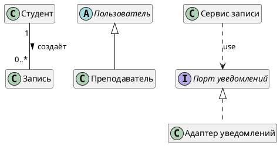

:::note[TL;DR]
Ассоциация, обобщение, зависимость и реализация похожи на линии между элементами, но отвечают на разные вопросы. Тип отношения выбирают по его смыслу, а не по внешнему сходству стрелок.
:::

## Ассоциация

**Классификатор** — элемент, описывающий множество похожих экземпляров: например, класс, роль или компонент. **Ассоциация** показывает допустимые связи между экземплярами классификаторов. Связь `Студент — Запись` означает, что конкретный студент может быть связан с конкретными записями. Она сама по себе не говорит о вызове метода, внешнем ключе базы данных или HTTP-запросе.

У концов ассоциации могут быть кратности, имена ролей, направление навигации и ограничения. Кратность показывает допустимое число связанных экземпляров, а роль уточняет участие экземпляра в связи.

## Обобщение

**Обобщение** связывает более специальный элемент с более общим. Если `Преподаватель` специализирует `Пользователь`, экземпляр преподавателя также является экземпляром пользователя. Связь уместна, когда фразу можно прочитать как «является видом».

Обобщение не подходит для отношений «содержит», «использует», «оформляет» или «работает с». В этих случаях чаще нужна ассоциация, зависимость или описание поведения.

## Зависимость, абстракция и реализация

**Зависимость** (`Dependency`) показывает, что изменение поставщика может повлиять на клиента. Стрелка направляется от клиента к поставщику. Специализированные зависимости уточняют причину этой связи:

| Отношение | Смысл |
| --- | --- |
| `Usage` | клиенту требуется поставщик для выполнения или реализации |
| `Abstraction` | элементы представляют одно понятие на разных уровнях или в разных моделях |
| `Realization` | клиент реализует спецификацию, заданную поставщиком |
| `Substitution` | один классификатор может заменить другой в его контракте |
| `Manifestation` | артефакт физически воплощает элемент модели |
| `Deployment` | развёртываемый элемент размещён на выбранной цели |

Ключевые слова и стереотипы дополнительно уточняют зависимость. `«use»` обозначает использование, `«call»` — вызов, а `«trace»` — трассировку между связанными элементами. Подпись не должна скрывать более точное отношение, если его семантика существенна для модели.

Реализация интерфейса — частый случай `Realization`: классификатор принимает контракт интерфейса. Реализация компонента (`ComponentRealization`) связывает компонент с классификаторами, воплощающими его поведение. `Substitution` сильнее обычной зависимости: она утверждает допустимость замены, поэтому должна быть обоснована совместимостью контрактов.

На одной схеме различие отношений видно по тому, какое утверждение делает каждая линия:

:::tip[Проверка]
Перед проведением стрелки сформулируйте её смысл полным предложением. Если предложение не получается, отношение пока выбрано слишком рано или элементам не хватает контекста.
:::

## Ограничения и примечания

Ограничение (`constraint`) утверждает правило модели: например, `{количество позиций >= 1}`. Его можно написать естественным языком или формальным выражением, например на OCL. Примечание поясняет элемент, но само по себе не обязательно является правилом. Стереотип добавляет элементу уточняющую категорию или роль, не заменяя его базовый смысл.

## В модели

Смысл отношений появляется после определения [предметных объектов](/modelling/domain-objects), [бизнес-правил](/modelling/business-rules-and-constraints) и архитектурных решений. Дальше в этом разделе отношения будут встречаться в контексте конкретных диаграмм.
