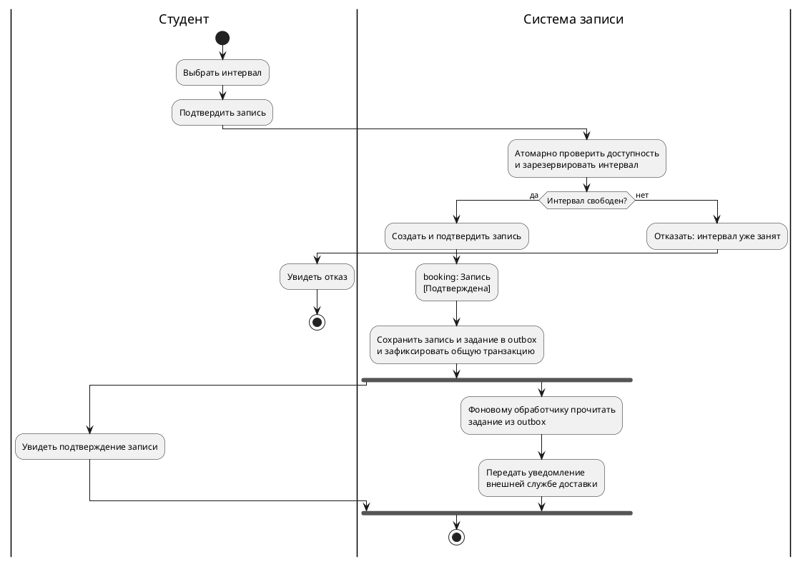

:::note[TL;DR]
Диаграмма деятельности показывает поток работы: действия, решения, параллельные ветви, участников и передаваемые объекты. Её используют для процессов и сценариев, когда важен порядок выполнения, а не устройство реализации.
:::

:::tip[Определение]{icon="starlight"}
**Действие** — элементарный шаг поведения без раскрытой внутренней структуры. **Деятельность** — более крупное поведение, которое при необходимости можно развернуть на отдельной диаграмме.
:::

Диаграмму строят по уже выделенному процессу или сценарию. Сначала формулируют начало и результат потока, затем добавляют действия, решения и участников. Если на схеме появляются контроллеры, HTTP-вызовы и таблицы базы данных, скорее всего, она смешивает процессный и технический уровни.

## Действия и поток управления

Действие показывается прямоугольником со скруглёнными углами. Поток управления соединяет действия и показывает, в каком порядке может передаваться выполнение.

Узел со значком в виде трезубца (`rake`) обозначает вызов другой деятельности. Он полезен при декомпозиции: на верхнем уровне остаётся крупный этап «Проверить заявку», а отдельная диаграмма раскрывает его внутренние действия.

## Начало, завершение и выбор

Начальный узел создаёт поток выполнения. **Конечный узел деятельности** завершает всю деятельность, включая другие параллельные ветви. **Конечный узел потока** останавливает только пришедшую в него ветвь.

**Решение** (`decision`) выбирает один из допустимых путей. Условия записывают на исходящих рёбрах в квадратных скобках: `[интервал свободен]`, `[мест нет]`. **Слияние** (`merge`) объединяет альтернативные пути после решения.

Условия должны опираться на бизнес-правила или состояние объектов. Для детерминированного сценария они должны быть взаимоисключающими либо одна ветвь должна быть явно отмечена как `else`.

## Параллельные ветви

**Развилка** (`fork`) запускает несколько ветвей, а **соединение** (`join`) ждёт завершения всех нужных ветвей. Это не тот же механизм, что решение: развилка означает параллельное выполнение, а решение — выбор одного пути.

Если длинное ребро мешает чтению, его можно разорвать парой коннекторов с одним именем. Коннектор не меняет семантику потока и не является дополнительным действием.

## Участники и результаты

Дорожки (`activity partitions`) группируют узлы деятельности по общему признаку: участнику, роли, подсистеме или другому выбранному основанию. Участник или роль — частый способ показать предполагаемого исполнителя, но сама дорожка не назначает ответственность и не превращает диаграмму в организационную схему.

Если результат действия важен для понимания процесса, покажите его объектным потоком: например, заявка создаётся, передаётся на проверку и становится согласованной. Детальная нотация объектов, контактов и хранилищ разобрана в [расширенной нотации диаграммы деятельности](/notation/activity-advanced).

## Полный пример: запись на консультацию

Этот поток раскрывает цель «Записаться на консультацию» из [диаграммы использования](/notation/usecase-diagrams). Он показывает действия студента и системы, а не отдельные процессы контроллера, планировщика и уведомлений.

*Рисунок — поток создания записи на консультацию.*

Прямоугольный объектный узел `booking: Запись [Подтверждена]` показывает результат, передаваемый на сохранение. Резервирование, сохранение записи и задания в outbox фиксируются вместе. После этого отображение результата и обработка уведомления идут независимо; outbox уже служит долговечной очередью, отдельный брокер не требуется. Синхронизация в конце означает завершение обеих ветвей изображённой деятельности, но не задержку ответа студенту до доставки. Порядок технических вызовов раскрыт на [диаграмме последовательности](/notation/sequence-diagrams).

## Проверка диаграммы

- у процесса есть понятный результат или условие завершения;
- действие названо как шаг работы, а не как экран интерфейса;
- решение не используется для параллельности, а развилка — для выбора;
- дорожки используют единое основание группировки;
- условия, объекты и статусы согласованы с правилами и предметной моделью.

## В модели

Диаграмма опирается на [процессную модель](/modelling/process-model), [декомпозицию процесса](/modelling/process-decomposition) и [участников с потоками](/modelling/process-participants-and-flows). Цель процесса может быть связана с [вариантом использования](/notation/usecase-diagrams); технический обмен сообщениями раскрывают на [диаграмме последовательности](/notation/sequence-diagrams).
