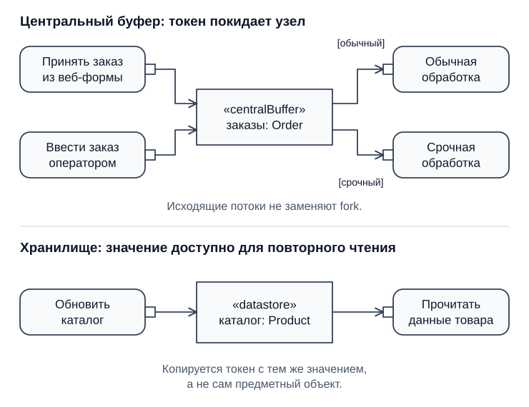
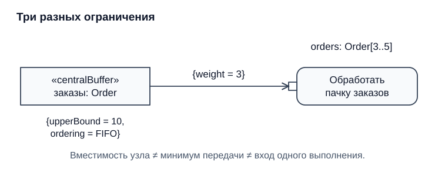
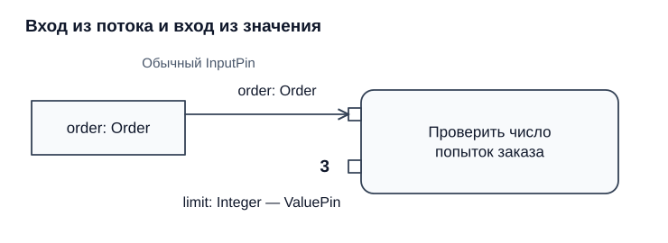
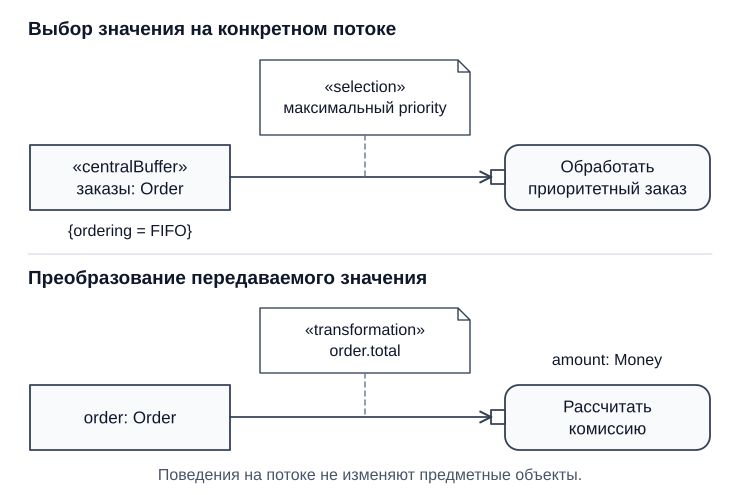
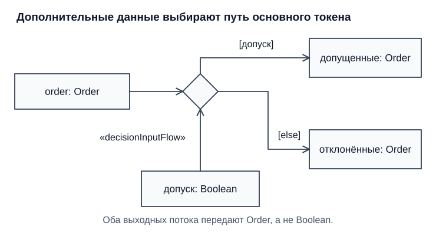
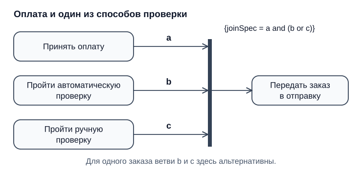
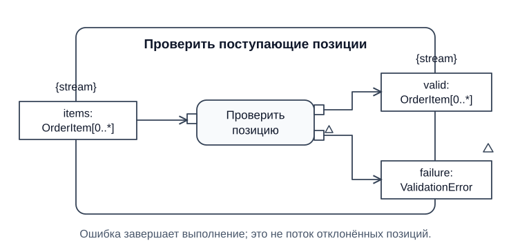
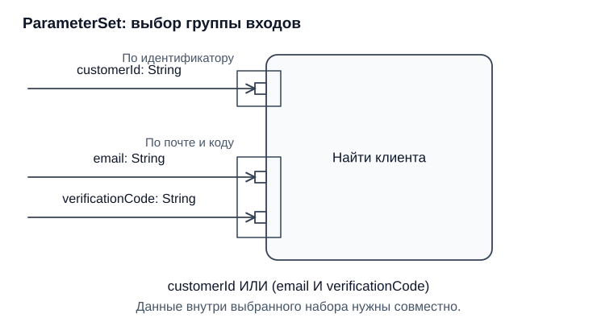

:::note[TL;DR]
Расширенная нотация уточняет, какие данные нужны действию, где они ожидают обработки, как выбираются токены и синхронизируются ветви. Она также описывает вызовы, события, обработку коллекций, прерывания и исключения. Выбирайте конструкцию по её семантике: похожие прямоугольники и стрелки могут задавать разные правила выполнения.
:::

Предположим, деятельность `Обработать заказ` получает заказ, проверяет его позиции, резервирует доступные товары и возвращает результат. Базовая диаграмма покажет последовательность шагов. Расширенная должна дополнительно ответить, какие значения проходят между шагами, как обрабатывается каждая позиция и что происходит при отмене или ошибке.

## От управления к данным

Сначала проведём заказ от входа деятельности к проверке. Поток управления показывает лишь возможность начать следующий шаг. Чтобы показать сам передаваемый заказ, нужен **объектный поток**: узел объекта `Заказ` соединяет действия «Получить заказ» и «Проверить заказ».

**Контакт** (`pin`) уточняет вход или выход конкретного действия. Например, выход `проверенныйЗаказ` действия проверки становится входом действия резервирования. **Узел параметра деятельности** (`activity parameter node`) играет ту же роль на границе всей деятельности: входной параметр принимает `order: Order`, выходной возвращает `result: ProcessingResult`.

Объектный поток не заменяет диаграмму классов. Здесь `Заказ` показан как значение, участвующее в одном поведении; его свойства, ассоциации и допустимые состояния остаются частью структурной модели.

## Центральный буфер и хранилище данных

**Центральный буфер** (`CentralBufferNode`) — самостоятельный объектный узел между входящими и исходящими объектными потоками. Он принимает предлагаемые токены в пределах вместимости, удерживает их и предлагает потребителям. В отличие от контакта, буфер не является входом или выходом конкретного действия.

Например, заказы поступают из веб-формы и от оператора, а обрабатываются обычным или срочным маршрутом. Буфер отделяет поступление заказов от готовности следующего шага их принять.

Прямоугольник с `«centralBuffer»` обозначает буфер; это ключевое слово можно опустить. Принятый потребителем токен покидает буфер. Несколько исходящих стрелок сами по себе **не размножают токен**: один токен проходит по одному исходящему ребру. Если нужно предложить его нескольким ветвям, используйте `fork`.

**Хранилище данных** (`DataStoreNode`) — специальный центральный буфер с обозначением `«datastore»`. При передаче токена потребителю хранилище оставляет у себя его копию с тем же значением. Поэтому значение доступно для повторного чтения. Копия токена не означает создание копии самого предметного объекта.

| Вопрос | Центральный буфер | Хранилище данных |
| --- | --- | --- |
| Что происходит после передачи токена? | токен удаляется из буфера | копия токена с тем же значением остаётся |
| Можно ли снова получить это значение без нового поступления? | переданный токен больше недоступен | да |
| Допустимы ли токены с одним и тем же объектом? | да, если другие ограничения не запрещают | повторный токен с той же идентичностью объекта не добавляется |
| Пример | ожидающие обработки заказы | каталог, к которому обращаются несколько шагов |

Сохраняемость `DataStoreNode` относится к **одному выполнению содержащей деятельности**. Сама нотация не гарантирует хранение после завершения деятельности, запись на диск или восстановление после сбоя. Если каталог соответствует реальной БД, это решение нужно дополнительно связать с моделью данных и архитектурой.

### Вместимость, порядок и состояние объектов

Объектный узел может уточнять не только тип значения, но и правила удержания и выдачи токенов:

| Запись | Что задаёт |
| --- | --- |
| `заказы: Order` | имя узла и допустимый тип значений |
| `[Проверен]` под именем | требуемое состояние объекта в связанном автомате состояний |
| `{upperBound = 10}` | максимум одновременно удерживаемых токенов |
| `{ordering = FIFO}` | выдачу в порядке поступления |
| `{ordering = LIFO}` | выдачу в обратном порядке поступления |
| `{ordering = unordered}` | отсутствие заданного порядка выдачи |
| `{ordering = ordered}` и примечание `«selection»` | выбор очередного значения заданным поведением |

Если буфер с `upperBound = 10` уже содержит десять токенов, он не принимает следующий, пока не освободится место. Это ограничение модели; способ ожидания, отказа или регулирования нагрузки в реализации требует отдельного решения.

Для приоритетной обработки можно задать `ordering = ordered` и поведение `«selection»`, выбирающее заказ с наибольшим приоритетом. Порядок выдачи токенов не следует путать с `{ordered}` у коллекции значений параметра или свойства. Аналогично `[Проверен]` описывает состояние удерживаемого объекта, а guard на ребре проверяется при предложении токена для перехода.

## Контакты и готовность действия

У обычного входного контакта кратность ограничивает число значений, потребляемых **одним выполнением действия**. Например, `orders: Order[3..5]` требует от трёх до пяти заказов. Действие не начинает это выполнение, пока не доступны необходимые значения всех обычных входов и требуемые управляющие токены.

| Ограничение | На какой вопрос отвечает |
| --- | --- |
| `upperBound` объектного узла | сколько токенов может удерживаться одновременно? |
| кратность контакта `3..5` | сколько значений получает одно выполнение действия? |
| вес ребра `{weight = 3}` | какое минимальное число токенов должно пройти по ребру вместе? |

Таким образом, `weight = 3` не задаёт пачку **ровно** из трёх заказов. При пяти доступных заказах и готовом контакте `3..5` могут пройти все пять. Если действие должно получать ровно три значения, это выражают кратностью `3` его входа.

Необязательный вход с нижней границей `0` не обязывает действие ждать значения. Отсутствие токена также отличается от **токена без значения** (`null token`): второй может пройти по объектному потоку и, например, быть проверен в решении.

### Специальные контакты

| Вид | Как получается вход | Когда полезен |
| --- | --- | --- |
| обычный `InputPin` | из входящего объектного потока | заказ приходит от предыдущего шага |
| `ValuePin` | вычислением `ValueSpecification` при запуске | задать постоянный лимит `3` |
| `ActionInputPin` | выполнением указанного действия `fromAction` | прочитать значение переменной для вложенного выражения |
| управляющий контакт `{control}` | по правилам управляющих потоков | явно показать буферизацию управляющих токенов |

Значение `ValuePin` записывают рядом с маленьким прямоугольником контакта. Это может быть не только литерал, но и выражение. Для `ActionInputPin` важно указать вычисляющее действие в модели; произвольная формула рядом с контактом сама по себе такой связи не создаёт.

`ValuePin` и `ActionInputPin` **не делают действие готовым сами по себе**. Их значения вычисляются после того, как выполнение разрешено другими входами или управляющим потоком. Управляющий контакт обозначают `{control}` и отличают от обычного контакта данных.

## Правила на объектном потоке

**Защитное условие** (`guard`) допускается не только после ромба решения, но и на другом ребре деятельности. Оно разрешает прохождение предлагаемого токена, когда выражение истинно. Например, `[заказ проверен]` на выходе из буфера ограничивает предложения потребителю, но не превращает буфер в действие проверки.

У объектного потока есть ещё два средства уточнения:

| Средство | Пример | Что меняется |
| --- | --- | --- |
| `«selection»` | выбрать заказ с наибольшим приоритетом | какое из предлагаемых значений будет передано |
| `«transformation»` | получить `order.total: Money` из `order: Order` | какое значение предлагается следующему узлу |

Оба поведения показывают в примечаниях, присоединённых к соответствующему ребру. **Выбор на исходящем потоке имеет приоритет над порядком выбора объектного узла.** Поэтому наличие `FIFO` у буфера ещё не означает, что потребитель с собственным `«selection»` получает первый поступивший заказ.

Преобразование может, например, передать сумму заказа в контакт `amount: Money`, не заставляя получателя принимать весь `Order`. Оно не изменяет исходный заказ. Если на одном потоке заданы оба поведения, сначала применяется преобразование, затем выбор.

:::caution[Предложение токена ещё не означает его передачу]
`selection`, `transformation`, guards и `decisionInput` могут вычисляться повторно до принятия токена потребителем. Они не должны менять предметные объекты или выполнять внешние эффекты. Резервирование товара, списание денег и отправка уведомления должны быть отдельными действиями.
:::

## Решение с дополнительными данными

Обычный `decision` выбирает путь для пришедшего токена. Иногда решение требует ещё одного значения: например, нужно направить заказ в обработку или на отказ по уже рассчитанному допуску.

**Дополнительный вход решения** (`decisionInputFlow`) — отдельный объектный поток с пометкой `«decisionInputFlow»`. Он предоставляет данные для guards, но не заменяет основной поток и не является ещё одной альтернативой на выходе.

В этом фрагменте основной вход и оба выхода несут `Order`, а дополнительный вход — `Boolean`. Решение должно получить предложения с **обоих входов**, прежде чем предложить основной токен дальше. По выбранной ветви передаётся заказ, а не значение допуска. Предполагается, что допуск рассчитан для этого заказа; при нескольких одновременных заказах соответствие данных нужно обеспечить явно.

**Вычисление входа решения** (`decisionInput`) — поведение, результат которого доступен guards. Его показывают в присоединённом примечании `«decisionInput»`. Например, для основного токена `Order` поведение `достаточенЛимит(order): Boolean` вычисляет результат, которым пользуются исходящие условия.

Это два разных расширения, которые могут применяться вместе. При основном объектном потоке и дополнительном входе `decisionInput` получает оба значения; без дополнительного входа — значение основного токена. Во всех случаях вычисление должно быть без побочных эффектов. Условия исходящих рёбер остаются условиями выбора одного пути; порядок стрелок не задаёт приоритет.

## Синхронизация с joinSpec

По умолчанию `join` требует предложение токена на **каждом** входе. **Спецификация соединения** (`joinSpec`) задаёт другое логическое условие; её записывают рядом с полосой как `{joinSpec = выражение}`.

Пусть отправка заказа требует оплаты и одного из двух способов проверки. Назовём входящие управляющие рёбра `a`, `b`, `c` и зададим `a and (b or c)`:

| Предлагаемые управляющие токены | Можно продолжить? |
| --- | --- |
| только `a` | нет: нет результата проверки |
| только `b` или только `c` | нет: нет оплаты |
| `a` и `b` | да |
| `a` и `c` | да |

Для управляющего входа имя ребра в таком выражении означает наличие предложения токена. Если вход объектный, имя может обозначать **значение** предлагаемого токена: например, результат измерения или внесённую сумму. Поэтому выражение нужно проверять вместе с видами и типами входов.

Фрагмент предполагает, что для одного заказа выбирается либо автоматическая, либо ручная проверка. `joinSpec` само по себе не отменяет ненужную ветвь, не сопоставляет заказы по идентификатору и не гарантирует однократное продолжение при новых поступлениях. Если требуется «первый ответ завершает ожидание и прерывает остальные работы», нужна модель прерывания.

При срабатывании соединения только управляющих потоков дальше предлагается один управляющий токен. Если на входах есть объектные токены, соединение передаёт объектные токены, а не собирает из их значений новый объект автоматически.

## Вызвать шаг или дождаться события

Когда заказ дошёл до проверки, нужно определить, что означает действие «Проверить заказ». Если оно вызывает операцию объекта, используется `CallOperationAction`: реализация выбирается через получателя операции. Если запускается заранее выбранная деятельность, используется `CallBehaviorAction`. Обычное непрозрачное действие оставляет способ выполнения за пределами текущей модели.

После резервирования процесс может отправить сигнал `OrderProcessed`. **Посылка сигнала** (`SendSignalAction`) создаёт экземпляр сигнала, передаёт его получателю и сразу продолжает выполнение. Ответ не является частью семантики сигнала.

Если дальнейшая работа зависит от внешнего события, **приём события** (`AcceptEventAction`) останавливает эту ветвь до подходящего возникновения. Он может принять `SignalEvent`, вызов или событие времени. Например, процесс ждёт подтверждения оплаты не более пятнадцати минут, после чего отдельное событие времени переводит его на ветвь отмены.

У ожидания события времени есть обозначение в виде **песочных часов**. Абсолютный момент и относительную задержку задают соответствующим `TimeEvent`. Сам рисунок часов не вводит таймаут с отменой других ветвей: ожидание оплаты и таймер нужно связать с требуемым прерыванием обычного хода.

Так сигналы и вызовы занимают понятное место в истории заказа: вызов запускает требуемое поведение, посылка сигнала уведомляет внешнего участника, а приём события обозначает ожидание.

### Принять вызов и вернуть ответ

Для приёма синхронного вызова операции служит **`AcceptCallAction`**, специализация приёма события. Оно выдаёт аргументы вызова и отдельное значение `returnInformation`, необходимое для ответа. **`ReplyAction`** получает это значение и результаты обработки, после чего отвечает исходному вызывающему участнику.

Например, при обработке `проверитьЗаказ(order): CheckResult`:

1. `AcceptCallAction` принимает вызов и предоставляет `order` и `returnInformation`;
2. действия деятельности вычисляют `CheckResult`;
3. `ReplyAction` получает результат и сохранённое `returnInformation` и возвращает ответ.

На объектных потоках нужно провести **и результат, и информацию для ответа**. Одна подпись «ответить» не связывает ответ с конкретным вызовом. Одно и то же `returnInformation` нельзя использовать для второго ответа; если синхронный вызов принят, но ответ не выполнен, вызывающая сторона продолжит ждать.

Обычное `AcceptEventAction` не принимает синхронные вызовы без специализации `AcceptCallAction`. Посылка сигнала также не заменяет `ReplyAction`: она выражает другой контракт обмена.

### Приём без входящего ребра

`AcceptEventAction` без входящих рёбер включается при запуске непосредственно содержащей деятельности или структурированного узла и остаётся готовым принимать следующие подходящие события после первого приёма. Это отличается от действия с входящим управляющим ребром, которое разрешает конкретное ожидание после предыдущего шага.

Для области прерывания действует дополнительное правило: такой приём включается при входе токена в область. Поэтому обработчик отмены внутри области может ждать независимо от того, какой её обычный шаг сейчас выполняется.

## Потоковые параметры и выходы исключений

Обычный входной параметр получает значения при вызове деятельности, а обычный выход возвращает их при завершении. **Потоковый параметр** с `{stream}` позволяет передавать значения во время выполнения: например, сканер продолжает присылать позиции, а проверенные позиции поступают дальше до завершения всей обработки.

`{stream}` ставят возле соответствующего узла параметра или контакта вызова. Для обычного параметра допустима явная пометка `{nonstream}`; отсутствие пометки означает непотоковый параметр. Выходной параметр исключения отмечают небольшим треугольником у узла; у контакта вызова аналогичную отметку ставят у начала исходящего ребра.

Выход исключения, например `failure: ValidationError`, означает завершение поведения с исключительным результатом. Это не просто второй обычный результат «товар отклонён». Если в одном непрерывном потоке часть позиций принимается, а часть отклоняется и обработка продолжается, оба результата могут быть обычными потоковыми выходами.

Не смешивайте три конструкции:

| Конструкция | Назначение |
| --- | --- |
| `{stream}` у параметра | обмен значениями во время выполнения поведения |
| `stream` у области расширения | один вложенный поток обработки элементов коллекции |
| `isException` у выходного параметра | завершение с исключением вместо нормального возврата |

### Альтернативные наборы параметров

**Набор параметров** (`ParameterSet`) задаёт альтернативную группу входов или выходов. Например, поиск клиента принимает либо `customerId`, либо совместно `email` и `verificationCode`. Общий обязательный вход, например `tenantId`, можно включить в каждый из двух наборов. Если заданы входные наборы, входные параметры вне наборов должны быть потоковыми; аналогичное правило действует для выходов.

На действии вызова контакты одного набора охватывают общей рамкой. Так различаются логическое «и» внутри набора и выбор набора. Снижение нижней границы всех контактов до нуля такого правила не выражает: оно разрешило бы и отсутствие всех данных. Входные и выходные наборы задаются отдельно и должны соответствовать параметрам вызываемого поведения.

## Обработать набор и вернуть результат

У заказа несколько позиций, поэтому простое повторение стрелок быстро перестаёт объяснять модель. **Область расширения** (`expansion region`) получает коллекцию и обрабатывает её элементы. На границе области **узлы расширения** (`ExpansionNode`) обозначают маленькими прямоугольниками, разделёнными на несколько ячеек. Снаружи они представляют коллекции, внутри — поступающие из них элементы.

| Режим | Как выполняется вложенный фрагмент |
| --- | --- |
| `iterative` | отдельное выполнение для каждого элемента, последовательно |
| `parallel` | отдельные выполнения для элементов могут идти параллельно |
| `stream` | одно выполнение получает элементы потоком |

При нескольких входных коллекциях число обработок в режимах `iterative` и `parallel` определяется наименьшей коллекцией. Для упорядоченных коллекций сопоставляются элементы одинаковых позиций; это не декартово произведение. Режим выбирают только тогда, когда способ обработки позиций влияет на результат или ограничения системы.

Если повторение имеет отдельные настройку, условие и тело, применяют **узел цикла** (`LoopNode`). Например, повторную попытку резервирования можно выполнять, пока число попыток меньше предела. Свойство `isTestedFirst = true` задаёт проверку перед телом; при `false` тело выполняется хотя бы один раз. Входы цикла, его переменные цикла и итоговые значения должны быть согласованы по типам и кратностям.

Если условие управляет целым фрагментом с общими входами и выходами, используют **условный узел** (`ConditionalNode`). Он состоит из предложений (`Clause`), каждое из которых содержит проверочную и исполняемую части. Это уместно, например, когда способ расчёта результата зависит от типа заказа, а обе ветви обязаны вернуть `ProcessingResult`.

`isAssured = true` утверждает, что хотя бы одна проверка успешна; `isDeterminate = true` — что успешна не более чем одна. Это утверждения о модели, а не команда редактору автоматически исправить пересекающиеся условия. Порядок предложений на листе сам по себе не задаёт приоритет.

**Последовательный узел** (`SequenceNode`) задаёт полный порядок выполнения вложенных исполняемых узлов. В обычном структурированном узле расположение действий слева направо такого порядка не создаёт: нужны потоки управления или специальная семантика узла.

Цикл, условный узел и область расширения являются специализациями **структурированного узла деятельности** (`StructuredActivityNode`). Общий узел показывают пунктирной рамкой со скруглёнными углами и `«structured»`. У `LoopNode`, `ConditionalNode` и `SequenceNode` UML 2.5.1 не определяет собственной стандартной графической нотации; конкретные секции и оформление в редакторе могут быть его расширением.

Внутренняя переменная хранит значение в области выполнения фрагмента и не становится атрибутом класса `Order`. Потоки через его границу и контакты следует проверять по правилам выбранного вида узла: это не произвольная рамка для группировки рисунка.

### Изоляция фрагмента

`mustIsolate = true` у структурированного узла запрещает перемежать его выполнение с конфликтующими обращениями к используемым объектам извне. Например, чтение остатка и его изменение внутри изолированного фрагмента должны быть защищены от конфликтующей внешней записи.

Это **изоляция, а не обещание отката**. Способ обеспечения изоляции выбирает реализация; свойство само по себе не задаёт транзакцию БД и не гарантирует, что частично выполненные внешние эффекты будут отменены.

:::note[Граница завершения]
Конечный узел деятельности внутри структурированного узла завершает непосредственно содержащий структурированный узел, а не всю внешнюю деятельность. На базовой диаграмме без таких вложенных границ он завершает всю деятельность. Учитывайте эту область действия при декомпозиции.
:::

## Прервать обычный ход

Теперь добавим два разных нарушения обычного потока. Пользователь может отменить заказ в любой момент резервирования. Для этого действия помещают в **область прерывания** (`interruptible activity region`), а событие отмены выводят по прерывающему ребру. Срабатывание ребра прекращает остальные действия области и передаёт управление на ветвь отмены.

Ошибка конкретного действия моделируется иначе. **Обработчик исключения** (`ExceptionHandler`) принадлежит защищённому исполняемому узлу и принимает объект исключения совместимого типа. Если резервирование возбуждает `ReservationFailed`, обычное выполнение этого узла прекращается, а исключение и управление переходят обработчику.

Различие определяется источником нарушения: область прерывания реагирует на заданный поток внутри более крупного фрагмента, обработчик исключения — на ошибку защищённого исполняемого узла, в том числе структурированного. Если защищённый узел должен вернуть значение, обработчик обязан произвести совместимый результат, иначе следующий шаг не получит ожидаемый объектный токен.

Прерывание происходит, когда токен **действительно проходит по прерывающему ребру**, а не только предложен на нём. При этом прекращаются выполнения узлов области и удаляются находящиеся в них токены. Это не является автоматической компенсацией уже выполненных действий: возврат платежа или освобождение внешнего ресурса нужно моделировать отдельно.

## Разделы деятельности и несколько выполнений

**Раздел деятельности** (`ActivityPartition`, дорожка) группирует элементы по общему признаку и сам по себе не меняет движение токенов. Кроме обычных дорожек участников встречаются:

- вложенные разделы: например, организация и её подразделения;
- несколько измерений группировки: например, исполнитель и место выполнения; один узел может относиться к разделам разных измерений;
- внешний раздел с `«external»`: участник вне представленной внутренней структуры.

Раздел не создаёт независимый поток выполнения. Для параллельных путей нужны соответствующие потоки и управляющие узлы.

Обычно каждый вызов деятельности имеет отдельное выполнение (`isSingleExecution = false`). При `isSingleExecution = true` вызовы обслуживаются одним выполнением деятельности. Тогда несколько наборов входных токенов могут существовать в одном графе одновременно, и модель должна явно обеспечить их сопоставление.

Не смешивайте этот выбор с `Behavior::isReentrant`, определяющим возможность перекрывающихся выполнений поведения, и `Action::isLocallyReentrant`, допускающим перекрывающиеся выполнения одного действия. Наличие `parallel` на рисунке не задаёт эти свойства автоматически.

Для общей деятельности, обслуживающей несколько заказов, особенно осторожно используйте область прерывания: отмена удалит токены всей области, а не только токен заказа с совпавшим идентификатором. Часто отдельное выполнение на заказ позволяет выразить требуемые границы гораздо яснее.

## Как прочитать получившуюся модель

Диаграмма деятельности использует токенную семантику. В примере управляющий токен разрешает выполнение шагов, а объектный токен переносит конкретный заказ или результат. Действие становится готовым только после получения требуемых входов.

Полный ход чтения:

1. начальный узел создаёт управляющий токен;
2. входной параметр предоставляет объект `Order`;
3. действие получает нужные управляющие и объектные токены;
4. решение передаёт токен по ребру с истинным защитным условием;
5. развилка создаёт токены для параллельных ветвей;
6. соединение проверяет стандартное условие всех входов либо заданное `joinSpec`;
7. конечный узел потока поглощает токен, а конечный узел деятельности завершает содержащую деятельность или непосредственно содержащий структурированный узел.

Поэтому решение и развилка не взаимозаменяемы: первое выбирает путь, второе запускает несколько путей. Аналогично объектный токен и управляющий токен могут идти рядом, но отвечают на разные вопросы.

:::note[Сети Петри как контекст]
Сети Петри помогают понять параллельность через позиции, переходы и маркировку токенами. Диаграмма деятельности использует близкую идею, но добавляет действия, управляющие и объектные токены, типы данных, исключения и иерархию поведения. Для чтения прикладной модели достаточно отслеживать, какие токены требуются каждому узлу и куда они переходят после его выполнения.
:::

## Справочно: виды действий

Когда точный эффект шага важен, выберите соответствующее семейство действий:

| Семейство | Основные элементы | Смысл |
| --- | --- | --- |
| Вызовы | `CallOperationAction`, `CallBehaviorAction`, `AcceptCallAction`, `ReplyAction` | вызвать операцию, запустить поведение, принять входящий вызов или ответить на него |
| Объекты | `CreateObjectAction`, `DestroyObjectAction`, `ReadExtentAction`, `ReclassifyObjectAction` | создать или уничтожить экземпляр, получить множество экземпляров либо изменить классификацию существующего объекта |
| Структурные признаки | `ReadStructuralFeatureAction`, `AddStructuralFeatureValueAction`, `ClearStructuralFeatureAction` | прочитать или изменить значение свойства |
| Переменные | `ReadVariableAction`, `AddVariableValueAction`, `ClearVariableAction` | работать со значением переменной в области поведения |
| Связи | `CreateLinkAction`, `ReadLinkAction`, `DestroyLinkAction` | создать, прочитать или удалить связь между экземплярами |
| События и ошибки | `SendSignalAction`, `AcceptEventAction`, `RaiseExceptionAction` | отправить сигнал, принять событие или возбудить исключение |

У действия могут быть локальные предусловия и постусловия: примечания `«localPrecondition»` и `«localPostcondition»`. Они задают требования к началу и окончанию данного шага, а не заменяют guard входящего ребра. Нарушение такого условия означает несоответствие модели; способ обнаружения и реакции нужно определить отдельно.

Совсем редко объектный поток помечают `«multicast»` или `«multireceive»` для обмена с участниками, определяемыми механизмом публикации и подписки. Это не стандартное обещание конкретного брокера, порядка или надёжности доставки: механизм требуется уточнить в модели реализации.

## Проверить себя

### Буфер или хранилище?

Один токен заказа находится в центральном буфере. Два готовых потребителя соединены с ним исходящими объектными потоками. Обязательно ли оба получат заказ?

Разбор

Нет. Один токен покидает буфер по одному исходящему ребру; эти стрелки не заменяют `fork`. Если же значение должно оставаться доступным для повторного чтения, нужно рассмотреть `DataStoreNode`, учитывая его область сохраняемости и правила повторных токенов.

### Вместимость или пачка?

Буфер содержит четыре заказа и имеет `upperBound = 10`. Вес ребра равен `3`, но вход действия имеет кратность `5`. Все остальные входы готовы. Начнётся ли действие?

Разбор

Нет: для одного выполнения требуется пять значений. Доступных четырёх достаточно для минимального веса ребра, но недостаточно для кратности контакта. Вместимость десять ограничивает накопление, а не уменьшает требуемый вход действия.

### Условие соединения или отмена?

У `join` задано `a and (b or c)`. Предложены управляющие токены на `a` и `b`. Можно ли продолжить и будет ли автоматически остановлена работа, которая могла бы позже дать `c`?

Разбор

Продолжить можно, если выходной потребитель принимает токен. Автоматической остановки ветви `c` нет: `joinSpec` задаёт условие синхронизации, а не прерывание других работ. Для отмены нужен соответствующий механизм прерывания и определённая область его действия.

## Проверка диаграммы

- каждый прямоугольник данных различим как контакт, параметр, буфер, хранилище или узел расширения;
- вместимость, кратность контакта и вес ребра выражают разные обоснованные ограничения;
- `selection`, `transformation`, guards и `decisionInput` не имеют побочных эффектов;
- основной и дополнительный вход решения согласованы по смыслу и относятся к одному случаю обработки;
- `joinSpec` согласовано с видами входных потоков и не используется вместо отмены ветвей;
- потоковый выход и выход исключения соответствуют разным контрактам завершения;
- несколько вызовов деятельности не смешивают данные разных заказов;
- прерывание, завершение и изоляция имеют явно определённые границы.

## Нотация и источники

Основа — [OMG UML 2.5.1](https://www.omg.org/spec/UML/2.5.1/). Для проверки точных обозначений и семантики используйте соответствующие разделы [нормативного PDF](https://www.omg.org/spec/UML/2.5.1/PDF):

| Тема | Раздел UML 2.5.1 |
| --- | --- |
| Рёбра, вес, выбор и преобразование потоков | 15.2 |
| Решения, соединения и их спецификации | 15.3 |
| Объектные узлы, центральный буфер и хранилище | 15.4 |
| Разделы и области прерывания | 15.6 |
| Контакты и локальные условия действий | 16.2 |
| Вызовы, пометки контактов и наборы параметров | 16.3 |
| Приём вызова, события и ответ | 16.10 |
| Структурированные узлы и изоляция | 16.11 |
| Области расширения | 16.12 |
| Параметры и выполнения поведений | 9.4, 13.2 |

Схемы на этой странице показывают отдельные фрагменты нотации. Отсутствие начального или конечного узла на таком фрагменте не означает, что он описывает полное выполнение деятельности.

## В модели

Сначала постройте [обычную диаграмму деятельности](/notation/activity-diagrams), а затем добавляйте данные, ожидания и обработку отклонений к уже понятному потоку. Типы параметров, переменных и контактов разобраны в статье о [типах и значениях](/notation/types-properties-and-values), различия операций, поведений, действий и событий — в статье о [поведении и вызовах](/notation/behaviors-events-and-calls). Если главным становится обмен участников, продолжите модель на [диаграмме последовательности](/notation/sequence-diagrams).
