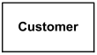
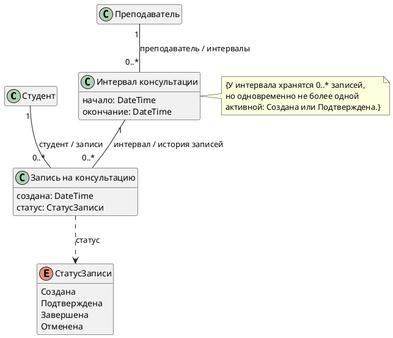

:::note[TL;DR]
Концептуальная диаграмма классов показывает понятия предметной области, их значимые свойства, связи и правила. Она не описывает таблицы базы данных, контроллеры или структуру исходного кода.
:::

:::tip[Определение]{icon="starlight"}
**Класс** описывает множество объектов с общими свойствами и поведением. В концептуальной модели классом является предметное понятие: `Запись`, `Интервал консультации`, `Преподаватель`.
:::

Исходный материал для диаграммы — [словарь](/modelling/domain-and-vocabulary), [объекты предметной области](/modelling/domain-objects), сценарии и бизнес-правила. Если понятие не нужно для объяснения предметной области, не стоит добавлять его только потому, что оно позже может стать таблицей или классом программы.

## Классы и свойства

Класс показывают прямоугольником; при необходимости его делят на секции с именем, атрибутами и операциями. На концептуальной диаграмме чаще всего нужны имя и предметные атрибуты: дата, статус, сумма, причина отмены.

Атрибут — свойство объекта. Его можно записать как `статус: СтатусЗаписи` или `датаСоздания: DateTime`. Тип показывает допустимый вид значения, а не технический тип столбца базы данных. Если значение имеет небольшой закрытый набор вариантов, используйте перечисление: `СтатусЗаписи = {создана, подтверждена, отменена}`.

## Ассоциации и кратности

Ассоциация показывает возможную связь между экземплярами. Кратность указывается у конца ассоциации и задаёт допустимое число связанных объектов.

| Кратность | Значение |
| --- | --- |
| `0..1` | не более одного |
| `1` | ровно один |
| `0..*` или `*` | любое число, включая ноль |
| `1..*` | один или больше |

Запись кратности имеет вид `нижняяГраница..верхняяГраница`; `*` означает неограниченную верхнюю границу. Например, `1..3, 5, 7..10` допускает только перечисленные количества. Запись `5..3` некорректна, потому что нижняя граница больше верхней, а отрицательные значения недопустимы.

Например, одна запись относится к одному интервалу, а у интервала может быть ноль или одна активная запись. Это правило модели, а не инструкция по созданию внешнего ключа.

Имя ассоциации и стрелка чтения помогают выразить смысл связи, а имя роли уточняет участие на её конце. Навигацию стоит показывать только тогда, когда направление важно для ответственности или будущей реализации; на концептуальном уровне её часто можно не указывать.

## Целое и часть

Композиция показывает сильное отношение «целое — часть»: часть в рамках модели принадлежит не более чем одному целому и обычно прекращает существование вместе с ним, если не была отделена ранее. Например, позиции заказа могут быть композиционными частями заказа. Обычная агрегация имеет слабую формальную семантику, поэтому её лучше не использовать как декоративный «ромбик».

Если у самой связи есть дата, статус или правило, связь становится самостоятельным понятием. Между `Студентом` и `Курсом` это может быть класс `ЗаписьНаКурс`, а не безымянная линия. UML позволяет показать такой случай классом ассоциации, но в предметной модели часто понятнее изобразить его обычным классом и двумя ассоциациями.

## Обобщение и правила

Обобщение уместно, если специальный класс действительно является видом общего: `Преподаватель` — вид `Пользователя`. Множества обобщений позволяют зафиксировать полноту и пересечение классификаций: `{complete, disjoint}` означает, что классификация полна и специализации не пересекаются, поэтому каждый экземпляр общего класса входит ровно в одну из показанных специализаций.

Бизнес-правило выражают кратностью, ограничением в фигурных скобках или примечанием. Например, `{у оплаченного заказа нельзя изменить состав}` не заменяется одной связью: это правило поведения, которое должно согласоваться со сценариями и состояниями.

## Пример: запись на консультацию

Ниже предметная модель записи студента к преподавателю. Она фиксирует понятия и правила, а не контроллеры, сервисы или таблицы; переходы статуса раскрывает [диаграмма состояний](/notation/state-machine-diagrams).

Число рядом с концом связи говорит, сколько объектов этой роли может быть у объекта на другом конце: каждая запись принадлежит одному студенту и одному интервалу, а студент и интервал могут быть связаны со многими записями. История записей не отменяет ограничение на активную запись: отменённые и завершённые остаются в модели. Само ограничение следует согласовать с [бизнес-правилами](/modelling/business-rules-and-constraints) и сценариями.

## Проверка диаграммы

- классы названы терминами предметной области;
- каждая ассоциация читается как осмысленная связь экземпляров;
- кратности выражают правило, а не случайную оценку;
- композиция означает жизненную зависимость части от целого;
- технические классы не смешаны с предметными понятиями;
- важные ограничения можно найти в правилах и сценариях.

## В модели

Диаграмма развивает [словарь](/modelling/domain-and-vocabulary), [объекты предметной области](/modelling/domain-objects) и [концептуальную модель](/modelling/conceptual-model). Её экземпляры можно проверить на [диаграмме объектов](/notation/object-diagrams), жизненный цикл — на [диаграмме состояний](/notation/state-machine-diagrams), а переход к реализации раскрыт в [технической диаграмме классов](/notation/technical-class-diagrams).
