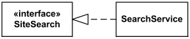
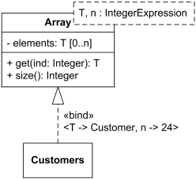

:::note[TL;DR]
Техническая диаграмма классов показывает элементы реализации: классы, интерфейсы, операции, типы и зависимости. Её строят после выбора ответственности объектов и архитектурных границ.
:::

Техническая модель отвечает не на вопрос «какие понятия существуют в предметной области», а на вопрос «какие программные элементы реализуют нужное поведение и от чего они зависят». Поэтому `OrderController`, `OrderRepository` и `PaymentGateway` уместны здесь, но не в концептуальной модели заказа.

## Атрибуты и операции

Операция задаёт доступное поведение классификатора. Её сигнатура может содержать имя, параметры, возвращаемые значения и свойства: `подтвердить(код: String): Результат`. Метод — реализация операции, поэтому на UML-диаграмме точнее говорить об операции.

Видимость показывает, кому доступен признак: `+` — общедоступный (`public`), `-` — закрытый (`private`), `#` — защищённый (`protected`), `~` — доступный в пакете (`package`). Если видимость на диаграмме не указана, это означает, что она не показана на данном уровне детализации, а не обязательно является общедоступной.

Атрибуты и операции могут быть статическими; тогда они относятся к классификатору, а не к каждому экземпляру. Типы данных, перечисления и интерфейсы являются отдельными классификаторами и должны быть отличимы от классов предметной области.

У свойства могут быть дополнительные характеристики. `/{имя}` обозначает производное значение, `{readOnly}` — значение только для чтения, `{id}` — часть идентификатора, а `ordered` и `unique` задают упорядоченность и уникальность коллекции. Важны только те характеристики, которые несут проверяемое правило:

| Коллекция значений | `isOrdered` | `isUnique` |
| --- | --- | --- |
| Мультимножество | `false` | `false` |
| Список | `true` | `false` |
| Множество | `false` | `true` |
| Упорядоченное множество | `true` | `true` |

`subsets` фиксирует, что значения свойства входят в другое свойство, `union` — что свойство объединяет подмножества, а `redefines` — что свойство переопределяет унаследованное. Эти ключевые слова полезны для точных технических моделей и метамоделей, но редко нужны на обзорной диаграмме.

## Стандартные виды и стереотипы

Интерфейс, перечисление и тип данных — самостоятельные виды классификаторов. Стандартный профиль UML также определяет стереотипы, которые иногда встречаются на технических диаграммах: `«utility»` для класса-службы со статическими признаками, `«auxiliary»` для вспомогательного класса, `«focus»` для центрального класса предметной логики и `«metaclass»` для класса, экземплярами которого выступают классы. Эти обозначения используют, когда они добавляют смысл, а не ради маркировки каждого класса.

## Интерфейсы и зависимости

Интерфейс задаёт контракт. Реализация связывает класс с интерфейсом, который он выполняет; зависимость (`Dependency`) или `«use»` показывает, что другой класс зависит от контракта. Это позволяет показать, например, что `NotificationService` использует `NotificationGateway`, не зная конкретного провайдера.

Интерфейс или класс может объявлять **приём** (`Reception`): готовность обработать определённый сигнал. Приём имеет то же имя и параметры, что и связанный с ним сигнал. Он фиксирует асинхронный контракт, но не раскрывает реализацию реакции.

Нотация «шарик и розетка» (`lollipop`) показывает предоставляемый интерфейс кружком, а требуемый — полукругом. Она особенно полезна на диаграммах компонентов, где важен внешний контракт, а не полный список операций.

## Технические отношения

Зависимость (`Dependency`) показывает, что изменение поставщика может повлиять на клиента: например, тип параметра операции или используемый интерфейс. Стрелка направлена от зависимого элемента к поставщику. Не стоит заменять зависимость ассоциацией только потому, что оба элемента «связаны» в коде.

Класс может быть абстрактным: он не имеет непосредственных экземпляров и обычно обозначается курсивом. В UML допустимы несколько обобщений, но циклы обобщения недопустимы. Множественное наследование и ромбовидные иерархии требуют отдельного решения о том, как согласуются унаследованные свойства и операции.

Шаблонный класс или операция принимает параметры типа; связывание шаблона (`TemplateBinding`) с `«bind»` показывает подстановку конкретных параметров. Вложенный класс используют только когда вложенность действительно является частью публичной структуры реализации.

## Расширенные ассоциации

**Квалификатор** уточняет, как найти объект на конце ассоциации по ключу: например, `Каталог` находит `Товар` по `артикулу`. N-арная ассоциация связывает более двух классификаторов одновременно. Оба средства нужны редко; если связь имеет собственные свойства и жизненный цикл, чаще понятнее выделить отдельный класс.

Свойства ассоциации могут иметь упорядоченность, уникальность, значение только для чтения, включение в другое свойство или переопределение; в UML для этого служат `ordered`, `unique`, `readOnly`, `subsets` и `redefines`. Их добавляют только когда это формальное свойство значимо для решения. Полный набор редких свойств не делает техническую диаграмму точнее сам по себе.

## В модели

Техническая диаграмма опирается на [объектно-ориентированное проектирование](/modelling/object-oriented-design), различие [концептуальной и технической моделей](/modelling/conceptual-vs-technical-model) и [проектные решения](/modelling/project-decisions). Крупные зависимости затем сворачивают в [пакеты](/notation/package-diagrams) и [компоненты](/notation/component-diagrams).

[Представление кода C4](/c4/components-and-code) может вести к этой диаграмме как к детализации одного важного компонента; оно не требует строить полную схему классов всей системы.
