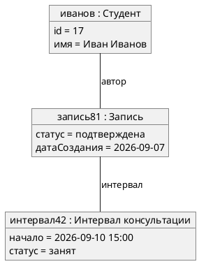
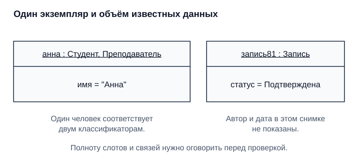

:::note[TL;DR]
Диаграмма объектов показывает конкретный снимок системы: экземпляры классификаторов, значения их свойств и связи между экземплярами. Она помогает проверить, что диаграмма классов допускает нужную ситуацию.
:::

:::tip[Определение]{icon="starlight"}
**Спецификация экземпляра** (`InstanceSpecification`) описывает конкретный объект или иной экземпляр классификатора в выбранный момент времени.
:::

Объект обычно записывают как `имя : Класс`; имя и список классификаторов могут быть опущены в зависимости от выбранного представления. Подпись подчёркивают, чтобы отличить экземпляр от классификатора. Например, `записьИванова : Запись` — конкретная запись, а `Запись` — класс всех таких записей.

```text
записьИванова : Запись
----------------------
статус = подтверждена
датаСоздания = 2026-08-04
```

Значение свойства показывают в **слоте** (`slot`). Слот соответствует свойству классификатора: у объекта `записьИванова` можно показать значение атрибута `статус`, если этот атрибут определён у `Записи`.

Связь между объектами (`link`) является экземпляром ассоциации. Если диаграмма классов показывает связь `Студент — Запись`, объектная диаграмма может показать конкретного студента, конкретную запись и линию между ними. Так проверяют кратности и ограничения на реальной ситуации, а не только на схеме типов.

Такой снимок фиксирует одну допустимую конфигурацию экземпляров:



## Несколько классификаторов одного экземпляра

Спецификация экземпляра может ссылаться на несколько классификаторов. Например, подпись `анна : Студент, Преподаватель` описывает **одного человека**, который одновременно соответствует двум классификациям. Всю подпись подчёркивают; это не два объекта, соединённые ассоциацией.



Такой пример допустим, если множества обобщений разрешают пересечение. При `{disjoint}` у специализаций `Студент` и `Преподаватель` он нарушил бы модель. Принадлежность экземпляра подклассу также означает принадлежность его обобщениям, поэтому перечислять в подписи всех предков обычно не нужно.

## Частичный снимок и неизвестные значения

`InstanceSpecification` может описывать экземпляр частично. Отсутствие слота `датаСоздания` означает, что значение **не задано этой спецификацией**, а не что оно отсутствует у объекта или равно `null`. Слот связывается с конкретным признаком классификатора, а не просто с совпадающим текстовым именем.

Для примера со свойством `автор: Студент[1]` различайте три утверждения:

| Представление | Что можно заключить |
| --- | --- |
| слот `автор` не показан | снимок не сообщает значение; нельзя доказать нарушение кратности |
| известно, что значений у `автор` нет | полная известная конфигурация нарушает нижнюю границу `1` |
| слот явно задаёт ссылку на `иванов` | значение можно проверить на тип и остальные ограничения |

Перед проверкой кратностей оговорите, какие слоты и связи перечислены полностью. Иначе отсутствие линии на неполном рисунке ошибочно превращается в утверждение «связи нет». Пропуск детали и явно заданный `LiteralNull` — разные части модели.

## Изменение классификации

**Переклассификация** (`ReclassifyObjectAction`) меняет классификацию существующего объекта, сохраняя его идентичность. Например, для `p17` классификация `Кандидат` может быть заменена на `Клиент`, если обе допустимы в данной модели:

```text
до:     p17 : Кандидат
после:  p17 : Клиент
```

Это два снимка одного объекта. Само действие принадлежит [диаграмме деятельности](/notation/activity-advanced#справочно-виды-действий); две подписи не задают автоматического перехода. Свойства `oldClassifier`, `newClassifier` и `isReplaceAll` определяют, какие классификации снимаются, добавляются и сохраняются. Должны соблюдаться ограничения обобщений и согласованность признаков и связей; изменение класса не является простым переименованием подписи.

Для обычного изменения `Заказ.status` с `Создан` на `Оплачен` чаще достаточно свойства и автомата состояний. Переклассификация полезна, когда меняется именно набор классификаторов объекта и соответствующих им признаков.

## Когда использовать

- проверить пример из сценария на соответствие диаграмме классов;
- обсудить начальное или итоговое состояние объекта;
- показать тестовый набор данных или конфигурацию;
- объяснить, почему связь должна быть отдельным классом;
- связать статическую структуру с объектными потоками и линиями жизни.

Диаграмма объектов не показывает поведение во времени. Для изменения статуса используйте [диаграмму состояний](/notation/state-machine-diagrams), а для обмена сообщениями — [диаграмму последовательности](/notation/sequence-diagrams).

## В модели

Частичные спецификации и несколько классификаторов определены в разделе 9.8, переклассификация — в 16.4 и описании `ReclassifyObjectAction` в 16.14.44 [UML 2.5.1](https://www.omg.org/spec/UML/2.5.1/).

Снимок строят на основе [концептуальной](/notation/conceptual-class-diagrams) или [технической диаграммы классов](/notation/technical-class-diagrams) и конкретного сценария из [потоков](/modelling/scenarios-and-flows). Он полезен как проверка согласованности до перехода к состояниям и взаимодействиям.
