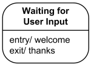
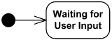
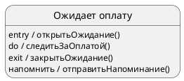
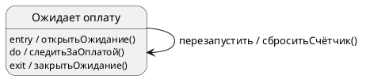
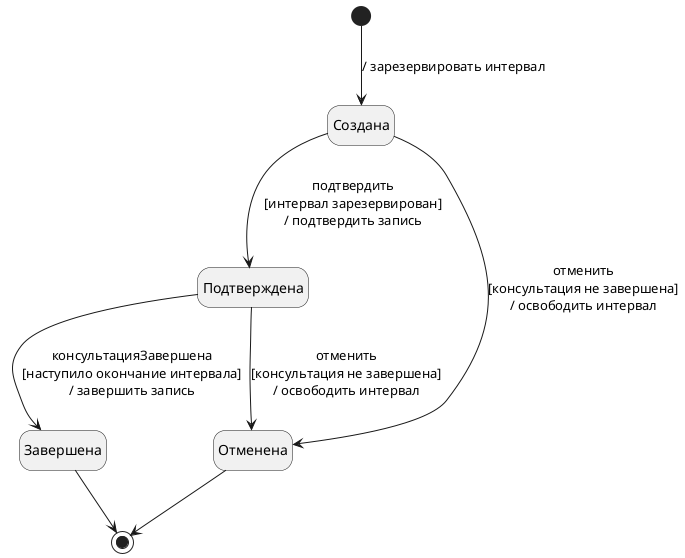

:::note[TL;DR]
Диаграмма состояний показывает жизненный цикл объекта: устойчивые состояния, события, условия и допустимые переходы. Она нужна, когда возможность действия зависит от текущего состояния объекта.
:::

:::tip[Определение]{icon="starlight"}
**Состояние** — период жизни объекта, в котором он удовлетворяет некоторому условию, ожидает событие или выполняет связанную деятельность.
:::

Диаграмму строят для объекта с настоящим жизненным циклом: заказа, заявки, документа, платежа, записи на консультацию. «Открыта форма» и «нажата кнопка» обычно описывают интерфейс, а не состояние предметного объекта.

## Состояния и переходы

Простое состояние показывают прямоугольником со скруглёнными углами. Переход — направленной стрелкой. Подпись перехода имеет вид:

```text
trigger [guard] / effect
```

Триггер (`trigger`) — событие или вызов операции, защитное условие (`guard`) определяет допустимость, а действие перехода (`effect`) выполняется при срабатывании перехода. Например, `подтвердить [интервал свободен] / отправитьУведомление`.



У состояния могут быть поведения `entry`, `do` и `exit`: при входе, пока объект находится в состоянии и при выходе. Они относятся к состоянию, а не к переходу.

## Начало, завершение и выбор

Начальное псевдосостояние показывает начало региона автомата. Конечное состояние завершает его. **Точка выбора** (`choice`) выбирает переход по защитным условиям; условия должны быть связаны с бизнес-правилами и атрибутами объекта.



Если объект действительно проходит независимые ветви жизненного цикла одновременно, применяют развилку (`fork`) и соединение (`join`). Для большинства предметных объектов достаточно одного последовательного региона.

## Внутренний переход и самопереход

Два перехода могут оставлять объект в состоянии с тем же именем, но выполнять разное поведение. Рассмотрим ожидание оплаты; это отдельный пример, не дополнительное правило сервиса консультаций.

**Внутренний переход** записан внутри состояния. Событие `напомнить` вызывает эффект, не покидая состояние:



**Внешний самопереход** — стрелка из состояния обратно в него. Событие `перезапустить` выводит объект из состояния и вводит заново:



| Событие | Что выполняется для уже активного состояния |
| --- | --- |
| `напомнить` | только `отправитьНапоминание()`; `entry` и `exit` не вызываются, текущая `doActivity` продолжает работу |
| `перезапустить` | незавершённая `doActivity` прекращается; выполняются `exit`, эффект `сброситьСчётчик()`, затем `entry`; `doActivity` запускается заново |

Таким образом, замена внутреннего перехода петлёй может повторно открыть ресурс, сбросить таймер или прервать фоновую работу. Проверяйте не только итоговое имя состояния, но и последовательность эффектов.

### Когда заканчивается `doActivity`

`entry` выполняется при входе, после него запускается `doActivity`. Она может закончиться, пока состояние остаётся активным: окончание работы само по себе не означает выход. При выходе незавершённая `doActivity` прерывается до выполнения `exit`.

Для простого состояния переход без триггера рассматривается после завершения его `entry` и `doActivity`; guard, если задан, всё равно должен быть истинен. Обработка события до завершения (`run-to-completion`) не требует ждать окончания длительной `doActivity`, прежде чем принять следующее внешнее событие. Подробности очереди событий и составных состояний — в [расширенной нотации](/notation/state-machine-advanced#события-которые-пока-нельзя-обработать).

## Пример: жизненный цикл записи

Статус записи на консультацию из [концептуальной диаграммы классов](/notation/conceptual-class-diagrams) меняется только по допустимым событиям. Диаграмма показывает правило занятого интервала в момент создания и действие, которое отмена выполняет над интервалом.


Автомат начинается после принятия команды создания при условии отсутствия активной записи; эта проверка выполняется атомарно с резервированием. Начальный переход не ждёт события и не имеет защиты. В успешном техническом сценарии создание и подтверждение происходят внутри одной транзакции, поэтому промежуточное состояние `Создана` не видно другим запросам.


В подписи обычного перехода событие стоит перед защитой в квадратных скобках, а действие после `/`: отменить можно только из состояний `Создана` и `Подтверждена`, и она освобождает интервал. Завершение возможно после окончания консультации. Конечное состояние завершает выполнение автомата, но не удаляет историческую запись: она остаётся связанной с интервалом, как показано в [концептуальной модели](/notation/conceptual-class-diagrams).

## Проверка диаграммы

- каждое состояние описывает устойчивое условие объекта;
- у значимых переходов есть событие или понятная причина;
- защитное условие выражает проверяемое правило;
- состояние и переходы согласованы с атрибутами, правилами и сценариями;
- диаграмма не подменяет жизненный цикл последовательностью экранов.

## В модели

Потренируйтесь различать переходы в [задачах по автоматам](/notation/exercises#автоматы-состояний); допустимые последовательности событий можно превратить в [проверки реализации](/modelling/model-based-testing).

Состояния выводятся из [бизнес-правил](/modelling/business-rules-and-constraints), [сценариев](/modelling/scenarios-and-flows) и [концептуальной модели](/modelling/conceptual-model). Экземпляры жизненного цикла можно показать на [диаграмме объектов](/notation/object-diagrams), а события между участниками — на [диаграмме последовательности](/notation/sequence-diagrams). Составные автоматы и протоколы вынесены в [расширенную нотацию](/notation/state-machine-advanced).
