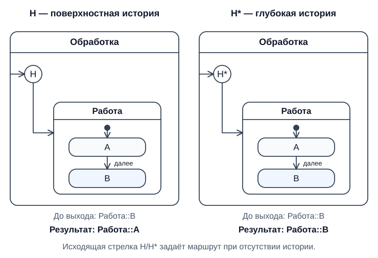
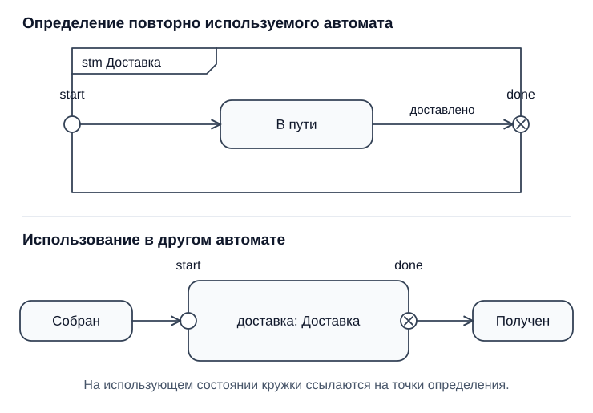

:::note[TL;DR]
Расширенная нотация нужна, когда жизненный цикл перестаёт помещаться в плоскую последовательность состояний: этап содержит собственные шаги, несколько аспектов меняются параллельно, часть автомата повторно используется или требуется описать внешний протокол операций.
:::

Возьмём заказ со состояниями `Создан`, `Ожидает оплату`, `Выполняется`, `Доставлен` и `Отменён`. Пока каждое состояние достаточно объясняется одним условием, базовой диаграммы хватает. Расширенные элементы появляются по мере того, как мы уточняем сложный этап `Выполняется`.

## Раскрыть сложное состояние

Сначала выясняется, что выполнение заказа состоит из проверки, комплектации и передачи в доставку. Вместо добавления этих шагов на общий уровень состояние `Выполняется` делают **составным** и помещают детальные состояния во вложенный регион. Внешняя диаграмма сохраняет крупный жизненный цикл, внутренняя — детали одного этапа. Отдельно определённую подмашину используют для другого случая — повторного использования автомата.

Если комплектация и оформление документов действительно развиваются независимо, составное состояние делят на **ортогональные регионы**. При входе запускаются оба региона, а завершение составного состояния требует завершения каждого из них. Ортогональность не следует использовать только ради размещения элементов в две колонки.

Иногда выполнение временно прерывается, например заказ возвращается на уточнение. **Поверхностная история** восстанавливает ранее активное непосредственное подсостояние региона. **Глубокая история** восстанавливает всю сохранённую вложенную конфигурацию. Если возврат всегда должен вести в одно известное состояние, обычный переход понятнее истории.

### H и H*: на какую глубину возвращаться

Поверхностную историю обозначают кружком с `H`, глубокую — кружком с `H*`. Входящий переход указывает на этот кружок, а не просто на границу составного состояния.

Пусть перед паузой активна конфигурация `Обработка::Работа::B`. Вложенная `Работа` при обычном входе начинается с `A`:

| Цель возврата | Получившаяся конфигурация |
| --- | --- |
| граница `Обработки` | её обычный вход по умолчанию |
| `H` в регионе `Обработки` | восстанавливается `Работа`, затем её обычный вход ведёт в `A` |
| `H*` в том же регионе | восстанавливаются и `Работа`, и вложенное `B` |

Из кружка истории может исходить **переход истории по умолчанию** без триггера и guard. Он определяет вход, когда сохранённой истории ещё нет, например при первом обращении к региону. На рисунке этот переход ведёт в `Работу`; если такой переход не задан, применяется обычный вход региона по умолчанию. Вход через историю и обычный начальный переход региона — разные маршруты.

История хранит конфигурацию состояний, а не позицию в исполняемом коде. При возвращении выполняются необходимые `entry`-поведения; `doActivity` вошедших состояний запускается по правилам входа. История сама по себе не восстанавливает стек вызовов и не откатывает изменения данных.

## Повторно использовать вложенный автомат

Допустим, один и тот же процесс доставки используется для обычного и срочного заказа. Его выделяют в отдельный автомат, а в состоянии `Доставка` размещают **состояние-подмашину** (`submachine state`).

Войти в подмашину и выйти из неё можно через именованные точки входа и выхода (`entry point`, `exit point`). Они принадлежат повторно используемому автомату и обозначают его разрешённые границы.

На состоянии-подмашине размещается **ссылка на точку соединения** (`ConnectionPointReference`). Она указывает, к какой точке входа или выхода подмашины подключён переход внешнего автомата, но не создаёт новую границу внутри повторно используемого автомата.

Так разделяются две ответственности: подмашина определяет собственные допустимые входы и выходы, а использующее состояние выбирает, какие из них участвуют в данном жизненном цикле.

### Точка определения и ссылка в использующем состоянии

Точку входа обозначают пустым кружком, точку выхода — кружком с крестом. Это не начальное псевдосостояние с закрашенным кружком и не конечное состояние с двойным обозначением.

Верхний фрагмент определяет автомат `Доставка`: вход через `start` ведёт в `В пути`, выход через `done` сообщает об окончании этого маршрута. Нижний фрагмент использует его в состоянии `доставка: Доставка`. Кружки на **использующем состоянии** — `ConnectionPointReference`, ссылающиеся на точки верхнего автомата. Имена помогают читать рисунок, но ссылка должна быть задана свойством модели, а не совпадением строк.

Внешний переход может привести прямо к выбранной ссылке входа, обходя обычный вход подмашины. Достижение связанной точки выхода позволяет продолжить переход наружу. Ссылка не копирует внутренние состояния подмашины и не добавляет ей новый вход только потому, что кружок нарисован на рамке.

## Уточнить реакцию состояния

В состоянии `Ожидает оплату` событие `напомнить` должно отправить уведомление, но не должно выводить заказ из ожидания. Для этого используют **внутренний переход**: у него есть собственные триггер, защитное условие и эффект, однако состояние не покидается и его `entry`- и `exit`-поведения не выполняются.

Переход без триггера решает другую задачу. Такой **переход завершения** становится готовым, когда завершилось поведение исходного состояния и его вложенные регионы. Он не срабатывает сразу после входа, если внутри ещё выполняется работа.

**Инвариант состояния** фиксирует условие, которое должно оставаться истинным всё время его активности. Например, для `Ожидает оплату` можно потребовать `{paymentId = null}`. Защитное условие перехода проверяется только при выборе перехода, поэтому не заменяет инвариант.

Триггер связывает переход с событием. Вызов операции создаёт `CallEvent`, получение сигнала — `SignalEvent`, наступление момента или интервала — `TimeEvent`, изменение условия — `ChangeEvent`. Сигнал при этом является классификатором передаваемого сообщения, а не самим событием его получения.

## Развести маршруты переходов

После проверки оплаты заказ может продолжить выполнение или перейти к ручному разбору. **Точка выбора** (`choice`) оценивает защитные условия во время выполнения, поэтому они могут зависеть от результата предыдущего сегмента.

**Соединительное псевдосостояние** (`junction`) связывает сегменты составного перехода и помогает повторно использовать общий маршрут. Оно выражает статическую структуру переходов, а не отдельный момент принятия решения. Поэтому `choice` подходит для выбора по только что полученному результату, а `junction` — для соединения заранее определённых путей.

Конечное состояние (`FinalState`) завершает содержащий его регион; составное состояние завершается после завершения всех регионов. Псевдосостояние `terminate` немедленно прекращает весь автомат без обычного выхода из активных состояний и выполнения их `exit`-поведений. Для нормального завершения заказа нужен `FinalState`, а не `terminate`.

## Описать внешний протокол

До этого диаграмма объясняла внутренний жизненный цикл заказа. Потребителю компонента чаще нужен другой вопрос: какие операции разрешено вызывать в каждом состоянии. На него отвечает **протокольный автомат состояний**.

Например, `оплатить` допустимо после `создать`, `отменить` — до начала доставки, а `подтвердитьДоставку` — только после передачи курьеру. Протокол фиксирует эти разрешённые последовательности, не раскрывая внутренние `entry`, `do` и `exit`.

**Протокольный переход** (`ProtocolTransition`) разделяет предусловие, триггер и постусловие. Предусловие уточняет допустимость вызова в исходном состоянии, триггер обозначает операцию, постусловие фиксирует гарантию после перехода. Внутренний эффект реализации в такой контракт не входит.

Если специальный тип заказа уточняет общий протокол, **соответствие протоколов** (`ProtocolConformance`) утверждает их взаимозаменяемость. Специальный протокол не должен запрещать вызовы, обещанные общим контрактом, или ослаблять гарантированные результаты.

## Прочитать выполнение автомата

Автомат принимает события по принципу **обработки до завершения** (`run-to-completion`). Одно принятое событие доводит модель до устойчивой конфигурации: выбираются переходы, выполняются эффекты, завершаются необходимые входы и выходы. Только после этого обрабатывается следующее событие.

Поэтому триггер, защитное условие и эффект имеют разные роли: триггер делает переход кандидатом, защита разрешает его в текущих данных, эффект выполняет работу. Их нельзя сворачивать в одну неразличимую подпись без потери семантики.

### Локальный переход внутри составного состояния

Пусть состояние `Обработка` содержит `Проверка` и `Подготовка`. Локальный переход от границы `Обработка` к `Проверка` по событию `перепроверить` сохраняет активность самой `Обработки`, но покидает текущую вложенную конфигурацию и входит в `Проверку`.

| Вид перехода | Выход из `Обработки` и повторный вход | Вложенные состояния |
| --- | --- | --- |
| внутренний | нет | текущая конфигурация сохраняется |
| локальный к вложенному состоянию | нет | нужные вложенные состояния покидаются и вводятся |
| внешний из `Обработки` к её вложенному состоянию | да | вложенная конфигурация также перестраивается |

Локальность является свойством `Transition::kind`, а не просто расположением стрелки внутри рамки. В редакторе задайте `local` явно. Для понимания различия достаточно взять `Подготовка` как текущую конфигурацию: локальная перепроверка выполняет её `exit` и `entry` состояния `Проверка`, но не повторяет `entry` самой `Обработки`.

### События, которые пока нельзя обработать

У событий есть возникновения, ожидающие обработки в пуле событий. Это не обязательно очередь FIFO: порядок выбора обычных событий UML полностью не фиксирует. Если приложению нужен определённый порядок, его задают отдельным контрактом.

В состоянии `Настраивается` устройство ещё не может выполнить команду `запустить`. Возможны два разных решения:

- без подходящего разрешённого перехода и без отсрочки выбранное событие отбрасывается; ложный guard сам по себе не сохраняет событие на будущее;
- запись `запустить / defer` в состоянии объявляет событие отложенным. Оно сохраняется до конфигурации, где больше не откладывается, и может быть обработано позже.

| Шаг | С отсрочкой `запустить` в `Настраивается` | Без отсрочки |
| --- | --- | --- |
| приходит `запустить` | возникновение сохраняется | при выборе для обработки отбрасывается |
| приходит и обрабатывается `настройкаЗавершена` | переход в `Готово` | переход в `Готово` |
| дальнейшая обработка | сохранённое `запустить` может перевести в `Работает` | нужен новый запрос `запустить` |

Отложенное событие не является таймером или автоматическим повтором сетевой доставки. Для обычного предметного автомата чаще яснее явно вернуть отказ на уровне операции; ответ вызывающему участнику нужно показать в контракте или взаимодействии.

### Конкурирующие переходы

Если одно событие разрешает несколько конфликтующих переходов, переход из более глубоко вложенного состояния имеет приоритет над переходом из содержащего его состояния. Не переносите это правило на независимые ортогональные регионы: в одном шаге там могут сработать совместимые переходы.

В одном состоянии два перехода по `подтвердить` с одновременно истинными guards не образуют приоритетный список сверху вниз. Если результат должен быть однозначным, сделайте условия непересекающимися. События завершения имеют приоритет перед ожидающими обычными событиями; длительная `doActivity` при этом не блокирует все последующие шаги обработки событий.

Уточнения соответствуют разделу 14 [UML 2.5.1](https://www.omg.org/spec/UML/2.5.1/); для локальных переходов проверяйте также свойства модели в инструменте, а не только рисунок.

## Проверка диаграммы

- вложенное состояние действительно скрывает более детальный уровень;
- ортогональные регионы описывают независимые аспекты одного объекта;
- история нужна для возврата к неизвестной заранее конфигурации;
- для первого входа через историю определён подходящий маршрут по умолчанию;
- точки подмашины согласованы с её внешними переходами;
- кружок определения точки отличим по контексту от ссылки на неё в использующем состоянии;
- внутренний переход не должен покидать состояние;
- `choice`, `junction`, `FinalState` и `terminate` выбраны по их семантике;
- протокольный автомат описывает доступный клиенту контракт, а не алгоритм реализации.

## В модели

История, входы и выходы, подмашины и их графические обозначения определены в разделе 14.2 [UML 2.5.1](https://www.omg.org/spec/UML/2.5.1/).

Для большинства объектов достаточно [базовой диаграммы состояний](/notation/state-machine-diagrams). Расширяйте её от конкретного усложнения жизненного цикла, а внешний протокол сопоставляйте с [технической диаграммой классов](/notation/technical-class-diagrams) или [диаграммой компонентов](/notation/component-diagrams). Различия событий, триггеров, сигналов и операций собраны в статье о [поведении и вызовах](/notation/behaviors-events-and-calls).
