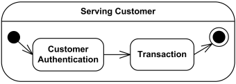
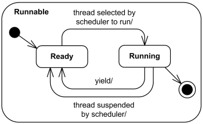

:::note[TL;DR]
Вложенные автоматы, ортогональные регионы, история и протокольные автоматы полезны для сложного поведения. Их добавляют, только когда базовой диаграммы недостаточно для выражения жизненного цикла или контракта.
:::

## Составные и вложенные состояния

Составное состояние скрывает внутренний автомат за одним крупным этапом. Например, состояние «Обрабатывается» может включать проверки, согласование и ожидание оплаты. Это помогает не смешивать разные уровни детализации на одной схеме.

Ортогональные регионы показывают независимые части состояния, существующие одновременно. Они уместны, когда объект действительно имеет несколько параллельных жизненных циклов; иначе диаграмма становится сложнее без новых выводов.

Поверхностная и глубокая история возвращают автомат в ранее активное вложенное состояние. **Точки входа и выхода** (`entry point` и `exit point`) обозначают именованные границы составного состояния, а **состояние-подмашина** (`submachine state`) ссылается на повторно используемый автомат. **Соединительное псевдосостояние** (`junction`) служит для соединения переходов, **псевдосостояние завершения** (`terminate`) прекращает работу автомата, а **отложенное событие** (`deferred event`) ждёт подходящего состояния для обработки.

## Внутренние переходы

Внутренний переход обрабатывает событие, не покидая состояние. Его отличают от поведения `entry`, `do` и `exit`: те привязаны соответственно к входу, пребыванию и выходу, а внутренний переход имеет собственные триггер, защитное условие и действие перехода. Например, в состоянии «Ожидает оплату» событие `напомнить` может отправить уведомление, не меняя состояние.

Триггер связывает переход с событием. Основные виды событий: `CallEvent` для вызова операции, `SignalEvent` для получения сигнала, `TimeEvent` для момента или интервала времени, `ChangeEvent` для изменения наблюдаемого условия и `AnyReceiveEvent` для сообщения, не обработанного более конкретным триггером.

**Сигнал** (`Signal`) — не само событие, а классификатор, задающий вид асинхронного сообщения и его атрибуты. `SignalEvent` ссылается на такой сигнал. Поэтому таймаут не следует записывать как пользовательскую операцию, а внешний сигнал — как внутреннее поведение `do`.

## Протокольный автомат

**Протокольная диаграмма состояний** описывает допустимые операции классификатора с точки зрения его внешнего потребителя. Она не раскрывает внутренние действия `entry`, `do` и `exit`, а фиксирует, какие вызовы допустимы до и после других вызовов.

Например, объект заказа может принять `оплатить` только после `создать`, а `отменить` — пока не началась доставка. Такая диаграмма подходит для публичного контракта компонента или класса.

В протокольном переходе отдельно фиксируют предусловие, триггер и постусловие. Предусловие определяет, когда операция допустима, триггер обозначает операцию или событие, а постусловие говорит, какое состояние или свойство будет истинно после успешного перехода. Внутренние действия и история в протоколе обычно не показываются: потребителю важен контракт, а не реализация.

## Семантика выполнения

Автомат обрабатывает события по принципу **обработки до завершения** (`run-to-completion`): одно принятое событие доводит автомат до устойчивой конфигурации, после чего начинается обработка следующего. Это объясняет, почему триггер, защитное условие и действие перехода имеют разные роли и не должны записываться как одно неразличимое описание перехода.

## В модели

Для большинства предметных объектов достаточно [базовой диаграммы состояний](/notation/state-machine-diagrams). Протокол имеет смысл сопоставлять с техническим контрактом из [диаграммы классов](/notation/technical-class-diagrams) или [диаграммы компонентов](/notation/component-diagrams).
