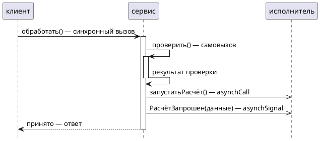
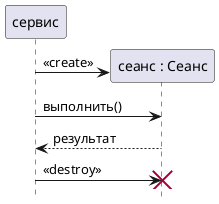
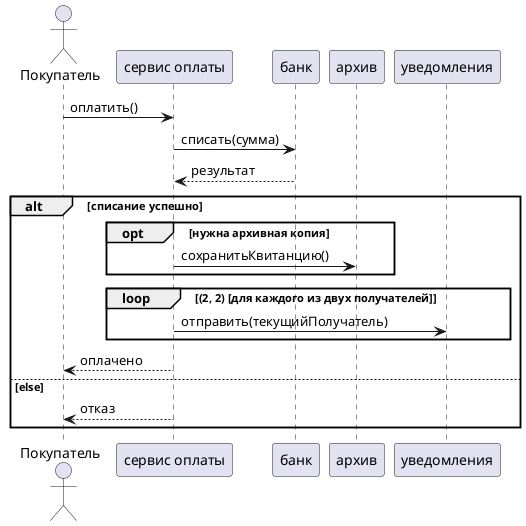
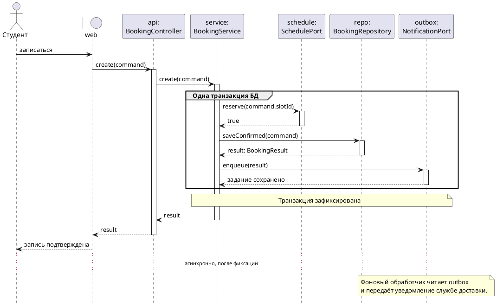

:::note[TL;DR]
Диаграмма последовательности показывает участников сценария и сообщения между ними в порядке возникновения. Она помогает проверить, как сценарий реализуется объектами, компонентами и операциями.
:::

Диаграмму строят для конкретного сценария: успешной записи на консультацию, отмены заказа или обработки ошибки оплаты. Она отвечает на вопрос, кто кому отправляет сообщение и что должно существовать в модели, чтобы такой обмен был возможен.

## Линии жизни и порядок

**Линия жизни** (`lifeline`) представляет отдельного участника взаимодействия: объект, часть компонента или внешнюю роль в выбранном сценарии. Её заголовок обычно подписывают как `имя : Тип`, например `запись : Запись`; при несущественном имени можно оставить `: Запись`. Это элемент взаимодействия, представляющий участника, а не сам объект или его спецификация экземпляра. Заголовок линии жизни не подчёркивают, в отличие от подписи на диаграмме объектов.

Вертикальная ось задаёт порядок событий, но не измеряет их длительность. События на одной линии жизни читаются сверху вниз; отправка сообщения предшествует его получению. Если важны секунды, таймауты или длительность, нужна [диаграмма синхронизации](/notation/timing-diagrams).

**Трасса** (`trace`) — последовательность событий взаимодействия. Диаграмма может задавать лишь частичный порядок событий на разных линиях жизни, которому соответствуют несколько разных линейных трасс. Модель определяет, какие трассы допустимы или запрещены, а не точную длительность каждого вызова.

## Сообщения

Сообщение показывает передачу информации или вызов между линиями жизни. В основной модели различают:

| Вид сообщения | Смысл |
| --- | --- |
| Синхронный вызов (`synchCall`) | отправитель ждёт завершения обработки операции |
| Асинхронный вызов (`asynchCall`) | отправитель вызывает операцию и продолжает работу, не ожидая результата |
| Асинхронный сигнал (`asynchSignal`) | отправитель передаёт экземпляр сигнала и не ждёт ответа |
| Ответ (`reply`) | получатель возвращает результат или управление |
| Создание и уничтожение | линия жизни появляется или завершается в ходе сценария |

Сигнал (`Signal`) задаёт тип одностороннего асинхронного сообщения и может иметь атрибуты. Не смешивайте его с асинхронным вызовом: `asynchCall` вызывает операцию, а `asynchSignal` передаёт сигнал.

Активация показывает отрезок выполнения поведения на линии жизни. Её используют, когда вложенность вызовов или длительность обработки помогает понять сценарий, но не рисуют автоматически на каждом сообщении.

Создающее сообщение начинает линию жизни в своей точке, а уничтожающее заканчивает её крестом. Их стоит показывать, когда жизненный цикл объекта является существенной частью сценария: например, временная сессия создаётся при входе и уничтожается после завершения оплаты.

Имена сообщений должны соответствовать действиям сценария и операциям получателя. Если `orderService` получает `подтвердитьОплату()`, такая операция или контракт должны быть обоснованы на технической модели.

Минимальный технический фрагмент может выглядеть так: `actor → api: создатьЗапись()`, `api → bookingService: создать()`, `bookingService → repository: сохранить(запись)`, затем `bookingService → notificationGateway: отправитьПодтверждение()`. Такой обмен проверяет, что для сценария существуют нужные операции и границы компонентов.

## Как выглядят сообщения

Сплошная линия с закрашенным треугольным наконечником показывает синхронный вызов. У асинхронного сообщения наконечник открытый; тип сообщения определяется также его контрактом — операция или сигнал. Ответ обычно показывают пунктирной линией с открытым наконечником.

Самовызов обращается к той же линии жизни; вложенная активация показывает вложенное выполнение, а не второй объект. Две нижние стрелки к исполнителю иллюстрируют **разные** асинхронные контракты и не означают, что реальная система обязана отправлять оба сообщения. Открытая стрелка не обещает ни надёжной доставки, ни отдельного процесса, ни очереди.

### Создание и уничтожение

Заголовок `сеанс : Сеанс` расположен на уровне создающего сообщения, до него экземпляр не участвует во взаимодействии. Крест завершает линию жизни; после него нельзя посылать сообщения этому экземпляру. Здесь уничтожается временный сеанс, а не историческая запись на консультацию.

## Базовые фрагменты: `alt`, `opt`, `loop`

Рамка ограничивает часть взаимодействия, а её оператор определяет допустимые трассы. Для базового курса нужны три оператора:

| Оператор | Чтение | Частая ошибка |
| --- | --- | --- |
| `alt` | выполнить один операнд, guard которого истинен; `[else]` покрывает оставшиеся случаи | сообщения успешного пути оставлены снаружи рамки и выполняются также после отказа |
| `opt` | выполнить один операнд при истинном guard либо пропустить его | обязательное действие случайно помещено внутрь необязательной рамки |
| `loop` | повторить операнд в заданных границах и при соответствующем условии | повторно сохранять объект вместо повторения отправки каждому адресату |

Для примера оплаты примем отдельные учебные контракты `списать`, `сохранитьКвитанцию`, `отправить`. Это не новые операции модели консультаций.

На успехе отправляются два уведомления, а архивная копия создаётся только при заданном условии. На отказе нет ни копии, ни уведомлений об успешной оплате. Синхронные вызовы в цикле означают ожидание завершения операции `отправить`, но не обязательно фактической доставки человеку: это зависит от контракта получателя.

Вложенные рамки читаются изнутри наружу. Условие не является отдельным сообщением, а расположение операндов сверху вниз не задаёт их приоритет. Параллельность, строгий порядок и временные ограничения разобраны в [расширенных взаимодействиях](/notation/sequence-advanced).

## Что не показывает диаграмма

Диаграмма последовательности не является процессной схемой: она не заменяет диаграмму деятельности с дорожками, объектными потоками и правилами ветвления. Она также не является диаграммой компонентов или развёртывания: линии жизни могут представлять компоненты, но не показывают всю архитектуру.

## Сквозной пример: успешная запись

Студент уже вошёл через SSO и выбрал интервал. Покажем успешный вызов операций из [технической модели](/notation/technical-class-diagrams). Типы участников указаны под короткими именами, чтобы различать экземпляры и их контракты.

`enqueue` — синхронная запись задания, но доставка выполняется асинхронно: пользователь не ждёт внешнюю службу. Рамка группирует транзакцию выбранной реализации; сама по себе графическая рамка не обеспечивает атомарности. При конкурентной записи `reserve` может вернуть `false` — это альтернативный исход из [диаграммы деятельности](/notation/activity-diagrams), намеренно не включённый в успешную трассу.

После ответа запись находится в состоянии `Подтверждена` из [автомата записи](/notation/state-machine-diagrams). Размещение сервера, outbox и обработчика раскрывает [диаграмма развёртывания](/notation/deployment-diagrams).

## Проверка диаграммы

- сценарий ограничен одним понятным результатом;
- участники находятся на одном уровне абстракции;
- сообщения имеют получателя и читаемый смысл;
- условия и альтернативы происходят из сценариев и бизнес-правил;
- показанные классы, операции и интерфейсы существуют в соответствующей модели.

## В модели

Переход от внешних событий к внутренним сообщениям показан в [системной диаграмме последовательности](/notation/system-sequence-diagrams). Прочитать и исправить небольшие взаимодействия можно в [задачах с разборами](/notation/exercises#диаграммы-последовательности).

Диаграмма уточняет [сценарии и потоки](/modelling/scenarios-and-flows) и [техническую модель классов](/notation/technical-class-diagrams). Различия сообщения, вызова операции и сигнала собраны в статье о [поведении и событиях](/notation/behaviors-events-and-calls). Ветвления и повторное использование взаимодействий раскрыты в [расширенной нотации](/notation/sequence-advanced); альтернативный вид взаимодействия — [диаграмма коммуникации](/notation/communication-diagrams).

[Динамическое представление C4](/c4/dynamic-and-deployment) показывает архитектурно значимый путь через существующие контейнеры и компоненты; эта диаграмма раскрывает его точный протокол и альтернативы.
