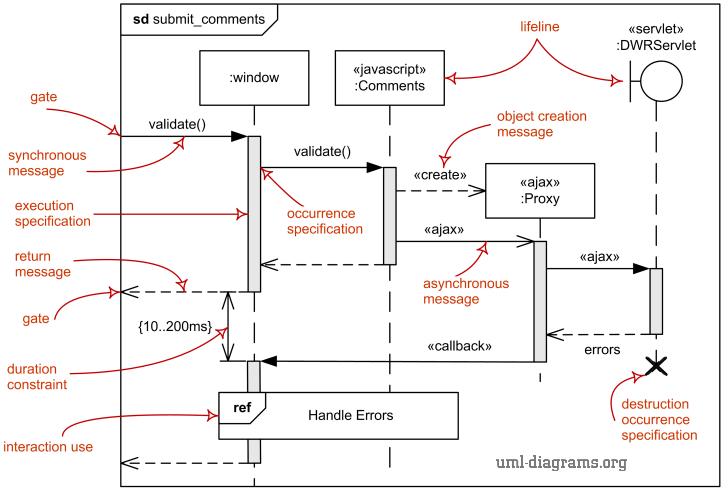

:::note[TL;DR]
Диаграмма последовательности показывает участников сценария и сообщения между ними в порядке возникновения. Она помогает проверить, как сценарий реализуется объектами, компонентами и операциями.
:::

Диаграмму строят для конкретного сценария: успешной записи на консультацию, отмены заказа или обработки ошибки оплаты. Она отвечает на вопрос, кто кому отправляет сообщение и что должно существовать в модели, чтобы такой обмен был возможен.

## Линии жизни и порядок

**Линия жизни** (`lifeline`) представляет участника взаимодействия: актора, объект, компонент, сервис или внешнюю систему. Экземпляр класса обычно подписывают как `имя : Тип`, например `запись : Запись`. Если имя несущественно, можно оставить только `: Запись`.

Вертикальная ось задаёт порядок событий, но не измеряет их длительность. События на одной линии жизни читаются сверху вниз; отправка сообщения предшествует его получению. Если важны секунды, таймауты или длительность, нужна [диаграмма синхронизации](/notation/timing-diagrams).

**Трасса** (`trace`) — допустимая последовательность событий взаимодействия. Это не всегда один линейный порядок: события на разных линиях жизни могут быть лишь частично упорядочены. Диаграмма задаёт ограничения на трассы, а не точную длительность каждого вызова.

## Сообщения

Сообщение показывает передачу информации или вызов между линиями жизни. В основной модели различают:

| Вид сообщения | Смысл |
| --- | --- |
| Синхронный вызов (`synchCall`) | отправитель ждёт завершения обработки операции |
| Асинхронный вызов (`asynchCall`) | отправитель вызывает операцию и продолжает работу, не ожидая результата |
| Асинхронный сигнал (`asynchSignal`) | отправитель передаёт экземпляр сигнала и не ждёт ответа |
| Ответ (`reply`) | получатель возвращает результат или управление |
| Создание и уничтожение | линия жизни появляется или завершается в ходе сценария |

Сигнал (`Signal`) задаёт тип одностороннего асинхронного сообщения и может иметь атрибуты. Не смешивайте его с асинхронным вызовом: `asynchCall` вызывает операцию, а `asynchSignal` передаёт сигнал.

Активация показывает отрезок выполнения поведения на линии жизни. Её используют, когда вложенность вызовов или длительность обработки помогает понять сценарий, но не рисуют автоматически на каждом сообщении.

Создающее сообщение начинает линию жизни в своей точке, а уничтожающее заканчивает её крестом. Их стоит показывать, когда жизненный цикл объекта является существенной частью сценария: например, временная сессия создаётся при входе и уничтожается после завершения оплаты.

Имена сообщений должны соответствовать действиям сценария и операциям получателя. Если `orderService` получает `подтвердитьОплату()`, такая операция или контракт должны быть обоснованы на технической модели.

Минимальный технический фрагмент может выглядеть так: `actor → api: создатьЗапись()`, `api → bookingService: создать()`, `bookingService → repository: сохранить(запись)`, затем `bookingService → notificationGateway: отправитьПодтверждение()`. Такой обмен проверяет, что для сценария существуют нужные операции и границы компонентов.

## Что не показывает диаграмма

Диаграмма последовательности не является процессной схемой: она не заменяет диаграмму деятельности с дорожками, объектными потоками и правилами ветвления. Она также не является диаграммой компонентов или развёртывания: линии жизни могут представлять компоненты, но не показывают всю архитектуру.

## Проверка диаграммы

- сценарий ограничен одним понятным результатом;
- участники находятся на одном уровне абстракции;
- сообщения имеют получателя и читаемый смысл;
- условия и альтернативы происходят из сценариев и бизнес-правил;
- показанные классы, операции и интерфейсы существуют в соответствующей модели.

## В модели

Диаграмма уточняет [сценарии и потоки](/modelling/scenarios-and-flows) и [техническую модель классов](/notation/technical-class-diagrams). Ветвления и повторное использование взаимодействий раскрыты в [расширенной нотации](/notation/sequence-advanced); альтернативный вид взаимодействия — [диаграмма коммуникации](/notation/communication-diagrams).

[C4 Dynamic view](/c4/dynamic-and-deployment) показывает архитектурно значимый путь через существующие containers и components; эта диаграмма раскрывает его точный протокол и альтернативы.
