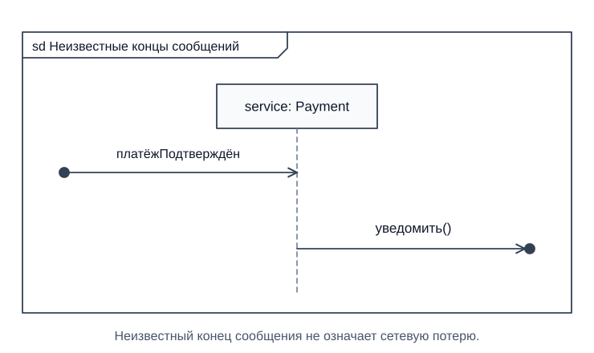
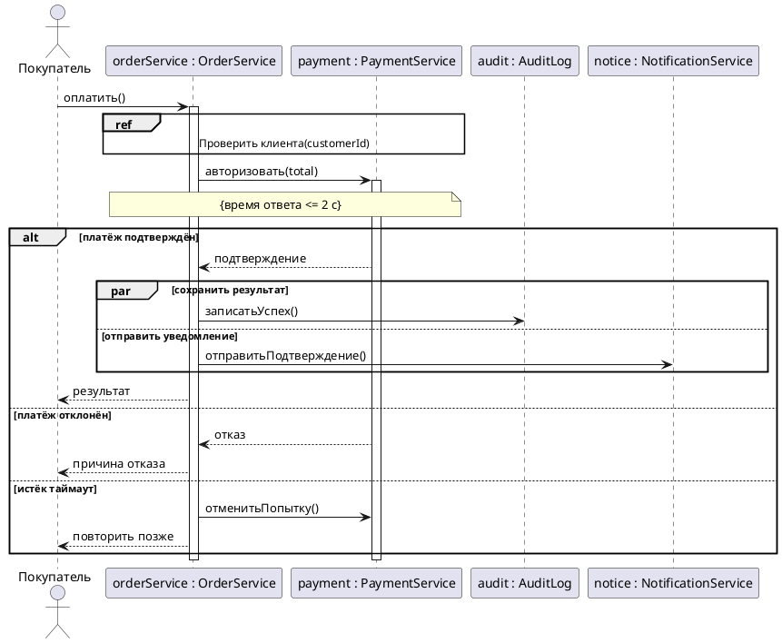
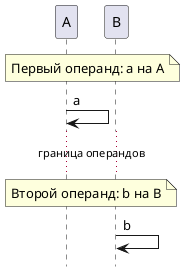
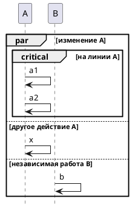
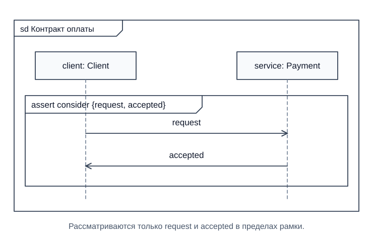

:::note[TL;DR]
Расширенная нотация уточняет уже понятный обмен сообщениями: где начинается и заканчивается выполнение, какие трассы допустимы, как повторно использовать взаимодействие, раскрыть внутренности участника и зафиксировать временные ограничения.
:::

Рассмотрим оплату заказа. Покупатель вызывает `оплатить()`, сервис заказов передаёт запрос платёжному сервису, а после ответа сохраняет результат и отправляет подтверждение. Базовая диаграмма показывает этот успешный обмен. Расширенная отвечает на следующие вопросы: что происходит при отказе или таймауте, какие части выполняются параллельно и где проходят границы повторно используемых фрагментов.

## От сообщения к трассе выполнения

Начнём с вызова платёжного сервиса. Отправка запроса и его получение — два отдельных события, между которыми передаётся сообщение. Момент на линии жизни задаётся **спецификацией возникновения** (`OccurrenceSpecification`). `MessageOccurrenceSpecification` одновременно специализирует её и является **концом сообщения** (`MessageEnd`). Другим видом конца сообщения служат ворота (`Gate`) на границе взаимодействия; `MessageEnd` не является разновидностью `OccurrenceSpecification`.

Для полного сообщения известны отправка и получение, причём отправка должна предшествовать получению. Если взаимодействие начинается с сообщения от неизвестного внешнего отправителя, сообщение считается найденным (`found message`). Если известен отправитель, но получатель остаётся за границей модели, сообщение считается потерянным (`lost message`).



Закрашенный кружок у начала стрелки обозначает неизвестный конец отправки, у конца — неизвестный конец получения. Слово `lost` здесь не утверждает, что сеть потеряла сообщение: получатель может просто находиться вне области описания. Ворота, напротив, задают явную точку согласования сообщения через границу рамки; они полезны, когда внешний и внутренний фрагменты нужно связать.

После получения запроса платёжный сервис начинает обработку. **Спецификация выполнения** (`ExecutionSpecification`) занимает участок линии жизни между началом и завершением поведения или действия. Полоса активации помогает увидеть вложенность вызовов, но её высота не задаёт физическую длительность.

Теперь успешный сценарий можно читать как трассу: допустимую последовательность отправок, получений, начал и завершений выполнения. На одной линии жизни события идут сверху вниз, а между разными линиями жизни порядок определяется сообщениями и дополнительными ограничениями.

## Добавить альтернативы и параллельность

У оплаты как минимум три исхода: подтверждение, отказ и таймаут. Вместо трёх несвязанных диаграмм общий обмен помещают в комбинированный фрагмент `alt`, а каждому операнду задают защитное условие: `[платёж подтверждён]`, `[платёж отклонён]`, `[истёк таймаут]`.

Другие операторы отвечают на другие изменения трассы:

| Оператор | Как меняет сценарий |
| --- | --- |
| `opt` | добавляет необязательную ветвь с одним условием |
| `loop` | повторяет обмен при условии или в диапазоне |
| `par` | разрешает независимым частям выполняться параллельно |
| `break` | при условии заменяет оставшуюся часть сценария |
| `critical` | запрещает вмешивание событий на охваченных линиях жизни внутрь критического фрагмента |
| `assert` | ограничивает допустимые продолжения множеством трасс своего операнда |
| `neg` | объявляет трассы своего операнда недопустимыми |

Например, сохранение результата и запись аудита можно поместить в `par`, только если их относительный порядок действительно несущественен. Повторную попытку платежа выражают `loop`, а не несколькими одинаковыми стрелками.

Операторы `strict` и `seq` уточняют порядок событий, `consider` и `ignore` — набор сообщений, учитываемых при проверке трассы. Базовые `alt`, `opt` и `loop` с небольшим примером разобраны в [основной статье](/notation/sequence-diagrams#базовые-фрагменты-alt-opt-loop).

Вместе эти элементы образуют один уточнённый сценарий оплаты:



## Вынести повторяющееся взаимодействие

Перед оплатой сервис заказов может каждый раз проверять клиента. Чтобы не копировать этот обмен, его оформляют отдельным взаимодействием `Проверить клиента`, а на основной диаграмме используют `ref` — **использование взаимодействия** (`InteractionUse`).

`ref` может передавать входные и выходные аргументы и получать возвращаемое значение. Они должны соответствовать формальным параметрам используемого взаимодействия. Например:

```text
ref Проверить клиента(customerId): verificationResult
```

**Ворота** (`gate`) связывают сообщения внутри и снаружи рамки взаимодействия. Совпадающие подписи рядом с рамкой не создают связь сами по себе: внешнее сообщение должно быть согласовано с соответствующим воротом.

На границе взаимодействия можно зафиксировать и состояние участника. Например, перед передачей платёжного запроса инвариант линии жизни требует `{order.status = AwaitingPayment}`. Это условие должно согласовываться с автоматом состояний заказа.

## Уточнить порядок независимых событий

После успешной оплаты сервис параллельно пишет аудит и готовит уведомление. События на разных линиях жизни могут оставаться лишь частично упорядоченными. Если уведомление разрешено только после успешной записи результата, **общее упорядочение** (`GeneralOrdering`) явно связывает соответствующие спецификации возникновения.

Для сложной группы альтернатив можно обозначить именованную точку дальнейшего хода — **продолжение** (`Continuation`). Одинаковое имя связывает допустимые продолжения на разных участках взаимодействия. В простом сценарии оно избыточно: одного `alt` и общего продолжения после рамки достаточно.

## Раскрыть одного участника

На внешней диаграмме платёжный сервис представлен одной линией жизни. Если важно объяснить его внутреннюю работу, **декомпозиция части** (`PartDecomposition`) ссылается на взаимодействие внутренних ролей, например адаптера банка, журнала операций и хранилища попыток.

Внешние сообщения согласуются с воротами декомпозиции, а внутренние линии жизни — с частями раскрываемого участника. Это отличается от обычного `ref`: использование взаимодействия повторяет фрагмент сценария, а декомпозиция объясняет, как одна внешняя линия жизни реализует своё участие.

## Сравнить допустимые трассы

Пусть событие `a` происходит на линии жизни `A`, `b` — на независимой линии `B`. Сначала задан операнд с `a`, затем операнд с `b`. Между ними нет сообщений или дополнительных ограничений.



Для краткости ниже `a` обозначает завершённый локальный обмен; при точной проверке разворачивают отдельно отправки и получения.

| Конструкция | `a, b` | `b, a` | Почему |
| --- | --- | --- | --- |
| `seq`, разные линии жизни | допустимо | допустимо | слабое упорядочение сохраняет порядок между операндами на общей линии жизни, но здесь общей линии нет |
| `seq`, оба события на `A` | допустимо | запрещено | события первого операнда на `A` предшествуют событиям второго на `A` |
| `strict` | допустимо | запрещено | события первого операнда должны предшествовать событиям второго независимо от линий жизни |
| `par` | допустимо | допустимо | операнды можно перемежать, сохраняя внутренний порядок каждого |

Если в первом параллельном операнде два локальных обмена `a1` затем `a2`, а во втором один `b`, то `a1, b, a2` допустимо для `par`; `a2, a1, b` запрещено из-за нарушения внутреннего порядка.

### Что именно защищает `critical`



Критическая область охватывает только `A`. Трассы `x, a1, a2` и `a1, a2, x` допустимы, а `a1, x, a2` — нет. Событие `b` на неохваченной линии `B` может произойти между `a1` и `a2`. Следовательно, `critical` не означает глобальной остановки всей системы, транзакции БД, блокировки ОС или гарантированного отката.

Если требуется дополнительный порядок только между двумя конкретными событиями, используйте `GeneralOrdering`, а не заменяйте весь сценарий на `strict`. Набор допустимых и запрещённых трасс можно использовать в [проверках модели и реализации](/modelling/model-based-testing).

## Выбрать сообщения для проверки: consider и ignore

При проверке оплаты служебные `heartbeat` и `audit` могут быть несущественны для контракта «после `request` приходит `accepted`». **`ignore {heartbeat, audit}`** разрешает не учитывать перечисленные сообщения в охваченном фрагменте. **`consider {request, accepted}`** учитывает только перечисленные сообщения; все остальные в этом фрагменте считаются несущественными.

Это разные области фильтрации: новое сообщение `cancel` не входит в список `ignore`, но будет отброшено при указанном `consider`. Фильтрация меняет взгляд на трассу, а не запрещает системе отправлять служебные сообщения.



На рисунке `assert consider {request, accepted}` — сокращение для вложенных рамок: рассматриваются только выбранные сообщения, а `assert` ограничивает допустимые продолжения трассами операнда.

Для чтения таблицы ниже имя сообщения сокращает его согласованную пару отправки и получения; при точной проверке события рассматривают отдельно.

| Наблюдаемая последовательность | После `consider {request, accepted}` | Соответствует показанному `assert`? |
| --- | --- | --- |
| `request, heartbeat, accepted` | `request, accepted` | да |
| `request, audit, audit, accepted` | `request, accepted` | да |
| `accepted, request` | `accepted, request` | нет: другой порядок |
| `request, cancel, accepted` | `request, accepted` | да; отмена намеренно не учитывается этим критерием |

Последняя строка показывает риск слишком узкого `consider`: существенное для требований событие можно случайно скрыть. Если отмена должна влиять на результат, включите её в критерий и опишите допустимые продолжения.

`assert` не обязательно означает **одну** линейную трассу: его операнд может содержать `alt` или `par` и допускать несколько вариантов. `neg` запрещает описанные трассы, но само по себе не задаёт полный набор допустимых. Эти конструкции полезно связывать с [проверками по моделям](/modelling/model-based-testing).

## Зафиксировать время

Высота активации и расстояние между стрелками показывают порядок, но не измеряют секунды. Если платёжный сервис обязан ответить за две секунды, отмечают моменты отправки и получения и задают ограничение длительности:

```text
t0 = момент отправки запроса
t1 = момент получения ответа
{t1 - t0 <= 2 s}
```

Временное наблюдение именует один момент, наблюдение длительности — интервал между событиями. Ограничение времени проверяет допустимый момент, ограничение длительности — длину интервала. Когда требуется показать изменение состояния на общей шкале, переходят к диаграмме синхронизации.

## Проверка диаграммы

- расширение начинается с уже понятного базового обмена;
- условия операторов соответствуют сценариям и бизнес-правилам;
- `par` не навязывает порядок независимым событиям;
- параметры `ref` согласованы с используемым взаимодействием;
- ворота действительно соединяют сообщения через границу;
- декомпозиция раскрывает внутренние роли выбранной линии жизни;
- временное требование записано ограничением, а не расстоянием на рисунке;
- `found` и `lost` использованы для неизвестных концов, а не вместо согласованных ворот;
- `consider` не скрывает сообщения, существенные для проверяемого контракта.

## В модели

Сообщения и их концы определены в 17.4, фильтрация и утверждения над трассами — в 17.6 [UML 2.5.1](https://www.omg.org/spec/UML/2.5.1/).

Если сценарий собирается из нескольких `ref`, используйте [обзорную диаграмму взаимодействия](/notation/interaction-overview-diagrams). Изменение значений на общей временной шкале показывает [диаграмма синхронизации](/notation/timing-diagrams). Типы сообщений, событий, сигналов и операций сопоставлены в статье о [поведении и вызовах](/notation/behaviors-events-and-calls).
