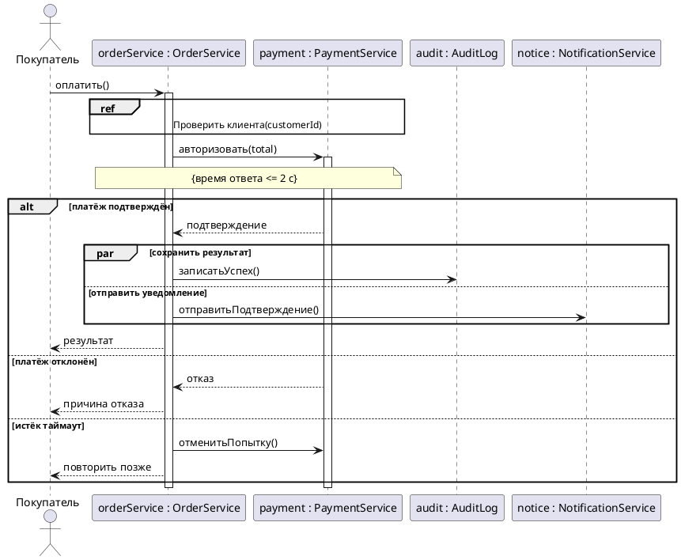

:::note[TL;DR]
Расширенная нотация уточняет уже понятный обмен сообщениями: где начинается и заканчивается выполнение, какие трассы допустимы, как повторно использовать взаимодействие, раскрыть внутренности участника и зафиксировать временные ограничения.
:::

Рассмотрим оплату заказа. Покупатель вызывает `оплатить()`, сервис заказов передаёт запрос платёжному сервису, а после ответа сохраняет результат и отправляет подтверждение. Базовая диаграмма показывает этот успешный обмен. Расширенная отвечает на следующие вопросы: что происходит при отказе или таймауте, какие части выполняются параллельно и где проходят границы повторно используемых фрагментов.

## От сообщения к трассе выполнения

Начнём с вызова платёжного сервиса. Отправка запроса и его получение — два отдельных события, между которыми передаётся сообщение. Каждый такой момент в упорядочении взаимодействия является **спецификацией возникновения** (`OccurrenceSpecification`), а концы сообщения — её специализированными видами (`MessageOccurrenceSpecification` и `MessageEnd`).

Для полного сообщения известны отправка и получение, причём отправка должна предшествовать получению. Если взаимодействие начинается с сообщения от неизвестного внешнего отправителя, сообщение считается найденным (`found message`). Если известен отправитель, но получатель остаётся за границей модели, сообщение считается потерянным (`lost message`).

После получения запроса платёжный сервис начинает обработку. **Спецификация выполнения** (`ExecutionSpecification`) занимает участок линии жизни между началом и завершением поведения или действия. Полоса активации помогает увидеть вложенность вызовов, но её высота не задаёт физическую длительность.

Теперь успешный сценарий можно читать как трассу: допустимую последовательность отправок, получений, начал и завершений выполнения. На одной линии жизни события идут сверху вниз, а между разными линиями жизни порядок определяется сообщениями и дополнительными ограничениями.

## Добавить альтернативы и параллельность

У оплаты как минимум три исхода: подтверждение, отказ и таймаут. Вместо трёх несвязанных диаграмм общий обмен помещают в комбинированный фрагмент `alt`, а каждому операнду задают защитное условие: `[платёж подтверждён]`, `[платёж отклонён]`, `[истёк таймаут]`.

Другие операторы отвечают на другие изменения трассы:

| Оператор | Как меняет сценарий |
| --- | --- |
| `opt` | добавляет необязательную ветвь с одним условием |
| `loop` | повторяет обмен при условии или в диапазоне |
| `par` | разрешает независимым частям выполняться параллельно |
| `break` | при условии заменяет оставшуюся часть сценария |
| `critical` | выполняет фрагмент атомарно относительно параллельных частей |
| `assert` | объявляет показанную трассу единственно допустимой |
| `neg` | объявляет показанную трассу недопустимой |

Например, сохранение результата и запись аудита можно поместить в `par`, только если их относительный порядок действительно несущественен. Повторную попытку платежа выражают `loop`, а не несколькими одинаковыми стрелками.

Операторы `strict` и `seq` уточняют порядок событий, `consider` и `ignore` — набор сообщений, учитываемых при проверке трассы. Эти операторы нужны для точного контракта; обычное ветвление лучше оставлять в `alt` или `opt`.

Вместе эти элементы образуют один уточнённый сценарий оплаты:



## Вынести повторяющееся взаимодействие

Перед оплатой сервис заказов может каждый раз проверять клиента. Чтобы не копировать этот обмен, его оформляют отдельным взаимодействием `Проверить клиента`, а на основной диаграмме используют `ref` — **использование взаимодействия** (`InteractionUse`).

`ref` может передавать входные и выходные аргументы и получать возвращаемое значение. Они должны соответствовать формальным параметрам используемого взаимодействия. Например:

```text
ref Проверить клиента(customerId): verificationResult
```

**Ворота** (`gate`) связывают сообщения внутри и снаружи рамки взаимодействия. Совпадающие подписи рядом с рамкой не создают связь сами по себе: внешнее сообщение должно быть согласовано с соответствующим воротом.

На границе взаимодействия можно зафиксировать и состояние участника. Например, перед передачей платёжного запроса инвариант линии жизни требует `{order.status = AwaitingPayment}`. Это условие должно согласовываться с автоматом состояний заказа.

## Уточнить порядок независимых событий

После успешной оплаты сервис параллельно пишет аудит и готовит уведомление. События на разных линиях жизни могут оставаться лишь частично упорядоченными. Если уведомление разрешено только после успешной записи результата, **общее упорядочение** (`GeneralOrdering`) явно связывает соответствующие спецификации возникновения.

Для сложной группы альтернатив можно обозначить именованную точку дальнейшего хода — **продолжение** (`Continuation`). Одинаковое имя связывает допустимые продолжения на разных участках взаимодействия. В простом сценарии оно избыточно: одного `alt` и общего продолжения после рамки достаточно.

## Раскрыть одного участника

На внешней диаграмме платёжный сервис представлен одной линией жизни. Если важно объяснить его внутреннюю работу, **декомпозиция части** (`PartDecomposition`) ссылается на взаимодействие внутренних ролей, например адаптера банка, журнала операций и хранилища попыток.

Внешние сообщения согласуются с воротами декомпозиции, а внутренние линии жизни — с частями раскрываемого участника. Это отличается от обычного `ref`: использование взаимодействия повторяет фрагмент сценария, а декомпозиция объясняет, как одна внешняя линия жизни реализует своё участие.

## Зафиксировать время

Высота активации и расстояние между стрелками показывают порядок, но не измеряют секунды. Если платёжный сервис обязан ответить за две секунды, отмечают моменты отправки и получения и задают ограничение длительности:

```text
t0 = момент отправки запроса
t1 = момент получения ответа
{t1 - t0 <= 2 s}
```

Временное наблюдение именует один момент, наблюдение длительности — интервал между событиями. Ограничение времени проверяет допустимый момент, ограничение длительности — длину интервала. Когда требуется показать изменение состояния на общей шкале, переходят к диаграмме синхронизации.

## Проверка диаграммы

- расширение начинается с уже понятного базового обмена;
- условия операторов соответствуют сценариям и бизнес-правилам;
- `par` не навязывает порядок независимым событиям;
- параметры `ref` согласованы с используемым взаимодействием;
- ворота действительно соединяют сообщения через границу;
- декомпозиция раскрывает внутренние роли выбранной линии жизни;
- временное требование записано ограничением, а не расстоянием на рисунке.

## В модели

Если сценарий собирается из нескольких `ref`, используйте [обзорную диаграмму взаимодействия](/notation/interaction-overview-diagrams). Изменение значений на общей временной шкале показывает [диаграмма синхронизации](/notation/timing-diagrams). Типы сообщений, событий, сигналов и операций сопоставлены в статье о [поведении и вызовах](/notation/behaviors-events-and-calls).
