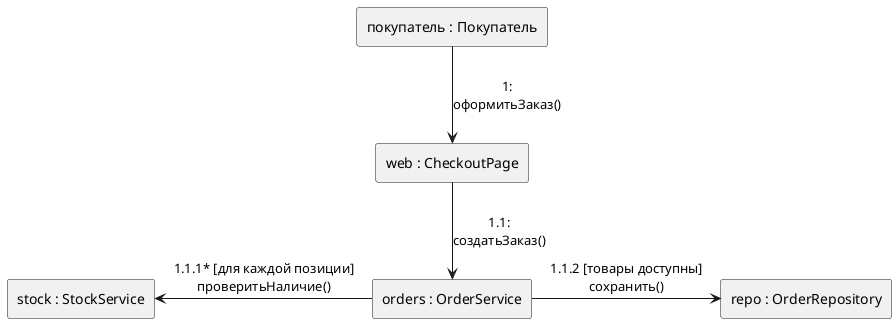
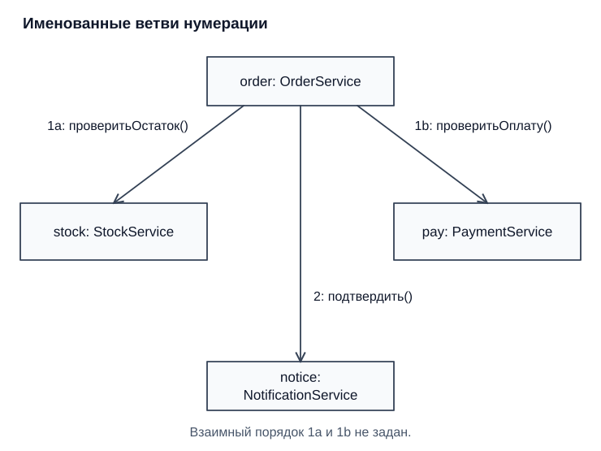

:::note[TL;DR]
Диаграмма коммуникации показывает тех же участников и сообщения, что и диаграмма последовательности, но делает главным сеть их связей. Порядок сообщений задаётся нумерацией, а не вертикальной осью.
:::

Линии жизни располагают как узлы сети и соединяют связями, по которым возможен обмен сообщениями. Рядом со стрелками указывают номер и имя сообщения: `1: создатьЗапись()`, `1.1: проверитьДоступность()`, `2: отправитьУведомление()`.

Вложенная нумерация показывает вызов, происходящий внутри другого вызова. Условия записывают в квадратных скобках, повторения — через `*` или уточняющий диапазон. Сообщения должны соответствовать возможным связям участников, а не пересекать схему произвольными стрелками.

Например, `1: создатьЗаказ()`, `1.1: проверитьКорзину()`, `1.2 [товар доступен]: сохранить()` показывают основной вызов, вложенные сообщения и условие. Повторение можно записать как `*[для каждой позиции]: проверитьНаличие()`. Такая нумерация обязательна, если порядок нельзя восстановить по одной схеме связей.

На диаграмме номера задают порядок, а расположение подчёркивает устойчивые связи участников:



`1.1.1` и `1.1.2` вложены в вызов `1.1: создатьЗаказ()`. Если бы сохранение было подписано `1.2`, номер поместил бы его на уровень вызовов внутри `1`, хотя на рисунке отправителем остаётся сервис, обрабатывающий `1.1`. Проверяйте согласованность вложенности и участника, выполняющего вызов.

## Параллельные ветви нумерации

Именная часть номера обозначает параллельную ветвь управления: `1a` и `1b` находятся на одном уровне и не получают порядка друг относительно друга. Внутри каждой ветви возможна обычная вложенность, например `1a.1`, `1a.2` и `1b.1`.



| Подписи | Как прочитать |
| --- | --- |
| `1.1`, затем `1.2` | последовательные сообщения одного уровня вложенности |
| `1a`, `1b` | параллельные ветви одного уровня; взаимный порядок не задан |
| `1a.1`, `1a.2` | вложенные последовательные сообщения внутри ветви `1a` |
| `1a`, `1b`, затем `2` | следующий уровень последовательности после обеих ветвей |

Нумерация описывает порядок сообщений, а не доказывает завершение всей работы получателя. Если `1a` и `1b` — асинхронные запросы и подтверждение требует обоих результатов, нужно дополнительно показать ответы и условие готовности. Сам номер `2` не создаёт ожидание ответов на асинхронные вызовы.

### Повторение и параллельное повторение

Запись `1.1 *[i := 1..n]: проверитьПозицию(i)` описывает последовательное повторение сообщения. Для параллельного повторения после звёздочки ставят две вертикальные черты:

```text
1.1 *||[для каждой позиции]: проверитьПозицию()
```

Условие повторения записывают псевдокодом или на выбранном языке; UML не задаёт для него универсального текстового синтаксиса. Параллельность не обещает отдельного потока ОС для каждой позиции и не задаёт порядок завершения проверок.

Диаграмма коммуникации удобна, когда важно обсудить, какие объекты или компоненты вообще могут взаимодействовать. Если важнее увидеть вложенные активации, ветвления обмена или временные ограничения, лучше выбрать [диаграмму последовательности](/notation/sequence-diagrams).

## Проверить чтение

Пусть `1a: проверитьОстаток()` и `1b: проверитьОплату()` — асинхронные сообщения. Можно ли по номеру `2: подтвердить()` заключить, что товар доступен и оплата подтверждена?

<details>
<summary>Разбор</summary>

Нет. Номера задают порядок соответствующих сообщений, но отправка асинхронного запроса не является получением успешного результата. Нужны сообщения с результатами и модель, разрешающая подтверждение после их проверки.

</details>

## В модели

Полная форма выражений последовательности, именованные параллельные ветви и `*||` определены в разделе 17.9.1.3 [UML 2.5.1](https://www.omg.org/spec/UML/2.5.1/).

Диаграмма конкретизирует техническое взаимодействие из [сценариев](/modelling/scenarios-and-flows) и [технической модели классов](/notation/technical-class-diagrams). Для большого сценария из нескольких взаимодействий есть [обзорная диаграмма](/notation/interaction-overview-diagrams).
