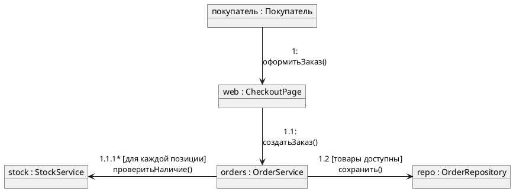

:::note[TL;DR]
Диаграмма коммуникации показывает тех же участников и сообщения, что и диаграмма последовательности, но делает главным сеть их связей. Порядок сообщений задаётся нумерацией, а не вертикальной осью.
:::

Линии жизни располагают как узлы сети и соединяют связями, по которым возможен обмен сообщениями. Рядом со стрелками указывают номер и имя сообщения: `1: создатьЗапись()`, `1.1: проверитьДоступность()`, `2: отправитьУведомление()`.

Вложенная нумерация показывает вызов, происходящий внутри другого вызова. Условия записывают в квадратных скобках, повторения — через `*` или уточняющий диапазон. Сообщения должны соответствовать возможным связям участников, а не пересекать схему произвольными стрелками.

Например, `1: создатьЗаказ()`, `1.1: проверитьКорзину()`, `1.2 [товар доступен]: сохранить()` показывают основной вызов, вложенные сообщения и условие. Повторение можно записать как `*[для каждой позиции]: проверитьНаличие()`. Такая нумерация обязательна, если порядок нельзя восстановить по одной схеме связей.

На диаграмме номера задают порядок, а расположение подчёркивает устойчивые связи участников:

Диаграмма коммуникации удобна, когда важно обсудить, какие объекты или компоненты вообще могут взаимодействовать. Если важнее увидеть порядок, вложенность вызовов или длительность, лучше выбрать [диаграмму последовательности](/notation/sequence-diagrams).

## В модели

Диаграмма конкретизирует техническое взаимодействие из [сценариев](/modelling/scenarios-and-flows) и [технической модели классов](/notation/technical-class-diagrams). Для большого сценария из нескольких взаимодействий есть [обзорная диаграмма](/notation/interaction-overview-diagrams).
