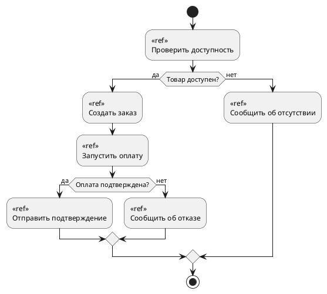

:::note[TL;DR]
Обзорная диаграмма взаимодействия показывает большой сценарий как поток управления, в котором содержательными узлами служат отдельные взаимодействия. Она связывает несколько диаграмм последовательности или коммуникации в одну картину.
:::

По внешнему виду диаграмма похожа на диаграмму деятельности: есть начальный и конечный узлы, решения, слияния, развилки, соединения и потоки управления. Главное отличие в том, что узел представляет не маленькое действие, а встроенное взаимодействие или ссылку `ref` на него.

Например, сценарий оформления заказа может состоять из `ref Проверить доступность`, `ref Создать заказ`, `ref Запустить оплату` и `ref Отправить уведомление`. Детали сообщений остаются на отдельных диаграммах последовательности.

Крупные взаимодействия складываются в поток так:

Диаграмма полезна, когда один сценарий слишком велик для одной диаграммы последовательности, содержит повторно используемые фрагменты или ветвится между крупными взаимодействиями. Для обычного процесса без сообщений лучше использовать [диаграмму деятельности](/notation/activity-diagrams).

## Проверка диаграммы

- каждый содержательный узел ссылается на существующее взаимодействие;
- уровень детализации узлов одинаковый;
- условия согласованы с альтернативными сценариями;
- диаграмма не повторяет последовательность мелких действий из диаграммы деятельности.

## В модели

Обзорная диаграмма помогает раскрыть [декомпозицию процесса](/modelling/process-decomposition), когда этапы состоят из самостоятельных взаимодействий. Сами фрагменты описывайте на [диаграммах последовательности](/notation/sequence-diagrams) или [коммуникации](/notation/communication-diagrams).
