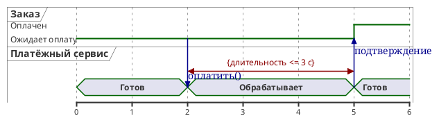

:::note[TL;DR]
Диаграмма синхронизации показывает изменение состояний или значений линий жизни на временной шкале. Она нужна, когда существенны сроки реакции, таймауты, длительности или протокол устройств.
:::

Линия жизни показывает участника, а горизонтальная ось — время. На ней отмечают состояния (`Ожидает оплату`, `Оплачен`) или значения свойства (`доступ = разрешён`). Сообщения и события объясняют причины изменений.

На диаграмме синхронизации могут присутствовать линия жизни, состояние или значение, событие, сообщение, временная ось, **наблюдение времени** (`time observation`), **наблюдение длительности** (`duration observation`), **ограничение момента времени** (`time constraint`) и **ограничение длительности** (`duration constraint`). Состояние и значение различаются: первое обычно связано с жизненным циклом объекта, второе показывает конкретную характеристику, например температуру или доступность соединения.

**Ограничение момента времени** задаёт условие на момент времени, например `{t < 10 с}`. **Ограничение длительности** ограничивает интервал между событиями: `{длительность <= 5 мин}`. Наблюдение времени и наблюдение длительности позволяют сослаться на конкретный момент или измеренный интервал.

На общей временной шкале момент вызова и длительность обработки становятся явными:

Физическое время, логический порядок сценария и порядок сообщений — разные вещи. Не используйте расстояние между линиями на диаграмме последовательности как замену временной шкалы; если ограничение времени существенно, запишите его явно.

Состояния должны соответствовать состояниям объекта на [диаграмме автомата](/notation/state-machine-diagrams), а события — сценарию или техническому контракту. Для обычного бизнес-процесса без временных требований диаграмма синхронизации избыточна: используйте диаграмму деятельности или последовательности.

## В модели

Источником временных ограничений служат [требования](/modelling/requirements), [бизнес-правила](/modelling/business-rules-and-constraints) и [системная архитектура](/modelling/system-architecture-and-deployment). Порядок сообщений без масштаба времени показывает [диаграмма последовательности](/notation/sequence-diagrams).
