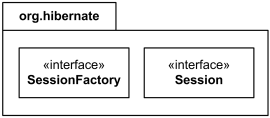

:::note[TL;DR]
Диаграмма пакетов группирует элементы модели и показывает зависимости между крупными областями, слоями или пространствами имён. Она делает границы и запрещённые зависимости видимыми.
:::

:::tip[Определение]{icon="starlight"}
**Пакет** — группирующий элемент UML, который объединяет логически связанные элементы и образует пространство имён.
:::

Пакет удобно использовать после определения слоёв и крупных модулей. Например, пакеты `Предметная область`, `Приложение`, `Инфраструктура` показывают архитектурные области, а не папки в репозитории сами по себе.

Зависимость (`Dependency`) между пакетами показывает её направление. Она полезнее одной большой диаграммы классов, когда нужно увидеть, что предметная логика не зависит от веб-интерфейса, а модуль уведомлений не знает внутренних классов модуля заказов.

**Импорт пакета** (`PackageImport`) делает элементы другого пакета доступными в пространстве имён импортирующего пакета; ключевые слова `«import»` и `«access»` различают публичный и приватный импорт. **Слияние пакетов** (`PackageMerge`) с `«merge»` позволяет дополнить определения одного пакета определениями другого, включая слияние одноимённых элементов. Оно нужно главным образом при построении профилей и метамоделей. В прикладной архитектуре чаще достаточно обычных зависимостей между пакетами.

Пакет, как и класс, может быть шаблонным. Шаблонный пакет принимает параметры, а **связывание шаблона** (`TemplateBinding`) подставляет в него конкретные значения. Это средство полезно при повторном использовании метамоделей и профилей, но для группировки прикладных модулей обычно не требуется.

## Проверка диаграммы

- пакет соответствует предметной или архитектурной области;
- направление зависимости согласовано с выбранными слоями;
- диаграмма не повторяет все классы внутри каждого пакета;
- импорт и слияние используются ради их точной семантики, а не вместо зависимости.

## В модели

Пакеты фиксируют [программную архитектуру и слои](/modelling/software-architecture-and-layers). Контракты крупных частей раскрываются на [диаграмме компонентов](/notation/component-diagrams), а расширения UML — в материале о [профилях](/notation/stereotypes-and-profiles).
