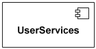
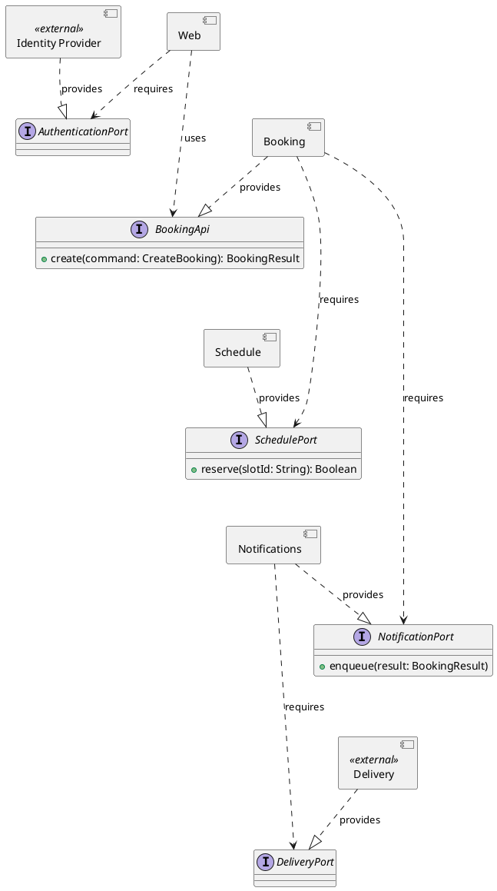

:::note[TL;DR]
Диаграмма компонентов показывает крупные заменяемые программные части через их ответственность, предоставляемые контракты и внешние потребности. Сначала определяют границу компонента, затем его интерфейсы и только после этого — реализации и зависимости.
:::

:::tip[Определение]{icon="starlight"}
**Компонент** — модульная часть системы, которая инкапсулирует своё содержимое и предоставляет либо требует интерфейсы.
:::

Рассмотрим серверную часть оформления заказов. На диаграмме классов она может состоять из контроллеров, обработчиков, правил и репозиториев. На диаграмме компонентов эти детали сначала сворачиваются в `OrderService`, потому что для архитектурного решения важнее его ответственность и контракт.

## Определить границу компонента

Компонент не обязан совпадать с классом, пакетом, процессом или контейнером. `OrderService` является компонентом, если его можно обсуждать как самостоятельную заменяемую часть: он принимает команды заказа, обеспечивает правила оформления и скрывает внутренний способ выполнения.

Внешний платёжный сервис компонентом `OrderService` не является, даже если без него невозможно завершить заказ. Он находится за границей рассматриваемой части и будет показан через требуемый контракт.

Формально компонент относится к структурированным классификаторам: у него могут быть поведение, внутренние части, порты и соединители. На текущем уровне они скрыты. Если для решения понадобится провести запрос через внутренние роли, тот же компонент можно раскрыть на диаграмме внутренней структуры.



## Выразить предоставляемый контракт

Клиенту `OrderService` не требуется знать его классы. Он обращается к предоставляемому интерфейсу `OrderApi` с операциями `createOrder`, `cancelOrder` и `getOrder`.

Реализация интерфейса связывает компонент с этим контрактом и утверждает, что компонент предоставляет требуемое поведение. Интерфейс должен быть устойчивой договорённостью на границе, а не списком всех публичных методов внутренних классов.

Теперь диаграмма уже отвечает на два вопроса: за что отвечает `OrderService` и через какой контракт его используют.

## Показать внешние потребности

Для списания денег `OrderService` требует `PaymentGateway`, для уведомления покупателя — `NotificationGateway`. Требуемый интерфейс показывает контракт, без которого компонент не может выполнить ответственность. Зависимость направляется от компонента к поставщику требуемого контракта.

В результате цепочка читается как архитектурное утверждение:

```text
клиент → OrderApi → OrderService
OrderService → PaymentGateway → платёжный провайдер
OrderService → NotificationGateway → сервис уведомлений
```

Внешняя система при этом остаётся отличимой от внутреннего компонента. Диаграмма не утверждает, в каком процессе работает сервис, через какой сетевой протокол идёт вызов или какие классы обрабатывают операцию.

## Связать компонент с реализацией

Если нужно показать, какие классификаторы воплощают компонент, используют **реализацию компонента** (`ComponentRealization`). Например, `OrderController`, `OrderProcessor` и `OrderRepository` могут совместно реализовывать поведение `OrderService`.

Это отношение не следует смешивать с реализацией интерфейса. Реализация интерфейса связывает классификатор с предоставляемым контрактом `OrderApi`; реализация компонента связывает внутренние классификаторы с самим `OrderService` как архитектурной частью.

Подробное перечисление классов добавляют только для объяснения выбранного решения. Если все внутренности снова оказались на обзорной диаграмме, граница компонента перестала выполнять свою задачу.

## Пример: запись на консультацию

Ниже логическая граница консультационного бронирования: студент создаёт запись через Web, а Booking резервирует слот, сохраняет подтверждение и ставит уведомление в очередь. Это компонентный вид; он не утверждает, что каждый компонент работает в отдельном процессе. Физическое размещение показано на [диаграмме развёртывания](/notation/deployment-diagrams).



`BookingApi` — предоставляемый контракт: `BookingController.create(command: CreateBooking): BookingResult` передаёт команду в `BookingService.create(command: CreateBooking): BookingResult`. Оба класса реализуют компонент Booking; `ScheduleService` реализует Schedule, `SqlBookingRepository` сохраняет подтверждённую запись, а `OutboxNotificationAdapter` и worker относятся к Notifications. Поэтому интерфейсы `SchedulePort.reserve` и `NotificationPort.enqueue` отделяют зависимости Booking от их реализаций, не превращая границы компонентов в границы процессов.

У слота может быть один студент и не более одной активной записи (`Создана` или `Подтверждена`). Отмена из этих состояний освобождает слот, но отменённая запись остаётся в истории; полный жизненный цикл и правила состояний показаны на [диаграммах состояний](/notation/state-machine-diagrams).

## Проверка диаграммы

- компонент имеет самостоятельную ответственность и объяснимую границу;
- предоставляемый интерфейс выражает устойчивый контракт;
- требуемый интерфейс соответствует реальной внешней потребности;
- зависимость направлена от потребителя к поставщику;
- внешняя система отличима от внутреннего компонента;
- классы реализации показаны только там, где они объясняют устройство компонента;
- физическое размещение и сетевые детали не смешаны с логическими контрактами.

## В модели

Диаграмма опирается на [проектные решения](/modelling/project-decisions) и [программную архитектуру](/modelling/software-architecture-and-layers). Группировку модулей показывает [диаграмма пакетов](/notation/package-diagrams), внутренний путь через роли и порты — [диаграмма внутренней структуры](/notation/internal-structure-diagrams), физическое окружение — [диаграмма развёртывания](/notation/deployment-diagrams).

[Представление компонентов C4](/c4/components-and-code) группирует связанную функциональность внутри одного контейнера C4. Оно не равно UML-компоненту: формальные интерфейсы, реализации и внутренние порты относятся к UML-модели компонента.
