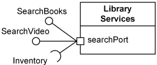

:::note[TL;DR]
Диаграмма внутренней структуры объясняет, как один структурированный классификатор выполняет свою ответственность с помощью внутренних ролей, портов и соединителей. Её строят от внешней границы внутрь: сначала определяют контракт целого, затем части и только потом связи между ними.
:::

Предположим, на диаграмме компонентов есть `OrderService` с внешним контрактом `OrderApi`. Пока достаточно знать ответственность сервиса, его внутренности скрыты. Если нужно объяснить, как запрос проходит через проверку заказа, резервирование и сохранение, `OrderService` раскрывают как структурированный классификатор.

## Определить целое и внутренние роли

**Структурированный классификатор** может содержать роли и соединители между ними. Его специализация — **инкапсулированный классификатор** — дополнительно владеет портами на своей границе. Компонент является инкапсулированным классификатором, поэтому `OrderService` можно показать с внутренними ролями и внешними точками взаимодействия.

Добавим роль `validator: OrderValidator`. Эта запись не просто сообщает о существовании класса `OrderValidator`: она утверждает, что его экземпляр участвует внутри конкретного `OrderService`.

Роль может быть частью или ссылочным свойством. **Часть** имеет композитную агрегацию, поэтому экземпляр целого владеет экземплярами этой роли. Так `processor: OrderProcessor` может принадлежать сервису и разделять его жизненный цикл. **Ссылочная роль** указывает на экземпляр, которым сервис не владеет; например, общий `catalog: ProductCatalog` остаётся внешней зависимостью, даже если участвует во внутреннем взаимодействии.

Тип роли определяет допустимые экземпляры, кратность — их число в одной структуре:

```text
validator: OrderValidator[1]
workers: ReservationWorker[1..*]
catalog: ProductCatalog[1]
```

Такой фрагмент описывает состав одного экземпляра `OrderService`, а не количество классов в модели.

## Провести запрос через границу

Внешний запрос входит через порт. **Порт** — свойство на границе инкапсулированного классификатора; он группирует предоставляемые и требуемые интерфейсы в определённой точке взаимодействия.

Например, порт `orders` предоставляет `OrderApi`, а порт `notifications` требует `NotificationGateway`. Первый принимает запрос клиента, второй фиксирует внешний контракт, без которого сервис не сможет завершить обработку.



Порт не является декоративным квадратом. Если интерфейс не относится к контракту этой точки, его нельзя сделать частью порта только ради удобного расположения линии.

## Соединить порты и части

Теперь запрос нужно провести от внешнего порта `orders` к внутреннему `processor`. **Делегирующий соединитель** (`delegation connector`) передаёт взаимодействие через границу классификатора внутренней роли или обратно. Ответственность перед внешним клиентом при этом остаётся у `OrderService`.

Когда `processor` требует интерфейс, который предоставляет `validator` или другая внутренняя часть, их связывает **сборочный соединитель** (`assembly connector`). Он собирает совместимые требуемый и предоставляемый контракты.


У соединителя два или больше концов (`ConnectorEnd`). Каждый конец указывает на роль или порт. Если используется порт внутренней части, конец должен одновременно определить эту часть и принадлежащий ей порт: совпадения подписи недостаточно.

Соединитель можно типизировать ассоциацией. Тогда его роли должны быть совместимы с типами и кратностями концов ассоциации. Нетипизированный соединитель всё равно утверждает возможность взаимодействия, но не создаёт отсутствующий интерфейс и не исправляет несовместимые направления контрактов.

В результате модель читается последовательно: внешний клиент обращается к порту `orders`, делегирование передаёт запрос `processor`, сборка связывает его с `validator`, а требуемый порт `notifications` выводит обращение к внешнему шлюзу.

## Повторно использовать структуру взаимодействия

Если сочетание ролей «обработчик — проверяющий — хранилище» повторяется в разных компонентах, его можно описать **кооперацией** (`Collaboration`). Кооперация задаёт формальные роли и соединители, необходимые для общего поведения, но не назначает им конкретные классы.

**Использование кооперации** (`CollaborationUse`) применяет этот шаблон внутри `OrderService`. Связывания ролей сопоставляют формальный `validator` с `orderValidator`, а формальный `store` — с `orderRepository`. Так повторно используется структура сотрудничества, а не набор конкретных реализаций.

Кооперация не нужна для любой внутренней схемы. Если структура используется один раз и понятна через части и соединители, дополнительный уровень ролей только усложнит модель.

## Проверка диаграммы

- рамка представляет один конкретный структурированный классификатор;
- часть действительно принадлежит целому, а внешняя зависимость остаётся ссылочной ролью;
- тип и кратность каждой роли имеют смысл для одного экземпляра целого;
- внешний порт выражает контракт на границе;
- делегирование проводит внешний контракт к внутренней роли;
- сборка связывает совместимые предоставляемый и требуемый интерфейсы;
- кооперация добавлена только ради повторно используемой структуры ролей.

## В модели

К внутренней структуре переходят от [диаграммы компонентов](/notation/component-diagrams), когда внешнего контракта уже недостаточно для объяснения решения. Общая семантика свойств, типов и кратностей разобрана в статье о [типах и значениях](/notation/types-properties-and-values), кооперация как классификатор — в [справке о классификаторах](/notation/classifiers-and-namespaces). Физическое размещение частей остаётся на [диаграмме развёртывания](/notation/deployment-diagrams).
