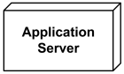
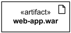
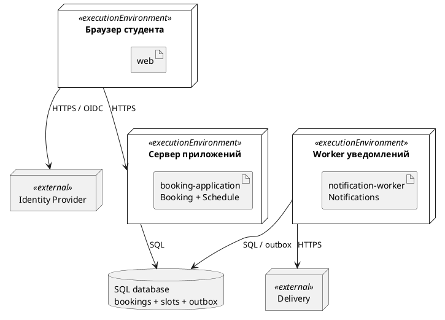

:::note[TL;DR]
Диаграмма развёртывания связывает программные артефакты с узлами выполнения. Она показывает, где работают части системы, через какие среды и сети они взаимодействуют.
:::

:::tip[Определение]{icon="starlight"}
**Узел** — вычислительный ресурс, который является целью развёртывания. Узлом может быть физическое устройство (`«device»`) или программная среда выполнения (`«executionEnvironment»`).
:::

Примеры узлов: сервер, мобильное устройство, браузер, контейнер приложений, СУБД, виртуальная машина. Узлы можно вкладывать: приложение работает в контейнере, контейнер — на сервере. Вложенность на рисунке показывает окружение; при необходимости её можно выразить и отношением композиции между узлами.

**Путь связи** (`communication path`) показывает возможность связи между узлами. На нём можно указать протокол и кратность узлов: например, балансировщик связан с несколькими экземплярами приложения. Уровень протокола должен соответствовать элементам: между браузером и веб-сервером уместен HTTPS, между физическими устройствами — сеть или среда связи, а не прикладной протокол.

Артефакт — физическая единица поставки или выполнения: файл, исполняемый модуль, библиотека, скрипт, документ, конфигурация. На диаграмме артефакт располагают внутри узла либо связывают с ним `«deploy»`.

## Пример: развёртывание записи на консультацию

На рисунке Web работает в браузере студента, Booking и Schedule поставляются одним артефактом серверного приложения, а доставка уведомлений — отдельным worker. Логические контракты между этими частями показаны на [диаграмме компонентов](/notation/component-diagrams).

При успешном бронировании сервер в одной SQL-транзакции резервирует слот, сохраняет подтверждённую запись и добавляет событие в outbox; при ошибке резервирование откатывается вместе с остальными изменениями. Worker читает outbox из той же базы и асинхронно передаёт уведомление в Delivery. Диаграмма не добавляет брокер или отдельные процессы для Booking и Schedule: они размещены в одном приложении.

## Проверка диаграммы

- логические компоненты не подменены их физическими копиями;
- показаны только существенные среды, узлы и каналы связи;
- протокол указан на подходящем уровне абстракции;
- артефакт отличим от компонента, который он представляет;
- диаграмма согласована с нефункциональными требованиями к доступности и безопасности.

## В модели

Диаграмма продолжает [системную архитектуру и развёртывание](/modelling/system-architecture-and-deployment) и [архитектуру данных](/modelling/data-architecture). Логические части берут из [компонентной диаграммы](/notation/component-diagrams); материализация и спецификация развёртывания разобраны в [расширенной нотации развёртывания](/notation/deployment-advanced).

[Представление развёртывания C4](/c4/dynamic-and-deployment) связывает экземпляры контейнеров C4 с выбранным окружением. Для точной UML-семантики узлов, сред выполнения и артефактов используйте эту диаграмму.
