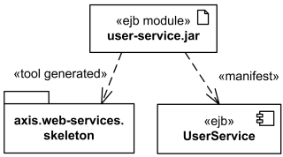

:::note[TL;DR]
Материализация (`Manifestation`), типы артефактов и спецификация развёртывания (`deployment specification`) уточняют связь логической модели с поставляемыми файлами и параметрами среды. Они нужны, когда общей схемы узлов и артефактов недостаточно.
:::

Артефакт может иметь стереотип `«file»`, `«document»`, `«source»`, `«library»`, `«executable»` или `«script»`. Это уточняет его физическую роль, но не превращает артефакт в компонент.

| Стереотип | Пример роли |
| --- | --- |
| `«file»` | конфигурационный или иной физический файл |
| `«document»` | документ, не являющийся исходным либо исполняемым файлом |
| `«source»` | исходный файл для обработки или компиляции |
| `«library»` | статическая или динамическая библиотека |
| `«executable»` | исполняемый модуль |
| `«script»` | интерпретируемый сценарий запуска или настройки |

Артефакты могут быть связаны ассоциацией, зависимостью или композицией, если эти связи отражают реальную поставку или состав файла. Например, пакет поставки может композиционно содержать исполняемый модуль и конфигурацию. Такие связи не заменяют `«manifest»` и `«deploy»`.

`«manifest»` (`Manifestation`) связывает артефакт с логическим элементом, который он представляет или реализует: компонентом, классом или пакетом. Это не то же самое, что `«deploy»`: первое отвечает на вопрос «какой элемент воплощён в артефакте», второе — «на каком узле размещён артефакт».

**Спецификация развёртывания** (`deployment specification`) — специальный артефакт с параметрами развёртывания: конфигурацией, числом реплик, адресом сервиса или режимом запуска. Она входит в отношение развёртывания как его конфигурация (`Deployment::configuration`) и параметризует размещение и выполнение артефактов. Такая спецификация применяется к развёртыванию компонентов в среде выполнения, а не служит произвольной зависимостью между файлами.

## В модели

Сначала постройте [основную диаграмму развёртывания](/notation/deployment-diagrams). Эти детали добавляйте, когда они фиксируют реальное архитектурное решение или существенное ограничение среды.
